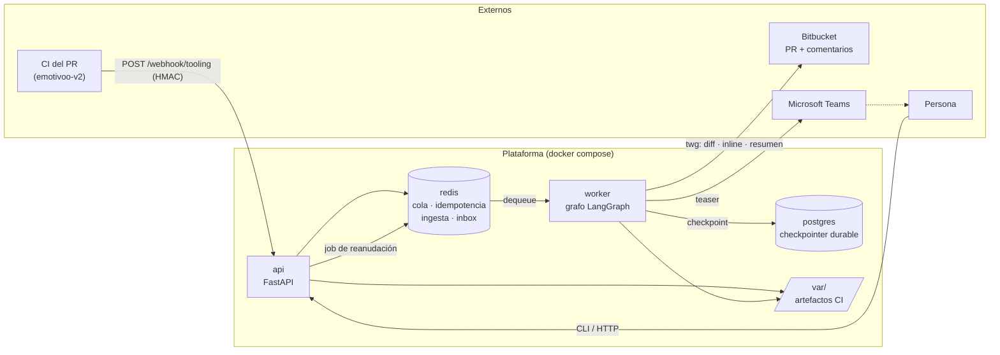
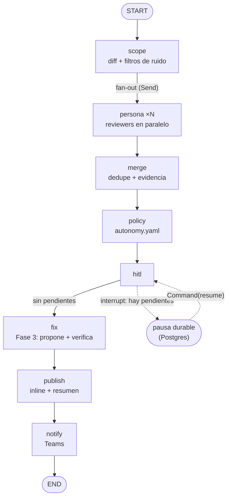

# reviews

Agente autónomo de code review sobre LangGraph. Recibe del CI la salida de las
herramientas estáticas, revisa el diff de un PR, decide por hallazgo (informar,
escalar, arreglar) y publica en Microsoft Teams y en el propio PR.

Documentación de fondo:

| Documento | Contenido |
|---|---|
| `docs/diseno-agente-code-review-20261010.md` | Diseño completo: arquitectura, autonomía, HITL, fases, perfil de `emotivoo-v2` |
| `docs/ingesta-diferida-ci-20261011.md` | Por qué la review espera al CI y por qué el artefacto es un puente desechable |
| `docs/fase2-hitl-20261011.md` | Pausa durable, decisión humana y reanudación |
| `docs/fase3-fix-verificacion-20261011.md` | Fix aprobado: parche, verificación en sandbox y entrega como sugerencia |
| `docs/decisiones-publish-inline-20261011.md` | Formato inline, orden de publicación y borrados |
| `docs/reintento-de-nodo-20261011.md` | `RetryPolicy` por nodo, clasificación de errores y DLQ |
| `docs/smoke-fase1-20261011.md` | Smoke E2E (Nivel 1 local y Nivel 2 contra Bitbucket) |
| `docs/edu/` | Serie didáctica sobre LangGraph aplicada a este repo |
| `tasks/plan.md` | Estado del plan: tareas cerradas y pendientes humanos |
| `tasks/todo-fase3.md` | Checklist de la Fase 3 (fix + verificación) |

## Arquitectura

Servicios independientes, comunicados por una cola y por estado durable. Cada
pieza externa (Bitbucket, Teams, LLM, sandbox) vive detrás de un **puerto**, así
que el grafo no conoce ningún proveedor concreto.



### Componentes

| Componente | Rol |
|---|---|
| `api` | FastAPI. Valida la firma del CI, deposita el artefacto, mantiene la idempotencia y encola la review. Expone el canal de decisión (`/reviews/.../decision`). |
| `worker` | Consume la cola y ejecuta el grafo con checkpointer durable. Reintenta fallos transitorios y aplica los TTL (ingesta y decisión). |
| `postgres` | Checkpointer de LangGraph: estado de cada ejecución, base del `interrupt` (HITL) y de la no-repetición. |
| `redis` | Cola de jobs, claves de idempotencia, registro de ingesta y *inbox* de reviews pausadas. |
| `twg` | Adaptador de Bitbucket/Jira (CLI). Obtiene diff, publica comentarios inline/resumen y resuelve anclas. |
| `var/` | Artefactos del CI (salida de PHPStan) que lee la persona estática. Solo lectura en el worker. |
| `config/` | `autonomy.yaml` (política) y `repo_profile.*.yaml` (perfil del repo: checks, herramientas esperadas). |

### Patrones

- **Ports & Adapters.** `VcsPort`, `ChatPort`, `ReviewerPort`, `ToolingOutputSource`,
  `LlmPort`, `SandboxPort`. Cambiar de Bitbucket a GitHub es otro adaptador.
- **Máquina de estados (LangGraph).** El estado es explícito y tipado; cada nodo
  lee y escribe su parte. Ver `src/reviews/graph/build.py`.
- **Policy-as-data.** La autonomía por hallazgo sale de `autonomy.yaml`, auditable
  y modificable sin desplegar.
- **Ejecución durable.** El checkpointer permite que un `interrupt` sobreviva a un
  reinicio del worker.

## El grafo



| Nodo | Responsabilidad |
|---|---|
| `scope` | Descarga el diff y descarta ruido (lockfiles, `vendor/**`, generados) y, si se declara, recorta por `max_files_per_pr`. |
| `persona` | Una rama por reviewer (`Send`), en paralelo sobre el mismo diff. Escribe `findings` (reducer `operator.add`) y el estado de su fuente. |
| `merge` | Deduplica por `(fichero, línea, título)` y fusiona el mismo problema visto por dos personas con anclas cercanas; conserva la evidencia más rica. |
| `policy` | Aplica `autonomy.yaml` y emite una `Decision` por hallazgo (con `matched_rule` y `policy_version`). |
| `hitl` | Pausa durable con `interrupt` si hay decisiones pendientes; se reanuda con la decisión humana. |
| `fix` | Fase 3. Para cada hallazgo **aprobado** con acción `fix_*`: lee el fichero al `head_sha`, pide un parche, lo valida y lo **verifica** en el sandbox. No-op si no hay candidatos. |
| `publish` | Publica un comentario inline por hallazgo (hasta `max_inline_comments`) y un resumen general, con resolución segura de anclas. Si hubo fix verificado, el inline lleva el bloque de sugerencia. |
| `notify` | Aviso en Teams. Nodo aparte para que un fallo del canal no repita `publish`. |

## Flujo

1. El CI de `emotivoo-v2` corre PHPStan y hace `POST /webhook/tooling` con el JSON
   de salida (firmado en `X-Reviews-Signature`).
2. La `api` valida la firma, deposita el artefacto y lo registra en la ingesta
   (`PendingReview`). Solo cuando están los artefactos esperados **encola la review**.
3. El `worker` consume, construye el grafo y ejecuta sobre `thread_id = review_key`.
4. Según la política, cada hallazgo se informa, escala o corrige; se publica inline
   + resumen en el PR y el teaser en Teams.

> **Por qué no dispara el PR.** El webhook de PR llegaba *antes* de que el CI
> produjese el artefacto, así que la review corría sin datos (`0 hallazgos`
> engañoso). La ingesta diferida encola solo cuando el artefacto ya está dentro
> (`docs/ingesta-diferida-ci-20261011.md`).

### Personas de review

Puerto `reviews.ports.reviewer`:

- `ToolingReviewer` (`standards`): convierte la salida de PHPStan en hallazgos y
  los ancla a líneas reales del diff. No ejecuta la herramienta. Activa por
  defecto cuando el perfil declara `checks.typecheck`.
- `LlmReviewer` (`correctness`): propone hallazgos con un modelo y los valida
  contra el contrato; una línea inventada se descarta. **Opt-in**
  (`LLM_REVIEWER_ENABLED`, `LLM_MODEL`). El proveedor es un puerto (`LlmPort`).
  Un fallo transitorio del modelo se reintenta en el nodo; si se agotan los
  intentos, o el fallo es permanente, la persona aporta 0 hallazgos y la review
  sigue.
- `NullReviewer`: por defecto cuando el perfil no declara checks y no hay LLM.

Ambas personas emiten el mismo contrato `Finding`; `merge` deduplica, de modo que
un mismo problema detectado por estática y por LLM aparece una sola vez.

La salida de PHPStan la deposita el **CI** como artefacto; el agente la lee vía
`ToolingOutputSource` (no ejecuta la herramienta: eso es el sandbox de Fase 3).
La fuente distingue **análisis limpio** de **salida no leída**: un artefacto
ausente marca la review como incompleta y el PR recibe un aviso explícito.

## Arranque

```bash
scripts/bootstrap-env.sh          # crea .env desde .env.example y comprueba dependencias
cp ~/.local/bin/twg bin/twg       # el contenedor lo usa como adaptador de Bitbucket/Jira
docker compose up --build
```

`bootstrap-env.sh` es idempotente: no sobrescribe un `.env` existente, lo deja con
permisos `600` y resume qué secretos faltan sin imprimir valores. El worker valida
`twg --version` en el arranque y falla ruidoso si falta.

**Credencial de `twg` (cuenta de servicio).** El agente usa un **API token scoped
de un actor de servicio** por entorno (`TWG_BBC_TOKEN`, más `TWG_SITE`/`TWG_USER`),
vía `.env`: no caduca cada hora como el OAuth y se revoca sin tocar a nadie. El
contenedor **no monta** `~/.config/twg`.

`api` y `worker` arrancan con `restart: unless-stopped` y healthcheck (el del
worker es un latido en `/tmp/reviews-worker-heartbeat`).

### No re-publicar la misma review (dedupe)

Un reinicio del worker, la reentrega de un mensaje o un `pipeline_id` nuevo sobre
el mismo commit no deben duplicar los comentarios. Dos capas:

1. **Checkpointer durable:** el grafo se invoca con `thread_id = review_key`
   (commit + `pipeline_id`). Si el hilo ya tiene estado y no hay nodos pendientes,
   no se re-ejecuta. Es también la base del `interrupt` de la Fase 2.
2. **Marca de publicación:** el resumen lleva un pie
   (`<!-- reviews:<hash>:ok -->`, o `:partial` si fue incompleta) derivado de la
   **ejecución**, no solo del commit. Un `pipeline_id` nuevo sobre el mismo `sha`
   es una review nueva y publica la suya; un inline ya publicado no se repite.

### Fallos transitorios (reintento y DLQ)

Un fallo de `twg` o de Teams no pierde la review. `process_request` propaga la
excepción y el worker reencola el mismo job con un contador de intentos
(`MAX_REVIEW_ATTEMPTS`, 3 por defecto). Agotados, el job va a la **DLQ**
(`reviews:jobs:dead`) con su `review_key`, intentos y motivo, desde donde se puede
reinyectar o inspeccionar. Las reviews **incompletas no se reencolan**: la ingesta
diferida ya esperó al artefacto, así que re-ejecutar solo duplicaría la publicación.

### Scope y coste

Antes de las personas, `scope` descarta ficheros ruidosos (lockfiles, `var/**`,
`vendor/**`, generados; ampliable con `SCOPE_IGNORE`) y, si `max_files_per_pr` está
declarado, recorta el diff a los ficheros con más churn. El presupuesto de la
persona LLM (`budget_tokens_per_pr`) **corta** la llamada si el coste estimado lo
supera. Las decisiones de publicación están fijadas en
`docs/decisiones-publish-inline-20261011.md`.

## Estado actual

**Fase 1 (report-only) implementada.** La ingesta diferida encola en Redis al
completarse el artefacto del CI, el worker ejecuta el grafo y publica **comentarios
inline** (+ resumen en el PR + Teams). Política en `max_autonomy: report`: cero
escritura de código en el repo del PR. La **Fase 2 (HITL)** permite pausar y
reanudar con una decisión humana.

**Fase 3 (fix + verificación) en curso.** La base pura está cerrada (`F1`–`F6`):
un hallazgo aprobado con acción `fix_*` produce un parche, se valida localmente y
se verifica en el sandbox; solo si pasa se publica como sugerencia inline. Sigue
**sin escribir** el repo. Falta el servicio `sandbox-runner` (`F7`–`F10`), que
depende de P6 (revisión de seguridad) y de Q2 (comando de tests dirigidos).

## Fix verificado (Fase 3, base pura)

- **Un parche, un fichero, un hunk.** La validación local rechaza lo que no encaje
  antes de gastar un segundo de sandbox: otro fichero, varios hunks, más de
  `max_fix_lines` o un rango fuera de las líneas **añadidas** del diff.
- **El diff se deriva del fichero real** al `head_sha`, no del que devuelva el
  modelo, para que `git apply` no falle por un header inventado.
- **Entrega tras un *seam*.** `FIX_DELIVERY=diff` (por defecto) o `suggestion`
  eligen el formato del bloque; Bitbucket no tiene *suggested changes* como GitHub.
- **Sin sandbox no hay `VERIFIED`:** sin fixer o sin runner, el fix queda
  `NOT_VERIFIABLE` y el inline lo dice. Un fallo tras los intentos queda `FAILED`
  con el `stderr_tail` acotado. Ver `docs/fase3-fix-verificacion-20261011.md`.

## Smoke real contra Bitbucket

Requiere credencial de `twg` (`TWG_BBC_TOKEN`) y un PR con cambios:

```bash
REVIEWS_LIVE_PR=417 uv run pytest tests/test_live_twg.py -m live   # solo lectura
scripts/smoke-nivel2.sh 417                                       # E2E completo
```

`smoke-nivel2.sh` levanta el stack, firma y deposita el artefacto como el CI y
verifica inline + resumen + Teams. Los tests `live` están excluidos por defecto.

## Desarrollo

```bash
make install     # uv sync con extras dev
make ci          # ruff (lint+formato) + mypy + pytest, igual que el CI
```

El CI propio (`.github/workflows/ci.yml`) corre `ruff check`, `ruff format
--check`, `mypy` y `pytest` en cada push y PR. `mypy` está limpio (strict) y
`pytest` en verde.

El contrato de hallazgo vive en `contracts/findings-schema.json`.
