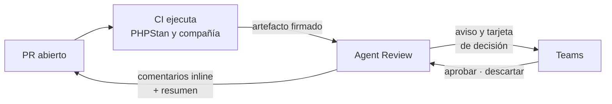

<p align="center">
  
</p>

# Agent Review LangGraph

Agente de code review para los pull requests de **un** repositorio. Espera a que el
CI le entregue la salida de las herramientas estáticas, revisa el diff, decide qué
hacer con cada hallazgo según una política versionada y publica el resultado en el
PR. Si la política lo pide, se pausa hasta que una persona responde, y puede
proponer un arreglo verificado en un sandbox.

**Nunca escribe en el repositorio revisado.** Lo más lejos que llega es un
comentario con una sugerencia, y solo después de comprobar el parche en un
sandbox con la misma imagen que el CI.

El detalle de cómo está construido vive en
[`docs/arquitectura.md`](docs/arquitectura.md). Esta página explica qué hace y
cómo dejarlo corriendo la primera vez.

---

## Qué hace con un pull request

La review no arranca al abrir el PR. Arranca cuando han llegado los artefactos
que el perfil espera (hoy, la salida de PHPStan). Si alguno no llega a tiempo,
publica una review degradada que lo dice: no publica un «limpio» sin haber
mirado.



1. **Lee** el diff y aparta el ruido: lockfiles, generados, `vendor/`.
2. **Revisa** con varios revisores a la vez. `standards` convierte el artefacto
   de PHPStan en hallazgos. `correctness`, `security` y `arch` son revisores de
   modelo, y solo entran si están activados y tienen un modelo asignado.
3. **Decide** por cada hallazgo, con [`config/autonomy.yaml`](config/autonomy.yaml).
   La primera regla que encaja gana. Las acciones van de «solo comentar» a
   «preguntar a una persona» o «intentar un arreglo».
4. **Pausa** si alguna acción necesita a una persona. El estado queda en
   Postgres y la review sigue desde ahí cuando llega la decisión (Teams, el CLI
   o la API). Si nadie responde a tiempo, se publica igual.
5. **Publica** comentarios en las líneas del diff y un resumen en el PR. Un
   arreglo aprobado se verifica fuera del grafo y, si pasa, se publica como
   sugerencia.

El techo `max_autonomy` manda sobre las reglas. Hoy vale `report`: todo se
publica como comentario y el agente no pausa ni propone arreglos. Subirlo es un
cambio de configuración, no del grafo. Un fichero o un tema protegido (auth,
migraciones, secretos) no se arregla nunca, aunque una persona lo apruebe.

Cada ejecución es un grafo de LangGraph
([`src/agent_review/graph/build.py`](src/agent_review/graph/build.py)). El estado
se guarda después de cada nodo: si el proceso se cae, la review continúa, no
vuelve a empezar. Los nodos, la política y los flujos están dibujados en
[`docs/arquitectura.md`](docs/arquitectura.md).

---

## De qué está hecho

Cinco procesos en Docker Compose, más Postgres y Redis. Se hablan por colas, así
que uno caído no tira a los demás.

| Proceso | Qué hace |
|---|---|
| `api` | Recibe el artefacto del CI (`POST /webhook/tooling`, firmado), lo guarda y encola la review cuando están todos. También recibe las decisiones humanas. Escucha en el puerto `8000`. |
| `worker` | Ejecuta el grafo, una review cada vez. Lee el diff y publica en Bitbucket o GitHub. |
| `teams-bot` | Publica avisos y convierte la tarjeta de Teams en una decisión. Apagado mientras `TEAMS_ENABLED=false`. |
| `fix-worker` | Manda cada parche al sandbox y devuelve el resultado. No publica nada. |
| `sandbox-runner` | Aplica el parche y corre las recetas del perfil, aislado. Apagado mientras `SANDBOX_ENABLED=false`. |

Dos perfiles opcionales, que el `up` de siempre no levanta: `panel` (una web
para ver la cola, el recorrido y decidir) y `claude` (otro motor de review, por
CLI de Claude, fuera del worker).

Lo que más se toca, sin cambiar código:

| Fichero | Qué controla |
|---|---|
| [`config/autonomy.yaml`](config/autonomy.yaml) | Política, techo `max_autonomy` y topes |
| [`config/models.yaml`](config/models.yaml) | Qué modelo usa cada rol |
| [`config/repo_profile.emotivoo-v2.yaml`](config/repo_profile.emotivoo-v2.yaml) | El repo revisado: imagen del CI, checks y herramientas esperadas |
| `.env` | Secretos, conexiones y qué capacidades están encendidas |

---

## Primera puesta en marcha

El primer arranque deja el agente en modo **solo informe**: comenta el PR a
partir de PHPStan y no llama a ningún modelo, no escribe en Teams y no verifica
arreglos. Es el comportamiento de `.env.example` y de `max_autonomy: report`.
Encender el resto va después, cuando este camino ya publica en un PR real.

Hace falta Docker con el plugin Compose. Para el repo de Bitbucket que viene por
defecto hace falta también el binario [`twg`](bin/README.md). `uv` solo hace
falta si vas a lanzar los tests en local (`make ci`); el agente corre dentro de
los contenedores.

### 1. Crear `.env`

```bash
scripts/bootstrap-env.sh
```

Copia `.env.example` a `.env` si no existe, le pone permisos `600` y lista lo
que sigue en `change-me`. No imprime valores y no pisa un `.env` que ya esté.
`make bootstrap` es el mismo script.

### 2. Rellenar lo mínimo

Abre `.env`. Para un primer arranque local deja `ENVIRONMENT=development`: con
`change-me`, la firma del webhook y el token de decisión no se exigen. En
`production` el proceso no arranca si un secreto obligatorio sigue así.

**Bitbucket** (`VCS_PROVIDER=twg`, el valor por defecto). El worker lee el diff
y publica con un API token *scoped* de un actor de servicio, no con la sesión
personal:

| Variable | Qué poner |
|---|---|
| `TWG_BBC_TOKEN` | El token. Sin él el contenedor arranca y falla en la primera review. |
| `TWG_USER` | El usuario de ese actor. |
| `BITBUCKET_WORKSPACE` | Workspace del repo. El ejemplo es `cqm`. |
| `BITBUCKET_REPO` | Repo. El ejemplo es `emotivoo-v2`. Cámbialo si revisas otro. |

**GitHub.** Pon `VCS_PROVIDER=github` y rellena `GITHUB_OWNER`, `GITHUB_REPO` y
`GITHUB_TOKEN` (PAT *fine-grained*: `pull_requests: write` y `contents: read`).
Con ese proveedor no hace falta `twg`.

`REDIS_URL` y `DATABASE_URL` apuntan a los nombres de servicio de Compose
(`redis`, `postgres`). Compose los vuelve a fijar al levantar los contenedores:
no los cambies a `localhost` para este arranque.

El contrato completo de secretos, qué es obligatorio en producción y cómo se
rota está en [`docs/operacion.md`](docs/operacion.md) §2 y §3.

### 3. Meter `twg` en la imagen

Solo con `VCS_PROVIDER=twg`. El binario se copia **al construir** la imagen; si
falta, el fallo aparece en la primera review, no en el `up`.

```bash
cp ~/.local/bin/twg bin/twg
```

`bin/twg` no se versiona. El detalle está en [`bin/README.md`](bin/README.md).

### 4. Levantar el stack

```bash
docker compose up --build -d
```

`make up` hace lo mismo. Arranca `api`, `worker`, `fix-worker`, `teams-bot`,
`sandbox-runner`, Postgres y Redis. El bot y el sandbox quedan en marcha pero
inactivos: no publican ni verifican hasta que se encienden en el `.env`.

### 5. Comprobar que responde

```bash
curl -fsS http://localhost:8000/healthz
docker compose ps
docker compose logs -f worker
```

`/healthz` responde `{"status":"ok"}`. En los logs del worker, un fallo de
arranque nombra el secreto o el binario que falta. `make ps` y `make logs` son
los mismos comandos (`make logs S=api` sigue otro servicio).

### 6. Lanzar la primera review

Hace falta un PR real del repo configurado y un artefacto de PHPStan. El script
de smoke levanta el stack si no está arriba, firma el cuerpo y lo entrega como
lo haría el CI:

```bash
make smoke PR=<id>
```

Equivale a `scripts/smoke-nivel2.sh <id>`. Necesita `jq`, `openssl`, `curl` y,
en Bitbucket, `twg` en el `PATH`. Por defecto manda el fixture
`tests/fixtures/phpstan/analysis.json`; para que los comentarios caigan en
líneas de ese PR, pasa la salida real con `PHPSTAN_ARTIFACT=/ruta/al/report.json`.

En el PR deben aparecer comentarios inline (como mucho los que el artefacto
ancla al diff) y un resumen. Reenviar el mismo pipeline no publica otra vez.

El CI del repo puede hacer el mismo `POST` en cada pipeline. El cuerpo, la
cabecera `X-Reviews-Signature` y los códigos de respuesta están en
[`docs/operacion.md`](docs/operacion.md) §4 y §5. Sin ese paso, la review espera
el artefacto y, al vencer el plazo, publica una pasada degradada.

---

## Qué encender después

Nada de esto hace falta para la primera review. Cada interruptor se cambia en
`.env` (o en el YAML que indica la tabla) y exige recrear el servicio que lo
lee, en la práctica `docker compose up -d`.

| Quieres… | Qué cambiar |
|---|---|
| Revisores de modelo y arreglos propuestos | `LLM_REVIEWER_ENABLED=true`, `LLM_API_KEY` y un binding en [`config/models.yaml`](config/models.yaml). Reinicia el worker. |
| Que una persona decida antes de publicar o de arreglar | Sube `max_autonomy` en [`config/autonomy.yaml`](config/autonomy.yaml) al menos a `fix_with_approval` y reinicia el worker. La decisión entra por Teams, `agent_review decide` o `POST /reviews/{review_key}/decision`. |
| Avisos y tarjeta en Teams | `TEAMS_ENABLED=true` y la identidad del bot (`TEAMS_BOT_ID`, `TEAMS_BOT_TENANT_ID`, `TEAMS_BOT_TOKEN`). El alta en el tenant sigue pendiente. |
| Ver la cola y decidir desde el navegador | `make panel` y abre `http://localhost:8090`. Con `PANEL_SESSION_SECRET=change-me` la sesión no se exige; en producción el secreto es un token opaco y el actor es `PANEL_SESSION_USER`. |
| Revisar con el CLI de Claude | `REVIEW_ENGINE=claude` en `.env` y `make claude` (o `make panel-claude` si también quieres el panel). El arranque rellena `CLAUDE_RUNNER_URL`, `CLAUDE_RUNNER_TOKEN` y `PANEL_SESSION_SECRET` si seguían en blanco. El checkout reutiliza `GITHUB_TOKEN` o `TWG_BBC_TOKEN`. |
| Verificar un arreglo en el sandbox | Las cinco condiciones de [`docs/operacion.md`](docs/operacion.md) §2 («Para activar la Fase 3»). Si falta una, el arreglo queda `not_verifiable` y se publica igual. |

---

## Desarrollo

```bash
make install     # uv sync con extras dev; hace falta Python 3.11+
make ci          # ruff, formato, mypy estricto, pytest y docs-check
make eval        # gold set de la review, sin red
make help        # el resto de atajos
```

Cómo añadir un revisor, un adaptador o un proveedor, y qué no se puede romper:
[`docs/desarrollo.md`](docs/desarrollo.md).

---

## Documentación

| Documento | Para qué |
|---|---|
| [`CONTEXT.md`](CONTEXT.md) | Qué significa cada término |
| [`docs/arquitectura.md`](docs/arquitectura.md) | Cómo es el sistema hoy: grafo, flujos, estado, deuda |
| [`docs/operacion.md`](docs/operacion.md) | Variables, secretos, contrato con el CI, API, diagnóstico |
| [`docs/desarrollo.md`](docs/desarrollo.md) | Tests, evaluación, cómo extenderlo |
| [`docs/adr/`](docs/adr/README.md) | Por qué se decidió cada cosa |
| [`docs/iniciativas/`](docs/iniciativas/README.md) | Qué se está construyendo y en qué estado |
| [`docs/edu/`](docs/edu/README.md) | LangGraph explicado con este repo |
