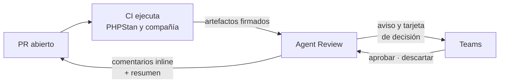
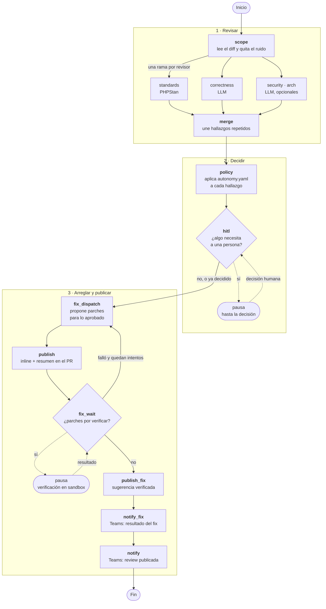
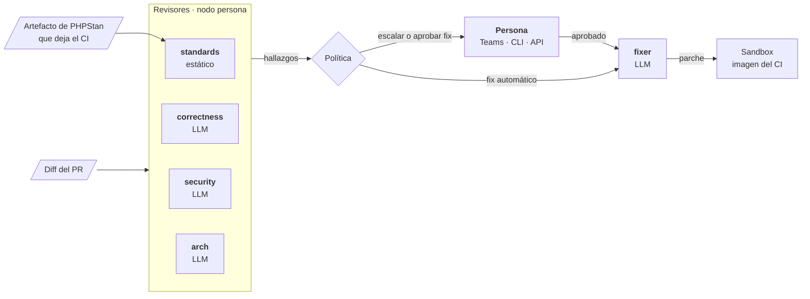
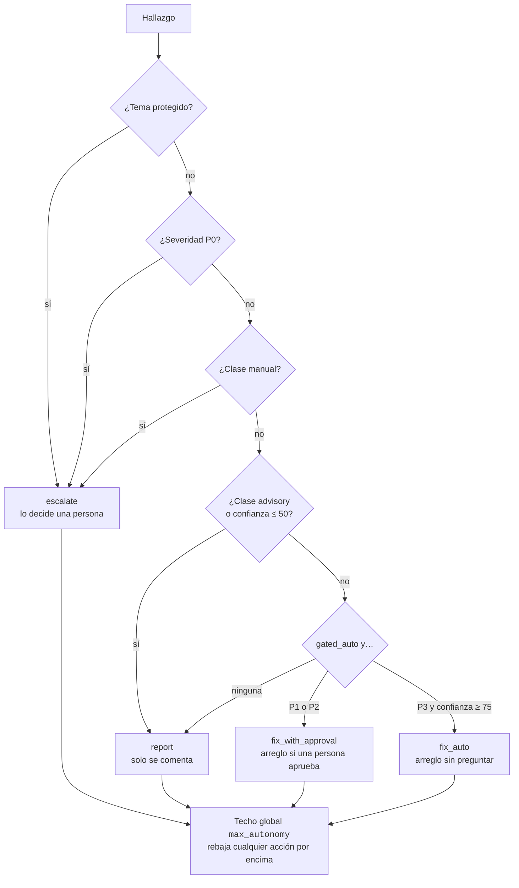
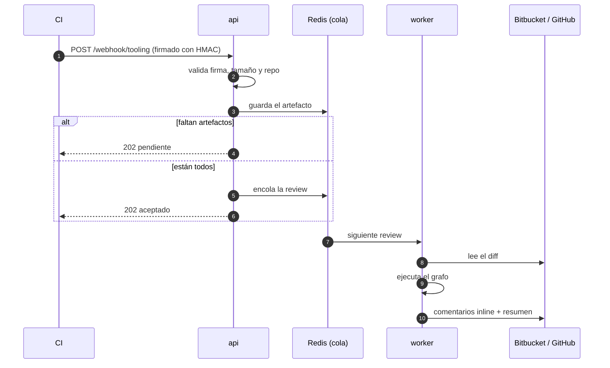
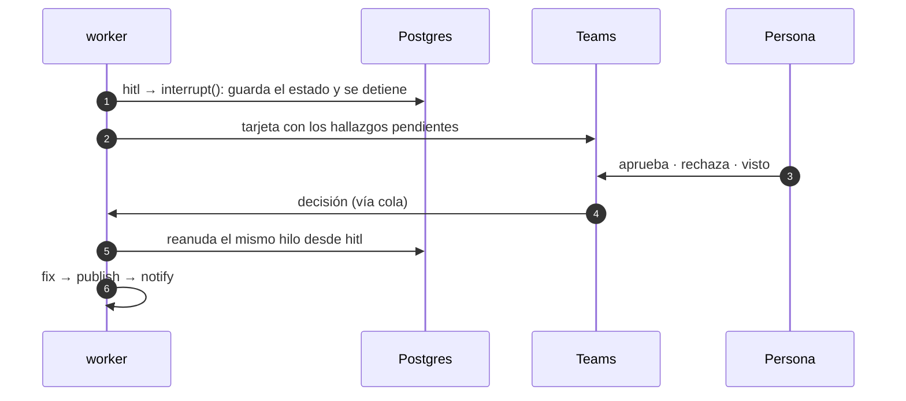
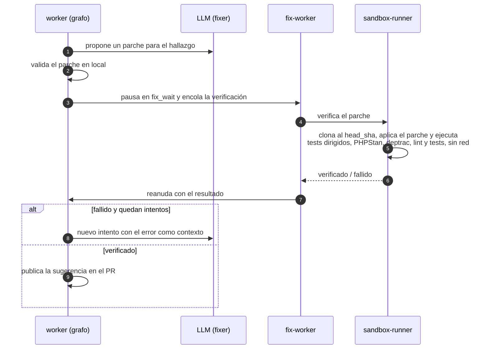
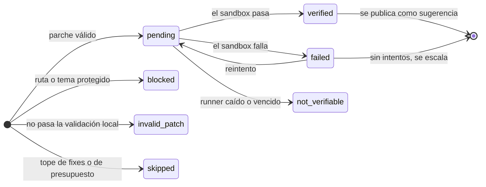
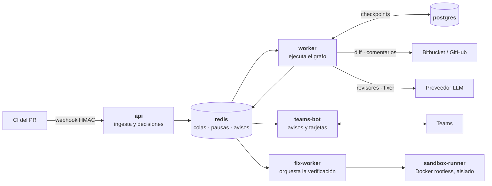

<p align="center">
  
</p>

# Agent Review LangGraph

**Agente de code review para los PRs de un repositorio.** Está construido como un
grafo de LangGraph y revisa cada PR con varios revisores en paralelo. Decide qué
hacer con cada hallazgo según una política versionada, se pausa cuando hace falta
una persona y publica el resultado en el PR y en Microsoft Teams.

> **Nunca escribe en el repositorio revisado.** Lo más lejos que llega es proponer
> un arreglo como *sugerencia*, después de verificarlo en un sandbox con la misma
> imagen que el CI.

---

## En 30 segundos



1. **Espera** a que el CI le entregue la salida de las herramientas estáticas.
2. **Revisa** el diff con varios revisores a la vez: uno estático y varios LLM.
3. **Decide** por cada hallazgo si solo informa, si escala a una persona o si
   intenta arreglarlo.
4. **Pregunta** cuando la política lo exige y se queda en pausa, sin perder el
   estado, hasta que alguien responde.
5. **Publica** comentarios en las líneas del PR, un resumen y un aviso en Teams.

---

## El grafo de una review

Toda review es una ejecución del mismo grafo
([`graph/build.py`](src/agent_review/graph/build.py)). Cada nodo hace una sola cosa
y el estado se guarda en Postgres después de cada paso. Así, si el proceso se cae,
la review sigue desde el último nodo y no vuelve a empezar.



| Fase | Nodos | Qué pasa |
|---|---|---|
| **Revisar** | `scope` → revisores → `merge` | Se lee el diff y se quitan lockfiles, generados y `vendor`. Cada revisor analiza el mismo diff en paralelo (*fan-out* con `Send`) y `merge` une el mismo problema visto por dos revisores. |
| **Decidir** | `policy` → `hitl` | Cada hallazgo recibe una acción. Si alguno necesita a una persona, el grafo se **pausa** con `interrupt()` y se reanuda cuando llega la decisión. |
| **Arreglar y publicar** | `fix_dispatch` → `publish` → `fix_wait` → `publish_fix` → `notify_fix` → `notify` | Primero se publica la review. Después, los arreglos aprobados se verifican fuera del grafo y, si pasan, se publican como sugerencia. |

Los nodos con efectos externos (diff, LLM, publicación, Teams) se reintentan solos
ante fallos pasajeros. Un revisor que falla en todos los intentos aporta 0
hallazgos, pero la review no se cae.

---

## Los roles

En el sistema participan tres tipos de actor: los **revisores**, que encuentran
problemas, el **fixer**, que propone arreglos, y las **personas**, que deciden lo
que la política no deja decidir a la máquina.



| Rol | Tipo | Qué hace | Se configura en |
|---|---|---|---|
| `standards` | Revisor estático | Convierte la salida de PHPStan en hallazgos y se queda solo con lo que toca líneas del PR. **No ejecuta la herramienta**: lee el artefacto que deja el CI. | `checks.typecheck` en el perfil del repo ([`config/repo_profile.*.yaml`](config/)) |
| `correctness` | Revisor LLM | Busca errores de lógica en el diff. Hace **una llamada** al modelo y recibe JSON. Un hallazgo cuya línea no existe en el diff se descarta. | `bindings` en [`config/models.yaml`](config/models.yaml) |
| `security`, `arch` | Revisores LLM | Igual que `correctness`. Solo se activan si tienen un modelo asignado en `bindings`. | `bindings` en [`config/models.yaml`](config/models.yaml) |
| `fixer` | LLM | Propone un parche para un hallazgo aprobado. Si la verificación falla, lo vuelve a intentar con el error como contexto, hasta `max_fix_attempts`. | `bindings` en [`config/models.yaml`](config/models.yaml) |
| Persona | Humano | Aprueba, rechaza o da por visto lo que se ha escalado. | Tarjeta de Teams, `agent_review decide` o `POST /decision` |

Los revisores LLM **no usan herramientas** (*tool calling*). Cada uno hace una sola
llamada, con un tope de hallazgos (`LLM_MAX_FINDINGS`) y de tokens
(`LLM_BUDGET_TOKENS_PER_PR`). El código no conoce ningún nombre de modelo: cambiar
de modelo es editar `models.yaml` y reiniciar el worker
([ADR-0015](docs/adr/0015-registro-declarativo-de-modelos.md)).

---

## Cómo se decide qué hacer con cada hallazgo

Cada hallazgo trae una severidad (`P0`–`P3`), una confianza (0–100) y una clase de
arreglo (`gated_auto`, `manual`, `advisory`). La política
[`config/autonomy.yaml`](config/autonomy.yaml) recorre sus reglas en orden y se
queda con **la primera que encaja**:



Encima de las reglas hay dos frenos:

- **`max_autonomy`** es el techo global. Hoy vale `report`, así que todo se publica
  como comentario y el agente no pausa ni arregla nada. Subirlo activa las fases
  siguientes sin tocar el grafo.
- **Las protecciones mandan sobre la aprobación.** Un fichero de `never_auto_paths`
  (por ejemplo `**/auth/**` o `migrations/**`) o un tema protegido no se arregla
  nunca, aunque una persona lo apruebe
  ([ADR-0009](docs/adr/0009-la-proteccion-manda-sobre-la-aprobacion.md)).

Los topes por PR (ficheros revisados, comentarios inline, fixes e intentos) están en
la sección `guards` del mismo fichero.

---

## Los flujos principales

### 1. De un pipeline del CI a una review

La review no arranca con el PR, sino cuando el CI ha entregado **todos** los
artefactos esperados. Si alguno no llega a tiempo, se publica una review degradada
que lo indica, nunca una review que diga «limpio» sin haber mirado
([ADR-0004](docs/adr/0004-ingesta-diferida-por-artefacto-del-ci.md)).



### 2. Cuando hace falta una persona



Una pausa sobrevive a reinicios y despliegues. Si nadie decide antes del plazo, la
review se reanuda como `expired` y se publica igualmente. La tarjeta de Teams es el
canal principal; el CLI (`agent_review list` / `agent_review decide`) y
`POST /decision` son el respaldo
([ADR-0008](docs/adr/0008-hitl-por-cli-y-http-con-cola-unica.md),
[ADR-0016](docs/adr/0016-bot-de-teams-para-el-canal-de-decision.md)).

### 3. De un hallazgo aprobado a una sugerencia verificada

Verificar un parche puede tardar unos 20 minutos, así que no se hace dentro del
grafo. El worker pausa la review y otro proceso, aislado, se encarga de la
verificación.





---

## Arquitectura en una imagen

Cinco procesos en `docker compose`. Se comunican por colas de Redis, de modo que
ninguno depende de que otro esté levantado en ese momento.



| Proceso | Responsabilidad |
|---|---|
| `api` | Recibe los artefactos del CI, comprueba la firma y encola la review cuando están todos. También recibe las decisiones humanas. |
| `worker` | Ejecuta el grafo, una review cada vez, con checkpoints en Postgres. |
| `teams-bot` | Publica los avisos en el hilo del PR y convierte los clics en la tarjeta en decisiones. |
| `fix-worker` | Pasa cada parche al sandbox y reanuda la review con el resultado. No publica nada. |
| `sandbox-runner` | Aplica el parche y ejecuta los checks del repo con la imagen del CI, aislado. |

El código sigue *Ports & Adapters*: el grafo trabaja contra interfaces (`VcsPort`,
`LlmPort`, `ReviewerPort`, `SandboxPort`…) y los proveedores concretos se conectan en
el arranque. El detalle completo (estado del grafo, claves de Redis, deuda conocida)
está en [`docs/arquitectura.md`](docs/arquitectura.md).

---

## Configuración que más se toca

| Fichero | Qué controla |
|---|---|
| [`config/autonomy.yaml`](config/autonomy.yaml) | Política: reglas por hallazgo, techo `max_autonomy` y topes (`guards`) |
| [`config/models.yaml`](config/models.yaml) | Proveedores, modelos y qué modelo usa cada rol |
| [`config/repo_profile.emotivoo-v2.yaml`](config/repo_profile.emotivoo-v2.yaml) | Perfil del repo revisado: imagen del CI, checks, recetas de verificación y herramientas esperadas |
| `.env` | Secretos, conexiones y ajustes de ejecución (ver [`.env.example`](.env.example)) |

Todas las variables, los secretos y el contrato con el CI están en
[`docs/operacion.md`](docs/operacion.md).

---

## Arranque rápido

```bash
scripts/bootstrap-env.sh          # crea .env desde .env.example y lista los secretos que faltan
$EDITOR .env
cp ~/.local/bin/twg bin/twg       # solo con VCS_PROVIDER=twg (Bitbucket)
docker compose up --build -d
```

## Desarrollo

```bash
make install     # uv sync con extras dev
make ci          # ruff + mypy (strict) + pytest + docs-check, igual que el CI
make eval        # evaluación de la review contra el gold set (replay, sin red)
```

Cómo añadir un revisor, un adaptador o un proveedor, y qué invariantes no se
pueden romper: [`docs/desarrollo.md`](docs/desarrollo.md). Los cambios no triviales
siguen el ciclo spec → plan → todo de la regla
[`documentacion`](.agents/rules/documentacion.md).

---

## Estado

| Fase | Qué aporta | Estado |
|---|---|---|
| 1 — Report-only | Revisa y comenta | ✅ Implementada; probada contra un PR real |
| 2 — HITL | Pausa y pregunta a una persona (CLI, HTTP y Teams) | ✅ Implementada; falta dar de alta el bot en el tenant |
| 3 — Fix + verificación | Propone y verifica arreglos | 🟡 Implementada salvo el smoke real, bloqueado por la revisión de seguridad (P6) |
| Calidad de la review | Mide y mejora lo que encuentra | 🟢 Evaluación con gold set lista (006); el resto (007–012, 014, 016, 017), en spec |
| Puesta en marcha real | Smokes y pendientes humanos | 🟠 Reunidos en la [015](docs/iniciativas/015-puesta-en-marcha-real/spec.md); P7 primero |
| 4 — Autonomía por política | Arregla solo lo que la política permite | ⚪ Sin empezar |

Detalle y pendientes: [`docs/iniciativas/README.md`](docs/iniciativas/README.md).

## Documentación

| Documento | Para qué |
|---|---|
| [`CONTEXT.md`](CONTEXT.md) | Glosario: qué significa cada término |
| [`docs/arquitectura.md`](docs/arquitectura.md) | Cómo es el sistema hoy, con detalle |
| [`docs/operacion.md`](docs/operacion.md) | Arrancar, configurar, operar y diagnosticar |
| [`docs/desarrollo.md`](docs/desarrollo.md) | Tests, evaluación, cómo extender e invariantes |
| [`docs/adr/`](docs/adr/README.md) | Por qué se decidió cada cosa |
| [`docs/iniciativas/`](docs/iniciativas/README.md) | Qué se está construyendo y en qué estado |
| [`docs/edu/`](docs/edu/README.md) | LangGraph explicado con este repo como ejemplo |
