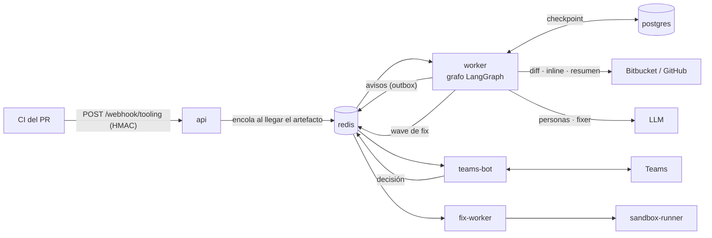

# Agent Review LangGraph

Agente autónomo de code review sobre LangGraph. Recibe del CI la salida de las
herramientas estáticas, revisa el diff de un PR con varias personas en paralelo
(estática y LLM), decide por hallazgo según una política declarativa (informar,
escalar, arreglar) y publica en el PR y en un canal de Microsoft Teams, donde una
persona puede aprobar o descartar lo que la política no deja hacer solo.

**No escribe nunca en el repo revisado:** un arreglo, si llega, es una sugerencia
verificada en un sandbox con la imagen del CI.

## Documentación

Empieza por el índice [`docs/README.md`](docs/README.md).

| Documento | Contenido |
|---|---|
| [`CONTEXT.md`](CONTEXT.md) | Glosario del dominio |
| [`docs/arquitectura.md`](docs/arquitectura.md) | Componentes, grafo, flujos, claves, estado por fase y deuda conocida |
| [`docs/operacion.md`](docs/operacion.md) | Arranque, configuración, secretos, contrato del CI, API/CLI, smoke y diagnóstico |
| [`docs/desarrollo.md`](docs/desarrollo.md) | Tests, evaluación, cómo extender e invariantes |
| [`docs/adr/`](docs/adr/README.md) | Decisiones de arquitectura |
| [`docs/iniciativas/`](docs/iniciativas/README.md) | Spec, plan y todo de cada iniciativa, con su estado |
| [`docs/edu/`](docs/edu/README.md) | Serie didáctica sobre LangGraph aplicada a este repo |

## Cómo funciona



1. El CI del repo revisado manda el artefacto de PHPStan, firmado. La `api` lo
   guarda y **encola la review solo cuando han llegado los artefactos esperados**
   ([ADR-0004](docs/adr/0004-ingesta-diferida-por-artefacto-del-ci.md)).
2. El `worker` ejecuta el grafo: `scope` → personas en paralelo → `merge` →
   `policy` (`config/autonomy.yaml`) → pausa humana si hace falta → fix → publicación.
3. Lo que necesita a una persona **pausa** la review de forma durable; se decide
   desde la tarjeta de Teams, el CLI o la API.
4. Un fix aprobado lo verifica el `fix-worker` en el `sandbox-runner`, aislado del
   resto; solo si pasa se publica como sugerencia.

El detalle de cada pieza está en [`docs/arquitectura.md`](docs/arquitectura.md).

## Arranque rápido

```bash
scripts/bootstrap-env.sh          # crea .env desde .env.example y lista los secretos que faltan
$EDITOR .env
cp ~/.local/bin/twg bin/twg       # solo con VCS_PROVIDER=twg (Bitbucket)
docker compose up --build -d
```

Variables, secretos, contrato del CI, API/CLI y diagnóstico:
[`docs/operacion.md`](docs/operacion.md).

## Desarrollo

```bash
make install     # uv sync con extras dev
make ci          # ruff + mypy (strict) + pytest + docs-check, igual que el CI
make eval        # evaluación de la review contra el gold set (replay, sin red)
```

Cómo extender el sistema y qué invariantes no se rompen:
[`docs/desarrollo.md`](docs/desarrollo.md). Los cambios no triviales siguen el ciclo
spec → plan → todo de la regla [`documentacion`](.agents/rules/documentacion.md).

## Estado

| Fase | Estado |
|---|---|
| 1 — Report-only | ✅ Implementada; probada contra un PR real |
| 2 — HITL (CLI, HTTP y bot de Teams) | ✅ Implementada; falta dar de alta el bot en el tenant |
| 3 — Fix + verificación | 🟡 Implementada salvo el smoke real, bloqueado por la revisión de seguridad (P6) |
| Calidad de la review (cascada) | 🟢 Evaluación con gold set lista (006); el resto de la cascada (007–012, 014), en spec |
| 4 — Autonomía por política | ⚪ Sin empezar |

Estado detallado y pendientes: [`docs/iniciativas/README.md`](docs/iniciativas/README.md).
