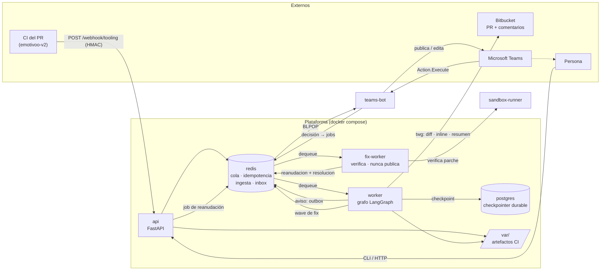
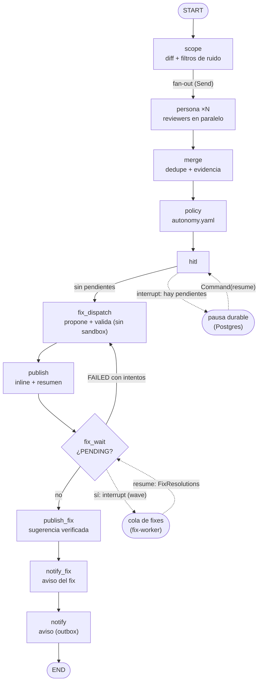

# Agent Review LangGraph

Agente autónomo de code review sobre LangGraph. Recibe del CI la salida de las
herramientas estáticas, revisa el diff de un PR, decide por hallazgo (informar,
escalar, arreglar) y publica en Microsoft Teams y en el propio PR.

Documentación: empieza por el índice [`docs/README.md`](docs/README.md).

| Documento | Contenido |
|---|---|
| [`CONTEXT.md`](CONTEXT.md) | Glosario del dominio |
| [`docs/arquitectura.md`](docs/arquitectura.md) | Componentes, grafo, flujos, estado por fase y deuda conocida |
| [`docs/operacion.md`](docs/operacion.md) | Arranque, configuración, secretos, contrato del CI, API/CLI, smoke y diagnóstico |
| [`docs/desarrollo.md`](docs/desarrollo.md) | Tests, cómo extender e invariantes |
| [`docs/adr/`](docs/adr/README.md) | Decisiones de arquitectura |
| [`docs/iniciativas/`](docs/iniciativas/README.md) | Spec, plan y todo de cada iniciativa, con su estado |
| [`docs/edu/`](docs/edu/README.md) | Serie didáctica sobre LangGraph aplicada a este repo |

## Arquitectura

Servicios independientes, comunicados por una cola y por estado durable. Cada
pieza externa (Bitbucket, Teams, LLM, sandbox) vive detrás de un **puerto**, así
que el grafo no conoce ningún proveedor concreto.



### Componentes

| Componente | Rol |
|---|---|
| `api` | FastAPI. Valida la firma del CI, deposita el artefacto, mantiene la idempotencia y encola la review. Expone el canal de decisión (`/reviews/.../decision`). |
| `worker` | Consume la cola y ejecuta el grafo con checkpointer durable. Reintenta fallos transitorios y aplica los TTL (ingesta, decisión y handoff del fix). **Nunca** toca el sandbox. Encola avisos al canal; no habla con Teams. |
| `teams-bot` | Canal de Teams: consume la outbox, publica/edita el hilo por PR y recibe `POST /api/messages`. Traduce la tarjeta a `HitlDecision` y **encola**; no reanuda el grafo. |
| `fix-worker` | Fase 3-E7. Consume la *wave* de verificaciones, llama al `sandbox-runner` por cada `VerifyJob` y encola la reanudación del worker con la resolución. Es el único invocador del sandbox; **no publica ni escribe en el PR**. Aislado: sin `docker.sock`, sin `TWG_*`, sin Postgres, sin token de decisión. |
| `sandbox-runner` | Fase 3. Verifica el parche de un fix con la imagen del CI **por digest** (`POST /verify` bloqueante con `run_key` idempotente). Clona, aplica el parche, corre `setup`+checks sin red y destruye. Aislado: sin `docker.sock`, sin puertos publicados, habla con su propio demonio rootless. |
| `postgres` | Checkpointer de LangGraph: estado de cada ejecución, base del `interrupt` (HITL) y de la no-repetición. |
| `redis` | Cola de jobs, cola de fixes, outbox del canal (`reviews:notices`), claves de idempotencia, registro de ingesta e *inbox* de reviews pausadas. |
| `twg` | Adaptador de Bitbucket/Jira (CLI). Obtiene diff, publica comentarios inline/resumen y resuelve anclas. |
| `github` | Adaptador de GitHub (API REST, `VcsPort`). Sustituye a `twg` con `VCS_PROVIDER=github`; el grafo no cambia. |
| `var/` | Artefactos del CI (salida de PHPStan) que lee la persona estática. Solo lectura en el worker. |
| `config/` | `autonomy.yaml` (política) y `repo_profile.*.yaml` (perfil del repo: checks, herramientas esperadas). |

### Patrones

- **Ports & Adapters.** `VcsPort`, `ChatPort`, `ReviewerPort`, `ToolingOutputSource`,
  `LlmPort`, `SandboxPort`. Cambiar de Bitbucket a GitHub es otro adaptador.
- **Máquina de estados (LangGraph).** El estado es explícito y tipado; cada nodo
  lee y escribe su parte. Ver `src/agent_review/graph/build.py`.
- **Policy-as-data.** La autonomía por hallazgo sale de `autonomy.yaml`, auditable
  y modificable sin desplegar.
- **Ejecución durable.** El checkpointer permite que un `interrupt` sobreviva a un
  reinicio del worker.

## El grafo



| Nodo | Responsabilidad |
|---|---|
| `scope` | Descarga el diff y descarta ruido (lockfiles, `vendor/**`, generados) y, si se declara, recorta por `max_files_per_pr`. |
| `persona` | Una rama por reviewer (`Send`), en paralelo sobre el mismo diff. Escribe `findings` (reducer `operator.add`) y el estado de su fuente. |
| `merge` | Deduplica por `(fichero, línea, título)` y fusiona el mismo problema visto por dos personas con anclas cercanas; conserva la evidencia más rica. |
| `policy` | Aplica `autonomy.yaml` y emite una `Decision` por hallazgo (con `matched_rule` y `policy_version`). |
| `hitl` | Pausa durable con `interrupt` si hay decisiones pendientes; se reanuda con la decisión humana. |
| `fix_dispatch` | Fase 3-E7. Para cada hallazgo **aprobado** con acción `fix_*`: lee el fichero al `head_sha`, pide un parche y lo **valida localmente**. Deja `PENDING` (con el `VerifyJob`) o terminal — **sin** tocar el sandbox. No-op si no hay candidatos. |
| `publish` | Publica un comentario inline por hallazgo (hasta `max_inline_comments`) y un resumen general, con resolución segura de anclas. Un `PENDING` se rotula "en verificación". |
| `fix_wait` | Pausa con `FixWaitRequest` si queda algún `PENDING`; al reanudar aplica la `FixResolutions` (la wave resuelta por el `fix-worker`). Re-propone si un `FAILED` tiene intentos; si no, sigue a `publish_fix`. |
| `publish_fix` | Publica el resultado terminal del fix en un comentario de seguimiento con marca `:fix` (una sola vez). |
| `notify_fix` | Aviso breve del resultado del fix, a la outbox del canal (Q3: nodo propio). |
| `notify` | Aviso de review publicada, a la outbox del canal. Nodo aparte para que un fallo del canal no repita `publish`. |

## Flujo

1. El CI de `emotivoo-v2` corre PHPStan y hace `POST /webhook/tooling` con el JSON
   de salida (firmado en `X-Reviews-Signature`).
2. La `api` valida la firma, deposita el artefacto y lo registra en la ingesta
   (`PendingReview`). Solo cuando están los artefactos esperados **encola la review**.
3. El `worker` consume, construye el grafo y ejecuta sobre `thread_id = review_key`.
4. Según la política, cada hallazgo se informa, escala o corrige; se publica inline
   + resumen en el PR y el teaser al canal (outbox).

> **Por qué no dispara el PR.** El webhook de PR llegaba *antes* de que el CI
> produjese el artefacto, así que la review corría sin datos (`0 hallazgos`
> engañoso). La ingesta diferida encola solo cuando el artefacto ya está dentro
> ([ADR-0004](docs/adr/0004-ingesta-diferida-por-artefacto-del-ci.md)).

### Personas de review

Puerto `agent_review.ports.reviewer`:

- `ToolingReviewer` (`standards`): convierte la salida de PHPStan en hallazgos y
  los ancla a líneas reales del diff. No ejecuta la herramienta. Activa por
  defecto cuando el perfil declara `checks.typecheck`.
- `LlmReviewer` (`correctness`): propone hallazgos con un modelo y los valida
  contra el contrato; una línea inventada se descarta. **Opt-in**
  (`LLM_REVIEWER_ENABLED`). El proveedor es un puerto (`LlmPort`) y el modelo se
  elige por **rol** en [`config/models.yaml`](config/models.yaml)
  ([ADR-0015](docs/adr/0015-registro-declarativo-de-modelos.md)).
  Un fallo transitorio del modelo se reintenta en el nodo; si se agotan los
  intentos, o el fallo es permanente, la persona aporta 0 hallazgos y la review
  sigue.
- `NullReviewer`: por defecto cuando el perfil no declara checks y no hay LLM.

Ambas personas emiten el mismo contrato `Finding`; `merge` deduplica, de modo que
un mismo problema detectado por estática y por LLM aparece una sola vez.

La salida de PHPStan la deposita el **CI** como artefacto; el agente la lee vía
`ToolingOutputSource` (no ejecuta la herramienta: eso es el sandbox de Fase 3).
La fuente distingue **análisis limpio** de **salida no leída**: un artefacto
ausente marca la review como incompleta y el PR recibe un aviso explícito.

## Arranque

```bash
scripts/bootstrap-env.sh          # crea .env desde .env.example y comprueba dependencias
cp ~/.local/bin/twg bin/twg       # el contenedor lo usa como adaptador de Bitbucket/Jira
docker compose up --build
```

`bootstrap-env.sh` es idempotente: no sobrescribe un `.env` existente, lo deja con
permisos `600` y resume qué secretos faltan sin imprimir valores. Con el proveedor
`twg`, el worker valida `twg --version` en el arranque y falla ruidoso si falta;
con `VCS_PROVIDER=github` no necesita `twg` y exige `GITHUB_TOKEN`.

**Credencial de `twg` (cuenta de servicio).** El agente usa un **API token scoped
de un actor de servicio** por entorno (`TWG_BBC_TOKEN`, más `TWG_SITE`/`TWG_USER`),
vía `.env`: no caduca cada hora como el OAuth y se revoca sin tocar a nadie. El
contenedor **no monta** `~/.config/twg`.

**Proveedor de GitHub.** Con `VCS_PROVIDER=github`, `GITHUB_OWNER`/`GITHUB_REPO` y
un PAT fine-grained (`GITHUB_TOKEN`) sustituyen a `twg`: el worker instala el
adaptador de la API REST y ya no requiere el binario. Ver
[ADR-0012](docs/adr/0012-vcs-tras-un-puerto.md).

`api` y `worker` arrancan con `restart: unless-stopped` y healthcheck (el del
worker es un latido en `/tmp/reviews-worker-heartbeat`).

### No re-publicar la misma review (dedupe)

Un reinicio del worker, la reentrega de un mensaje o un `pipeline_id` nuevo sobre
el mismo commit no deben duplicar los comentarios. Dos capas:

1. **Checkpointer durable:** el grafo se invoca con `thread_id = review_key`
   (commit + `pipeline_id`). Si el hilo ya tiene estado y no hay nodos pendientes,
   no se re-ejecuta. Es también la base del `interrupt` de la Fase 2.
2. **Marca de publicación:** el resumen lleva un pie
   (`<!-- reviews:<hash>:ok -->`, o `:partial` si fue incompleta) derivado de la
   **ejecución**, no solo del commit. Un `pipeline_id` nuevo sobre el mismo `sha`
   es una review nueva y publica la suya; un inline ya publicado no se repite.

### Fallos transitorios (reintento y DLQ)

Un fallo de `twg` o de Teams no pierde la review. `process_request` propaga la
excepción y el worker reencola el mismo job con un contador de intentos
(`MAX_REVIEW_ATTEMPTS`, 3 por defecto). Agotados, el job va a la **DLQ**
(`reviews:jobs:dead`) con su `review_key`, intentos y motivo, desde donde se puede
reinyectar o inspeccionar. Las reviews **incompletas no se reencolan**: la ingesta
diferida ya esperó al artefacto, así que re-ejecutar solo duplicaría la publicación.

### Scope y coste

Antes de las personas, `scope` descarta ficheros ruidosos (lockfiles, `var/**`,
`vendor/**`, generados; ampliable con `SCOPE_IGNORE`) y, si `max_files_per_pr` está
declarado, recorta el diff a los ficheros con más churn. El presupuesto de la
persona LLM (`budget_tokens_per_pr`) **corta** la llamada si el coste estimado lo
supera. Las decisiones de publicación están fijadas en
[ADR-0006](docs/adr/0006-publicacion-inline-primero-resumen-al-final.md).

## Estado actual

**Fase 1 (report-only) implementada.** La ingesta diferida encola en Redis al
completarse el artefacto del CI, el worker ejecuta el grafo y publica **comentarios
inline** (+ resumen en el PR + Teams). Política en `max_autonomy: report`: cero
escritura de código en el repo del PR. La **Fase 2 (HITL)** permite pausar y
reanudar con una decisión humana.

**Fase 3 (fix + verificación) en curso.** La base pura (`F1`–`F6`) y el **runner**
(`F7`–`F10`) están cerrados: un hallazgo aprobado con acción `fix_*` produce un
parche, se valida localmente y se verifica en el servicio `sandbox-runner` con la
imagen del CI por digest; solo si pasa se publica como sugerencia. Sigue **sin
escribir** el repo. El runner es **síncrono** (`POST /verify` bloqueante con
`run_key` idempotente).

El **desacople fuerte (iniciativa `004-fase3-e7-desacople`)** está implementado: la
verificación ya no vive en el worker de reviews. El worker propone, valida y
**pausa** (`fix_wait`); un servicio `fix-worker` independiente consume la *wave*,
llama al `sandbox-runner` y encola la reanudación con la resolución. El worker de
reviews nunca toca el sandbox — desacople por cola, no por llamada. Ver
[ADR-0011](docs/adr/0011-sandbox-runner-aislado.md) y `docs/arquitectura.md`.

Falta el cierre (`F11`–`F13`: spike R1 real, smoke real, docs) — el smoke real
depende de **P6** (revisión de seguridad), precondición para ejecutar código de PRs
de terceros.

## Fix verificado (Fase 3, base pura)

- **Un parche, un fichero, un hunk.** La validación local rechaza lo que no encaje
  antes de gastar un segundo de sandbox: otro fichero, varios hunks, más de
  `max_fix_lines` o un rango fuera de las líneas **añadidas** del diff.
- **El diff se deriva del fichero real** al `head_sha`, no del que devuelva el
  modelo, para que `git apply` no falle por un header inventado.
- **Entrega tras un *seam*.** `FIX_DELIVERY=diff` (por defecto) o `suggestion`
  eligen el formato del bloque; Bitbucket no tiene *suggested changes* como GitHub.
- **Sin sandbox no hay `VERIFIED`:** sin fixer o sin runner, el fix queda
  `NOT_VERIFIABLE` y el inline lo dice. Un fallo tras los intentos queda `FAILED`
  con el `stderr_tail` acotado. Ver `docs/iniciativas/003-fase3-fix-verificacion/spec.md`.

### Servicio `sandbox-runner`

El worker nunca ejecuta código del PR: delega en este servicio interno, aislado
(sin `docker.sock`, sin puertos publicados, demonio rootless propio). El ciclo —
clonar, aplicar el parche, `setup` con red donde haga falta (`composer install
--no-scripts`), checks con `--network none`, y destruir **siempre**— vive entero
en el runner. El `run_key` lo hace idempotente: una reentrega tras una caída no
lanza una segunda ejecución. La imagen se fija **por digest** (`ci_image_digest`
del perfil); un tag mutable o su ausencia → `NOT_VERIFIABLE` sin ejecutar nada.

### Handoff del fix (Fase 3-E7)

Quien espera la verificación ya no es el worker de reviews. El flujo, por cola:

1. `fix_dispatch` propone y **valida localmente** el parche; deja `PENDING` con un
   `VerifyJob` por candidato (fichero + parche + recetas).
2. `publish` publica los hallazgos y `fix_wait` **pausa** con la *wave*
   (`FixWaitRequest`, `kind="fix"`), sin bloquear el worker.
3. El `fix-worker` consume la wave de `reviews:fixes`, llama al `sandbox-runner`
   por cada job y encola la reanudación en `reviews:jobs` con la `FixResolutions`.
4. El worker de reviews reanuda, aplica la resolución y publica el seguimiento
   (`publish_fix` + `notify_fix`). Un `FAILED` con intentos vuelve a `fix_dispatch`.

**Idempotencia:** cada `run_key` se marca en `reviews:fixes:done` (set en Redis);
una reentrega no relanza la verificación. El worker de reviews solo aplica una
resolución cuyo `run_key` está entre los `PENDING` que espera. Si el runner o el
`fix-worker` no responden, `sweep_fix_expired` reanuda con `outcome="error"` al
vencer `FIX_VERIFY_TTL_S` (7200 s): el fix queda `NOT_VERIFIABLE` y publicado, nunca
colgado. La pausa de fix se poda (`FixWaitRetention`, `FIX_WAIT_MAX_AGE_S`) cuando
la review ya quedó publicada; las pausas `human` siguen intocables.

## Smoke real contra Bitbucket

Requiere credencial de `twg` (`TWG_BBC_TOKEN`) y un PR con cambios:

```bash
REVIEWS_LIVE_PR=417 uv run pytest tests/test_live_twg.py -m live   # solo lectura
scripts/smoke-nivel2.sh 417                                       # E2E completo
```

`smoke-nivel2.sh` levanta el stack, firma y deposita el artefacto como el CI y
verifica inline + resumen + Teams. Los tests `live` están excluidos por defecto.

## Desarrollo

```bash
make install     # uv sync con extras dev
make ci          # ruff (lint+formato) + mypy + pytest, igual que el CI
```

El CI propio (`.github/workflows/ci.yml`) corre `ruff check`, `ruff format
--check`, `mypy` y `pytest` en cada push y PR. `mypy` está limpio (strict) y
`pytest` en verde.

`tests/conftest.py` aísla la suite del entorno del host: desactiva el `.env` en
`Settings` y borra del proceso las variables que el modelo conoce, de modo que
los tests parten siempre de los valores por defecto y no de un `.env` local (los
tests `live` quedan fuera, que sí necesitan credenciales). Añadir un campo a
`Settings` no requiere tocar el `conftest`: las claves se derivan del modelo y de
`.env`/`.env.example`.

El contrato de hallazgo vive en `contracts/findings-schema.json`.
