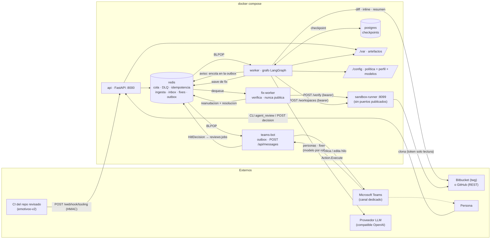
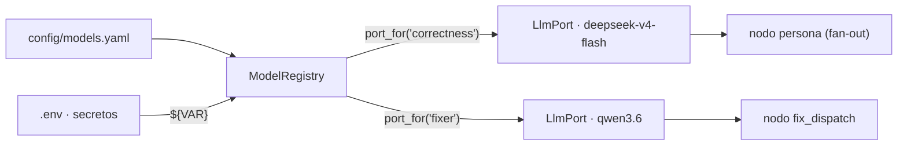
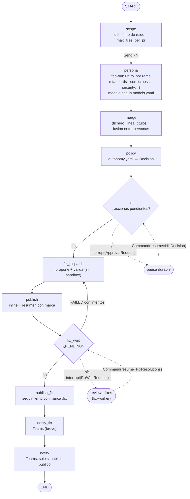
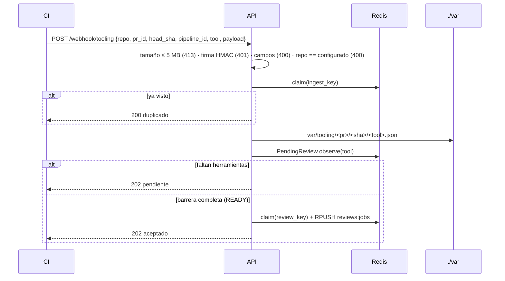
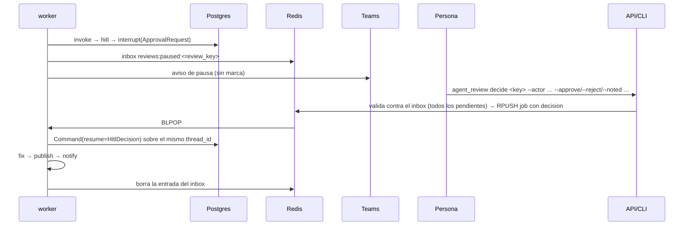
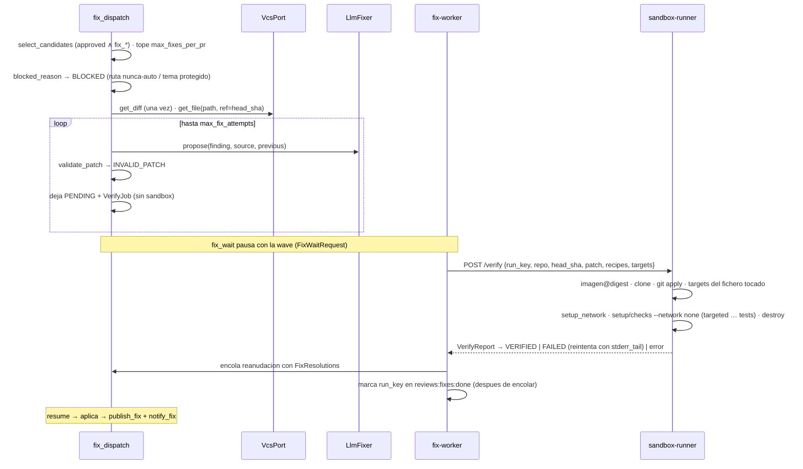

Última modificación: 2026-10-17 | Creado: 2026-10-11

# Arquitectura

Cómo está construido el agente **hoy**, contado desde el código. El vocabulario está
en [`CONTEXT.md`](../CONTEXT.md) y el porqué de cada decisión, en [`adr/`](adr/).
Para arrancarlo y operarlo, ver [`operacion.md`](operacion.md).

---

## 1. Vista de conjunto



> **Canal de Teams ([ADR-0016](adr/0016-bot-de-teams-para-el-canal-de-decision.md),
> iniciativa 013).** El worker **encola** avisos en `reviews:notices`; `teams-bot`
> los consume, publica/edita en el hilo del PR y traduce las acciones de la
> tarjeta a una `HitlDecision` encolada en `reviews:jobs` (no reanuda el grafo).
> Solo acepta acciones del canal capturado y, con `TEAMS_BOT_TENANT_ID`, de ese
> tenant (C5): sin canal capturado, rechaza todas. El respaldo de decisión sigue
> siendo el CLI y `POST /decision`. Pendiente humano: alta del bot en el tenant (T10).

| Proceso | Entrada | Responsabilidad |
|---|---|---|
| `api` (`api/main.py`) | `uvicorn agent_review.api.main:app` | Valida firma y tamaño, filtra `repo`, deposita artefactos, aplica la barrera de ingesta, encola. Expone el canal de decisión y el inbox. No construye el grafo. |
| `worker` (`worker/main.py`) | `python -m agent_review.worker.main` | Consume la cola **de uno en uno**, ejecuta el grafo con checkpointer, gestiona pausa, reanudación, reintentos y DLQ, y lanza los barridos periódicos. **No** toca el sandbox (E7). |
| `fix-worker` (`fixworker/main.py`) | `python -m agent_review.fixworker.main` | Consume `reviews:fixes`, verifica cada `VerifyJob` contra el `sandbox-runner` y encola la reanudación con la `FixResolutions`. Nunca publica ni invoca el grafo. Aislado: sin socket, `TWG_*`, Postgres ni token de decisión. |
| `sandbox-runner` (`sandbox_runner/`) | `python -m agent_review.sandbox_runner.main` | Verifica un parche con la imagen del CI por digest y sirve **workspaces de lectura** (`/workspaces`): clon *bare* que un lector de contexto lee con `git show`/`git grep`/`git ls-tree` ([016](iniciativas/archivo/016-lector-de-contexto/spec.md), [ADR-0018](adr/0018-workspace-de-lectura-en-el-runner.md)). Habla con su propio demonio Docker rootless. |
| `teams-bot` (`teams_bot/`) | `python -m agent_review.teams_bot.main` | Canal de Teams: consume la outbox, publica/edita el hilo por PR y recibe `POST /api/messages` (acciones de la tarjeta → `build_decision` → encola). **No** conoce el grafo. |
| CLI (`cli.py`) | `agent_review list` / `agent_review decide` | Lista las pausas y encola decisiones. No toca el grafo ni el PR. |

---

## 2. Capas del código

```
src/agent_review/
├── domain/        Modelos puros (Finding, ReviewRequest, Decision, HITL, Fix) y contrato
├── ports/         Protocolos: VcsPort, ReviewerPort, LlmPort, ChatPort, ToolingOutputSource,
│                  FixerPort, SandboxPort, ContextReaderPort, BudgetPort, ProgressPort
├── adapters/      twg_vcs, github_vcs, tooling_reviewer, llm_reviewer, llm_fixer,
│                  openai_llm, http_sandbox, tooling_source, diff_parser,
│                  context_fixture/context_vcs/context_workspace + tool_loop (lector de contexto, 016),
│                  progress_redis/progress_null (progreso del worker, 019)
├── teams_bot/     Canal de Teams (iniciativa 013): cards, state, service,
│                  ingress, sdk_client/handlers. El worker no importa este paquete.
├── chat_outbox.py Outbox `reviews:notices` + `OutboxChatAdapter` (`ChatPort`)
├── models_config.py  Registro declarativo de modelos (models.yaml): esquema y validacion
├── models_registry.py Bindings rol -> modelo, resueltos a LlmPort (y `probe` del catalogo)
├── graph/build.py Grafo, nodos, merge, render de inline/resumen y marcas de dedupe
│              wrapper.py (seam de nodo, 019 D2: progreso hoy, traza de 018 mañana)
├── policy/        PolicyEngine (autonomy.yaml)
├── fix/           Selección, validación local, nodo fix, formatters de entrega
├── fixworker/     Servicio de fixes (consume la wave, verifica, reanuda)
├── sandbox_runner/ Servicio de verificación y workspace de lectura (verifier, workspace,
│                  read_workspace, runtime, recipes)
├── api/  worker/  cli.py   Procesos (raíces de composición)
└── settings.py profile.py errors.py queue.py idempotency.py pending_store.py
    paused_store.py checkpointer.py scope.py decision.py trace.py
```

Patrones: **Ports & Adapters** (el grafo no conoce proveedores), **policy-as-data**
(`autonomy.yaml` y `models.yaml`), **Strategy** (`FixerPort`, `DeliveryFormatter`,
`RetentionPolicy`), **Registry** (`ModelRegistry`: rol → puerto), **map-reduce**
(fan-out de personas con `Send` + reducer), **ejecución durable** (checkpoint +
`interrupt`) y **degradación por capas** (el lector de contexto cae del workspace del
runner al VCS sin tumbar la review).

### Modelos por rol

El modelo de cada persona y del fixer no vive en el código: se declara por **rol**
en [`config/models.yaml`](../config/models.yaml) y lo resuelve `ModelRegistry`
([ADR-0015](adr/0015-registro-declarativo-de-modelos.md)). El registro se lee **al
arrancar** y el worker contrasta los modelos bindeados contra `GET /v1/models`
antes de procesar el primer job.



El `LlmPort` devuelve un `LlmReply` con el `usage` real del proveedor
(`prompt_tokens`, `completion_tokens`, `reasoning_tokens`) y acepta `json_mode`: el
adaptador pide al modelo solo la salida estructurada que su especificación declara,
porque un `json_schema` no soportado es un 400 permanente que la `RetryPolicy` no
recupera. Un `finish_reason: length` con contenido vacío (un razonador que gasta el
presupuesto en `reasoning_tokens`) se convierte en `LlmError` trazable, no en 0
hallazgos silenciosos.

---

## 3. El grafo



| Nodo | Reintento de nodo | Qué hace |
|---|---|---|
| `scope` | Sí | `get_diff`; con `max_files_per_pr`, también `get_diffstat` y recorte por churn. Quita el ruido (`scope.DEFAULT_IGNORE_PATTERNS` + `SCOPE_IGNORE`). Vacía `findings` y `source_status`; fija `budget_total`. |
| `persona` | Sí; degrada en el último intento | Una rama por revisor. Escribe `findings`, `finding_sources`, `source_status` y, si se corta por presupuesto, `budget_exhausted` y `tokens_spent`. |
| `merge` | No (puro) | [ADR-0014](adr/0014-criterio-de-merge-entre-personas.md). |
| `policy` | No (puro) | Una `Decision` por hallazgo, con `matched_rule` y `policy_version`. |
| `hitl` | **Nunca** | Sin pendientes o con `human_decisions` ya presente, sigue. Si no, `interrupt`. Si la decisión está incompleta o es ilegible, vuelve a pausar. |
| `fix_dispatch` | Sí | Selección → bloqueo de seguridad → fixer → validación **local**. Deja `PENDING` (con el `VerifyJob`) o terminal, sin tocar el sandbox. |
| `publish` | Sí | [ADR-0006](adr/0006-publicacion-inline-primero-resumen-al-final.md). Escribe `published` e `inlined_count`. Un `PENDING` se rotula "en verificación". |
| `fix_wait` | **Nunca** | `interrupt(FixWaitRequest)` si hay `PENDING`; al reanudar aplica la `FixResolutions`. Re-propone si un `FAILED` tiene intentos; si no, sigue. |
| `publish_fix` | Sí | Publica el resultado terminal como comentario de seguimiento (marca `:fix`, una vez). |
| `notify_fix` | Sí | Aviso compacto del resultado del fix, a la outbox del canal. |
| `notify` | Sí | Avisa de una review publicada, a la outbox del canal. Un fallo no transitorio se registra y no tumba la review. |

**Envoltura de nodo (019 D2).** Todos los nodos se registran a través de un único
*seam* (`graph/wrapper.node_wrapper`, `src/agent_review/graph/wrapper.py`). Con un
`ProgressPort` anota la frontera de cada nodo (`reviews:active:<review_key>`, W10);
sin él solo deja pasar los argumentos. La 018 añadirá aquí su traza, no una segunda
envoltura. La envoltura preserva la firma del nodo (`functools.wraps`), que es lo que
LangGraph lee para inyectar el `Runtime` de `persona` y lo que mantiene la
`RetryPolicy` sobre el nodo, no sobre el envoltorio.

### Estado (`ReviewState`)

| Campo | Reducer | Nota |
|---|---|---|
| `request`, `diff`, `reviewer` | Sustituye | `reviewer` solo existe en cada rama del `Send` |
| `findings` | `operator.add` | Lo escriben las personas en paralelo |
| `finding_sources`, `source_status`, `fixes` | Merge de dict | Por `finding_id` o por persona |
| `budget_exhausted` | `operator.or_` | Personas que se cortaron por presupuesto (017); cada rama escribe la suya en paralelo |
| `tokens_spent` | Suma de dict | Tokens confirmados por persona: el gasto real de la review |
| `budget_total` | Sustituye | Tope del contador compartido, escrito por `scope`; el saldo del `ReviewOutcome` se deriva de él |
| `merged`, `decisions` | Sustituye | Si compartieran campo con `findings`, se reacumularían |
| `human_decisions` | Sustituye | Lo escribe `hitl` al reanudar |
| `fix_wait` (wave) | Sustituye | La wave pendiente; la escribe `fix_wait` al pausar |
| `published`, `inlined_count` | Sustituye | Señal de `publish` a `notify` |

`pending_approvals` no se guarda: se deriva de `decisions`.

---

## 4. Flujo de una review

### 4.1 Ingesta (API)



Si algo falla tras un `claim`, la clave se libera (`_release_quietly`) antes de
propagar el error.

### 4.2 Bucle del worker

```
loop:
  job = BLPOP reviews:jobs (5 s)
  si hay job → _consume → process_request (según el estado del hilo, ADR-0007)
                fallo → reencolar con attempts+1, o DLQ al agotar
  si la cola está vacía:
    cada 30 s  → sweep_pending  (TTL de ingesta → pasada degradada :partial)
                 sweep_expired  (TTL de decisión → reanudación expired)
                 sweep_fix_expired (TTL del handoff → reanudación con outcome=error)
    cada 1 h   → reconcile_paused (repone pausas perdidas del inbox; re-encola la wave)
                 prune_completed_threads (CHECKPOINT_RETENTION_DAYS)
                 prune_fix_threads (FIX_WAIT_MAX_AGE_S; nunca poda un `human`)
  hilo aparte  → latido /tmp/reviews-worker-heartbeat cada 10 s (healthcheck)
```

### 4.3 Pausa y reanudación (HITL)



Al publicar con una decisión humana:

- `rejected`: solo en el resumen («descartado»).
- `approved`, `noted` y `expired`: inline con la línea `_Decision: … · actor_`.

### 4.4 Fix y verificación



El diff del parche se **deriva del fichero real** al `head_sha` (rango y texto de
reemplazo que propone el modelo), no se toma del diff que devuelva el modelo: un
header inventado haría fallar el `git apply` del runner.

El worker de reviews **no** llama al sandbox (E7): propone y valida localmente,
pausa y deja que el `fix-worker` verifique. La idempotencia del handoff vive en
`reviews:fixes:done` (por `run_key`), que se marca **después** de encolar la
reanudación: una caída entre ambas repite la verificación (el runner la sirve de su
caché por `run_key`) en vez de perder la reanudación, y una reanudación duplicada se
descarta porque no corresponde a la wave pendiente del hilo. Sin `SANDBOX_ENABLED`
o sin runner, `fix_dispatch` marca los fixes `NOT_VERIFIABLE` y no se pausa. El
vencimiento vive en `sweep_fix_expired`
(`FIX_VERIFY_TTL_S` → `NOT_VERIFIABLE`). La pausa de fix se poda con
`FixWaitRetention`; las pausas `human` nunca.

---

## 5. Claves y almacenes

| Dónde | Clave | Contenido | TTL |
|---|---|---|---|
| Redis | `<repo:pr:sha:tool>` / `<review_key>` | Claim de idempotencia | 7 días |
| Redis | `reviews:pending:<repo:pr:sha>` | `PendingReview` (incluye los payloads) | 7 días |
| Redis | `reviews:jobs` | Cola de reviews (`ReviewRequest` en JSON) | — |
| Redis | `reviews:jobs:dead` | DLQ: `review_key`, intentos, motivo, request | — |
| Redis | `reviews:fixes` | Cola de fixes (`FixJob`: wave + request) | — |
| Redis | `reviews:fixes:dead` | DLQ de fixes | — |
| Redis | `reviews:fixes:done` | Set de `run_key` ya verificados (idempotencia) | — |
| Redis | `reviews:paused:<review_key>` | `PausedReview` (inbox; `kind` `human`/`fix`) | 8 días |
| Redis | `reviews:active:<review_key>` | Hash de **progreso del worker** (019 W10): un campo por nodo en curso con `{node, started_at, branches}`. El panel lee de aquí «qué corre ahora y desde cuándo» (cierra D16). Sin `PROGRESS_ENABLED` no se escribe | `PROGRESS_TTL_S` (1 h) |
| Redis | `reviews:cancel:<review_key>` | Marca de **cancelación** (019 §5.4): la escribe el panel y la leen la frontera de nodo y `_consume` al desencolar, que abortan la review. Tras abortar queda como *tombstone* para abortar los jobs rezagados (sin hilo arrancarían desde `START`); solo «Reintentar» la retira. Una pausa de fix no se marca | `CANCEL_TTL_S` (7 días) |
| Redis | `reviews:notices` | Cola de avisos al canal (`ChatNotice` en JSON): outbox del egress (C10) | — |
| Redis | `reviews:notices:dead` | DLQ de la outbox de avisos (p. ej. pausa ya vencida: C13). Un aviso ilegible llega **en crudo** (`raw`) | — |
| Redis | `reviews:teams:card:<review_key>` | Hash `user_id\|finding_id → outcome`: estado de la tarjeta, por usuario (C8) | 8 días |
| Redis | `reviews:teams:card:<review_key>:final:<pause_id>` | Actor de la primera decisión de **esa pausa** (`SETNX`, C11). `pause_id` = `thread_id@created_at`: la pasada degradada y la completa comparten `review_key` y no se cierran entre sí | 8 días |
| Redis | `reviews:teams:channel` | `conversation_id` (id base, sin `;messageid=`) + `service_url` del canal dedicado (C14). **Gana la primera captura**; mover el canal es borrar la clave | — |
| Redis | `reviews:teams:threads` | Hash `sha256(repo:pr)[:12] → {conversation_id, root_message_id, service_url}`: hilo por PR (C6) | — |
| Redis | `reviews:teams:cards` | Hash `sha256(review_key)[:12] → {conversation_id, message_id, service_url}`: mensaje de la tarjeta editable (C7) | — |
| Redis | `budget:<review_key>` / `budget:reserved:<review_key>` | Gasto confirmado y reservado sin confirmar del presupuesto de tokens de la review (017). Contador compartido por el fan-out; el script Lua reserva y confirma de forma atómica | 8 días |
| Redis | `budget:fix:<review_key>` / `budget:fix:reserved:<review_key>` | Mismo contador para el fix (017 B11): clave aparte para que una review cara no deje sin presupuesto lo aprobado | 8 días |
| Postgres | `thread_id` | Checkpoints de LangGraph | Completados: 30 días; `fix_wait`: `FIX_WAIT_MAX_AGE_S` |
| Disco | `var/tooling/<pr>/<sha>/<tool>.json` | Artefacto del CI | — |
| PR | `<!-- reviews:<hash>:ok\|:partial -->`, `:i:<id>`, `:fix` | Marcas de publicación | Lo que viva el PR |

### Workspaces de lectura (memoria del `sandbox-runner`)

El runner sirve lecturas del repo ([016](iniciativas/archivo/016-lector-de-contexto/spec.md),
[ADR-0018](adr/0018-workspace-de-lectura-en-el-runner.md)) desde clones *bare* que
viven en su memoria de proceso: `ReadWorkspaceManager` con
`dict[workspace_id → (ReadWorkspace, expires_at)]` y un índice por `(repo,
head_sha)`. **No viajan en Redis ni en Postgres**: un reinicio del runner los pierde.
Un workspace desconocido responde `410` (y un fichero ausente, `404`): solo el `410`
hace que el adaptador reabra, una vez, o degrade al VCS. El clon corre **fuera** del
lock del gestor, con una marca por `(repo, head_sha)` para que dos aperturas del mismo
par clonen una sola vez; un clon lento no bloquea las lecturas de otros workspaces. Un TTL (`SANDBOX_WORKSPACE_TTL_S`,
1800 s) y un tope de abiertos (`SANDBOX_MAX_WORKSPACES`, 4) con *reaper* perezoso
acotan el disco; el desalojo borra el más antiguo. Cada clon vive en un directorio
temporal, **fuera** de lo que se monta en los contenedores de `/verify`.

### Consola en vivo (memoria del `sandbox-runner`)

El runner guarda en su memoria de proceso un **buffer circular por `run_key`** con las
últimas líneas de `stdout`/`stderr` de cada verificación (019 W5): `ConsoleBuffer`, con
`dict[run_key → (líneas, suscriptores, cerrado)]`. Lo alimenta `on_line` de
`ContainerRuntime.start` y lo sirve `GET /verify/{run_key}/console` como SSE. Igual que
los workspaces, **no viaja en Redis ni en Postgres**: un reinicio del runner lo pierde y
un `run_key` desconocido da `404`. Es *best-effort*: no se copia al `VerifyReport` (el
canal fiable) y perder la consola no afecta a la verificación (019 W8). El buffer
desaloja antes las verificaciones terminadas y sin lectores que las que tienen un
suscriptor vivo.

---

## 6. Estado por fase

| Fase | Estado | Qué falta |
|---|---|---|
| 1 — Report-only | Implementada y probada contra el PR 430 de `emotivoo-v2` | Visto bueno humano del formato (P3); el `POST` del CI es opcional (P1). Ambos en [015](iniciativas/015-puesta-en-marcha-real/spec.md) |
| 2 — HITL | Implementada (CLI + HTTP, inbox, TTL, poda, reconciliación). Canal Teams: bot + outbox ([013](iniciativas/archivo/013-canal-teams-bidireccional/spec.md), [ADR-0016](adr/0016-bot-de-teams-para-el-canal-de-decision.md)) | Smoke contra infraestructura real (S1) y alta del bot en el tenant (T10), en [015](iniciativas/015-puesta-en-marcha-real/spec.md). Se activa subiendo `max_autonomy` (parámetro de uso; por defecto `report`) |
| 3 — Fix + verificación | Base pura (F1–F6), runner (F7–F10) y **desacople E7** (F14–F28) hechos | F11 (spike R1 `suggestion`), F12 (smoke real) y P6 (revisión de seguridad; precondición), en [015](iniciativas/015-puesta-en-marcha-real/spec.md) |
| 4 — Autonomía por política | No empezada | `fix_auto`, Jira, memoria de aceptados, métricas, mutation testing |

El estado vivo de cada iniciativa y sus tareas están en
[`iniciativas/README.md`](iniciativas/README.md).

---

## 7. Deuda y discrepancias conocidas

Lo que el código hace distinto de lo que dice una spec, o lo que está a medias:

| # | Tema | Situación |
|---|---|---|
| D1 | **Targets heurísticos** | El runner deriva los tests dirigidos por nombre de clase (`ClaseTest.php`). Un test con otro nombre no se encuentra y la receta se salta; la suite completa sigue cubriéndolo. |
| D2 | **`APP_ENV=test` en todo el sandbox** | El perfil fija `APP_ENV=test` para todos los comandos, pero el CI de `emotivoo-v2` hace `cache:clear` en entorno `dev`, porque PHPStan lee `var/cache/dev/…Container.xml`. Sin verificar contra un fix real: es candidato a fallar en `typecheck` (F12). |
| D3 | **`importmap:install` con red** | Arranca el kernel (código del PR) con red. Es un riesgo asumido ([ADR-0011](adr/0011-sandbox-runner-aislado.md)). |
| D4 | **Guardas declarativas sin efecto** | `dedupe_by` y `require_tests_pass` no los lee ningún código. |
| D5 | **Orden de recetas por defecto** | `FIX_RECIPES` (fallback sin perfil) es `typecheck,arch,lint,targeted,tests`; el perfil dice `targeted` primero. |
| D6 | **Fallbacks a memoria abiertos** | Si Redis no responde, la API y el CLI encolan en memoria y responden OK (R1 de la revisión de `main`). El worker hace lo mismo. Lo aborda [015](iniciativas/015-puesta-en-marcha-real/spec.md) (S4). |
| D7 | **Firma y tokens desactivados por defecto** | Fuera de `production`, `change-me` desactiva el HMAC y los bearer de decisión y runner (R2). [015](iniciativas/015-puesta-en-marcha-real/spec.md) (S5) comprueba que el despliegue real corre en `production`. |
| D8 | **`observe` no atómico** | `RedisPendingStore.observe` lee, modifica y escribe sin `WATCH`. Además guarda payloads de hasta 5 MB (R4). |
| D9 | **Una sola fuente de tooling** | `ToolingReviewer` solo entiende PHPStan; añadir `deptrac` exige tocarlo (P3 de la revisión). |
| D10 | **Raíces de composición duplicadas** | `build_queue`/`build_paused`/`build_pending` existen en `api`, `worker` y `cli`, con diferencias (por ejemplo, el TTL del inbox). |
| D11 | **Worker secuencial** | La verificación de ~20 min ya no bloquea la cola: E7 desacopla por el `fix-worker` y un `interrupt`. Queda secuencial solo el resto del grafo (LLM, publicación). |
| D12 | **Detalles de la API** | `/profile/{repo_name}` ignora el nombre; un `pr_id` no numérico da 500; los handlers `async` hacen I/O bloqueante. |
| D13 | **Marcas en PRs largos** | `twg prs comment query -n 200`: a partir del comentario 200 el dedupe no ve marcas antiguas. |
| D14 | **Observabilidad** | **Parcial:** no hay trazas (LangSmith) ni métricas sobre tráfico real; solo logs. El **recorrido** de una review (nodos, orden y punto de parada) se lee del checkpointer con `trace.read_trace` y el **panel** de operación ([019](iniciativas/archivo/019-panel-de-operacion/spec.md)) muestra cola, en vuelo, pausas, descartes y gasto, además de la consola del sandbox en vivo. Las trazas con prompt/`usage`/latencia por llamada las aborda la [018](iniciativas/018-trazas-de-la-review/spec.md) (self-hosted); las métricas agregadas siguen fuera. |
| D15 | **Pausa degradada huérfana** | Si la pasada degradada pausa y después también pausa la completa, la completa ocupa la entrada del inbox (misma `review_key`). La reconciliación borra el hilo `:partial` superado. Vigilar que no queden hilos `:partial` pausados sin entrada. |
| D16 | **Heartbeat sin progreso** | **Resuelta (019).** El latido de compose sigue midiendo solo que el proceso vive, pero el worker deja en `reviews:active:<review_key>` el nodo en curso y su `started_at` (hash de progreso, W10) y el **panel** lo muestra: se distingue «vivo» de «avanzando». El latido se queda como healthcheck a propósito ([ADR-0020](adr/0020-panel-como-servicio-aparte.md)): no debe depender de Redis. |
| D18 | **Recorte silencioso de lo que ve el revisor** | `max_files_per_pr` (por churn) y el corte del `LlmReviewer` a 60 000 caracteres, a mitad de fichero, solo dejan un `logger.warning`; la review publicada no dice qué no se revisó. En el PR #3 el modelo vio ≈ 5 de 51 ficheros. Lo aborda la [012](iniciativas/012-cobertura-de-la-review/spec.md). |
| D19 | **Anclaje por cercanía** | `best_line` siempre devuelve una línea si hay añadidas: un hallazgo sobre código no visto se ancla a la línea visible más cercana. Lo aborda L0 de la [008](iniciativas/008-contexto-del-revisor/spec.md). |
| D20 | **Personas LLM con el mismo *prompt*** | `correctness`, `security` y `arch` son la misma clase `LlmReviewer` con el mismo `_SYSTEM`: solo cambia el modelo bindeado al rol. Los logs y el prefijo del `id` del hallazgo dicen `correctness` para las tres. El merge atribuye la fuente por `finding_sources`, así que la deduplicación no se ve afectada. Sin iniciativa. |
| D22 | **Contrato de secretos a mano** | El contrato de producción (ADR-0013) se escribe secreto a secreto en cinco funciones y repite el set de placeholders en cuatro módulos. El refactor `is_missing` (`92dea1e`) se dejó cuatro comprobaciones con el predicado viejo: `TOOLING_WEBHOOK_SECRET` y `REVIEWS_DECISION_TOKEN` vacíos no fallaban en `production`, y `SANDBOX_RUNNER_TOKEN` se juzgaba distinto en el worker y en el fix-worker. Corregido en `9fe30b0`; la causa raíz la aborda la [020](iniciativas/020-secretos-declarados/spec.md). |

---

## 8. Registro de fallos corregidos (revisión de `main`, 2026-10-11)

Los códigos B1–B10 aparecen en comentarios, tests y ADRs. Todos están corregidos y
cada uno tiene su test de regresión en `tests/test_revision_main.py` o
`tests/test_api.py`.

| Id | Fallo | Arreglo |
|---|---|---|
| B1 | Mandar a la DLQ una reanudación tumbaba el worker (`datetime` no serializable) | `model_dump(mode="json")`; el manejo del error ya no propaga excepciones |
| B2 | Un reintento re-ejecutaba el grafo desde `START` (LLM pagado dos veces, `findings` acumulados, hallazgos nuevos sin decidir) | Hilo a medias → `invoke(None)`; `RetryPolicy` por nodo ([ADR-0007](adr/0007-reintento-en-dos-capas.md)) |
| B3 | Una pausa vencida cuyo resume fallaba esquivaba la DLQ para siempre | `expired_enqueued_at` y tope de 3 encolados; limpieza del inbox también en la rama «completada» |
| B4 | Un artefacto tardío nunca publicaba la review completa | Hilo `:partial` para la pasada degradada ([ADR-0005](adr/0005-identidad-de-la-ejecucion.md)) |
| B5 | El merge por `(fichero, título)` se comía hallazgos | Clave `(fichero, línea, título)` + fusión entre personas ([ADR-0014](adr/0014-criterio-de-merge-entre-personas.md)) |
| B6 | El webhook aceptaba cualquier `repo` y comentaba el PR del repo configurado | `400` si `repo` ≠ configurado |
| B7 | La idempotencia se reclamaba antes de hacer el trabajo | Liberar la clave si falla el paso que protege |
| B8 | `twg` sin `timeout` bloqueaba el worker | `TWG_TIMEOUT_S` → `TwgError` transitorio |
| B9 | Un fallo de Teams contaba como fallo de la review y la notificación se perdía | Nodo `notify` propio |
| B10 | El aviso de pausa nunca llevaba enlace al PR | El worker pasa el `VcsPort` al aviso |

Las propuestas de esa revisión que siguen abiertas (fallbacks a memoria, firma por
defecto, `observe` atómico, raíz de composición única, parsers por herramienta,
configuración tipada, DTOs en la API, separar el render del grafo) están en la §7.
