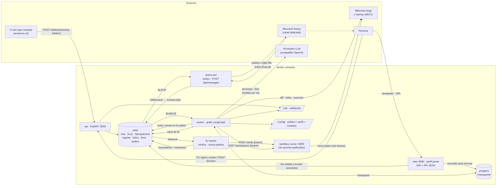
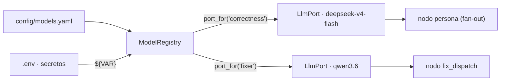
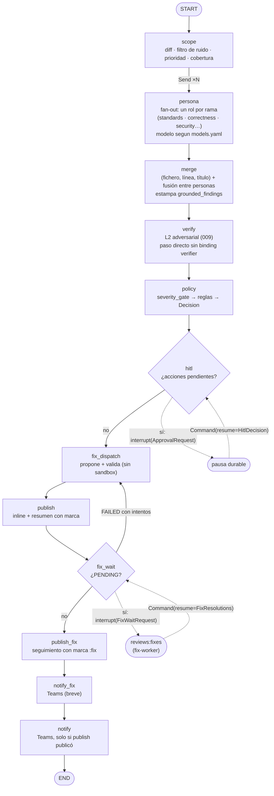
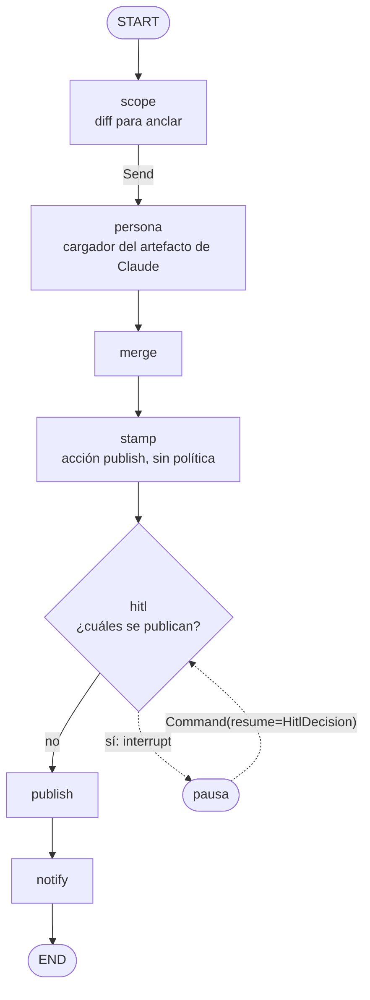
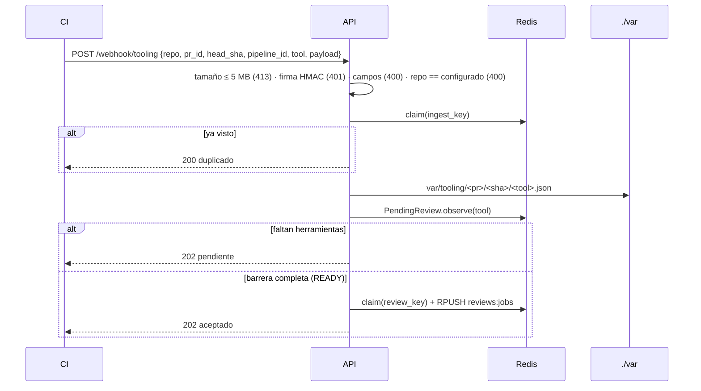
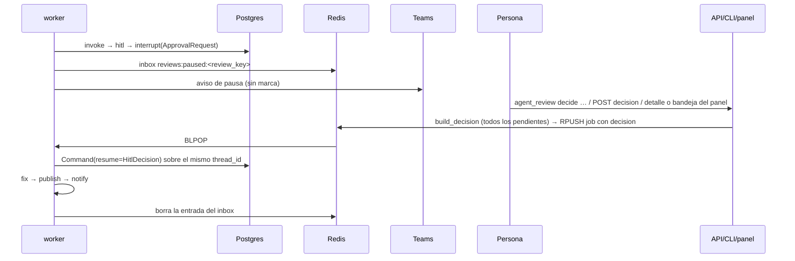
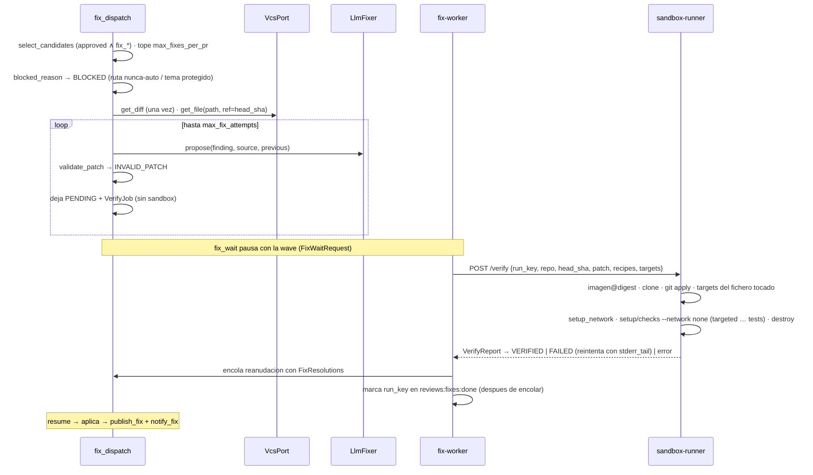

Última modificación: 2026-10-29 | Creado: 2026-10-11

# Arquitectura

Cómo está construido el agente **hoy**, contado desde el código. El vocabulario está
en [`CONTEXT.md`](../CONTEXT.md) y el porqué de cada decisión, en [`adr/`](adr/).
Para arrancarlo y operarlo, ver [`operacion.md`](operacion.md).

---

## 1. Vista de conjunto



> **Canal de Teams ([ADR-0016](adr/0016-bot-de-teams-para-el-canal-de-decision.md),
> iniciativa 013).** El worker **encola** avisos en `reviews:notices`; `teams-bot`
> los consume, publica/edita en el hilo del PR y traduce las acciones de la
> tarjeta a una `HitlDecision` encolada en `reviews:jobs` (no reanuda el grafo).
> Solo acepta acciones del canal capturado y, con `TEAMS_BOT_TENANT_ID`, de ese
> tenant (C5): sin canal capturado, rechaza todas. La **bandeja** del panel
> ([ADR-0030](adr/0030-bandeja-web-de-la-decision.md)) lista las mismas pausas
> humanas y responde con el mismo sello: la primera respuesta borra la tarjeta
> de Teams. Sin Teams, la bandeja es la única superficie. El CLI y
> `POST /decision` siguen siendo respaldo. Pendiente humano: alta del bot en el
> tenant (T10).

| Proceso | Entrada | Responsabilidad |
|---|---|---|
| `api` (`api/main.py`) | `uvicorn agent_review.api.main:app` | Valida firma y tamaño, filtra `repo`, deposita artefactos, aplica la barrera de ingesta, encola. Expone el canal de decisión y el inbox. No construye el grafo. |
| `worker` (`worker/main.py`) | `python -m agent_review.worker.main` | Consume la cola **de uno en uno**, ejecuta el grafo con checkpointer, gestiona pausa, reanudación, reintentos y DLQ, y lanza los barridos periódicos. Un lanzamiento del panel (`launch`, sin SHA) lo resuelve contra el VCS antes de invocar el grafo ([ADR-0029](adr/0029-lanzamiento-desde-el-panel.md)). **No** toca el sandbox (E7). |
| `fix-worker` (`fixworker/main.py`) | `python -m agent_review.fixworker.main` | Consume `reviews:fixes`, verifica cada `VerifyJob` contra el `sandbox-runner` y encola la reanudación con la `FixResolutions`. Nunca publica ni invoca el grafo. Aislado: sin socket, `TWG_*`, Postgres ni token de decisión. |
| `sandbox-runner` (`sandbox_runner/`) | `python -m agent_review.sandbox_runner.main` | Verifica un parche con la imagen del CI por digest y sirve **workspaces de lectura** (`/workspaces`): clon *bare* que un lector de contexto lee con `git show`/`git grep`/`git ls-tree` ([016](iniciativas/archivo/016-lector-de-contexto/spec.md), [ADR-0018](adr/0018-workspace-de-lectura-en-el-runner.md)). Habla con su propio demonio Docker rootless. |
| `teams-bot` (`teams_bot/`) | `python -m agent_review.teams_bot.main` | Canal de Teams: consume la outbox, publica/edita el hilo por PR, borra la tarjeta al responderse (`withdraw` o barrido) y recibe `POST /api/messages` (acciones de la tarjeta → `build_decision` → encola). **No** conoce el grafo. |
| `web` (`web/main.py`) | `python -m agent_review.web.main` | Panel de operación. Sirve la **SPA** (`frontend/dist`, en la imagen `web/static`) y la API JSON: lee el estado de Redis y el recorrido del checkpointer con un pool de solo lectura, y **encola** comandos, decisiones y lanzamientos. No escribe el estado del grafo ni habla con el VCS (`launch` lo resuelve el worker). El *fallback* de `index.html` no captura `/api/*` ni `/healthz` ([029](iniciativas/029-panel-en-react/spec.md), P5). Opt-in por el perfil `panel`. |
| CLI (`cli.py`) | `agent_review list` / `agent_review decide` | Lista las pausas y encola decisiones. No toca el grafo ni el PR. El **panel** ([022](iniciativas/archivo/022-decision-humana-en-el-panel/spec.md)) decide por su propio endpoint, con la misma `build_decision`. La **bandeja** ([026](iniciativas/archivo/026-bandeja-de-decisiones/spec.md)) es la lista de esas preguntas y comparte el sello con Teams y con el detalle. |

---

## 2. Capas del código

```
src/agent_review/
├── domain/        Modelos puros (Finding, ReviewRequest, Decision, HITL, Fix) y contrato
├── ports/         Protocolos: VcsPort, ReviewerPort, LlmPort, ChatPort, ToolingOutputSource,
│                  FixerPort, SandboxPort, ContextReaderPort, BudgetPort, ProgressPort,
│                  VerifierPort (L2 adversarial, 009)
├── adapters/      twg_vcs, github_vcs, tooling_reviewer, llm_reviewer, llm_fixer,
│                  llm_verifier (009), openai_llm, http_sandbox, tooling_source, diff_parser,
│                  context_fixture/context_vcs/context_workspace + tool_loop (lector de contexto, 016),
│                  progress_redis/progress_null (progreso del worker, 019)
├── teams_bot/     Canal de Teams (iniciativa 013): cards, state, service,
│                  ingress, sdk_client/handlers. El worker no importa este paquete.
├── chat_outbox.py Outbox `reviews:notices` + `OutboxChatAdapter` (`ChatPort`)
├── models_config.py  Registro declarativo de modelos (models.yaml): esquema y validacion
├── models_registry.py Bindings rol -> modelo, resueltos a LlmPort (y `probe` del catalogo)
├── graph/build.py Grafo, nodos (incl. `verify` L2), merge, render y marcas de dedupe
│              wrapper.py (seam de nodo, 019 D2: progreso hoy, traza de 018 mañana)
├── policy/        PolicyEngine (autonomy.yaml)
├── fix/           Selección, validación local, nodo fix, formatters de entrega
├── fixworker/     Servicio de fixes (consume la wave, verifica, reanuda)
├── sandbox_runner/ Servicio de verificación y workspace de lectura (verifier, workspace,
│                  read_workspace, runtime, recipes)
├── web/           Panel de operación: `main` (app y API), `spa` (build de la SPA y su
│                  *fallback*), `review_detail`/`config_api`/`bandeja`/`commands`,
│                  `read_model` (Redis + checkpointer) y `deps` (inyección)
├── api/  worker/  cli.py   Procesos (raíces de composición)
└── settings.py profile.py errors.py queue.py idempotency.py pending_store.py
    paused_store.py checkpointer.py scope.py decision.py trace.py
```

La interfaz no vive en Python: es una SPA en `frontend/` (Vite, React y TypeScript
estricto sobre CoreUI) cuyo build se sirve desde `web` y que consume la misma API
JSON. El servidor no sabe cómo se pinta una review.

Patrones: **Ports & Adapters** (el grafo no conoce proveedores), **policy-as-data**
(`autonomy.yaml` y `models.yaml`), **Strategy** (`FixerPort`, `DeliveryFormatter`,
`RetentionPolicy`), **Registry** (`ModelRegistry`: rol → puerto), **map-reduce**
(fan-out de personas con `Send` + reducer), **ejecución durable** (checkpoint +
`interrupt`) y **degradación por capas** (el lector de contexto cae del workspace del
runner al VCS sin tumbar la review).

### Modelos por rol

El modelo de cada persona y del fixer no vive en el código: se declara por **rol**
en [`config/models.yaml`](../config/models.yaml) y lo resuelve `ModelRegistry`
([ADR-0015](adr/0015-registro-declarativo-de-modelos.md)). El registro se lee **al
arrancar** y el worker contrasta los modelos bindeados contra `GET /v1/models`
antes de procesar el primer job.



El `LlmPort` devuelve un `LlmReply` con el `usage` real del proveedor
(`prompt_tokens`, `completion_tokens`, `reasoning_tokens` y `cached_tokens`, en
`None` cuando el proveedor no reporta caché) y acepta `json_mode`: el
adaptador pide al modelo solo la salida estructurada que su especificación declara,
porque un `json_schema` no soportado es un 400 permanente que la `RetryPolicy` no
recupera. Un `finish_reason: length` con contenido vacío (un razonador que gasta el
presupuesto en `reasoning_tokens`) se convierte en `LlmError` trazable, no en 0
hallazgos silenciosos.

---

## 3. El grafo



| Nodo | Reintento de nodo | Qué hace |
|---|---|---|
| `scope` | Sí | `get_diff`. Quita el ruido (`scope.DEFAULT_IGNORE_PATTERNS` + `SCOPE_IGNORE`) y ordena el resto por clase (configuración → código → tests → docs; `scope.classify`, ampliable con `scope.classes` del perfil) y por churn, **sin recortar** ([012](iniciativas/archivo/012-cobertura-de-la-review/spec.md)). Crea la `coverage` con los ignorados y la clase de cada fichero. Ensambla el `ReviewContext` (ficheros al `head_sha` + `context_docs` del perfil, una lectura por ruta) ([008](iniciativas/archivo/008-contexto-del-revisor/spec.md)). Vacía `findings` y `source_status`; fija `budget_total`. |
| `persona` | Sí; degrada en el último intento | Una rama por revisor. Recibe el `ReviewContext` del fan-out. Escribe `findings`, `finding_sources`, `source_status`, `coverage` (el `LlmReviewer` revisa por lotes de ficheros enteros, añade L1 bajo `LLM_CONTEXT_MAX_CHARS` sin recortar el diff, aplica L0 al anclar, y declara lo que no leyó: `too_large`, `budget`, `failed`, `context_omitted`) y, si se corta por presupuesto, `budget_exhausted` y `tokens_spent`. Una persona que declara cobertura y cae entera marca sus ficheros `failed`. Con razonamiento ([021](iniciativas/archivo/021-razonamiento-visible/spec.md)), el `LlmReviewer` pide *streaming*, manda el diff numerado en lotes de 20 000 caracteres (troceando por hunks lo que no cabe), reintenta **el lote** ante un corte del proveedor, un contenido en blanco o un cierre sin JSON —con un aviso añadido al final del *prompt*, porque una repetición idéntica con razonamiento tiende a repetir el vacío— y, si aun así no lo cierra, lo **parte en dos** y revisa cada mitad (un razonador en blanco lo es por el contenido del lote); solo un lote de un único bloque sale `failed` y emite su razonamiento a `reviews:reasoning:<review_key>` ([ADR-0023](adr/0023-razonamiento-por-streaming-y-stream-de-redis.md)). Con herramientas ([014](iniciativas/014-revisor-con-herramientas/spec.md)), los roles de `REVIEW_TOOLS_ROLES` corren además un **bucle *ReAct*** por lote (`run_tool_loop`, 016): el modelo pide `read_file`/`grep`/`list_dir`, el lector los sirve —`WorkspaceContextReader` con el runner, `VcsContextReader` sin él— y el bucle acumula turnos, peticiones y bytes. Lo servido es el `served` de la comprobación de citas (una cita a un fichero no servido se quita de la evidencia) y el `ToolUsage` del resultado; el anclaje al diff y L0 no cambian. |
| `merge` | No (puro) | [ADR-0014](adr/0014-criterio-de-merge-entre-personas.md). Estampa `grounded_findings` (ids cuyo grupo fusionó a una persona con `grounded=True`, p. ej. `ToolingReviewer`). |
| `verify` | Sí (llamada externa) | Segundo juicio adversarial ([009](iniciativas/archivo/009-verificador-adversarial/spec.md)): con binding `verifier` y presupuesto compartido de la review, verifica candidatos no grounded cuya severidad esté en `require_verified_for` (del `severity_gate` de la política si existe; si no, `VERIFIER_REQUIRE_VERIFIED_FOR`), hasta `VERIFIER_MAX_FINDINGS`. Escribe `verifications` y estampa `verification` / `failure_scenario` en `merged` sin tocar `severity`. Sin puerto: paso directo. |
| `policy` | No (puro) | Gate de severidad ([011](iniciativas/archivo/011-gate-de-severidad/spec.md), [ADR-0024](adr/0024-gate-de-severidad-en-la-politica.md)) y luego reglas: una `Decision` por hallazgo con severidad efectiva, `matched_rule` y `policy_version`. |
| `hitl` | **Nunca** | Sin pendientes o con `human_decisions` ya presente, sigue. Si no, `interrupt`. Si la decisión está incompleta o es ilegible, vuelve a pausar. |
| `fix_dispatch` | Sí | Selección → bloqueo de seguridad → fixer → validación **local**. Deja `PENDING` (con el `VerifyJob`) o terminal, sin tocar el sandbox. |
| `publish` | Sí | [ADR-0006](adr/0006-publicacion-inline-primero-resumen-al-final.md). Escribe `published` e `inlined_count`. Un `PENDING` se rotula "en verificación". Con código o configuración sin leer, la review es **parcial**: cabecera, marca `:partial` y se publica aunque no haya hallazgos. |
| `fix_wait` | **Nunca** | `interrupt(FixWaitRequest)` si hay `PENDING`; al reanudar aplica la `FixResolutions`. Re-propone si un `FAILED` tiene intentos; si no, sigue. |
| `publish_fix` | Sí | Publica el resultado terminal como comentario de seguimiento (marca `:fix`, una vez). |
| `notify_fix` | Sí | Aviso compacto del resultado del fix, a la outbox del canal. |
| `notify` | Sí | Avisa de una review publicada, a la outbox del canal. Un fallo no transitorio se registra y no tumba la review. |

El diagrama y la tabla son el motor `llm` (`REVIEW_ENGINE=llm`). El motor `claude`
compila otro grafo ([025](iniciativas/archivo/025-revisor-claude-cli/spec.md),
[ADR-0028](adr/0028-cli-claude-fuera-del-worker.md)):



No hay `verify`, `policy` ni `fix_dispatch`. El cargador lee el artefacto ya
validado y tira con L0 la cita que no está en el diff. El sello marca cada
hallazgo que pasó con acción `publish` y `publication=full`; no ejecuta la
política. `dropped` no se publica (ni inline ni resumen) y no es `rejected`.
Con `silence_without_choice`, solo un `approved` se publica. `dropped`,
`rejected`, `noted` y el `expired` del TTL dejan el hallazgo fuera; si no queda
nada elegido y no hay una fuente estática sin cubrir, `publish` no escribe en
el PR. El barrido del TTL, en esta pausa, reanuda con `dropped` (en la pausa
del motor `llm` sigue siendo `expired`). `notify` manda entonces un aviso
corto; si sí se publicó, el aviso cuenta publicados y dejados fuera, no los
pendientes de la política. Una fuente estática sin cubrir sigue comentando el
PR. `stamp`
deja `pause_kind=publication` en el estado y `build_approval` lo copia a la
pausa: el worker reconstruye la `ApprovalRequest` desde el estado, no desde el
`interrupt`. La tarjeta de Teams, con ese campo, ofrece tres lotes (solo
bloqueantes, todos, ninguno) y el marcado suelto; el bot los traduce a una
`HitlDecision` antes de encolar. Sin el campo, la tarjeta sigue siendo Aprobar,
Rechazar y Anotar. Antes de arrancar el grafo, el worker pide stdout al
servicio `claude-runner` (perfil `claude`) y lo guarda si es una lista de
hallazgos. Si ese `head_sha` ya es válido, no vuelve a llamar. Un stdout
inválido o un proceso caído no entra al grafo y el job se reintenta. Sin
sesión (`GET /session` responde no), el job sale a `reviews:claude:parked` y
el bucle sigue con el resto de la cola; el primer caso encola un aviso con
enlace al panel y el segundo no. Una reanudación que ya trae `decision` o
`fix_resolution` no se parkea: no necesita el CLI. El token vive en un fichero
`0600` que el worker no abre. El job que agota el cupo parkea con `reason`
`quota`, no entra al grafo y no se reintenta. Mientras dura el aviso (900 s),
los jobs siguientes salen a la misma lista con `reason` `quota-wait` y vuelven
a la cola cuando el aviso caduca; un artefacto ya válido de ese `head_sha` no
espera. El login del operador suelta solo lo parqueado por la sesión. El
barrido de cola vacía vuelve a mirar la sesión y suelta `quota-wait` si el
aviso ya no está.

**Envoltura de nodo (019 D2).** Todos los nodos se registran a través de un único
*seam* (`graph/wrapper.node_wrapper`, `src/agent_review/graph/wrapper.py`). Con un
`ProgressPort` anota la frontera de cada nodo (`reviews:active:<review_key>`, W10);
sin él solo deja pasar los argumentos. La 018 añadirá aquí su traza, no una segunda
envoltura. La envoltura preserva la firma del nodo (`functools.wraps`), que es lo que
LangGraph lee para inyectar el `Runtime` de `persona` y lo que mantiene la
`RetryPolicy` sobre el nodo, no sobre el envoltorio.

### Estado (`ReviewState`)

| Campo | Reducer | Nota |
|---|---|---|
| `request`, `diff`, `reviewer` | Sustituye | `reviewer` solo existe en cada rama del `Send` |
| `review_context` | Sustituye | `ReviewContext` de L1 (008): ficheros al head y docs del perfil; lo escribe `scope` y el fan-out lo reenvía |
| `findings` | `operator.add` | Lo escriben las personas en paralelo |
| `finding_sources`, `source_status`, `fixes` | Merge de dict | Por `finding_id` o por persona |
| `budget_exhausted` | `operator.or_` | Personas que se cortaron por presupuesto (017); cada rama escribe la suya en paralelo |
| `tokens_spent` | Suma de dict | Tokens confirmados por persona: el gasto real de la review |
| `budget_total` | Sustituye | Tope del contador compartido, escrito por `scope`; el saldo del `ReviewOutcome` se deriva de él |
| `coverage` | `ReviewCoverage.combine` | La crea `scope`; cada persona que revisa por lotes añade lo que leyó. Un fichero cuenta como revisado si alguien lo leyó |
| `merged`, `decisions` | Sustituye | Si compartieran campo con `findings`, se reacumularían |
| `grounded_findings` | Sustituye | Ids ya grounded tras el merge (009); L2 no los vuelve a verificar |
| `verifications` | Sustituye | Veredictos L2 por `finding_id` (009); el nodo lee lo existente como `existing` (idempotente) |
| `human_decisions` | Sustituye | Lo escribe `hitl` al reanudar |
| `fix_wait` (wave) | Sustituye | La wave pendiente; la escribe `fix_wait` al pausar |
| `published`, `inlined_count` | Sustituye | Señal de `publish` a `notify` |
| `silence_without_choice` | Sustituye | Solo lo escribe el grafo `claude`. Sin él, una review parcial del motor `llm` sigue comentando el PR |
| `pause_kind` | Sustituye | Solo lo escribe `stamp` del grafo `claude` (`publication`). `build_approval` lo copia a la tarjeta. El grafo `llm` no lo escribe |

`pending_approvals` no se guarda: se deriva de `decisions`.

---

## 4. Flujo de una review

### 4.1 Ingesta (API)



Si algo falla tras un `claim`, la clave se libera (`_release_quietly`) antes de
propagar el error.

El panel puede encolar una review sin artefacto
([ADR-0029](adr/0029-lanzamiento-desde-el-panel.md)): parsea la URL, comprueba el
repo y deja en `reviews:jobs` un `ReviewRequest` con `launch=True`,
`pipeline_id=panel` y el SHA vacío. No llama al VCS.

### 4.2 Bucle del worker

```
loop:
  reclaim de reviews:jobs:processing:*  (un arranque distinto recupera lo suyo ya;
                         otro host, solo si el latido supera 6 h)
  job = BLMOVE reviews:jobs → reviews:jobs:processing:<host> (5 s)
  si hay job → _consume: si es un lanzamiento sin SHA, lee el commit en el VCS
                (ADR-0029) y luego process_request (según el estado del hilo, ADR-0007)
                fallo → reencolar con attempts+1, o DLQ al agotar
                al terminar → LREM (ack). Sin ack, el reclaim devuelve el job
  si la cola está vacía:
    cada 30 s  → sweep_pending  (TTL de ingesta → pasada degradada :partial)
                 sweep_expired  (TTL de decisión → reanudación expired)
                 sweep_fix_expired (TTL del handoff → reanudación con outcome=error)
    cada 1 h   → reconcile_paused (repone pausas perdidas del inbox; re-encola la wave)
                 prune_completed_threads (CHECKPOINT_RETENTION_DAYS)
                 prune_fix_threads (FIX_WAIT_MAX_AGE_S; nunca poda un `human`)
  hilo aparte  → latido /tmp/reviews-worker-heartbeat cada 10 s (healthcheck)
```

### 4.3 Pausa y reanudación (HITL)



La bandeja y el detalle sellan la pausa antes de encolar. Si Teams está activo,
quien gana encola `withdraw` y el bot borra el mensaje. Una pausa ya sellada no
vuelve a publicarse si el aviso de pausa llega tarde. El CLI y la API no sellan:
el barrido del bot retira la tarjeta cuando la pausa sale del inbox.

Al publicar con una decisión humana:

- `rejected`: solo en el resumen («descartado»).
- `approved`, `noted` y `expired`: inline con la línea `_Decision: … · actor_`.

### 4.4 Fix y verificación



El diff del parche se **deriva del fichero real** al `head_sha` (rango y texto de
reemplazo que propone el modelo), no se toma del diff que devuelva el modelo: un
header inventado haría fallar el `git apply` del runner.

El worker de reviews **no** llama al sandbox (E7): propone y valida localmente,
pausa y deja que el `fix-worker` verifique. La idempotencia del handoff vive en
`reviews:fixes:done` (por `run_key`), que se marca **después** de encolar la
reanudación: una caída entre ambas repite la verificación (el runner la sirve de su
caché por `run_key`) en vez de perder la reanudación, y una reanudación duplicada se
descarta porque no corresponde a la wave pendiente del hilo. Sin `SANDBOX_ENABLED`
o sin runner, `fix_dispatch` marca los fixes `NOT_VERIFIABLE` y no se pausa. El
vencimiento vive en `sweep_fix_expired`
(`FIX_VERIFY_TTL_S` → `NOT_VERIFIABLE`). La pausa de fix se poda con
`FixWaitRetention`; las pausas `human` nunca.

---

## 5. Claves y almacenes

| Dónde | Clave | Contenido | TTL |
|---|---|---|---|
| Redis | `<repo:pr:sha:tool>` / `<review_key>` | Claim de idempotencia | 7 días |
| Redis | `reviews:pending:<repo:pr:sha>` | `PendingReview` (incluye los payloads) | 7 días |
| Redis | `reviews:jobs` | Cola de reviews (`ReviewRequest` en JSON) | — |
| Redis | `reviews:jobs:processing:<host>` | Job en vuelo de ese worker, hasta el `ack`. Un proceso nuevo con el mismo host lo devuelve a `reviews:jobs`; otro host, si el latido (`…:hb`) supera 6 h | latido 6 h |
| Redis | `reviews:jobs:dead` | DLQ: `review_key`, intentos, motivo, `error` (log de los intentos) y request. Un payload ilegible llega en crudo (`raw`). El enlace del panel abre ese log cuando no hay recorrido | — |
| Redis | `reviews:failure:<review_key>` | Log de intentos aún no descartados. Al ir a la DLQ se copia en `error` y se borra; si el job termina, también | 7 días |
| Redis | `reviews:journal:<review_key>` | Log de la ficha: intentos, fallos y cómo terminó. No se borra al cerrar la review. El panel lo muestra en el detalle junto al motivo leído del estado | 10 días |
| Redis | `reviews:claude:parked` | Jobs del motor `claude` en espera (`reason` `session`, `quota`, `quota-wait` o `ceiling` + `ReviewRequest`). Fuera del `BLPOP`. `quota-wait` vuelve al caducar el aviso de cupo; `quota` y `ceiling` no. El panel lo lee y lo pinta en el cuadro de mando con su motivo ([030](iniciativas/030-panel-ensena-los-aparcados/spec.md)) | — |
| Redis | `reviews:claude:notice:session` | Aviso único de falta de sesión. La borra el login; no lleva el token | — |
| Redis | `reviews:claude:notice:quota` | Aviso único de cupo, y enfriamiento para no relanzar el CLI | 900 s |
| Redis | `reviews:claude:notice:session`, `reviews:claude:notice:ceiling` | Aviso único de cada motivo. `session` además se borra al iniciar sesión. El de `ceiling` no se desbloquea solo: su fecha es lo que permite volver a avisar al chocar de nuevo el techo | 86400 s |
| Redis | `reviews:fixes` | Cola de fixes (`FixJob`: wave + request) | — |
| Redis | `reviews:fixes:processing:<host>` | Fix en vuelo, misma regla que `reviews:jobs:processing` | latido 6 h |
| Redis | `reviews:fixes:dead` | DLQ de fixes. Un payload ilegible llega en crudo (`raw`) | — |
| Redis | `reviews:fixes:done` | Set de `run_key` ya verificados (idempotencia) | — |
| Redis | `reviews:paused:<review_key>` | `PausedReview` (inbox; `kind` `human`/`fix`) | 8 días |
| Redis | `reviews:active:<review_key>` | Hash de **progreso del worker** (019 W10): un campo por nodo en curso con `{node, started_at, branches}`. El panel lee de aquí «qué corre ahora y desde cuándo» (cierra D16). Sin `PROGRESS_ENABLED` no se escribe | `PROGRESS_TTL_S` (1 h) |
| Redis | `reviews:reasoning:<review_key>` | *Stream* del **razonamiento de los revisores** (021): un evento por inicio, trozo de texto (agrupado), fin o fallo de cada lote, con persona, lote *i/N*, ficheros y `usage`. Lo escribe el worker con `REASONING_STREAM_ENABLED` y lo lee el panel por SSE. `MAXLEN ~` por `REASONING_MAX_BYTES` | `REASONING_TTL_S` (10 días) |
| Redis | `reviews:history` / `reviews:history:data` | **Histórico de reviews terminadas** (021): *sorted set* `review_key` → instante de cierre y hash `review_key` → `ReviewSummary` en JSON. Lo escribe el worker al cerrar cada review (una reentrega actualiza la entrada) y lo lee el panel | Poda por fecha con `CHECKPOINT_RETENTION_DAYS` (30 días), al escribir y en el barrido |
| Redis | `reviews:cancel:<review_key>` | Marca de **cancelación** (019 §5.4): la escribe el panel y la leen la frontera de nodo y `_consume` al desencolar, que abortan la review. Tras abortar queda como *tombstone* para abortar los jobs rezagados (sin hilo arrancarían desde `START`); solo «Reintentar» la retira. Una pausa de fix no se marca | `CANCEL_TTL_S` (7 días) |
| Redis | `reviews:notices` | Cola de avisos al canal (`ChatNotice` en JSON): outbox del egress (C10). `kind` `published`, `pause` o `withdraw` (retirar la tarjeta ya respondida) | — |
| Redis | `reviews:notices:dead` | DLQ de la outbox de avisos (p. ej. pausa ya vencida: C13). Un aviso ilegible llega **en crudo** (`raw`) | — |
| Redis | `reviews:teams:card:<review_key>` | Hash `user_id\|finding_id → outcome`: estado de la tarjeta, por usuario (C8) | 8 días |
| Redis | `reviews:teams:card:<review_key>:final:<pause_id>` | Actor de la primera decisión de **esa pausa** (`SETNX`, C11). `pause_id` = `thread_id@created_at`: la pasada degradada y la completa comparten `review_key` y no se cierran entre sí | 8 días |
| Redis | `reviews:teams:channel` | `conversation_id` (id base, sin `;messageid=`) + `service_url` del canal dedicado (C14). **Gana la primera captura**; mover el canal es borrar la clave | — |
| Redis | `reviews:teams:threads` | Hash `sha256(repo:pr)[:12] → {conversation_id, root_message_id, service_url}`: hilo por PR (C6) | — |
| Redis | `reviews:teams:cards` | Hash `sha256(review_key)[:12] → {conversation_id, message_id, service_url, review_key}`: mensaje de la tarjeta (C7). El bot lo borra al sellarse la pausa o al salir del inbox. Una entrada antigua sin `review_key` solo se borra con un `withdraw` que traiga la clave | — |
| Redis | `budget:<review_key>` / `budget:reserved:<review_key>` | Gasto confirmado y reservado sin confirmar del presupuesto de tokens de la review (017). Contador compartido por el fan-out; el script Lua reserva y confirma de forma atómica | 8 días |
| Redis | `budget:fix:<review_key>` / `budget:fix:reserved:<review_key>` | Mismo contador para el fix (017 B11): clave aparte para que una review cara no deje sin presupuesto lo aprobado | 8 días |
| Postgres | `thread_id` | Checkpoints de LangGraph | Completados: 30 días; `fix_wait`: `FIX_WAIT_MAX_AGE_S` |
| Postgres | `panel_config` / `panel_config_history` | Documento vigente de diales del panel (027, [ADR-0031](adr/0031-configuracion-desde-el-panel.md)): overrides, revisión, actor. El historial guarda cada foto. Sin fila, la review usa `Settings` | — |
| Disco | `var/tooling/<pr>/<sha>/<tool>.json` | Artefacto del CI | — |
| PR | `<!-- reviews:<hash>:ok\|:partial -->`, `:i:<id>`, `:fix` | Marcas de publicación | Lo que viva el PR |

### Workspaces de lectura (memoria del `sandbox-runner`)

El runner sirve lecturas del repo ([016](iniciativas/archivo/016-lector-de-contexto/spec.md),
[ADR-0018](adr/0018-workspace-de-lectura-en-el-runner.md)) desde clones *bare* que
viven en su memoria de proceso: `ReadWorkspaceManager` con
`dict[workspace_id → (ReadWorkspace, expires_at)]` y un índice por `(repo,
head_sha)`. **No viajan en Redis ni en Postgres**: un reinicio del runner los pierde.
Un workspace desconocido responde `410` (y un fichero ausente, `404`): solo el `410`
hace que el adaptador reabra, una vez, o degrade al VCS. `GET .../file` devuelve además
`total_bytes` (tamaño real del blob antes del rango y del recorte), `truncated` y
`served_range`; `grep` y `tree` devuelven `total` y `truncated`
([ADR-0026](adr/0026-contrato-de-lectura-con-tamano-real.md)). `grep` acepta
`mode="regex"` cuando el runner anuncia la capacidad `grep.mode`; el patrón viaja
**ya normalizado** al dialecto portable ([ADR-0027](adr/0027-dialecto-portable-de-grep.md)),
así que `git grep -E` y el `re` del fixture y del VCS interpretan la misma cadena, y
un patrón no portable o inválido es `400`, nunca una lista vacía. `tree` acepta
`glob` (relativo al directorio pedido) y `depth`: un directorio **vacío** es `200`
con `entries` vacío; una ruta que no existe o que es un fichero es `400`, para que
`list_dir` no confunda «no hay nada» con «no está» (L1 de 023). El clon corre **fuera** del
lock del gestor, con una marca por `(repo, head_sha)` para que dos aperturas del mismo
par clonen una sola vez; un clon lento no bloquea las lecturas de otros workspaces. Un TTL (`SANDBOX_WORKSPACE_TTL_S`,
1800 s) y un tope de abiertos (`SANDBOX_MAX_WORKSPACES`, 4) con *reaper* perezoso
acotan el disco; el desalojo borra el más antiguo. Cada clon vive en un directorio
temporal, **fuera** de lo que se monta en los contenedores de `/verify`.

### Consola en vivo (memoria del `sandbox-runner`)

El runner guarda en su memoria de proceso un **buffer circular por `run_key`** con las
últimas líneas de `stdout`/`stderr` de cada verificación (019 W5): `ConsoleBuffer`, con
`dict[run_key → (líneas, suscriptores, cerrado)]`. Lo alimenta `on_line` de
`ContainerRuntime.start` y lo sirve `GET /verify/{run_key}/console` como SSE. Igual que
los workspaces, **no viaja en Redis ni en Postgres**: un reinicio del runner lo pierde y
un `run_key` desconocido da `404`. Es *best-effort*: no se copia al `VerifyReport` (el
canal fiable) y perder la consola no afecta a la verificación (019 W8). El buffer
desaloja antes las verificaciones terminadas y sin lectores que las que tienen un
suscriptor vivo.

---

## 6. Estado por fase

| Fase | Estado | Qué falta |
|---|---|---|
| 1 — Report-only | Implementada y probada contra el PR 430 de `emotivoo-v2` | Visto bueno humano del formato (P3); el `POST` del CI es opcional (P1). Ambos en [015](iniciativas/015-puesta-en-marcha-real/spec.md) |
| 2 — HITL | Implementada (CLI + HTTP, inbox, TTL, poda, reconciliación). Canal Teams: bot + outbox ([013](iniciativas/archivo/013-canal-teams-bidireccional/spec.md), [ADR-0016](adr/0016-bot-de-teams-para-el-canal-de-decision.md)) | Smoke contra infraestructura real (S1) y alta del bot en el tenant (T10), en [015](iniciativas/015-puesta-en-marcha-real/spec.md). Se activa subiendo `max_autonomy` (parámetro de uso; por defecto `report`) |
| 3 — Fix + verificación | Base pura (F1–F6), runner (F7–F10), **desacople E7** (F14–F28), **L2 adversarial** ([009](iniciativas/archivo/009-verificador-adversarial/spec.md)) y **gate de severidad** ([011](iniciativas/archivo/011-gate-de-severidad/spec.md), [ADR-0024](adr/0024-gate-de-severidad-en-la-politica.md)) hechos | F11 (spike R1 `suggestion`), F12 (smoke real) y P6 (revisión de seguridad; precondición), en [015](iniciativas/015-puesta-en-marcha-real/spec.md) |
| 4 — Autonomía por política | No empezada | `fix_auto`, Jira, memoria de aceptados, métricas, mutation testing |

El estado vivo de cada iniciativa y sus tareas están en
[`iniciativas/README.md`](iniciativas/README.md). El motor `claude` de
[025](iniciativas/archivo/025-revisor-claude-cli/spec.md) está implementado: grafo,
tarjeta de lote, `claude-runner` y sesión en el panel.
[028](iniciativas/028-claude-revisa-con-la-skill/spec.md) también: la skill revisa
fuera del núcleo, el sandbox cierra `Bash` y el techo no se reintenta
([ADR-0033](adr/0033-skill-fuera-del-nucleo.md)).

---

## 7. Deuda y discrepancias conocidas

Lo que el código hace distinto de lo que dice una spec, o lo que está a medias:

| # | Tema | Situación |
|---|---|---|
| D1 | **Targets heurísticos** | El runner deriva los tests dirigidos por nombre de clase (`ClaseTest.php`). Un test con otro nombre no se encuentra y la receta se salta; la suite completa sigue cubriéndolo. |
| D2 | **`APP_ENV=test` en todo el sandbox** | El perfil fija `APP_ENV=test` para todos los comandos, pero el CI de `emotivoo-v2` hace `cache:clear` en entorno `dev`, porque PHPStan lee `var/cache/dev/…Container.xml`. Sin verificar contra un fix real: es candidato a fallar en `typecheck` (F12). |
| D3 | **`importmap:install` con red** | Arranca el kernel (código del PR) con red. Es un riesgo asumido ([ADR-0011](adr/0011-sandbox-runner-aislado.md)). |
| D4 | **Guardas declarativas sin efecto** | `dedupe_by` y `require_tests_pass` no los lee ningún código. |
| D5 | **Orden de recetas por defecto** | `FIX_RECIPES` (fallback sin perfil) es `typecheck,arch,lint,targeted,tests`; el perfil dice `targeted` primero. |
| D6 | **Fallbacks a memoria abiertos** | Si Redis no responde, la API y el CLI encolan en memoria y responden OK (R1 de la revisión de `main`). El worker hace lo mismo. Lo aborda [015](iniciativas/015-puesta-en-marcha-real/spec.md) (S4). |
| D7 | **Firma y tokens desactivados por defecto** | Fuera de `production`, `change-me` desactiva el HMAC y los bearer de decisión y runner (R2). [015](iniciativas/015-puesta-en-marcha-real/spec.md) (S5) comprueba que el despliegue real corre en `production`. |
| D8 | **`observe` no atómico** | `RedisPendingStore.observe` lee, modifica y escribe sin `WATCH`. Además guarda payloads de hasta 5 MB (R4). |
| D9 | **Una sola fuente de tooling** | `ToolingReviewer` solo entiende PHPStan; añadir `deptrac` exige tocarlo (P3 de la revisión). |
| D10 | **Raíces de composición duplicadas** | `build_queue`/`build_paused`/`build_pending` existen en `api`, `worker` y `cli`, con diferencias (por ejemplo, el TTL del inbox). |
| D11 | **Worker secuencial** | La verificación de ~20 min ya no bloquea la cola: E7 desacopla por el `fix-worker` y un `interrupt`. Queda secuencial solo el resto del grafo (LLM, publicación). |
| D12 | **Detalles de la API** | `/profile/{repo_name}` ignora el nombre; un `pr_id` no numérico da 500; los handlers `async` hacen I/O bloqueante. |
| D13 | **Marcas en PRs largos** | `twg prs comment query -n 200`: a partir del comentario 200 el dedupe no ve marcas antiguas. |
| D14 | **Observabilidad** | **Parcial:** no hay trazas (LangSmith) ni métricas sobre tráfico real; solo logs. El **recorrido** de una review (nodos, orden y punto de parada) se lee del checkpointer con `trace.read_trace` y el **panel** de operación ([019](iniciativas/archivo/019-panel-de-operacion/spec.md)) muestra cola, en vuelo, pausas, descartes y gasto, además de la consola del sandbox en vivo. Las trazas con prompt/`usage`/latencia por llamada las aborda la [018](iniciativas/018-trazas-de-la-review/spec.md) (self-hosted); las métricas agregadas siguen fuera. |
| D15 | **Pausa degradada huérfana** | Si la pasada degradada pausa y después también pausa la completa, la completa ocupa la entrada del inbox (misma `review_key`). La reconciliación borra el hilo `:partial` superado. Vigilar que no queden hilos `:partial` pausados sin entrada. |
| D16 | **Heartbeat sin progreso** | **Resuelta (019).** El latido de compose sigue midiendo solo que el proceso vive, pero el worker deja en `reviews:active:<review_key>` el nodo en curso y su `started_at` (hash de progreso, W10) y el **panel** lo muestra: se distingue «vivo» de «avanzando». El latido se queda como healthcheck a propósito ([ADR-0020](adr/0020-panel-como-servicio-aparte.md)): no debe depender de Redis. |
| D19 | **Anclaje por cercanía** | **Resuelto (008 L0):** el `LlmReviewer` ya no recoloca por cercanía; cita de contexto/borrada va al resumen y cita inventada se descarta. `ToolingReviewer` sigue con `best_line` (grounded). |
| D20 | **Personas LLM con el mismo *prompt*** | `correctness`, `security` y `arch` son la misma clase `LlmReviewer` con el mismo `_SYSTEM`: solo cambia el modelo bindeado al rol. Los logs y el prefijo del `id` del hallazgo dicen `correctness` para las tres. El merge atribuye la fuente por `finding_sources`, así que la deduplicación no se ve afectada. Sin iniciativa. |
| D22 | **Contrato de secretos a mano** | **Resuelta (020, [ADR-0022](adr/0022-contrato-de-secretos-declarado.md)).** El contrato se deriva de `Settings`: cada campo secreto declara un `Secret` en su `metadata` (procesos donde aplica, condición de activación y qué se espera del valor) y `secrets_for(settings, process)` es la única vía de lectura. Se borran las listas a mano y los cuatro sets de placeholders: `PLACEHOLDER_VALUES` es la única definición, y API, web y el `sandbox_runner` comparten el predicado `is_missing` que la encapsula. La causa del fallo de `92dea1e` (dos listas para el mismo secreto) ya no puede repetirse. |
| D23 | **Una grabación caducada se lee como un resultado malo** | **Resuelta (023 T0, T0c).** `FingerprintMismatch` vive en `ports/llm.py` (hereda de `LlmError`, así que `is_transient` la clasifica como permanente) y el harness la importa de ahí. `LlmReviewer` la deja subir en los **tres** sitios (`_call_once`, `_call_with_tools` y `_call_with_retries`); un error permanente que escape de `_call_with_retries` deja el lote `FAILED` y la review parcial, sin tumbar el resto (si subiera, `persona` lo relanzaría). En el borde de la medida, `evaluate` lanza `IncompleteMeasurement` si un replay deja algún lote en `FAILED` (`BUDGET` no aborta) y `scripts/eval.py` sale con código 2: una grabación caducada termina en error ruidoso, no en un informe de recall 0. |
| D25 | **`served` por lote y `files_read` por review** | **Resuelta (023 S1).** El registro (`ReadingRegistry` en `ports/context.py`) vive en el `LlmReviewer`, se comparte entre lotes con `run_tool_loop` y se vacía al empezar cada review: una cita a un fichero del lote 1 vale en el 3. `Reading` distingue `full`/`range`/`outline`/`grep` y la `ref`; solo `full`/`range` de la misma `ref` prueban una cita, y `files_read` (cobertura) cuenta solo cuerpos. |
| D26 | **El `usage` agregado del bucle está mal atribuido** | **Resuelta (024 S1/S4).** `LoopResult` acumula `prompt_tokens`, `completion_tokens`, `reasoning_tokens` y `cached_tokens` (este último por turno, `None` si alguno no lo reporta) además de `usage`, que sigue siendo la suma para el presupuesto. `_call_with_tools` devuelve un `LlmReply` con esos contadores separados, no el total metido en *completion*; `LlmReply.cached_tokens` es `None` cuando el proveedor no lo reporta (tres dialectos normalizados en `openai_llm`), la grabación lo guarda y devuelve, y el informe de 006 publica `cache` (`cached_tokens / prompt_tokens`) por review y por lote. |
| D27 | **La conversación no lleva la respuesta del modelo** | `run_tool_loop` acumula en `conversation` solo los bloques `<tool_result>`: en el turno siguiente el modelo ve los resultados sin su propia petición. No hay evidencia de que le haga repetir lecturas (22 rutas se piden en más de una llamada, `domain/models.py` en 5), pero la conversación está mal formada. Se cierra en 024 (E5, eco del *assistant*), que declara su coste en *prompt*. |
| D28 | **La grabación pierde el orden de ejecución** | **Resuelta (023 T3).** `Recording` guarda `order`: la lista de llamadas en el orden en que ocurrieron, cada una con `seq`, `call_id`, `batch_index` y `turn`; `calls` queda como índice por *fingerprint* (la primera ocurrencia) y el *replay* consume una llamada por vez, así que dos turnos con el mismo *prompt* ya no se colapsan. `batch_index`/`turn` los aporta `BatchTracker`, que escucha el `start` que el revisor ya emite por lote. Una grabación anterior al formato (sin `order`) se reproduce por *fingerprint* y `measurable_by_batch` es `False`: no se le inventa el orden. |
| D30 | **La grabación perdía los intentos fallidos** | **Resuelta (023 C0c).** Una llamada que el puerto lanzaba (`LlmTruncatedError` por agotar `max_tokens`, `LlmTransientError` por un corte) no dejaba entrada, así que el *replay* se saltaba un turno que en vivo ocurrió y abortaba por *fingerprint*: una corrida con un solo reintento era irreproducible. `record_call` acepta ahora `error`, `RecordedCall` lo guarda (`tipo: mensaje`) y `ReplayLlm` levanta el mismo tipo con el mismo mensaje. Los tokens de un intento fallido no se graban porque el puerto no los reporta. |

---

## 8. Registro de fallos corregidos (revisión de `main`, 2026-10-11)

Los códigos B1–B10 aparecen en comentarios, tests y ADRs. Todos están corregidos y
cada uno tiene su test de regresión en `tests/test_revision_main.py` o
`tests/test_api.py`.

| Id | Fallo | Arreglo |
|---|---|---|
| B1 | Mandar a la DLQ una reanudación tumbaba el worker (`datetime` no serializable) | `model_dump(mode="json")`; el manejo del error ya no propaga excepciones |
| B2 | Un reintento re-ejecutaba el grafo desde `START` (LLM pagado dos veces, `findings` acumulados, hallazgos nuevos sin decidir) | Hilo a medias → `invoke(None)`; `RetryPolicy` por nodo ([ADR-0007](adr/0007-reintento-en-dos-capas.md)) |
| B3 | Una pausa vencida cuyo resume fallaba esquivaba la DLQ para siempre | `expired_enqueued_at` y tope de 3 encolados; limpieza del inbox también en la rama «completada» |
| B4 | Un artefacto tardío nunca publicaba la review completa | Hilo `:partial` para la pasada degradada ([ADR-0005](adr/0005-identidad-de-la-ejecucion.md)) |
| B5 | El merge por `(fichero, título)` se comía hallazgos | Clave `(fichero, línea, título)` + fusión entre personas ([ADR-0014](adr/0014-criterio-de-merge-entre-personas.md)) |
| B6 | El webhook aceptaba cualquier `repo` y comentaba el PR del repo configurado | `400` si `repo` ≠ configurado |
| B7 | La idempotencia se reclamaba antes de hacer el trabajo | Liberar la clave si falla el paso que protege |
| B8 | `twg` sin `timeout` bloqueaba el worker | `TWG_TIMEOUT_S` → `TwgError` transitorio |
| B9 | Un fallo de Teams contaba como fallo de la review y la notificación se perdía | Nodo `notify` propio |
| B10 | El aviso de pausa nunca llevaba enlace al PR | El worker pasa el `VcsPort` al aviso |

Las propuestas de esa revisión que siguen abiertas (fallbacks a memoria, firma por
defecto, `observe` atómico, raíz de composición única, parsers por herramienta,
configuración tipada, DTOs en la API, separar el render del grafo) están en la §7.
