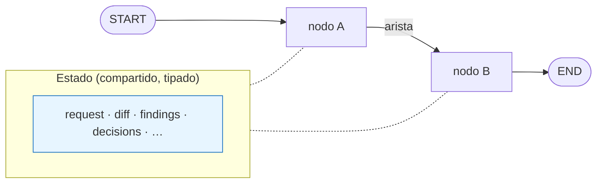
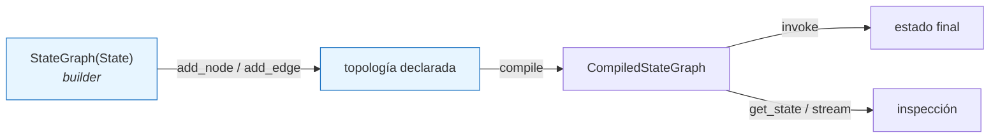
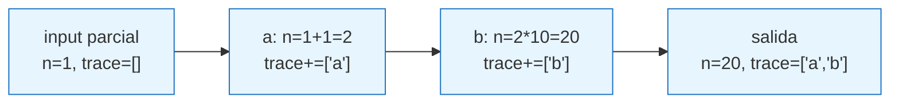
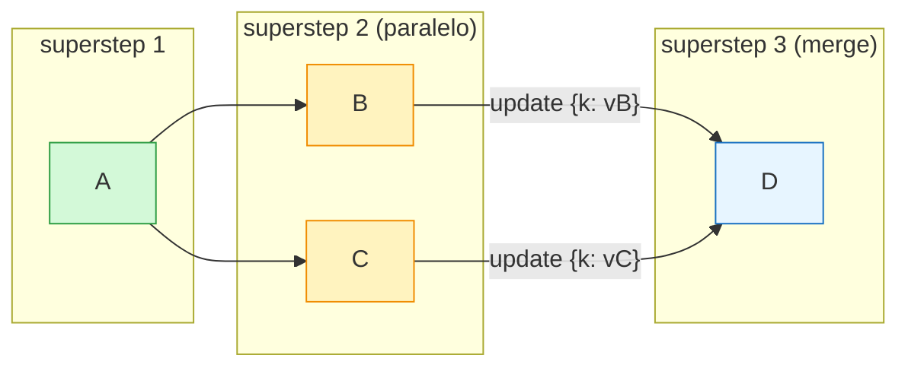

Última modificación: 2026-10-11 | Creado: 2026-10-11

# 01 — Grafos y estado

> Índice: [README](README-20261011.md) · Siguiente: [02 — Reducers](02-reducers-20261011.md)

---

## 1. Qué es y para qué

LangGraph modela un programa como un **grafo dirigido**:

- **Nodos**: unidades de trabajo. Una función (o un callable) que lee el estado y
  devuelve una actualización parcial.
- **Aristas**: transiciones. Dicen qué nodo se ejecuta después.
- **Estado**: un objeto compartido que los nodos leen y escriben parcialmente.
- **`START`** y **`END`**: los dos nodos virtuales que marcan la entrada y la salida.

La diferencia frente a encadenar funciones a mano no es estética. Un grafo aporta:

1. **Estado explícito y tipado** que fluye entre pasos (no variables sueltas).
2. **Ejecución en paralelo** de nodos independientes en un mismo *superstep*.
3. **Persistencia** del estado (checkpoints) para reanudar, inspeccionar y depurar.
4. **Observabilidad**: cada nodo es una unidad trazable.

Piensa en un grafo de LangGraph como una **máquina de estados**: el estado es el
"estado de la máquina", los nodos son las transiciones, y las aristas deciden el
siguiente paso.



Lo importante del dibujo: **los nodos no se pasan datos entre sí**. Cada uno lee del
estado común y escribe su cambio parcial; la "comunicación" es siempre a través de él.

---

## 2. API de LangGraph

```python
from langgraph.graph import StateGraph, START, END
from typing import TypedDict

class MyState(TypedDict):
    ...

builder = StateGraph(MyState)          # 1. declaras el esquema de estado
builder.add_node("nombre", funcion)    # 2. registras nodos
builder.add_edge(START, "nombre")      # 3. declaras transiciones
builder.add_edge("nombre", END)
grafo = builder.compile()              # 4. compilas -> CompiledStateGraph
resultado = grafo.invoke({"campo": valor})
```

El flujo "declarativo → ejecutable":



Puntos finos de la API:

- `add_node(name, action)`: `name` es el identificador; `action` es cualquier callable
  `(state) -> dict` (o `(state) -> None`).
- `compile(...)` devuelve un `CompiledStateGraph`, que es lo que se invoca. Acepta
  `checkpointer`, `store`, `cache`, `interrupt_before`/`interrupt_after`, `name`…
- Se **compila una vez** y se reutiliza. Enhorabuena: ya estás usando el patrón
  *builder*.

---

## 3. Ejemplo mínimo

Tres nodos en línea, un contador que se va incrementando:

```python
from typing import TypedDict
from langgraph.graph import StateGraph, START, END


class State(TypedDict):
    n: int
    trace: list[str]


def paso_a(state: State) -> dict:
    return {"n": state["n"] + 1, "trace": [*state["trace"], "a"]}


def paso_b(state: State) -> dict:
    return {"n": state["n"] * 10, "trace": [*state["trace"], "b"]}


builder = StateGraph(State)
builder.add_node("a", paso_a)
builder.add_node("b", paso_b)
builder.add_edge(START, "a")
builder.add_edge("a", "b")
builder.add_edge("b", END)

grafo = builder.compile()
print(grafo.invoke({"n": 1, "trace": []}))
# {'n': 20, 'trace': ['a', 'b']}
```

Cómo evoluciona el estado paso a paso (nótese el `n` que va mutando):



Observa que:

- El input es un **estado inicial parcial**; LangGraph lo fusiona con el esquema.
- Cada nodo devuelve **solo las claves que cambia** (actualización parcial).
- El `trace` lo construye cada nodo a mano porque aún no hemos hablado de reducers
  (módulo 02). Con un reducer, el nodo solo devolvería `{"trace": ["a"]}`.

> **Ejercicio de calentamiento.** Cambia el nombre de un nodo en `add_edge` por uno
> que no existe y compila. Verás que LangGraph valida la topología en `compile()`, no
> en `invoke()`: el error salta pronto. Ese es el primer motivo por el que "grafo" vale
> más que "cadena de `if`s".

---

## 4. Matices y avanzado

### 4.1 El esquema de estado: `TypedDict` y `total=False`

Lo habitual es declarar el estado como `TypedDict`. Con `total=False` todas las claves
son opcionales, lo que permite pasar estados iniciales parciales:

```python
class ReviewState(TypedDict, total=False):
    request: ReviewRequest
    findings: list[Finding]
    ...
```

Con `total=True` (por defecto) LangGraph exigiría todas las claves presentes en la
entrada. En un grafo "de pipeline" casi siempre quieres `total=False`.

LangGraph también acepta una **clase Pydantic** como esquema o un **dataclass**. El
`TypedDict` es el más ligero y el que mejor combina con "actualizaciones parciales".

### 4.2 Nodos: qué pueden devolver

- Un `dict` con las claves a actualizar (lo normal).
- `None` (o `{}`): no actualiza nada. Útil para nodos que solo tienen efectos
  externos (publicar, notificar).
- Una lista de `Send` (solo si es el nodo de origen de una arista condicional — ver
  módulo 3).
- Un objeto `Command` (ver módulos 5 y 6), que además de actualizar decide el
  siguiente nodo.

### 4.3 Nodos virtuales `START` / `END`

- `START` es la entrada: `add_edge(START, "primer_nodo")`.
- `END` es la salida: cuando un nodo apunta a `END`, esa rama termina.
- Puedes tener **varias aristas a `END`** y varias salidas desde `START`. Un grafo con
  varias ramas que acaban todas en `END` es totalmente normal.

### 4.4 Estados de entrada y salida distintos (`input_schema` / `output_schema`)

A veces no quieres exponer todo el estado:

```python
StateGraph(InternalState, input_schema=Entrada, output_schema=Salida)
```

- `input_schema`: lo que acepta `invoke`.
- `output_schema`: lo que devuelve `invoke`.

Sirve para **ocultar claves internas** (por ejemplo, un campo de trabajo temporal) del
contrato público del grafo. Se cubre con más detalle en el módulo 10.

### 4.5 Supersteps y paralelismo implícito

Si dos nodos son alcanzables en el "mismo turno" (p. ej. dos aristas que salen del
mismo nodo), LangGraph los ejecuta **en paralelo dentro de un superstep** y luego
fusiona sus escrituras. Esto enlaza directamente con los reducers (módulo 02): sin
reducer, dos escrituras simultáneas a la misma clave son un conflicto.



La barrera entre supersteps es **explícita**: `D` no empieza hasta que `B` y `C`
terminan, y por el camino los dos updates han pasado por el reducer de su clave.

### 4.6 `builder` vs `compile`

| Objeto | Cuándo lo usas |
|---|---|
| `StateGraph` (builder) | Para declarar nodos y aristas. No se ejecuta. |
| `CompiledStateGraph` | Resultado de `compile()`. Se invoca (`.invoke`, `.stream`, `.get_state`). |

Separar "declarar" de "compilar" permite: compilar el mismo builder con distintos
checkpointers (tests con memoria, producción con Postgres), y reutilizar el grafo
compilado (el `compile()` es lo caro de construir, no de invocar).

---

## 5. Dónde aparece en `reviews`

`src/reviews/graph/build.py` es el corazón. La construcción del grafo:

```startLine:393:409:src/reviews/graph/build.py
    graph = StateGraph(ReviewState)
    graph.add_node("scope", scope)
    graph.add_node("persona", persona)
    graph.add_node("merge", merge)
    graph.add_node("policy", apply_policy)
    graph.add_node("hitl", hitl)
    graph.add_node("publish", publish)

    graph.add_edge(START, "scope")
    graph.add_conditional_edges("scope", dispatch, ["persona"])
    graph.add_edge("persona", "merge")
    graph.add_edge("merge", "policy")
    graph.add_edge("policy", "hitl")
    graph.add_edge("hitl", "publish")
    graph.add_edge("publish", END)

    return graph
```

Y el esquema, en `src/reviews/graph/build.py`:

```startLine:59:79:src/reviews/graph/build.py
class ReviewState(TypedDict, total=False):
    request: ReviewRequest
    diff: str
    # Persona asignada a esta rama del fan-out (la escribe cada `Send`).
    reviewer: str
    # Las personas escriben aqui en paralelo; el reducer acumula.
    findings: Annotated[list[Finding], operator.add]
    # Estado de las fuentes estaticas por reviewer. Sin reducer: se sustituye, y
    # cada rama solo escribe el suyo (el fan-out escribe dicts sobre claves
    # distintas). Las claves ausentes se tratan como PRESENT.
    source_status: Annotated[dict[str, ToolingSourceStatus], _merge_status]
    # Resultado del merge: sin reducer, se sustituye (no se acumula).
    merged: list[Finding]
    # Juicio de la politica sobre cada hallazgo mergeado. Sin reducer.
    # `pending_approvals` no vive aqui: es derivado de decisions.
    decisions: list[Decision]
    # HITL (Fase 2): decision humana. La escribe `hitl` al reanudar; sin ella, si
    # hay pendientes, el grafo pausa antes de publicar.
    human_decisions: HitlDecision | None
```

La **compilación** con checkpointer, en `src/reviews/worker/main.py`:

```startLine:155:162:src/reviews/worker/main.py
    saver = checkpointer or build_checkpointer(settings.database_url)
    graph = build_graph(
        vcs=vcs,
        reviewers=reviewers,
        policy=policy,
        chat=chat,
        scope_ignore=settings.scope_ignore,
    )
    return graph.compile(checkpointer=saver)
```

Y el tipo del grafo compilado que consume el worker:

```startLine:40:41:src/reviews/worker/main.py
# Grafo de review ya compilado (lo que consume el worker).
ReviewGraph = CompiledStateGraph[ReviewState]
```

### Detalles que merece la pena notar

- El `builder` (aquí `graph`) se devuelve **sin compilar** desde `build_graph`, y es
  `build_runtime` quien llama a `graph.compile(checkpointer=saver)`. De este modo los
  tests pueden compilar el mismo grafo **sin** checkpointer (ver `tests/test_graph.py`)
  y producción **con** Postgres. Es exactamente la separación del §4.6.
- `dispatch` (el nodo que hace fan-out) **no se registra con `add_node`**: aparece solo
  como la función de la arista condicional, no como nodo ejecutable. Es un patrón
  común y volveremos a él en el módulo 03.

---

## 6. Experimento propuesto

1. Abre `src/reviews/graph/build.py`, comenta `graph.add_node("hitl", hitl)` y su
   arista `policy -> hitl`, y conecta `policy -> publish`. Ejecuta un test:
   `make test` (o `.venv/bin/pytest tests/test_graph.py -q`). Observa que la mayoría
   siguen pasando: el grafo simplemente tiene otra topología.
2. Ahora rompe un nombre: `graph.add_edge("policy", "hitl_typo")`. Verás que el error
   salta en `compile()`, no en `invoke()`. Esto explica por qué el proyecto construye
   el grafo en el arranque (fallo ruidoso y temprano).
3. Imprime el "dibujo" del grafo compilado:
   ```python
   print(grafo.get_graph().draw_mermaid())   # siempre disponible
   # print(grafo.get_graph().draw_ascii())   # requiere `pip install grandalf`
   ```
   `draw_mermaid()` no necesita dependencias extra; `draw_ascii()` es más cómodo en
   terminal pero exige el paquete opcional `grandalf`. Ambos sirven para verificar la
   topología sin dibujar nada a mano.

---

> Siguiente: [02 — Reducers y contratos de estado](02-reducers-20261011.md)
