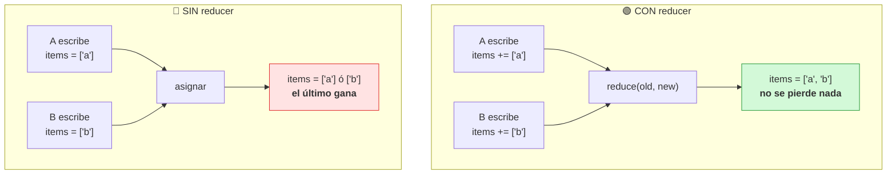
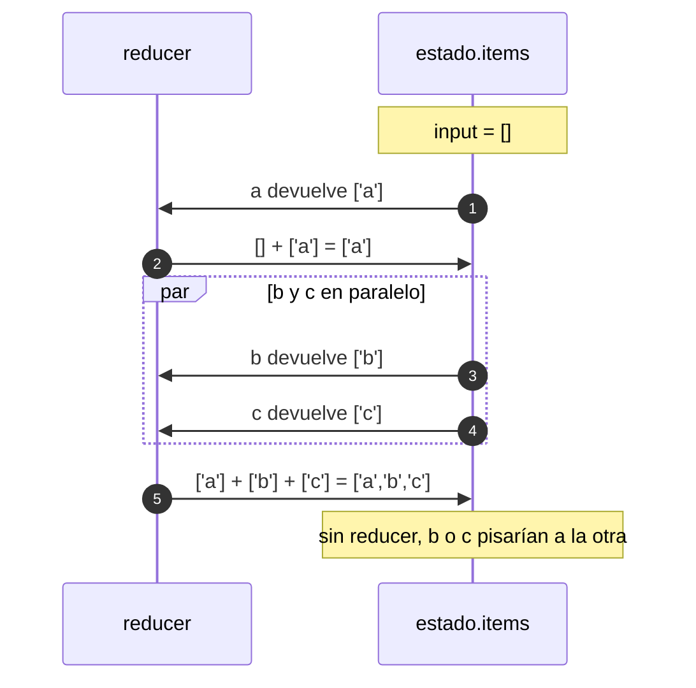
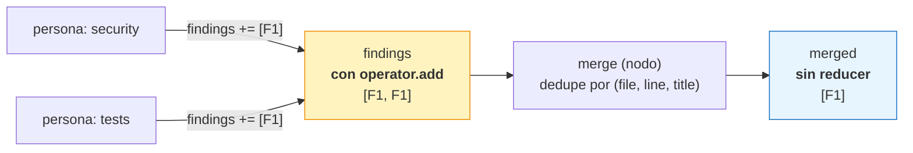

Última modificación: 2026-10-11 | Creado: 2026-10-11

# 02 — Reducers y contratos de estado

> Índice: [README](README.md) · Anterior: [01](01-grafos-y-estado.md) · Siguiente: [03](03-ramificacion-y-fan-out.md)

---

## 1. Qué es y para qué

Un **reducer** (reductor) es la función que decide **cómo se combinan** el valor actual
de una clave del estado con un valor nuevo propuesto por un nodo.

¿Por qué hacen falta? Porque LangGraph puede ejecutar **varios nodos a la vez**
(fan-out, aristas paralelas) y todos pueden escribir en el **mismo** estado. Cuando
llegan varias escrituras de la misma clave en el mismo superstep, hace falta una regla:
¿se quedan todas, gana la última, se suman…?

- **Sin reducer**: la clave se **sustituye** por el valor nuevo. Si dos nodos escriben
  a la vez sin reducer, LangGraph lanza un error de escritura concurrente.
- **Con reducer**: las escrituras se **fusionan** aplicando la función.



La forma de declarar un reducer es `Annotated`:

```python
from typing import Annotated
import operator

class State(TypedDict):
    findings: Annotated[list[Finding], operator.add]   # reducer: concatena
    merged: list[Finding]                              # sin reducer: sustituye
```

El segundo argumento de `Annotated` es la función reductora. `operator.add` es el
reducer más común: **listas que se acumulan**.

---

## 2. API de LangGraph

- Se declara en el **esquema de estado**: `Annotated[tipo, reducer]`.
- El reducer recibe `(izquierda, derecha)` y devuelve el valor combinado. `izquierda`
  es el valor ya acumulado (o `None`/vacío si es la primera escritura) y `derecha` el
  valor nuevo.
- **Sin `Annotated` no hay reducer**: cualquier clave "pelada" se comporta como
  "asignar" (`Overwrite`).
- Cuando LangGraph fusiona el estado inicial con los updates de cada superstep, usa el
  reducer de cada clave para resolver el merge.

---

## 3. Ejemplo mínimo

Tres nodos que escriben en la misma lista con un reducer, frente a la misma situación
sin reducer:

```python
from typing import Annotated, TypedDict
import operator
from langgraph.graph import StateGraph, START, END


class ConReducer(TypedDict):
    items: Annotated[list[str], operator.add]


class SinReducer(TypedDict):
    items: list[str]


def a(state):
    return {"items": ["a"]}


def b(state):
    return {"items": ["b"]}


def c(state):
    return {"items": ["c"]}


def build(schema):
    g = StateGraph(schema)
    for name, fn in [("a", a), ("b", b), ("c", c)]:
        g.add_node(name, fn)
    g.add_edge(START, "a")
    g.add_edge("a", "b")
    g.add_edge("a", "c")   # b y c corren en paralelo
    g.add_edge("b", END)
    g.add_edge("c", END)
    return g.compile()


print("Con reducer:", build(ConReducer).invoke({"items": []}))
# Con reducer: {'items': ['a', 'b', 'c']}  (b y c se fusionan)

print("Sin reducer:", build(SinReducer).invoke({"items": []}))
# Puede quedarse con uno solo (['a','c'] o ['a','b']) segun quien escriba el
# ultimo: una escritura pisa a la otra. Es "last write wins".
```

Con el reducer, el orden de `b` y `c` puede variar (concurrencia), pero **ninguno se
pierde**.

La secuencia de este ejemplo, con el superstep de `b` y `c` en paralelo:



---

## 4. Matices y avanzado

### 4.1 `operator.add` no siempre sirve: **additivo** ≠ correcto

En el ejemplo, `operator.add` concatena listas. Pero "concatenar" el estado inicial con
el nuevo puede dar sorpresas. Piensa en una clave que ya tiene valor en el input:

```python
grafo.invoke({"items": ["semilla"]})
# -> {'items': ['semilla', 'a', 'b', 'c']}
```

El estado **inicial** también pasa por el reducer cuando el primer nodo escribe. Si
quieres "resetear" una lista al empezar, inicialízala vacía en el input.

### 4.2 Reducers que también "sustituyen": `dict` merge

No hay que elegir entre "acumular" y "sustituir" para todo. Puedes escribir un reducer
que **fusione** dos diccionarios, manteniendo claves distintas y quedándose con el
valor nuevo en las repetidas:

```python
def merge_status(left, right):
    return {**(left or {}), **(right or {})}
```

Con esto, dos ramas pueden escribir en el **mismo** campo `source_status` siempre que
usen **claves distintas** del diccionario (`{"security": ...}` y `{"tests": ...}`), sin
pisarse.

### 4.3 Escrituras concurrentes sin reducer

Si dos nodos que corren a la vez escriben la **misma** clave sin reducer, LangGraph no
puede decidir y **falla** con un error de tipo
`InvalidUpdateError: At key 'x': Can receive only one value per step`. Es un error
frecuente y la respuesta casi siempre es "me falta un reducer".

### 4.4 `Overwrite` explícito

Si en un momento puntual quieres **ignorar** el reducer y reemplazar el valor de una
clave (aunque tenga reducer), devuelve el valor envuelto en `Overwrite`:

```python
from langgraph.types import Overwrite

def reset(state):
    return {"items": Overwrite([])}   # ignora operator.add
```

Útil para "vaciar" un acumulador a mitad de grafo.

### 4.5 Reducers que "sustituyen" de verdad

A veces quieres lo contrario de acumular: el resultado de un merge debe **reemplazar**
lo anterior, no sumarse. Escribir el valor sin `Annotated` ya lo hace. La clave es que
los dos campos convivan en el mismo estado con contratos distintos:

| Campo | Reducer | Semántica |
|---|---|---|
| `findings` | `operator.add` | Acumula lo que dijeron las ramas en paralelo. |
| `merged` | — | Sustituye: es el resultado ya deduplicado. |



Si `merged` compartiera el reducer de `findings`, el resultado del merge **se
reacumularía** sobre los hallazgos crudos y cada hallazgo aparecería duplicado. Este es
el error clásico del map-reduce.

### 4.6 El reducer se aplica en **cada** superstep

No es una pasada única al final. Cada vez que un nodo escribe, el update se fusiona.
Por eso un nodo que corre dos veces (re-intento, reanudación) puede aportar al acumulador
**dos veces** si no es idempotente. De ahí la importancia del módulo 07 (idempotencia):
el reducer garantiza que **no se pierde** una escritura, pero **no** que no se repita.

### 4.7 Un reducer no valida: combina

El reducer no sustituye a la validación del contrato. Si necesitas que el estado siempre
cumpla una invariante (p. ej. "no hay hallazgos sin decisión"), eso se comprueba en un
nodo explícito (en `reviews` es `ReviewIntegrityError`) o en el propio modelo Pydantic,
no en el reducer.

---

## 5. Dónde aparece en `reviews`

En `src/agent_review/graph/build.py`, la distinción acumular/sustituir es deliberada y está
comentada:

```startLine:63:79:src/agent_review/graph/build.py
    # Persona asignada a esta rama del fan-out (la escribe cada `Send`).
    reviewer: str
    # Las personas escriben aqui en paralelo; el reducer acumula.
    findings: Annotated[list[Finding], operator.add]
    # Estado de las fuentes estaticas por reviewer. Sin reducer: se sustituye, y
    # cada rama solo escribe el suyo (el fan-out escribe dicts sobre claves
    # distintas). Las claves ausentes se tratan como PRESENT.
    source_status: Annotated[dict[str, ToolingSourceStatus], _merge_status]
    # Resultado del merge: sin reducer, se sustituye (no se acumula).
    merged: list[Finding]
    # Juicio de la politica sobre cada hallazgo mergeado. Sin reducer.
    # `pending_approvals` no vive aqui: es derivado de decisions.
    decisions: list[Decision]
    # HITL (Fase 2): decision humana. La escribe `hitl` al reanudar; sin ella, si
    # hay pendientes, el grafo pausa antes de publicar.
    human_decisions: HitlDecision | None
```

El reducer `_merge_status` (un merge de diccionarios, §4.2):

```startLine:80:84:src/agent_review/graph/build.py
def _merge_status(
    left: dict[str, ToolingSourceStatus] | None,
    right: dict[str, ToolingSourceStatus] | None,
) -> dict[str, ToolingSourceStatus]:
    return {**(left or {}), **(right or {})}
```

Y la prueba del comportamiento está en `tests/test_graph.py`:

```startLine:122:141:tests/test_graph.py
def test_grafo_de_duplica_hallazgos_de_dos_personas() -> None:
    vcs = FakeVcs(anchors={"tests/FooTest.php": InlineAnchor(path="tests/FooTest.php", line=3)})
    reviewers: list[ReviewerPort] = [
        StaticReviewer("correctness", [make_finding()]),
        StaticReviewer("tests", [make_finding()]),
    ]
    policy = PolicyEngine.from_file("config/autonomy.yaml")
    graph = build_graph(vcs=vcs, reviewers=reviewers, policy=policy).compile()

    result = graph.invoke(
        {
            "request": {"repo": "cqm/emotivoo-v2", "pr_id": 7, "head_sha": "abc"},
            "findings": [],
        }
    )

    outcome = outcome_from_state(result)
    assert len(outcome.findings) == 1, "el merge debe deduplicar"
```

Fíjate en la segunda persona: `StaticReviewer("tests", ...)` devuelve el **mismo**
hallazgo (mismo `(file, line, title)`). El reducer `operator.add` hace que `findings` tenga
**dos** entradas, y es el nodo `merge` el que deduplica por `(file, line, title)` hasta
dejar una. Es decir: **el reducer acumula, el nodo de dominio depura.** No son lo mismo
y por eso viven en sitios distintos.

El estado inicial siempre arranca `findings` vacío — se ve en cada `graph.invoke`:

```python
graph.invoke({"request": request, "findings": []}, config=config)
```

Ese `"findings": []` es deliberado: si no se sembrara, la primera escritura de una rama
se fusionaría con un valor inicial `None` y `operator.add` fallaría.

---

## 6. Experimento propuesto

1. **Rompe el reducer.** En `build.py`, quita `Annotated[...]` de `findings` y deja
   `findings: list[Finding]`. Ejecuta el test de fan-out:
   ```bash
   .venv/bin/pytest tests/test_graph.py::test_grafo_de_duplica_hallazgos_de_dos_personas -q
   ```
   Deberías ver un `InvalidUpdateError` por escritura concurrente. Es la mejor forma de
   "sentir" para qué sirve un reducer.
2. **Obliga a que se acumule `merged`.** Añade `Annotated[list[Finding], operator.add]`
   a `merged` y observa el test: aparecerán duplicados aunque el merge deduplique. Es
   el patrón map-reduce mal hecho.
3. **Escribe tu propio reducer.** Sustituye `operator.add` por una función que
   deduplique al vuelo por id de hallazgo:
   ```python
   def _dedupe_add(left, right):
       seen = {f.id: f for f in (left or [])}
       for f in right or []:
           seen[f.id] = f
       return list(seen.values())
   ```
   Y razona: ¿debería la deduplicación vivir en el reducer o en un nodo? (Pista: en un
   nodo, porque es una regla de negocio, y el ejemplo del repo la pone en `merge`.)

---

> Siguiente: [03 — Ramificación y fan-out](03-ramificacion-y-fan-out.md)
