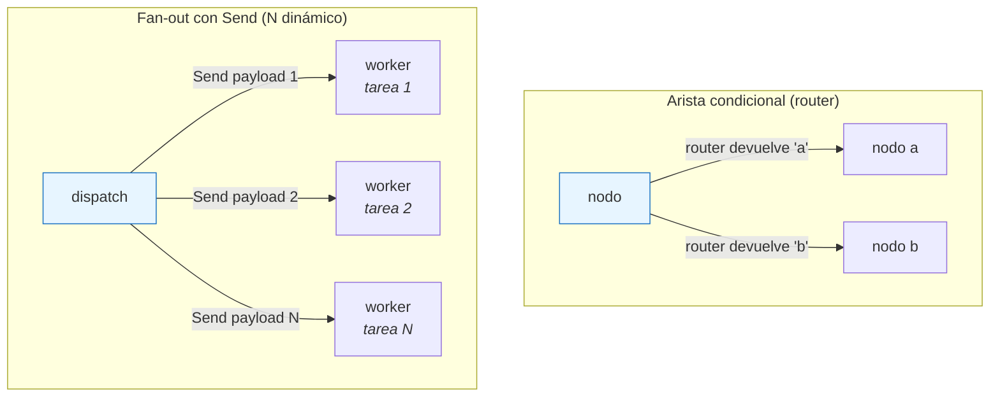
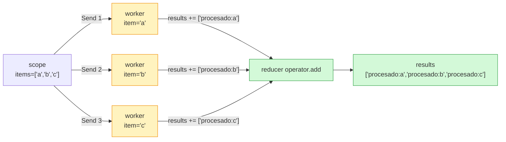
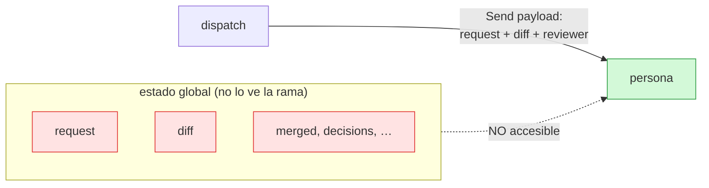
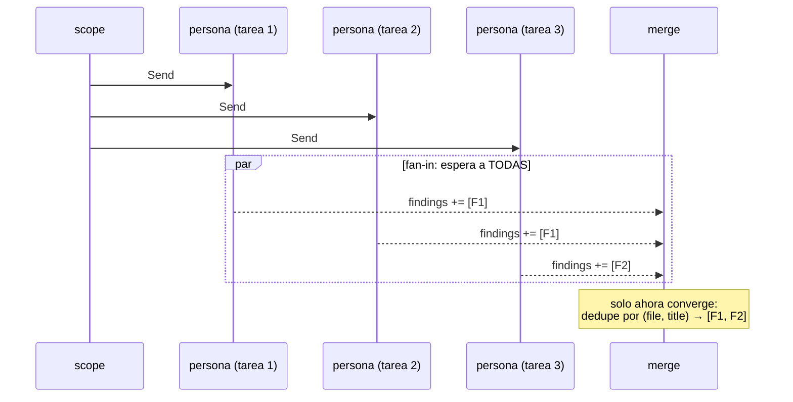

Última modificación: 2026-10-11 | Creado: 2026-10-11

# 03 — Ramificación y fan-out

> Índice: [README](README-20261011.md) · Anterior: [02](02-reducers-20261011.md) · Siguiente: [04](04-durabilidad-y-checkpoints-20261011.md)

---

## 1. Qué es y para qué

Hasta ahora las aristas eran fijas: `a -> b` siempre. Un grafo real necesita **decidir**
y **paralelizar**. LangGraph cubre las dos cosas con:

- **Aristas condicionales** (`add_conditional_edges`): el siguiente nodo depende del
  estado. Es un `if`/`switch` que vive **en la topología**, no dentro de un nodo.
- **Fan-out con `Send`**: en lugar de llevar el mismo estado a N ramas, se envían N
  "paquetes" con destino y **estado propio** a la misma función. Es el mecanismo del
  patrón **map-reduce**.

La razón de fondo para usar `Send` en vez de simplemente dibujar N aristas paralelas es
que `Send` permite **N dinámico** (uno por cada elemento de una lista) y **pasar un
estado distinto a cada rama** (p. ej. "tú eres la persona `security`").



El router **elige una** (o varias) ramas estáticas; `Send` **crea N tareas** del mismo
nodo, con un estado inicial distinto cada una.

---

## 2. API de LangGraph

### 2.1 Aristas condicionales

```python
builder.add_conditional_edges(
    "origen",                 # nodo del que sale la decisión
    funcion_router,           # (state) -> nombre_de_nodo | lista_de_nombres
    ["nodo_a", "nodo_b"],     # destinos posibles (opcional, para validación/dibujo)
)
```

- `funcion_router` devuelve el **nombre del siguiente nodo** (string), una lista de
  nombres (se ejecutan todos), o valores que se mapean con `path_map`.
- El tercer argumento (`path_map` como lista o dict) es opcional pero recomendable:
  LangGraph valida en `compile()` que los destinos devueltos existan, y `draw_ascii()`
  los muestra.

### 2.2 `Send` (fan-out dinámico)

```python
from langgraph.types import Send

def dispatch(state) -> list[Send]:
    return [Send("worker", {"item": x}) for x in state["items"]]
```

Firma en la versión instalada `langgraph` 1.2.14 (verificado):

```
Send(node: str, arg: Any, *, timeout: ... = None)
```

- `node`: el nodo de destino (una **función**, no un "super-nodo" distinto por rama).
- `arg`: el estado **inicial de esa rama concreta**.
- `Send` **solo** puede devolverse desde la función de una arista condicional (o desde
  un nodo que devuelve `Command(goto=...)`).

---

## 3. Ejemplo mínimo

### 3.1 Rama condicional simple

```python
from typing import TypedDict
from langgraph.graph import StateGraph, START, END


class State(TypedDict):
    n: int


def router(state: State) -> str:
    return "grande" if state["n"] > 10 else "pequeno"


def grande(state):  return {"n": state["n"] * 2}
def pequeno(state): return {"n": state["n"] + 1}


g = StateGraph(State)
g.add_node("grande", grande)
g.add_node("pequeno", pequeno)
g.add_edge(START, "router_placeholder")   # ver nota
# LangGraph no ejecuta una funcion-router como nodo: se conecta desde un nodo real.
```

**Cuidado con el error más común:** el router **no es un nodo**. `add_conditional_edges`
se engancha **a la salida de un nodo existente**. Si quieres un "nodo decisor" puro,
convención habitual: un nodo que no cambia el estado (`return {}`) y del que sale la
arista condicional. Ejemplo coherente:

```python
def entrada(state): return {}         # nodo trivial
def router(state):  return "grande" if state["n"] > 10 else "pequeno"

g = StateGraph(State)
g.add_node("entrada", entrada)
g.add_node("grande", grande)
g.add_node("pequeno", pequeno)
g.add_edge(START, "entrada")
g.add_conditional_edges("entrada", router, ["grande", "pequeno"])
g.add_edge("grande", END)
g.add_edge("pequeno", END)
print(g.compile().invoke({"n": 50}))   # {'n': 100}
```

### 3.2 Fan-out con `Send`

```python
from typing import TypedDict, Annotated
import operator
from langgraph.graph import StateGraph, START, END
from langgraph.types import Send


class State(TypedDict, total=False):
    items: list[str]
    item: str                                     # lo escribe cada Send
    results: Annotated[list[str], operator.add]   # acumula el fan-in


def scope(state):
    return {"items": ["a", "b", "c"], "results": []}


def dispatch(state) -> list[Send]:
    return [Send("worker", {"item": item}) for item in state["items"]]


def worker(state):
    return {"results": [f"procesado:{state['item']}"]}


g = StateGraph(State)
g.add_node("scope", scope)
g.add_node("worker", worker)
g.add_edge(START, "scope")
g.add_conditional_edges("scope", dispatch, ["worker"])
g.add_edge("worker", END)

print(g.compile().invoke({}))
# {'items': [...], 'results': ['procesado:a', 'procesado:b', 'procesado:c']}
```

Tres ramas de `worker`, cada una con `{"item": ...}` distinto, y el reducer
`operator.add` junta los resultados. Ese es el **map-reduce** de LangGraph.



---

## 4. Matices y avanzado

### 4.1 La rama de un `Send` **solo ve su propio estado**

Verificado en 1.2.14: si haces `Send("worker", {"item": "x"})`, el nodo `worker` **no**
ve el resto del estado global (por ejemplo una clave `diff` que sí estaba en `scope`).
Recibe exactamente el `arg` del `Send`.

> Esto es una fuente clásica de `KeyError`. La convención es **pasar por `Send` todo lo
> que la rama necesita**. En `reviews`, `dispatch` pasa `request`, `diff` y `reviewer`
> juntos:



Por eso `dispatch` copia explícitamente `request` y `diff` en el `arg` de cada `Send`.

```startLine:159:168:src/reviews/graph/build.py
    def dispatch(state: ReviewState) -> list[Send]:
        """Fan-out: una rama por persona, sobre el mismo diff."""
        request = ReviewRequest.model_validate(state["request"])
        return [
            Send(
                "persona",
                {"request": request, "diff": state["diff"], "reviewer": reviewer.name},
            )
            for reviewer in reviewers
        ]
```

### 4.2 El "fan-in" no coincide con el nombre del nodo

Fíjate en que `dispatch` envía todos los `Send` al nodo `"persona"`, y sin embargo hay
**una sola** arista `persona -> merge`. LangGraph espera **a que terminen todas** las
ramas de `persona` antes de ejecutar `merge`. Ese es el fan-in implícito: converge por
que la arista de salida es común.

**Aviso importante:** `Send` con el **mismo `node`** repetido no crea nodos distintos;
crea **tareas** distintas del mismo nodo. Si escribes a la misma clave del estado en dos
ramas **sin reducer**, obtienes el `InvalidUpdateError` del módulo 02.



### 4.3 Estados "de rama" frente a estado estable

Un patrón limpio: distinguir en el esquema las claves **de rama** (las que solo usa el
nodo de fan-out, como `reviewer` o `item`) de las claves **estables** (las que persisten
tras el merge). LangGraph no lo impone; es una decisión de diseño. En `reviews`,
`reviewer` es la clave de rama y `findings` la estable.

### 4.4 `Command(goto=...)` como alternativa a las aristas condicionales

Un nodo puede decidir el siguiente paso devolviendo `Command` en vez de usar una arista
condicional:

```python
from langgraph.types import Command

def decision(state):
    if state["ok"]:
        return Command(goto="publicar")
    return Command(goto="escalar", update={"motivo": "fallo"})
```

`Command` combina **actualizar estado** y **elegir destino** en el mismo retorno. Es
más expresivo cuando la decisión "pertenece" a un nodo; las aristas condicionales son
mejores cuando quieres mantener la lógica de topología separada y dibujable. Veremos
`Command` a fondo en los módulos 05 y 06.

### 4.5 Listas en la arista condicional

El router puede devolver **una lista** de nombres de nodo: se ejecutan todos. Es la
alternativa "estática" al `Send` dinámico (útil cuando conoces los destinos de antemano
y no necesitas estado por rama).

### 4.6 Map-reduce: dónde va la reducción

La tentación es reducir dentro de cada `worker`. Es un error de diseño: cada `worker`
no sabe de los demás. La reducción va en **un nodo aguas abajo** (aquí `merge`) que se
ejecuta **después** del fan-in. Ventaja: si mañana añades una persona, no tocas la
lógica de reducción.

---

## 5. Dónde aparece en `reviews`

- **Router del fan-out**: `dispatch` en `src/reviews/graph/build.py:159` (arriba).
- **Nodo de fan-out**: `persona`, que resuelve su persona por el campo de rama
  `reviewer`:

```startLine:171:186:src/reviews/graph/build.py
    def persona(state: ReviewState) -> ReviewState:
        name = state["reviewer"]
        reviewer = next((r for r in reviewers if r.name == name), None)
        if reviewer is None:
            return {"findings": []}
        request = ReviewRequest.model_validate(state["request"])
        result = reviewer.review(
            repo=request.repo,
            pr_id=request.pr_id,
            diff=state["diff"],
            head_sha=request.head_sha,
        )
        update: ReviewState = {"findings": result.findings}
        if result.tooling_status is not None:
            update["source_status"] = {reviewer.name: result.tooling_status}
        return update
```

- **Fan-in (reducción)**: `merge`, que deduplica por `(fichero, título)`:

```startLine:188:199:src/reviews/graph/build.py
    def merge(state: ReviewState) -> ReviewState:
        """Deduplica por (fichero, titulo) y conserva la evidencia mas rica."""
        seen: dict[tuple[str, str], Finding] = {}
        for finding in state.get("findings", []):
            key = _merge_key(finding)
            current = seen.get(key)
            if current is None or len(finding.evidence) > len(current.evidence):
                seen[key] = finding
        merged = list(seen.values())
        deduped = len(state.get("findings", [])) - len(merged)
        if deduped:
            logger.info("Merge: %d hallazgos duplicados eliminados", deduped)
        return {"merged": merged}
```

Fíjate en el detalle fino: `persona` escribe `source_status` con **una sola clave**
(`{reviewer.name: ...}`). Por eso el reducer `_merge_status` (§4.2 del módulo 02) puede
fusionar las escrituras de varias personas sin pisarse: cada una toca una clave distinta
del diccionario.

Y el cableado de la arista condicional, en `src/reviews/graph/build.py:405`:

```python
graph.add_conditional_edges("scope", dispatch, ["persona"])
graph.add_edge("persona", "merge")
```

Es decir: `scope` decide cuántas ramas `persona` hay; todas convergen en `merge`.

---

## 6. Experimento propuesto

1. **Comprueba la ceguera de la rama.** En el ejemplo del §3.2, haz que `worker` lea
   `state["items"]` (que no viene en el `Send`). Verás `KeyError`. Moraleja: por `Send`
   se pasa **todo** lo que la rama necesita.
2. **Dos escrituras sin reducer.** Añade dos `Send` al mismo nodo que escriban la misma
   clave sin reducer y observa `InvalidUpdateError`. Después añade el reducer y míralo
   funcionar.
3. **Añade una persona imaginaria** a `reviews` en un test: crea un `StaticReviewer`
   sin nombre duplicado y verifica que su hallazgo aparece (o se deduplica) igual. Es
   la prueba de que añadir ramas no requiere tocar el `merge`.
4. **Dibuja el fan-out.**
   ```python
   print(grafo.get_graph().draw_mermaid())
   ```
   Deberías ver la arista condicional de `scope`, el nodo `persona` y su convergencia
   en `merge`. (`draw_ascii()` da lo mismo en terminal pero necesita `grandalf`.)

---

> Siguiente: [04 — Durabilidad y checkpoints](04-durabilidad-y-checkpoints-20261011.md)
