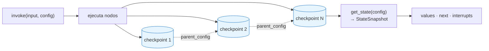
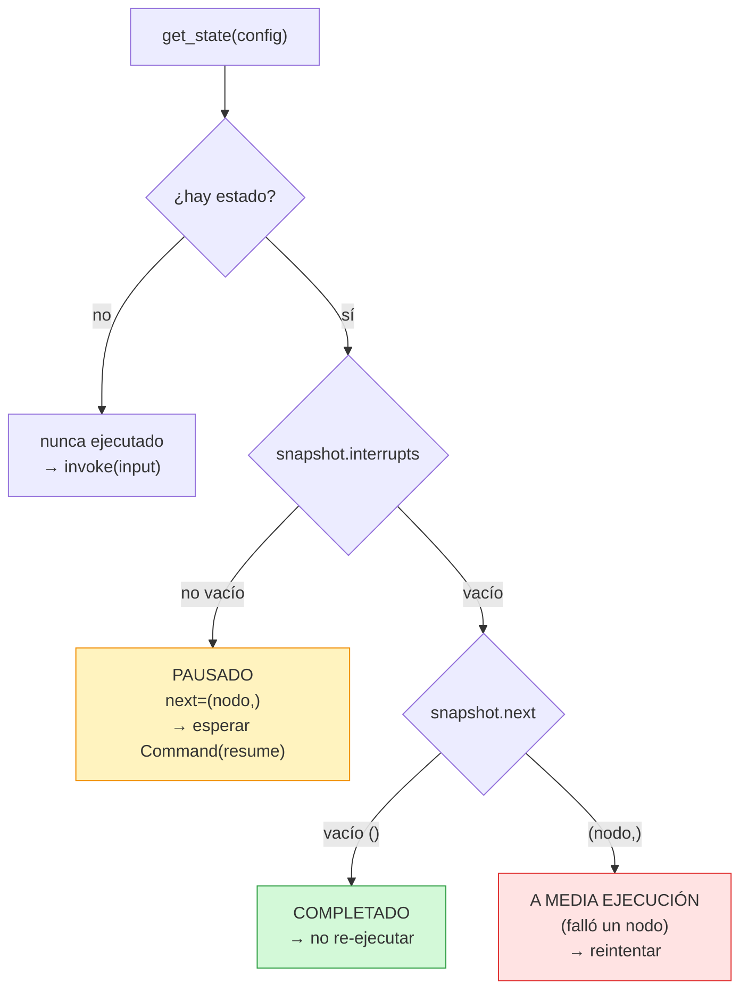
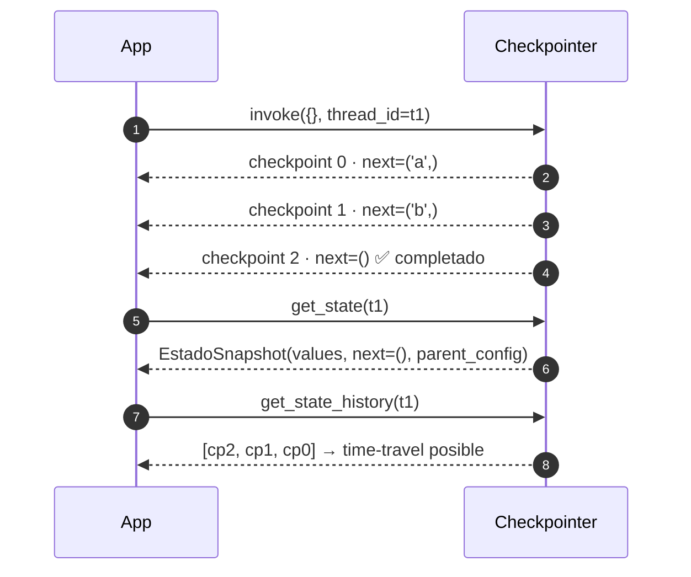

Última modificación: 2026-10-11 | Creado: 2026-10-11

# 04 — Durabilidad y checkpoints

> Índice: [README](README-20261011.md) · Anterior: [03](03-ramificacion-y-fan-out-20261011.md) · Siguiente: [05](05-invocacion-y-reejecucion-20261011.md)

---

## 1. Qué es y para qué

Un **checkpointer** es la pieza que **persiste el estado del grafo** entre pasos,
identificado por un **`thread_id`**. Sin él, cada `invoke` empieza de cero y olvida todo.
Con él, el grafo puede:

- **Reanudarse** tras un reinicio del proceso.
- **Pausar de forma durable** (la base del HITL, módulo 06).
- **Inspeccionarse**: `get_state` devuelve el último snapshot de un hilo.
- **Soportar reintentos idempotentes**: un mismo hilo se puede re-ejecutar sin perder el
  hilo de lo ocurrido.

Modelo mental: el checkpointer es como un **WAL / journal** de una máquina de estados.
Cada superstep deja un checkpoint. Un `thread_id` es la "sesión" (o el "caso") que
agrupa esos checkpoints.



Todos los checkpoints de un mismo `thread_id` forman el **hilo**. `get_state` te da el
último; `get_state_history`, la cadena entera.

> Sin checkpointer, `interrupt` **no funciona**. LangGraph lo exige porque necesita
> guardar dónde se quedó para poder reanudar después.

---

## 2. API de LangGraph

```python
from langgraph.checkpoint.memory import InMemorySaver
from langgraph.checkpoint.postgres import PostgresSaver

saver = InMemorySaver()                     # solo proceso, para tests
grafo = builder.compile(checkpointer=saver)

config = {"configurable": {"thread_id": "mi-hilo"}}
grafo.invoke(input, config)
snapshot = grafo.get_state(config)          # StateSnapshot
```

Implementaciones habituales:

| Backend | Clase | Uso |
|---|---|---|
| Memoria | `langgraph.checkpoint.memory.InMemorySaver` | Tests y ejecución local sin base de datos. |
| SQLite | `langgraph.checkpoint.sqlite.SqliteSaver` | Prototipos persistentes de un solo proceso. |
| Postgres | `langgraph.checkpoint.postgres.PostgresSaver` | Producción (compartido entre procesos). |

`PostgresSaver` necesita una conexión y una llamada `setup()` que **crea las tablas**:

```python
from psycopg import Connection
from psycopg.rows import dict_row

conn = Connection.connect(url, autocommit=True, prepare_threshold=0, row_factory=dict_row)
saver = PostgresSaver(conn)
saver.setup()
```

Objetos que devuelve `get_state` (**`StateSnapshot`**), simplificado:

| Atributo | Significado |
|---|---|
| `values` | El estado actual (el diccionario del grafo). |
| `next` | Tupla con los nodos que **quedan** por ejecutar; vacía si terminó. |
| `config` | El config exacto de ese checkpoint (incluye `thread_id` y `checkpoint_id`). |
| `metadata` | Metadatos del paso (origen, escrituras, etc.). |
| `interrupts` | Interrupciones pendientes (módulo 06). |
| `created_at` | Cuándo se creó el checkpoint. |
| `parent_config` | Checkpoint anterior (permite navegar el historial). |

Cómo se leen esos atributos según el estado del hilo (el diagrama que más se usa para
decidir "¿re-ejecuto o no?"):



---

## 3. Ejemplo mínimo

```python
from typing import TypedDict, Annotated
import operator
from langgraph.graph import StateGraph, START, END
from langgraph.checkpoint.memory import InMemorySaver


class State(TypedDict, total=False):
    pasos: Annotated[list[str], operator.add]


def a(state): return {"pasos": ["a"]}
def b(state): return {"pasos": ["b"]}


g = StateGraph(State)
g.add_node("a", a)
g.add_node("b", b)
g.add_edge(START, "a")
g.add_edge("a", "b")
g.add_edge("b", END)

grafo = g.compile(checkpointer=InMemorySaver())
config = {"configurable": {"thread_id": "t1"}}

print(grafo.invoke({}, config))          # {'pasos': ['a', 'b']}

snap = grafo.get_state(config)
print(snap.values)                       # {'pasos': ['a', 'b']}
print(snap.next)                         # ()  -> terminado

# Historial completo de checkpoints del hilo:
for s in grafo.get_state_history(config):
    print(s.metadata.get("step"), s.next, s.values)
```

Dos detalles de oro de este ejemplo:

1. `snap.next == ()` significa **"este hilo ya terminó"**. Es la señal que usa el
   proyecto para no re-publicar (módulo 05).
2. `get_state_history` permite "viajar al pasado": cada checkpoint tiene
   `parent_config`, así que se puede reanudar desde un punto anterior (time-travel).

La línea temporal de checkpoints de este hilo (cada `invoke` deja el suyo):



---

## 4. Matices y avanzado

### 4.1 El `thread_id` es **tu** clave, no de LangGraph

LangGraph no genera el `thread_id`: se lo das en el `config`. Si dos ejecuciones
distintas comparten `thread_id`, **comparten hilo** (y el estado). En `reviews`, el
`thread_id` es la **clave de ejecución** de la review (`repo:pr:sha:pipeline`), no el
commit: un pipeline nuevo sobre el mismo commit es un **hilo nuevo** a propósito.

### 4.2 ¿Cuándo se crea un checkpoint?

Por defecto, **después de cada superstep** (tras ejecutar los nodos de una tanda).
Existe un parámetro `durability` (ver módulo 10) para relajar esto: `"async"`, `"exit"`,
`"sync"`. Relajarlo mejora el rendimiento pero puede perder trabajo si el proceso muere
a media ejecución.

### 4.3 El **serde** y la allowlist de tipos

El estado puede contener objetos propios (`Finding`, `Decision`, `HitlDecision`…). El
checkpointer los serializa. El serializador por defecto (`JsonPlusSerializer`) usa
`msgpack` **permisivo**: avisa (o en el futuro bloqueará) con tipos no registrados. Es
buena costumbre **declarar la allowlist** de los tipos que viajan por el estado:

```python
from langgraph.checkpoint.serde.jsonplus import JsonPlusSerializer

serde = JsonPlusSerializer(allowed_msgpack_modules=(ReviewRequest, Finding, Decision, ...))
saver = InMemorySaver(serde=serde)
```

Por qué importa:

- **Seguridad**: evita deserializar tipos arbitrarios (superficie de ataque).
- **Determinismo**: impide que "funcione hoy por accidente" y rompa al subir de versión.
- **Errores tempranos**: si un nodo introduce un tipo no declarado, salta al primer
  roundtrip, no en producción a las 3 a.m.

### 4.4 El estado serializado **no** debe contener lo no serializable

El checkpointer guarda **todo** el estado. Si metes una conexión abierta, un socket, un
`File` o un cliente HTTP en el estado, no podrá serializarlo. Regla práctica: en el
estado, **datos**; los recursos (clientes, conexiones), **fuera** (inyectados en los
nodos o vía `context`).

### 4.5 `PostgresSaver.setup()` y las tablas

`setup()` crea las tablas (`checkpoints`, `checkpoint_blobs`, `checkpoint_writes`,
`checkpoint_migrations`). Debe ejecutarse **una vez**. Si en vez de eso usas
`PostgresSaver.from_conn_string(...)` obtienes un context manager que gestiona la
conexión; el proyecto prefiere una **conexión de larga vida** porque el worker es un
proceso único (y así el `saver` se comparte).

### 4.6 Retención y poda

Los checkpoints crecen sin límite. `PostgresSaver` expone `delete_thread` para borrar
hilos. Política razonable: podar hilos **completados** más viejos que N días, **nunca**
uno pausado. En `reviews` la deduplicación vive en las **marcas del PR**, no en el
checkpoint: por eso podar el checkpoint no reabre el problema de "republicar" (buena
separación de responsabilidades).

### 4.7 Checkpointer vs `Store` (memoria de largo plazo)

No confundir:

- **Checkpointer** = estado **de la conversación/ejecución** (corto plazo, por hilo).
- **`Store`** (`InMemoryStore`/`PostgresStore`) = memoria **a través de hilos** (largo
  plazo), para hechos que sobreviven a una ejecución. Se cubre en el módulo 10.

Un agente de review usa el checkpointer para la ejecución; un `Store` le vendría bien
para "recordar" que un hallazgo se rechazó antes (feedback). Es trabajo futuro del repo.

### 4.8 El checkpointer es **pluggable** por diseño

El worker recibe el checkpointer como parámetro (`build_runtime(..., checkpointer=...)`)
y `build_checkpointer` decide Postgres o memoria. Los tests compilan el mismo grafo con
`InMemorySaver`. Esta inversión de dependencia (puerto/adaptador) es lo que hace que el
HITL se pueda probar sin base de datos.

---

## 5. Dónde aparece en `reviews`

La fábrica del checkpointer, `src/agent_review/checkpointer.py`:

```startLine:38:64:src/agent_review/checkpointer.py
def build_serde() -> JsonPlusSerializer:
    return JsonPlusSerializer(allowed_msgpack_modules=_STATE_TYPES)


def build_checkpointer(database_url: str) -> BaseCheckpointSaver[Any]:
    """Checkpointer durable si hay Postgres; en memoria si no (tests/local/CI).

    Nunca lanza: sin base de datos el worker sigue funcionando sin dedupe por
    hilo (la marca de publicacion cubre el resto de casos). El checkpointer
    durable permite reanudar el grafo en Fase 2 (HITL) sin cambios adicionales.
    """
    if not database_url:
        logger.info("Sin DATABASE_URL; checkpointer en memoria (no durable)")
        return InMemorySaver(serde=build_serde())
    try:
        from langgraph.checkpoint.postgres import PostgresSaver
        from psycopg import Connection
        from psycopg.rows import dict_row

        # Conexion dedicada y de larga vida: el worker es un proceso unico.
        conn = Connection.connect(
            database_url, autocommit=True, prepare_threshold=0, row_factory=dict_row
        )
        saver = PostgresSaver(conn, serde=build_serde())
        saver.setup()
        logger.info("Checkpointer Postgres listo")
        return saver
    except Exception:
        logger.exception("No se pudo abrir el checkpointer Postgres; uso memoria")
        return InMemorySaver(serde=build_serde())
```

La allowlist de tipos (`_STATE_TYPES`) es el §4.3:

```startLine:23:35:src/agent_review/checkpointer.py
# Tipos del dominio que viajan por el estado del grafo. Allowlist explicita para
# que el serializer no dependa del msgpack permisivo (que avisa hoy y bloqueara
# los tipos no registrados en versiones futuras).
_STATE_TYPES: tuple[type, ...] = (
    ReviewRequest,
    Finding,
    Decision,
    Severity,
    AutofixClass,
    Owner,
    FindingAction,
    ToolingSourceStatus,
)
```

Y el test que ancla el comportamiento del serde:

```startLine:104:110:tests/test_checkpointer.py
def test_serde_no_depende_del_msgpack_permisivo() -> None:
    # Si el serializer no tuviera allowlist, la deserializacion avisaria. Con la
    # allowlist explicita el roundtrip del estado de dominio es silencioso.
    serde = build_serde()
    request = ReviewRequest(repo="r", pr_id=1, head_sha="abc", pipeline_id="7")
    payload = serde.dumps_typed(request)
    assert serde.loads_typed(payload) == request
```

La identidad del hilo, en `src/agent_review/domain/models.py`:

```startLine:220:229:src/agent_review/domain/models.py
    @property
    def thread_id(self) -> str:
        """Hilo del checkpointer: una review re-ejecutada no duplica comentarios.

        Es la clave de ejecucion (`review_key`), no el commit: un `pipeline_id`
        nuevo sobre el mismo `sha` es una review nueva (intencional), y por eso
        va en el hilo. Repetir la *misma* ejecucion reutiliza el hilo.
        """
        return self.review_key
```

---

## 6. Experimento propuesto

1. **Observa el historial.** Con el ejemplo del §3, imprime `get_state_history` y mira
   cuántos checkpoints hay y en qué `next` queda cada uno. Luego provoca un fallo en el
   nodo `b` y repite: verás un checkpoint intermedio con `next == ('b',)`.
2. **Rompe el serde.** Añade un tipo nuevo al estado (p. ej. un `set` o una clase
   propia) y pasa el grafo con `build_serde()`. Verás un error/aviso de serialización.
   Es exactamente lo que la allowlist pretende hacer visible **en tests**.
3. **Mismo `thread_id`, dos ejecuciones.** Compila el grafo dos veces con el **mismo**
   saver (simulando un reinicio del worker) e invoca con el mismo `config`. Comprueba
   que el segundo ve el estado del primero. Esto es la base del test de durabilidad del
   HITL (los tests de durabilidad de la Fase 2, `tests/test_hitl.py`).
4. **Cambia Postgres por memoria** en `settings.database_url = ""` y ejecuta la suite.
   El proyecto sigue funcionando: la durabilidad es una capacidad adicional, no un
   requisito del pipeline.

---

> Siguiente: [05 — Invocación y semántica de re-ejecución](05-invocacion-y-reejecucion-20261011.md)
