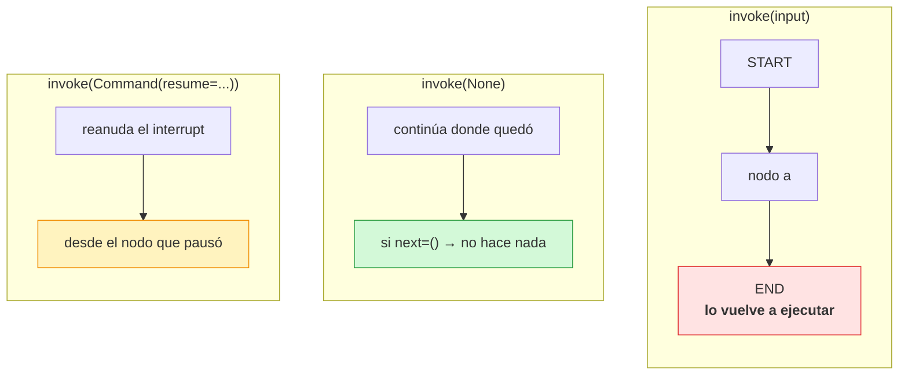
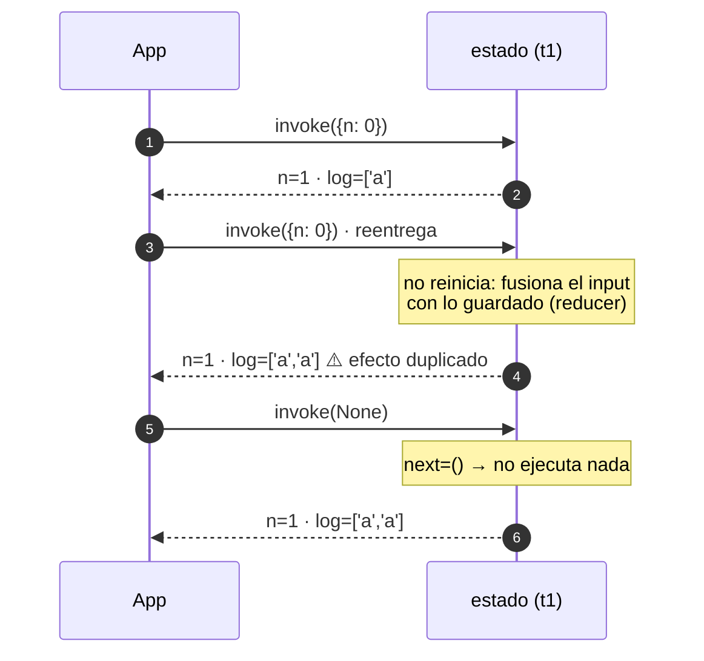
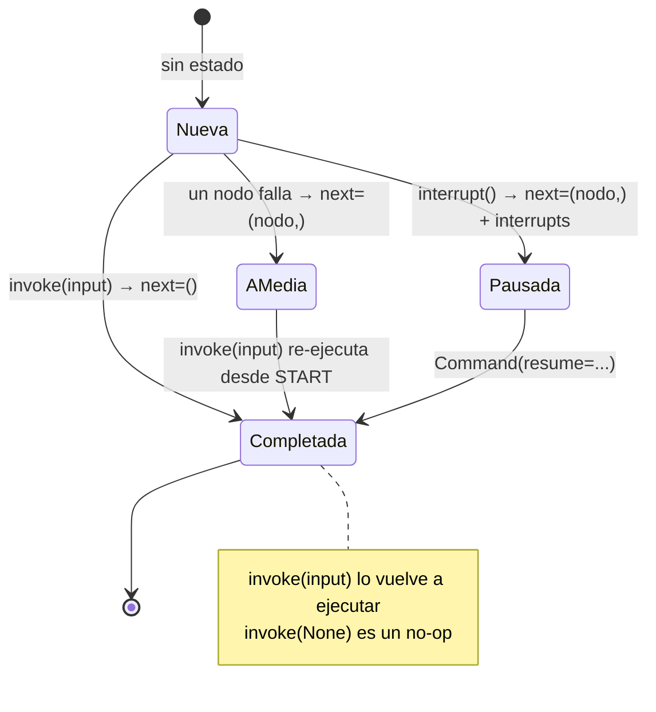
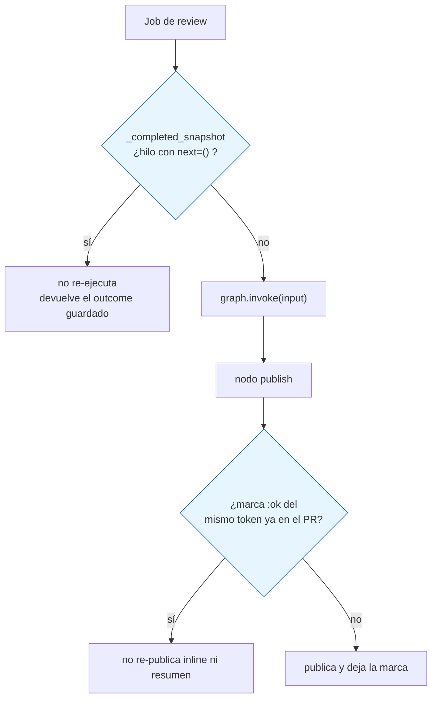

Última modificación: 2026-10-11 | Creado: 2026-10-11

# 05 — Invocación y semántica de re-ejecución

> Índice: [README](README-20261011.md) · Anterior: [04](04-durabilidad-y-checkpoints-20261011.md) · Siguiente: [06](06-hitl-20261011.md)

---

## 1. Qué es y para qué

Este módulo trata una pregunta que parece trivial y no lo es: **¿qué pasa exactamente
cuando llamas dos veces a `invoke` sobre el mismo hilo?**

La respuesta depende de **cómo** llames:

| Llamada | Efecto sobre un hilo existente |
|---|---|
| `invoke(input, config)` | **Re-ejecuta desde `START`** con ese input (fusión + reducers). |
| `invoke(None, config)` | **Continúa** el hilo desde donde quedó; no reinicia. |
| `invoke(Command(...), config)` | Continúa, además con update/resume/goto. |

Entender esto es **crítico** en cualquier sistema con efectos externos (comentarios en un
PR, emails, pagos): re-invocar con input puede **duplicar** el trabajo y los efectos.
Casi todos los bugs "se publicó dos veces" nacen aquí.



---

## 2. API de LangGraph

Métodos principales de un `CompiledStateGraph`:

- `invoke(input, config)`: ejecuta hasta `END` (o hasta una interrupción). Devuelve el
  estado final.
- `stream(input, config, stream_mode=...)`: como `invoke` pero emitido por partes
  (módulo 09).
- `get_state(config)`: último snapshot del hilo.
- `get_state_history(config)`: todos los snapshots.
- `update_state(config, values, as_node=...)`: escribe en el estado **sin** ejecutar
  nodos (inyección manual / "time-travel").
- `bulk_update_state(...)`: varias escrituras a la vez.

El `input` puede ser:

- Un `dict` (estado inicial o parcial).
- `None`: continuar el hilo tal cual.
- Un `Command` (módulo 06): `update`, `goto`, `resume`.

El `config` tiene la forma `{"configurable": {"thread_id": ...}}` y puede llevar más
cosas (`checkpoint_id`, `checkpoint_ns`).

---

## 3. Ejemplo mínimo

Reproduzco aquí el experimento que confirma la semántica. Un grafo de un solo nodo que
incrementa un contador y anota cada ejecución:

```python
from typing import Annotated, TypedDict
import operator
from langgraph.graph import StateGraph, START, END
from langgraph.checkpoint.memory import InMemorySaver


class State(TypedDict, total=False):
    n: int
    log: Annotated[list[str], operator.add]


calls = []


def a(state):
    calls.append("a")
    return {"n": state.get("n", 0) + 1, "log": ["a"]}


g = StateGraph(State)
g.add_node("a", a)
g.add_edge(START, "a")
g.add_edge("a", END)
app = g.compile(checkpointer=InMemorySaver())
cfg = {"configurable": {"thread_id": "t1"}}

print(app.invoke({"n": 0}, cfg))   # {'n': 1, 'log': ['a']}     llamadas: ['a']
print(app.invoke({"n": 0}, cfg))   # {'n': 1, 'log': ['a', 'a']} llamadas: ['a', 'a']
print(app.invoke(None, cfg))       # {'n': 1, 'log': ['a', 'a']} llamadas: [] (no re-ejecuta)
```

Salida verificada con `langgraph` 1.2.14:

```
INVOKE 1: {'n': 1, 'log': ['a']}            calls: ['a']
INVOKE 2 (reentrega): {'n': 1, 'log': ['a', 'a']}  calls: ['a', 'a']
invoke None: {'n': 1, 'log': ['a', 'a']}    calls: []
```

Tres lecciones:

1. El segundo `invoke({...})` **vuelve a correr el nodo `a`**. `log` acumuló **dos**
   veces (reducer `operator.add`). El estado **no** se reinicia a `n=0`; se fusiona el
   input con lo guardado (por eso `n` acabó otra vez en `1`, no en `2`).
2. `invoke(None)` **no** ejecuta nada: el hilo ya estaba en `END`. Sirve para
   "reanudar si hay trabajo pendiente".
3. Si el nodo tuviera un efecto externo (publicar un comentario), la segunda llamada
   lo **duplicaría**. El reducer no evita duplicar efectos: solo evita perder trabajo.

La misma secuencia vista como línea temporal (fíjate: el estado **no** se reinicia a
`n=0`, se fusiona):



---

## 4. Matices y avanzado

### 4.1 Re-ejecutar "desde START" no es "desde cero"

`invoke(input)` **re-ejecuta los nodos**, pero el estado guardado se **fusiona** con el
input (reducers de por medio). No arranca un hilo nuevo, sino que **rehace el recorrido**
sobre el hilo existente. Esto es lo que sorprende: no reinicia, pero sí recomputa.

### 4.2 `next` distingue los tres estados de un hilo

Tras un `invoke`, mira `get_state(config).next`:

| `next` | `interrupts` | Significado |
|---|---|---|
| `()` | vacío | **Completado**. No hay nada por hacer. |
| `(nodo,)` | vacío | **Interrumpido a media ejecución** (un nodo falló o quedó a medias). |
| `(nodo,)` | no vacío | **Pausado por `interrupt`** esperando a una persona. |



Es la tabla que el worker de `reviews` usa para decidir si re-ejecutar o no (§4.3 del
diseño HITL).

### 4.3 `invoke(None)`: el "reanudar sin input"

Es la forma idiomática de decir "continúa el hilo donde quedó". Si el hilo terminó, es
un no-op; si quedó un nodo pendiente, lo ejecuta; si está pausado por `interrupt`, **no
reanuda** (un `interrupt` necesita un `Command(resume=...)`, ver módulo 06).

### 4.4 `update_state`: escribir a mano

`update_state(config, values, as_node="nodo")` inyecta una escritura como si la hubiera
hecho ese nodo, **sin ejecutarlo**. Sirve para:

- Corregir un estado a mano durante el desarrollo.
- Simular el resultado de un paso humano.
- Hacer "time-travel": cargar un `checkpoint_id` anterior y rebobinar desde allí.

Ejemplo:

```python
app.update_state(cfg, {"n": 42}, as_node="a")
print(app.get_state(cfg).values)   # n == 42
```

### 4.5 `checkpoint_id` para navegar el historial

El `config` puede incluir `checkpoint_id`. Con `get_state_history` obtienes los configs
de cada paso, y puedes pasar uno concreto para consultar/actualizar **ese** punto:

```python
for s in app.get_state_history(cfg):
    print(s.config["configurable"].get("checkpoint_id"), s.next)
```

Esto habilita *forkear* un hilo desde el pasado (patrón de "branching" de conversaciones).

### 4.6 Implicaciones para los efectos externos (la estrofa del repo)

Como re-invocar re-ejecuta nodos, **los efectos externos deben ser idempotentes**. Hay
dos escuelas:

1. **Dedupe por el propio efecto**: antes de publicar, mirar si ya está publicado. Es lo
   que hace `reviews` con marcas (`<!-- reviews:...:ok -->`) leídas del PR.
2. **Dedupe por hilo**: consultar `get_state` y saltarse el trabajo si `next` está
   vacío. Es lo que hace `reviews` en `process_request`/`_completed_snapshot`.

El proyecto usa **las dos**, y con razón: el checkpointer protege del reintento
inmediato; las marcas protegen del re-push y de la pérdida del checkpoint.



### 4.7 `as_node` y por qué importa

`update_state` necesita saber **quién** escribe para aplicar los reducers correctos y
decidir el siguiente nodo. `as_node="a"` hace que la escritura "cuente como" si viniera
de `a`. Si no lo indicas, LangGraph infiere el último nodo; mejor ser explícito.

---

## 5. Dónde aparece en `reviews`

El corazón del asunto está en `src/reviews/worker/main.py`. Primero, la consulta previa
que lee el estado del hilo antes de invocar:

```startLine:533:551:src/reviews/worker/main.py
def _thread_snapshot(graph: ReviewGraph, config: RunnableConfig) -> Any | None:
    """Snapshot del hilo (pausado o completado), o `None` si no hay.

    `invoke(input)` sobre un hilo existente re-ejecuta el grafo desde `START`
    (duplicando la publicacion). Antes de invocar se consulta el checkpointer y
    se decide: pausado (hay `interrupts`), completado (`next` vacio) o a medias.
    Sin checkpointer no hay hilo que consultar y se procesa siempre.

    Si la lectura falla, la excepcion sube (el job se reencola): tratarlo como
    "no hay hilo" re-ejecutaria desde `START` un hilo quiza pausado, que volveria
    a pausar y a avisar.
    """
    if getattr(graph, "checkpointer", None) is None:
        return None
    snapshot = graph.get_state(config)
    values = getattr(snapshot, "values", None)
    if not values:
        return None
    return snapshot
```

Y su uso en `process_request`, que elige **cómo** invocar según el estado del hilo:

```startLine:261:301:src/reviews/worker/main.py
    snapshot = _thread_snapshot(graph, config)
    if snapshot is not None and snapshot.interrupts:
        return _resume_paused(
            graph, request, config=config, paused_state=snapshot, paused=paused, chat=chat, vcs=vcs
        )
    if snapshot is not None and not snapshot.next:
        logger.info(
            "Review %s ya completada en su hilo; no se re-ejecuta ni re-publica",
            request.review_key,
        )
        if request.decision is not None:
            # Carrera habitual: el `expired` del TTL y la decision humana estaban
            # ambos en cola y gano el primero. No se pierde en silencio.
            logger.warning(
                "Decision de %s sobre %s descartada: el hilo ya estaba completado",
                request.decision.actor,
                request.review_key,
            )
        # Si el worker murio entre el resume y la limpieza, la entrada seguiria en
        # el inbox y el barrido la reencolaria en bucle.
        _clear_paused(paused, request)
        return outcome_from_state(cast("ReviewState", snapshot.values))
    if snapshot is not None:
        logger.info(
            "Review %s a medias en su hilo (siguiente: %s); se continua desde el checkpoint",
            request.review_key,
            ", ".join(snapshot.next),
        )
        result = cast("ReviewState", graph.invoke(None, config=config))
    else:
        if request.decision is not None:
            # Sin hilo (podado o checkpointer en memoria reiniciado) no hay pausa que
            # reanudar: se revisa desde cero y la decision no aplica.
            logger.warning(
                "Decision de %s sobre %s descartada: no hay hilo; se revisa desde cero",
                request.decision.actor,
                request.review_key,
            )
        result = cast(
            "ReviewState", graph.invoke({"request": request, "findings": []}, config=config)
        )
```

Las cuatro ramas son la tabla del §3 aplicada:

| Estado del hilo | Invocación |
|---|---|
| Pausado (`interrupts`) | `Command(resume=decision)`, o no-op si el job no trae decisión |
| Completado (`next == ()`) | Ninguna: devuelve el estado guardado |
| A medias (`next` no vacío, sin `interrupts`) | `invoke(None)`: continúa desde el nodo que falló |
| Sin estado | `invoke(input)`: pasada nueva |

Fíjate en la sutileza de `if not values: return None`: un hilo **sin valores** se trata
como "nunca ejecutado" y se invoca con input.

El test que documenta el fallo a media ejecución (y por qué el reintento re-ejecuta):

```startLine:301:321:tests/test_checkpointer.py
def test_fallo_a_media_ejecucion_deja_el_hilo_incompleto() -> None:
    # La premisa del reintento: un nodo que falla a media ejecucion NO deja el
    # hilo "completado" (queda `next=('publish',)`), asi que el checkpointer no
    # puede saltarse la re-ejecucion. El job ya salio de la cola con BLPOP: solo
    # `_consume` impide perderlo.
    vcs = _MidRunFailVcs()
    graph = _graph(vcs)
    request = ReviewRequest(repo="r", pr_id=1, head_sha="abc", pipeline_id="7")

    with pytest.raises(RuntimeError):
        process_request(graph, request)

    config = {"configurable": {"thread_id": request.thread_id}}
    snapshot = graph.get_state(config)
    assert snapshot.next, "el hilo queda con el nodo pendiente, no completado"
    assert len(vcs.inlines) == 1
    assert vcs.comments == []
```

> Hasta la revisión de `main` (B2), la rama «a medias» re-invocaba con input: cada
> reintento arrancaba **desde `START`**, volvía a pagar las personas, acumulaba
> `findings` por el reducer `operator.add` y, si había fallado un resume, publicaba
> hallazgos recalculados con la decisión humana anterior sin volver a pausar. El
> test de arriba fija la premisa (el hilo queda con `next=('publish',)`) y
> `test_b2_*` en `tests/test_revision_main.py` fija que el reintento lo continúa
> con `invoke(None)` en vez de repetirlo.

---

## 6. Experimento propuesto

1. **Duplica un efecto a propósito.** En el ejemplo §3, haz que `a` imprima algo
   ("publico comentario"). Llama dos veces a `invoke(input)` y cuenta impresiones.
   Luego cambia a `invoke(None)` y explica por qué la segunda no imprime nada.
2. **Reproduce el bug del worker.** Construye un grafo con dos nodos donde el segundo
   lanza una excepción. Invoca, captura la excepción, y mira `get_state(config).next`.
   Después invoca otra vez con input y observa que el **primer** nodo se vuelve a
   ejecutar. Ese es el motivo exacto de `_completed_snapshot`.
3. **Time-travel.** Usa `get_state_history` para obtener un `config` con un
   `checkpoint_id` anterior y llama a `invoke(None, ese_config)`. Observa cómo se
   reanuda desde **ese** punto.
4. **Inyecta estado.** Usa `update_state(cfg, {"findings": [...]}, as_node="persona")` y
   luego `invoke(None)`: verás que el grafo continúa con tus datos como si los hubiera
   producido la persona. Herramienta de depuración potentísima.

---

> Siguiente: [06 — Human-in-the-loop: `interrupt` y `Command`](06-hitl-20261011.md)
