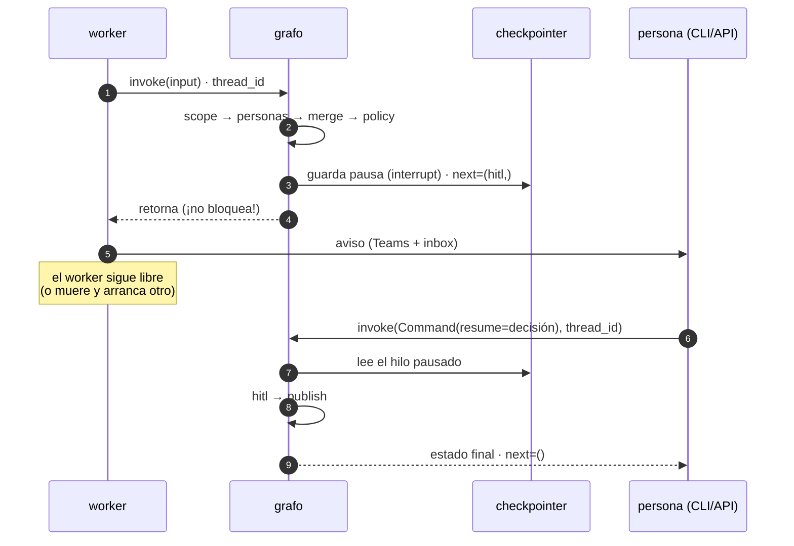
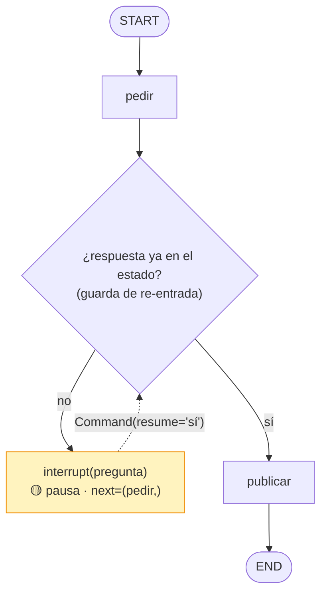
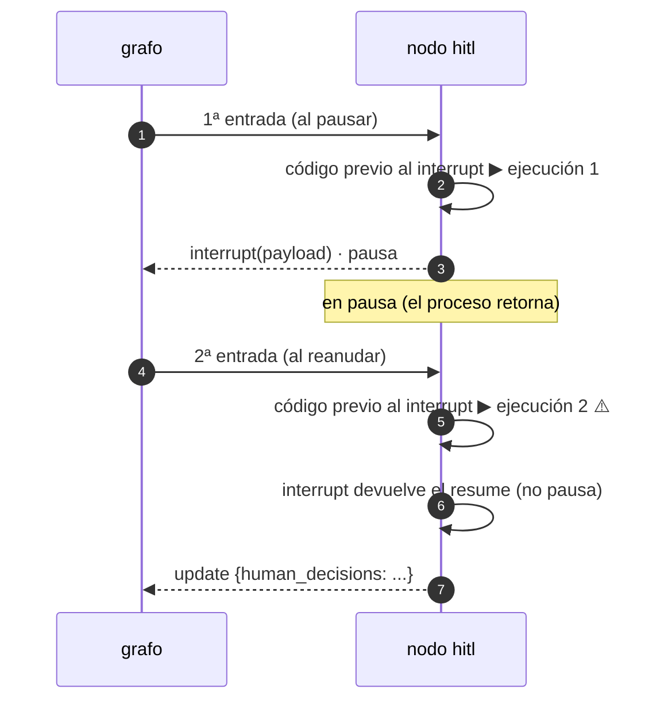
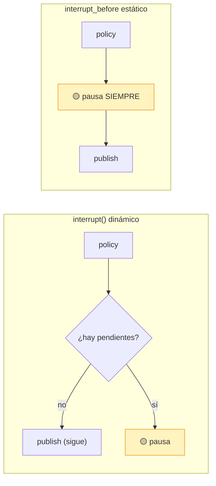
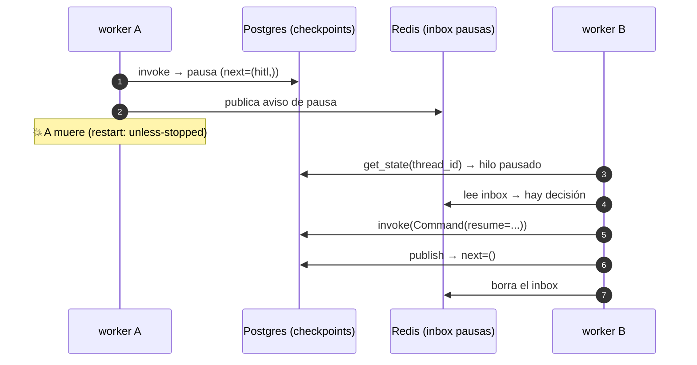
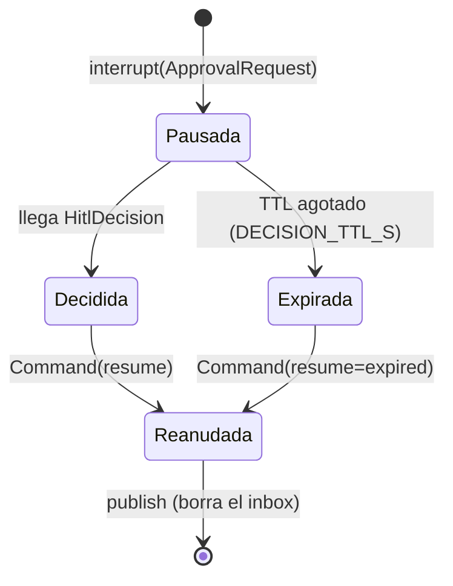
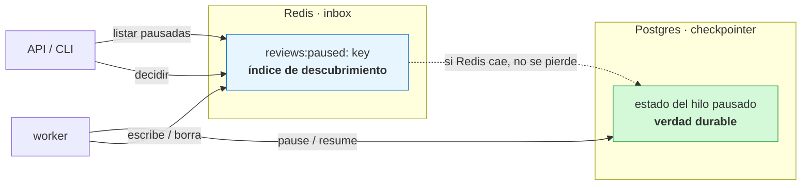

Última modificación: 2026-10-11 | Creado: 2026-10-11

# 06 — Human-in-the-loop: `interrupt` y `Command`

> Índice: [README](README.md) · Anterior: [05](05-invocacion-y-reejecucion.md) · Siguiente: [07](07-idempotencia-y-efectos.md)

---

## 1. Qué es y para qué

**HITL** (*human-in-the-loop*) es el patrón por el que un grafo **pausa**, expone algo a
una persona y **reanuda** con su respuesta. Es lo que convierte un pipeline automático
en un colaborador.

La pregunta de diseño no es "¿cómo paro un proceso?" sino **"¿cómo paro de forma
durable y sin bloquear un proceso?"**. `time.sleep()` o un `while True` esperando una
respuesta serían un desastre: atan un worker, no sobreviven a un reinicio y no escalan.
LangGraph lo resuelve con dos primitivas:

- **`interrupt(value)`**: dentro de un nodo, **pausa** el grafo y **expone** un valor.
- **`Command(resume=...)`**: al reanudar, entrega la respuesta al `interrupt` que la
  estaba esperando.

El grafo queda con el hilo **pendiente en el checkpointer**; el proceso que lo invocó
**retorna** (no se bloquea). Cualquier otro proceso (u otro worker tras un reinicio)
puede reanudar pasando el `Command`.



> **Prerrequisito innegociable:** `interrupt` necesita un **checkpointer**. Sin él,
> LangGraph no puede guardar dónde se pausó.

---

## 2. API de LangGraph

```python
from langgraph.types import interrupt, Command

def nodo(state):
    respuesta = interrupt({"pregunta": "¿lo arreglo?", "opciones": ["sí", "no"]})
    # `respuesta` es lo que se pasó en Command(resume=...)
    return {"decision_humana": respuesta}
```

Y para reanudar, desde **cualquier** proceso:

```python
grafo.invoke(Command(resume={"decision": "sí"}), config)
```

Detalles veriles de la versión instalada `langgraph` 1.2.14 (de la propia docstring de
`interrupt`, resumida):

- La **primera** invocación de `interrupt` en un nodo lanza internamente una excepción
  resumible (`GraphInterrupt`) que **detiene** la ejecución; el `value` viaja al cliente.
- Al reanudar, el grafo **re-ejecuta el nodo desde el principio**; el `interrupt` que ya
  se había disparado **devuelve** el valor del `resume` en lugar de volver a pausar.
- Si un nodo tiene **varios** `interrupt`, los valores de resume se emparejan **por
  orden**.
- Los valores de resume están **scoped a la tarea** que ejecuta el nodo (no se comparten
  entre ramas paralelas).

Y el objeto que se ve al inspeccionar: `snapshot.interrupts` es una tupla de `Interrupt`:

```python
Interrupt(value={'ask': 'approve?', 'pending': ['f1']}, id='a30d...', response_schema=None)
```

---

## 3. Ejemplo mínimo

Grafo que pausa, recibe una respuesta y continúa:

```python
from typing import TypedDict
from langgraph.graph import StateGraph, START, END
from langgraph.checkpoint.memory import InMemorySaver
from langgraph.types import interrupt, Command


class State(TypedDict, total=False):
    respuesta: str | None


def pedir(state):
    if state.get("respuesta"):        # ya reanudado
        return {}
    valor = interrupt({"pregunta": "¿publico la review?"})
    return {"respuesta": valor}


def publicar(state):
    print("Publicando... respuesta =", state.get("respuesta"))
    return {}


g = StateGraph(State)
g.add_node("pedir", pedir)
g.add_node("publicar", publicar)
g.add_edge(START, "pedir")
g.add_edge("pedir", "publicar")
g.add_edge("publicar", END)
app = g.compile(checkpointer=InMemorySaver())
cfg = {"configurable": {"thread_id": "t1"}}

print("1) invoke:", app.invoke({}, cfg))          # retorna sin ejecutar 'publicar'
snap = app.get_state(cfg)
print("   next:", snap.next)                       # ('pedir',)
print("   interrupts:", snap.interrupts)           # pausa pendiente

print("2) resume:", app.invoke(Command(resume="sí"), cfg))
# Publicando... respuesta = sí
print("   next:", app.get_state(cfg).next)         # ()
```

Salida (verificada en 1.2.14): el primer `invoke` **retorna** con el hilo pendiente en
`pedir`; el segundo entrega `"sí"` y termina. Obsérvese la línea `if state.get("respuesta"): return {}`:
es la guarda de re-entrada, porque al reanudar **el nodo se re-ejecuta desde el
principio**.



El bucle `I -.-> Q` es la reanudación: el nodo vuelve a entrar y, esta vez, la guarda
deja pasar en lugar de volver a pausar.

---

## 4. Matices y avanzado

### 4.1 Al reanudar, el nodo **se vuelve a ejecutar** (desde el inicio)

No hay "pausa a mitad de función" en Python. LangGraph reanuda **ejecutando el nodo otra
vez**; el `interrupt` que ya se disparó no vuelve a dispararse, sino que **devuelve** el
valor. Consecuencia: **todo el código anterior al `interrupt` se ejecuta dos veces**.
Por eso conviene que el trabajo pesado ocurra **antes** del nodo que interrumpe, o que
sea idempotente.



### 4.2 `interrupt` devuelve `dict`/`list`, no un tipo tuyo

El valor de `interrupt` al reanudar es lo que hayas pasado en `resume` (típicamente un
`dict`). Si quieres un modelo Pydantic, conviértelo explícitamente:

```python
valor = interrupt(approval)
decision = valor if isinstance(valor, HitlDecision) else HitlDecision.model_validate(valor)
```

Es exactamente lo que hace el repo (ver §5), y permite pasar un `HitlDecision` ya
construido o un `dict` serializado.

### 4.3 `interrupt_before` / `interrupt_after`: la variante **estática**

`compile(interrupt_before=["nodo"], interrupt_after=["nodo"])` pausa **siempre** antes o
después de ese nodo, sin tocar su código. Es útil para depurar o para meter un punto de
aprobación rígido. La diferencia es clave:

| | `interrupt()` dentro del nodo | `interrupt_before/after` en `compile` |
|---|---|---|
| Cuándo pausa | **Decidido por el estado** (dinámico) | **Siempre** (estático) |
| Qué expone | Un valor propio | El estado en ese punto |
| Uso | HITL de negocio | Depuración, gates fijos |



El repo necesita el caso **dinámico**: solo pausa **si hay decisiones pendientes**.

### 4.4 Vigilancia: `interrupt` sin checkpointer

Si invocas un grafo con `interrupt` y **sin** `checkpointer`, LangGraph lanza un error:
`interrupt() requires a checkpointer to be provided`. Es el fallo nº 1 con HITL.

### 4.5 Dónde vive el "rebobinado": el resume reanuda el **mismo hilo**

La reanudación se hace sobre el **mismo `thread_id`**, lo que garantiza que se reutiliza
el estado (hallazgos, decisiones de política) y no se recomputa el trabajo previo. Es
por eso que `reviews` mantiene `thread_id == review_key`: la reanudación es la misma
ejecución, no una nueva.

### 4.6 Dos procesos, un hilo (durabilidad)

El productor que pausa y el consumidor que reanuda **no tienen que ser el mismo
proceso**. Con un checkpointer compartido (Postgres), el flujo puede ser:

```
worker A: invoke → pausa → aviso → muere
worker B: arranca → ve el hilo pausado → Command(resume) → publica
```

Ese es el escenario que valida el test de durabilidad de la Fase 2 del repo.



### 4.7 Qué `resume` NO hace

- **No** vuelve a pasar por la política de autonomía (la decisión humana manda).
- **No** reinicia el grafo desde `START` (a diferencia de `invoke(input)`).
- **No** es idempotente por sí solo: hacer `resume` dos veces sobre un hilo ya reanudado
  es un no-op *si el hilo ya terminó*, pero diseñar la idempotencia es cosa tuya
  (módulos 05 y 07).

---

## 5. Dónde aparece en `reviews`

El repo está **a medio camino** en HITL, y merece la pena decirlo con precisión:

- **Implementado**: los modelos (`HitlDecision`, `ApprovalRequest`, `PendingDecision`),
  el nodo `hitl` cableado en el grafo, y el inbox de pausas (`PausedStore`).
- **Especificado, aún no cableado en el worker/API**: el endpoint de decisión, el CLI y
  la rama de resume en `process_request`. El diseño y los criterios están en
  `docs/iniciativas/002-fase2-hitl/spec.md`.

El nodo `hitl` (implementado), en `src/agent_review/graph/build.py`:

```startLine:256:272:src/agent_review/graph/build.py
    def hitl(state: ReviewState) -> ReviewState:
        """Pausa durable si hay decisiones pendientes; si no, sigue a publish.

        `interrupt` no bloquea: el `invoke` retorna con el hilo pendiente y el
        worker no espera a nadie (ver docs/iniciativas/002-fase2-hitl/spec.md, §4.2).
        """
        if state.get("human_decisions") is not None:
            return {}
        approval = build_approval(state)
        if approval is None:
            return {}
        resume_value = interrupt(approval)
        decision = (
            resume_value
            if isinstance(resume_value, HitlDecision)
            else HitlDecision.model_validate(resume_value)
        )
        return {"human_decisions": decision}
```

Cuatro cosas para estudiar en este nodo, en orden:

1. **Guarda de re-entrada** (`if state.get("human_decisions") is not None: return {}`):
   evita volver a pausar si ya hay decisión (al reanudar, el nodo se re-ejecuta).
2. **Pausa condicional**: si `build_approval` devuelve `None` (no hay `Decision` con
   acción pendiente), el nodo **no** pausa. Es el HITL dinámico del §4.3.
3. **`interrupt(approval)`** donde `approval` es un `ApprovalRequest` (modelo Pydantic):
   es lo que el canal externo (CLI, API, Teams) muestra a la persona.
4. **Normalización del resume** (§4.2): acepta el modelo o un `dict`.

La carga de la pausa, en `src/agent_review/graph/build.py`:

```startLine:221:254:src/agent_review/graph/build.py
    def build_approval(state: ReviewState) -> ApprovalRequest | None:
        """Carga del HITL si hay decisiones pendientes; `None` si no las hay."""
        request = ReviewRequest.model_validate(state["request"])
        by_id = {d.finding_id: d for d in state.get("decisions", [])}
        pending: list[PendingDecision] = []
        for finding in _merged(state):
            decision = by_id.get(_finding_id(finding))
            if decision is None or decision.action.value not in PENDING_ACTIONS:
                continue
            pending.append(
                PendingDecision(
                    finding_id=decision.finding_id,
                    proposed_action=decision.action,
                    reason=decision.reason,
                    matched_rule=decision.matched_rule,
                    policy_version=decision.policy_version,
                    title=finding.title,
                    file=finding.file,
                    line=finding.line,
                    severity=finding.severity,
                )
            )
        if not pending:
            return None
        return ApprovalRequest(
            review_key=request.review_key,
            repo=request.repo,
            pr_id=request.pr_id,
            head_sha=request.head_sha,
            pending=pending,
            command_hint=(
                f"reviews decide {request.review_key} --actor <tu-nombre> --approve <finding_id>"
            ),
        )
```

Y el estado que transporta la decisión (una sola clave, sin reducer):

```startLine:75:77:src/agent_review/graph/build.py
    # HITL (Fase 2): decision humana. La escribe `hitl` al reanudar; sin ella, si
    # hay pendientes, el grafo pausa antes de publicar.
    human_decisions: HitlDecision | None
```

El inbox de descubrimiento (Redis con fallback a memoria), en `src/agent_review/paused_store.py`:

```startLine:23:30:src/agent_review/paused_store.py
@runtime_checkable
class PausedStore(Protocol):
    def pause(self, request: ReviewRequest, approval: ApprovalRequest) -> PausedReview: ...

    def get(self, review_key: str) -> PausedReview | None: ...

    def all(self) -> list[PausedReview]: ...

    def resume(self, review_key: str) -> None: ...

    def sweep(self, *, now: datetime | None = None) -> list[PausedReview]: ...
```

El ciclo de vida de una review pausada:



Y en qué almacén vive cada cosa (no confundir la verdad durable con el índice):



> **Idea de arquitectura que conviene interiorizar:** el **estado durable** de la pausa
> vive en el checkpoint de Postgres; el inbox de Redis es solo el **índice de
> descubrimiento** ("qué reviews están pausadas ahora mismo") para que la API y el CLI
> no tengan que hablar con el checkpointer. Si Redis cae, la review no se pierde (está
> en Postgres); lo que se pierde es la comodidad de listarla. Es la misma asimetría de
> la ingesta diferida (módulo 08).

---

## 6. Experimento propuesto

1. **Ejecuta el ejemplo del §3 sin checkpointer.** Cambia
   `compile(checkpointer=InMemorySaver())` por `compile()` y verás el error. Es la
   forma más rápida de fijar el acoplamiento `interrupt ↔ checkpointer`.
2. **Dos interrupt en un nodo.** Añade un segundo `interrupt` en `pedir` y reanuda con
   una **lista** de dos valores. Observa cómo se emparejan por orden. Después reanuda
   con un solo valor y mira el error: entenderás `response_schema`.
3. **Mismo nodo, dos ejecuciones.** Instrumenta `pedir` con un contador global y
   comprueba cuántas veces entra: una antes de pausar y otra al reanudar. Enlázalo con
   la guarda `if state.get("respuesta")` del ejemplo.
4. **Duplica el resume.** Reanuda dos veces con `Command(resume=...)`. La segunda debe
   ser un no-op (el hilo ya está en `END`). Ese es el comportamiento en el que se apoya
   la idempotencia de la decisión.

---

> Siguiente: [07 — Idempotencia y efectos](07-idempotencia-y-efectos.md)
