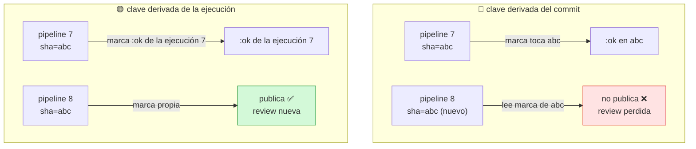
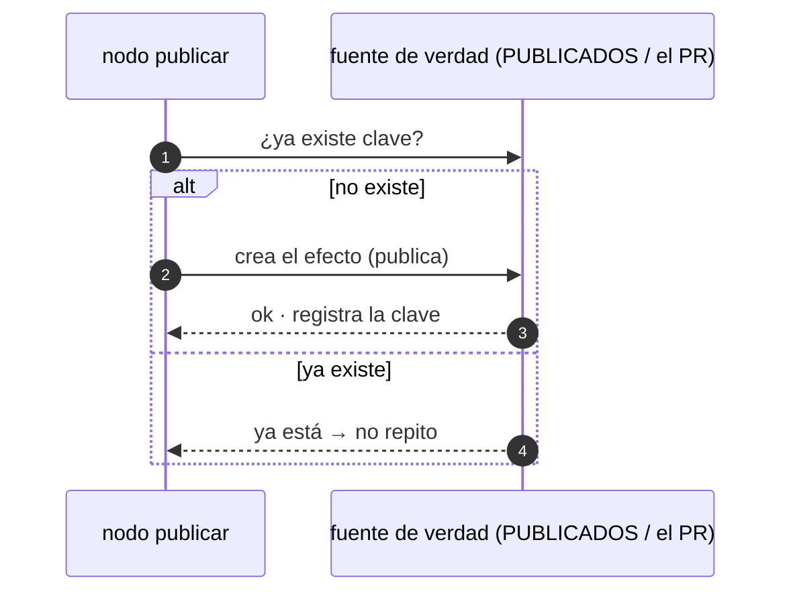
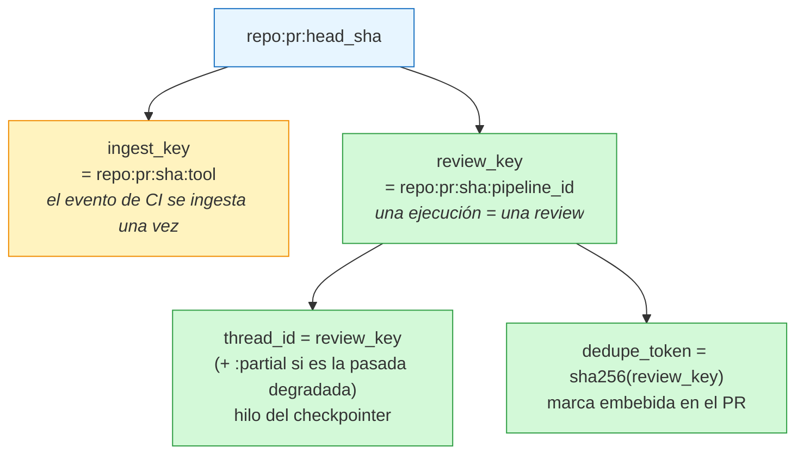
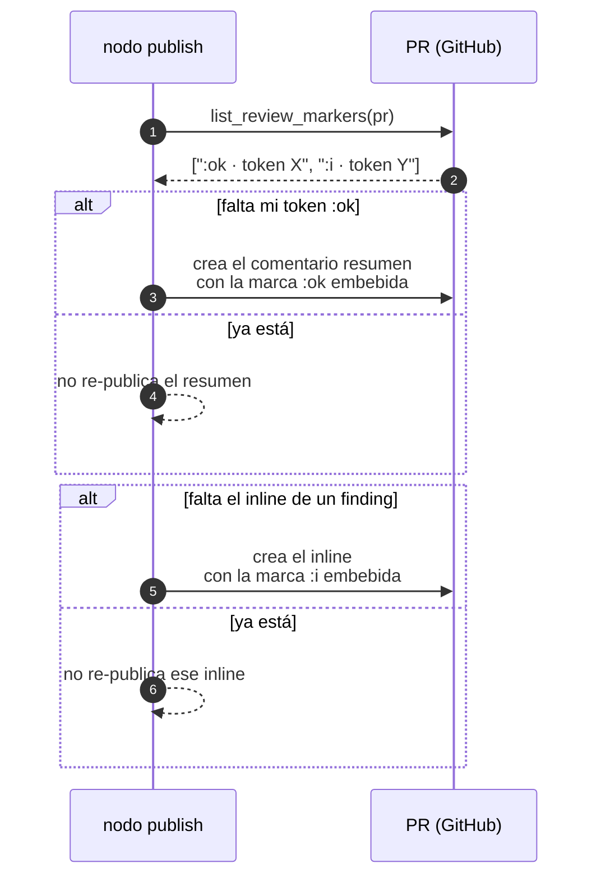

Última modificación: 2026-10-11 | Creado: 2026-10-11

# 07 — Idempotencia y efectos externos

> Índice: [README](README-20261011.md) · Anterior: [06](06-hitl-20261011.md) · Siguiente: [08](08-resiliencia-retries-20261011.md)

---

## 1. Qué es y para qué

Un grafo con LangGraph **se puede re-ejecutar** por muchos motivos legítimos: un reintento
tras fallo, una reentrega de mensaje, una reanudación tras reinicio, un `resume`
duplicado… Si un nodo produce **efectos externos** (publicar un comentario, mandar un
email, cobrar, abrir un ticket), re-ejecutarlo los **duplica**.

La **idempotencia** es la propiedad de que aplicar una operación varias veces tiene el
mismo efecto que aplicarla una vez. Hay dos maneras de conseguirla:

1. **Clave de idempotencia** (*idempotency key*): un identificador estable que el destino
   usa para reconocer "esto ya lo hice".
2. **Verificar-y-actuar**: antes de actuar, comprobar si el efecto ya existe (leer un
   registro, consultar una API) y actuar solo si falta.

El error de diseño típico es **derivar la clave del dato equivocado**. Si tu clave dice
"una review por commit", pero tu intención es "una review por ejecución de CI", el día
que haya dos pipelines sobre el mismo commit, una review desaparecerá en silencio. La
elección de la clave **es** la decisión de negocio.



> **Relación con los reducers.** El reducer (`operator.add`) garantiza que **no se
> pierde** una escritura. **No** garantiza que no se **repita**. Son problemas distintos:
> los reducers son de fusión de estado; la idempotencia es de efectos externos.

---

## 2. API de LangGraph

LangGraph no trae un "idempotency key" mágico; te da las herramientas para construirla:

- **`thread_id`**: la identidad del hilo. Dos invocaciones con el mismo `thread_id`
  comparten estado, y por tanto pueden **detectar** que ya hicieron algo (módulo 05).
- **`get_state`**: para consultar si el trabajo ya está hecho (`next` vacío).
- **`Store`** (módulo 10): memoria de largo plazo para "ya vi esto antes", a través de
  hilos.
- **`update_state`**: para sellar el estado indicando que un efecto ya ocurrió.
- La **propia persistencia externa**: la fuente de verdad del efecto (el PR, la BD).

En otras palabras: LangGraph te da dónde **guardar** la marca; **dónde** mirarla y cómo
derivarla es diseño tuyo.

---

## 3. Ejemplo mínimo

### 3.1 Verificar-y-actuar dentro del nodo

Un nodo que "publica" (efecto) pero comprueba antes si ya lo hizo:

```python
from typing import TypedDict, Annotated
import operator
from langgraph.graph import StateGraph, START, END
from langgraph.checkpoint.memory import InMemorySaver


class State(TypedDict, total=False):
    marcadores: Annotated[list[str], operator.add]


PUBLICADOS: set[str] = set()     # "fuente de verdad" del efecto (en la vida real, el PR)


def publicar(state, clave: str = "review:1"):
    if clave in PUBLICADOS:
        print("ya publicado, no repito")
        return {}
    PUBLICADOS.add(clave)
    print("publicando", clave)
    return {"marcadores": [clave]}


g = StateGraph(State)
g.add_node("publicar", publicar)
g.add_edge(START, "publicar")
g.add_edge("publicar", END)
app = g.compile(checkpointer=InMemorySaver())
cfg = {"configurable": {"thread_id": "t1"}}

app.invoke({}, cfg)   # publicando review:1
app.invoke({}, cfg)   # ya publicado, no repito
```



En la vida real, `PUBLICADOS` es el PR: se **lee** lo publicado y se decide. Eso es lo
que hace `reviews` con `list_review_markers` (ver §5).

### 3.2 Una clave estable por **unidad de intención**

La clave debe derivarse de la unidad de negocio:

```python
def idempotency_key(repo, pr_id, head_sha, pipeline_id):
    base = f"{repo}:{pr_id}:{head_sha}"
    return f"{base}:{pipeline_id}" if pipeline_id else base
```

- Mismo pipeline sobre el mismo commit → **misma** clave (un reintento no duplica).
- Pipeline **nuevo** sobre el mismo commit → clave **distinta** (review nueva).
- Commit distinto → clave distinta.

Las dos claves del sistema (evento de ingesta e intención de review):



La pasada **degradada** (la que encola el barrido cuando vence la espera de
artefactos) es la única excepción: comparte `review_key` y `dedupe_token`, pero su
hilo lleva el sufijo `:partial`. Si el artefacto llega tarde, la pasada completa de la
misma ejecución necesita un hilo propio; con el mismo hilo, el worker lo vería ya
terminado y no haría nada. El token compartido es lo que evita repetir los inline.

Las claves de la API (`ingest_key`, `review_key`) se reclaman con `SET NX`. Reclamar
antes de hacer el trabajo obliga a **liberar** la clave si el trabajo falla
(`IdempotencyStore.release`): si no, el reintento del CI recibe `duplicado` y el
artefacto se pierde en silencio durante los 7 días de TTL de la clave.

---

## 4. Matices y avanzado

### 4.1 Efectos externos e idempotencia del **consumidor**

Aun con clave, el destino puede no ser idempotente. Los comentarios de un PR suelen
**no** serlo (crear siempre crea). Por eso hacen falta dos capas:

1. **Clave de dedupe embebida** en el propio efecto (una marca invisible en el cuerpo
   del comentario), de modo que el **lector** pueda reconocerlo.
2. **Verificación previa** (leer los comentarios del PR antes de publicar).



La marca embebida es un truco muy práctico: convierte cualquier destino "tonto" en un
destino con memoria.

### 4.2 Escritura **antes** de actuar: ¿in-then-out u out-then-in?

El patrón clásico de idempotencia tiene dos variantes:

- **In-then-out**: marco "voy a hacerlo" en la BD, luego actúo. Protege contra
  concurrencia, pero si el proceso muere tras marcar y antes de actuar, el efecto no
  ocurre nunca (hay que reconciliar).
- **Out-then-in**: actúo, luego marco. Si muere entre ambas, el efecto se repite al
  reintentar (por eso hace falta la marca **en el efecto**, que es la primera opción).

El repo combina ambas: la **marca en el comentario** (out-then-in, con la marca dentro
del efecto) y la **lectura previa del PR** (verify).

### 4.3 Dos niveles de idempotencia: evento e intención

En sistemas con colas conviene separar:

| Nivel | Ejemplo en `reviews` | Clave | Qué evita |
|---|---|---|---|
| **Ingesta** | Un `POST` de CI llega dos veces | `repo:pr:sha:tool` | Ingestar el mismo artefacto dos veces |
| **Ejecución** | Un reintento del worker | `repo:pr:sha:pipeline` | Publicar dos veces la misma review |

Son **claves distintas** a propósito: si fueran la misma, deduplicar el evento taparía
reviews legítimas (dos herramientas, o un re-run del pipeline).

### 4.4 La trampa de "gana la primera marca por commit"

Supongamos que la marca de publicación se derivara del **commit**. Entonces:

- Review 1 (pipeline 7) publica y deja la marca.
- Review 2 (pipeline 8) sobre el mismo commit ve la marca y **no publica**.

Pero la intención era "cada pipeline publica su review". El sistema queda mudo por un
detalle de derivación de la clave. El repo lo corrigió anclando la marca a la
**ejecución** (`review_key`), no al commit. Moraleja: **cuando cambies el significado de
una clave, revisa todos los sitios donde se deriva**.

### 4.5 Estado "completitud" en la marca

La clave puede llevar más información que la identidad. En `reviews`, el sufijo `:ok`
o `:partial` distingue una review completa de una degradada. Regla resultante:

- Un reintento de la **misma** ejecución y completitud no republica.
- Una ejecución degradada **no** bloquea su versión completa posterior.

Codificar el estado en la marca es potente, pero **acopla** el formato a la lógica:
mantén el formato en **un solo sitio** (`_summary_token`, `_inline_token`) para no
tenerlo disperso.

### 4.6 El fallo parcial es el caso difícil

Si publicas 3 inlines y falla el resumen, el reintento debe: **no** repetir los 3
inlines y **sí** escribir el resumen. Esto se consigue porque cada inline lleva **su
propia** marca (por hallazgo) y el resumen lleva la suya. El repo lo prueba con
`test_reintento_tras_fallo_del_resumen_no_duplica_el_inline`.

### 4.7 Idempotencia y "efectos de orden"

Publicar en un orden distinto a lo registrado puede cambiar el resultado visible (un
inline antes que el resumen). El repo **fija el orden** (inlines primero, resumen al
final) precisamente para que la marca del resumen sea la "última escritura" y sirva de
indicador de completitud.

---

## 5. Dónde aparece en `reviews`

La definición de las dos claves y la marca, en `src/reviews/domain/models.py`:

```startLine:209:246:src/reviews/domain/models.py
    @property
    def idempotency_key(self) -> str:
        return f"{self.repo}:{self.pr_id}:{self.head_sha}"

    @property
    def review_key(self) -> str:
        """Clave de la *ejecucion* de la review, estable por pipeline."""
        if self.pipeline_id:
            return f"{self.idempotency_key}:{self.pipeline_id}"
        return self.idempotency_key

    @property
    def thread_id(self) -> str:
        """Hilo del checkpointer: una review re-ejecutada no duplica comentarios.

        Es la clave de ejecucion (`review_key`), no el commit: un `pipeline_id`
        nuevo sobre el mismo `sha` es una review nueva (intencional), y por eso
        va en el hilo. Repetir la *misma* ejecucion reutiliza el hilo.
        """
        return self.review_key

    @property
    def dedupe_token(self) -> str:
        """Marca de esta *ejecucion* de review, embebida en lo que publica.

        Se ancla a la clave de ejecucion (`review_key`), no solo al commit: un
        reintento del mismo `pipeline_id` reutiliza el token y el publish
        reconoce que ya publico, mientras que un `pipeline_id` nuevo sobre el
        mismo `sha` es una review nueva (intencional) y publica la suya. Asi el
        dedupe coincide con `thread_id` y deja de regir "gana la primera marca
        por commit". El `sha` va dentro, de modo que commits distintos nunca
        colisionan.
        """
        digest = hashlib.sha256(self.review_key.encode()).hexdigest()[:12]
        return f"reviews:{digest}"

    def ingest_key(self, tool: str) -> str:
        """Clave del *evento de CI* que deposita la salida de `tool`."""
        return f"{self.idempotency_key}:{tool}"
```

La **verificación previa** y las marcas del `publish`, en `src/reviews/graph/build.py`:

```startLine:284:303:src/reviews/graph/build.py
        complete = not unavailable
        published = _published_markers(vcs, request)
        # Solo se salta si ESTA ejecucion ya dejo su marca con la misma
        # completitud (o una completa, que no se degrada). Un reintento
        # degradado no repite el aviso; uno completo posterior si publica y
        # sustituye al degradado. La marca es de la ejecucion, no del commit:
        # un `pipeline_id` nuevo sobre el mismo `sha` es una review nueva.
        already_complete = _has_marker(
            published, _summary_token(request.dedupe_token, complete=True)
        )
        already_same = _has_marker(
            published, _summary_token(request.dedupe_token, complete=complete)
        )
        if already_complete or already_same:
            logger.info(
                "PR %s#%s: esta ejecucion (%s) ya publico una review (%s); no se re-publica",
                request.repo,
                request.pr_id,
                request.thread_id,
                "completa" if complete else "degradada",
            )
            return {}
```

El formato de las marcas (concentrado en helpers, como recomienda §4.5):

```startLine:436:448:src/reviews/graph/build.py
def _summary_token(token: str, complete: bool) -> str:
    suffix = ":ok" if complete else ":partial"
    return f"<!-- {token}{suffix} -->"


def _inline_token(token: str, finding_id: str) -> str:
    """Marca por hallazgo, corta a proposito.

    Bitbucket pinta los comentarios HTML en el cuerpo, asi que el id del hallazgo
    (que puede ser largo) se comprime a base32 para que el pie sea lo mas discreto
    posible sin perder la distincion entre dos hallazgos con el mismo titulo.
    """
    digest = base64.b32encode(hashlib.sha256(finding_id.encode()).digest()).decode()[:8].lower()
    return f"<!-- {token}:i:{digest} -->"
```

Y los tests que fijan cada escenario (en `tests/test_graph.py`):

| Test | Qué fija |
|---|---|
| `test_publish_no_repite_la_misma_ejecucion` | Reintento del mismo pipeline no republica. |
| `test_pipeline_nuevo_sobre_el_mismo_commit_publica_su_review` | Un pipeline nuevo sobre el mismo sha **sí** publica. |
| `test_reintento_tras_fallo_del_resumen_no_duplica_el_inline` | Fallo parcial: no repite inline y completa el resumen. |
| `test_reintento_de_la_misma_ejecucion_degradada_no_repite_el_aviso` | Un reintento degradado no duplica el aviso. |
| `test_inlines_con_mismo_titulo_en_ficheros_distintos_no_se_confunden` | La marca por hallazgo distingue dos inlines parecidos. |

Y el test que ancla explícitamente los dos niveles de clave:

```startLine:596:611:tests/test_graph.py
def test_dedupe_token_se_ancla_a_la_ejecucion_no_al_commit() -> None:
    base = dict(repo="r", pr_id=1, head_sha="abc")
    a = ReviewRequest(**base, pipeline_id="7")
    b = ReviewRequest(**base, pipeline_id="8")
    c = ReviewRequest(repo="r", pr_id=1, head_sha="def", pipeline_id="7")
    # Mismo pipeline sobre el mismo sha => misma marca (reintento no re-publica).
    assert a.dedupe_token == ReviewRequest(**base, pipeline_id="7").dedupe_token
    # Pipeline nuevo sobre el mismo sha => marca nueva (review nueva, si publica).
    assert a.dedupe_token != b.dedupe_token
    # Commit distinto => marca distinta (el sha sigue dentro de la clave).
    assert a.dedupe_token != c.dedupe_token
    # El token coincide con el hilo: una ejecucion, una marca.
    assert a.dedupe_token != a.thread_id
    assert a.thread_id != b.thread_id, "un pipeline nuevo es un hilo nuevo"
```

---

## 6. Experimento propuesto

1. **Rompe la clave.** Cambia `dedupe_token` para que se derive de `idempotency_key`
   (sin `pipeline_id`) y ejecuta los tests del §5. Verás cuántos se rompen: cada test
   es un escenario de negocio que la elección de clave estaba protegiendo.
2. **Fallo parcial controlado.** Ya existe `_FailingSummaryVcs` en el test. Úsalo para
   trazar la secuencia: primer intento publica inline y falla el resumen; segundo
   intento completa. Dibuja el "estado de las marcas" tras cada paso.
3. **Induce concurrencia.** Publica la misma review desde dos hilos casi a la vez con
   el mismo `thread_id`. Observa que el checkpointer serializa por hilo. Pregúntate qué
   pasaría **sin** checkpointer (pista: marca en el PR, pero carrera de lectura).
4. **Diseña una clave nueva.** Imagina que quieres "re-review cuando el autor responde".
   Propón la clave de idempotencia y dónde la mirarías. Compárala con la actual.

---

> Siguiente: [08 — Resiliencia: reintentos, timeouts y DLQ](08-resiliencia-retries-20261011.md)
