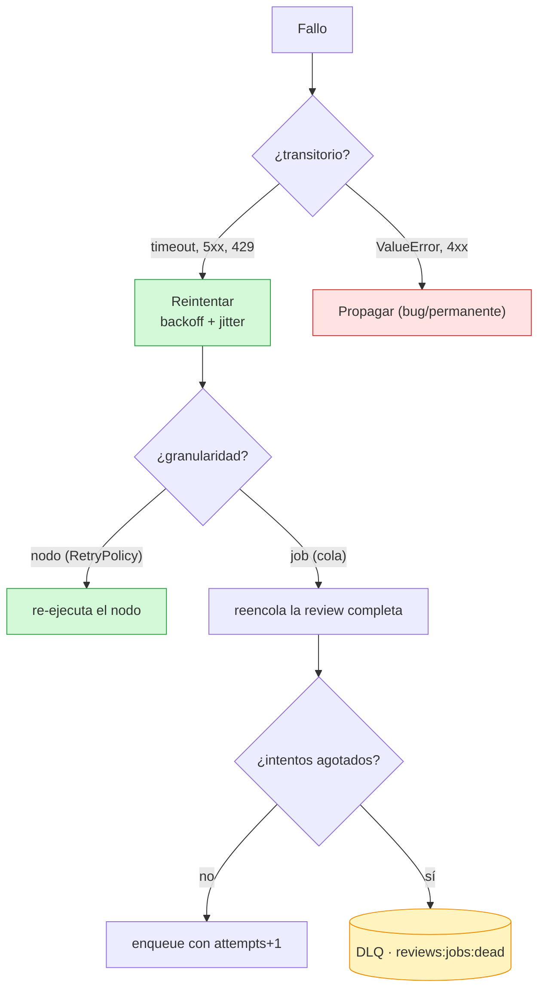
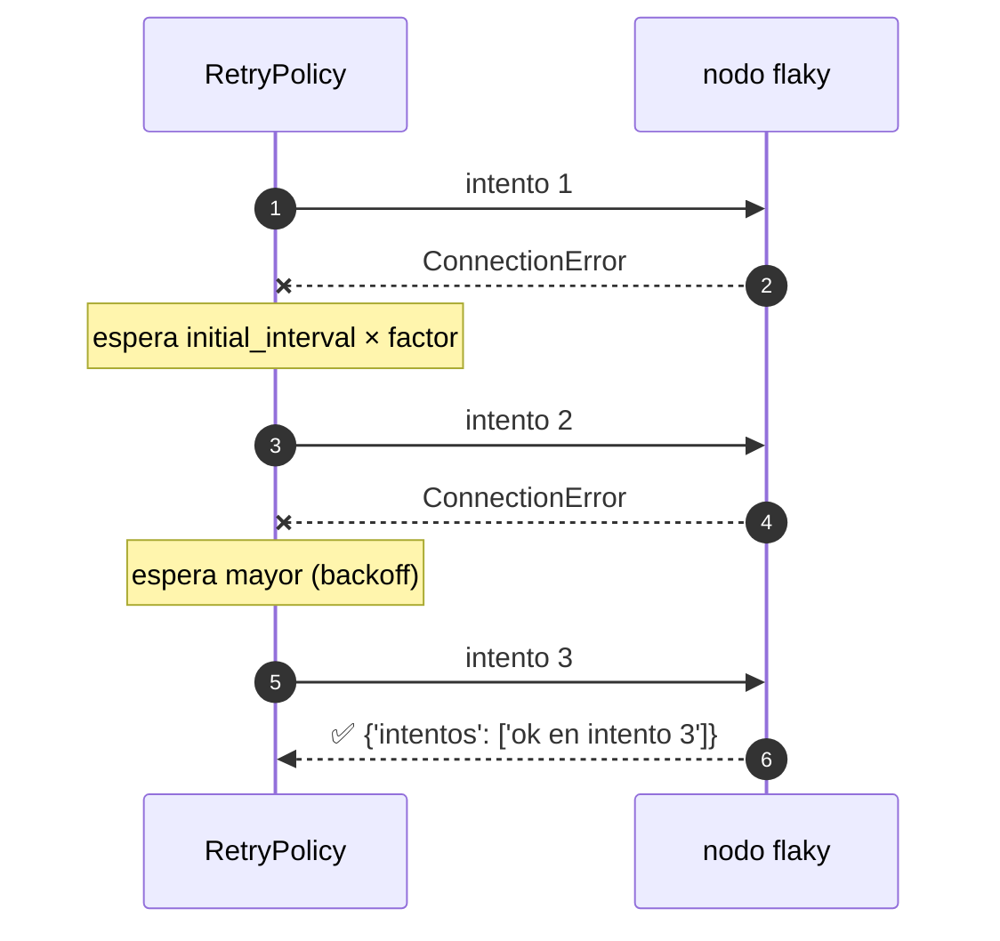
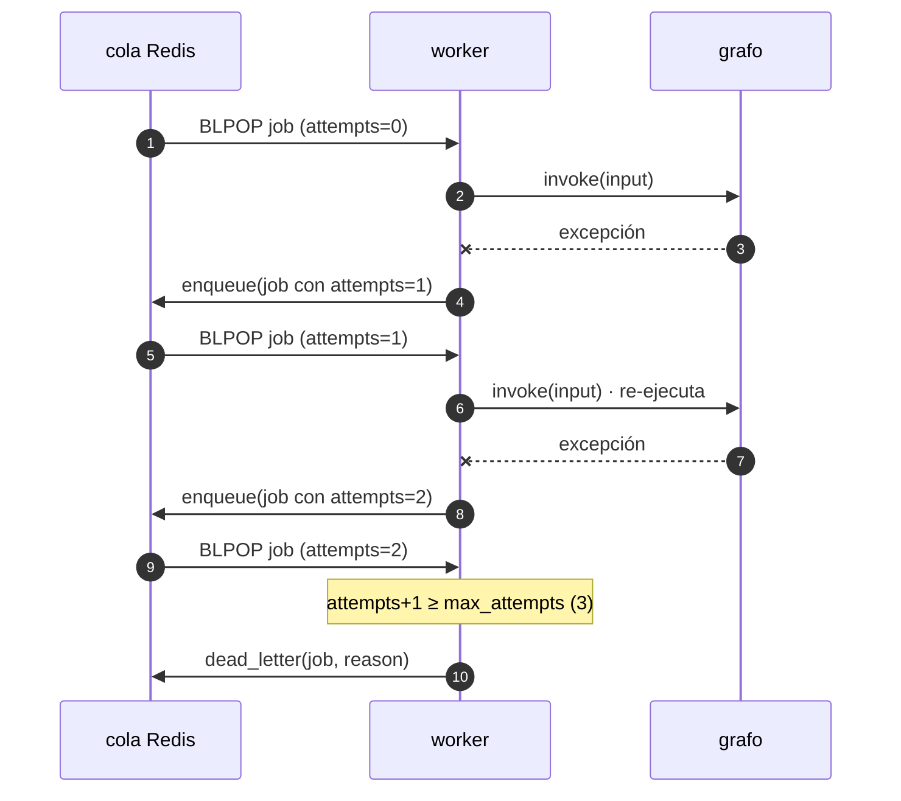

Última modificación: 2026-10-11 | Creado: 2026-10-11

# 08 — Resiliencia: reintentos, timeouts y DLQ

> Índice: [README](README-20261011.md) · Anterior: [07](07-idempotencia-y-efectos-20261011.md) · Siguiente: [09](09-streaming-y-observabilidad-20261011.md)

---

## 1. Qué es y para qué

Un grafo que llama a servicios externos (VCS, LLM, Teams, base de datos) **fallará a
veces**: timeouts, 500s, conexiones caídas. La resiliencia es el conjunto de decisiones
sobre **qué hacer cuando algo falla**:

- **Reintentar** el nodo (con espera creciente) cuando el fallo es *transitorio*.
- **No reintentar** cuando el fallo es *permanente* (un bug, un `ValueError`).
- **Acotar** el tiempo de un nodo para no colgar el worker.
- **Reintentar a nivel de job** cuando el fallo cruza varios nodos.
- **Descartar con dignidad** (a una **DLQ**) cuando se agotan los intentos.

Hay dos "granularidades" de reintento y conviene no confundirlas:

| Granularidad | Quién la ejecuta | Dónde vive |
|---|---|---|
| **Nodo** | LangGraph (`retry_policy` en `add_node`) | Dentro de una invocación |
| **Job / review** | La aplicación (worker + cola) | Entre invocaciones del grafo |

El repo usa **las dos**: LangGraph reintenta los nodos con efectos externos
(`scope`, `persona`, `publish`, `notify`) con `RetryPolicy`, y la aplicación reintenta
la review entera a través de la cola con un contador de intentos y una DLQ. La política de nodo
no sustituye a la de job: la primera recupera el fallo transitorio donde ocurrió, la
segunda es la red de seguridad de lo demás (ver §5).



---

## 2. API de LangGraph

### 2.1 `RetryPolicy` por nodo

```python
from langgraph.types import RetryPolicy

builder.add_node(
    "persona",
    persona,
    retry_policy=RetryPolicy(max_attempts=3, initial_interval=0.5, backoff_factor=2.0),
)
```

Firma verificada en `langgraph` 1.2.14:

```
RetryPolicy(
    initial_interval=0.5,        # espera antes del primer reintento (s)
    backoff_factor=2.0,          # multiplicador entre reintentos
    max_interval=128.0,          # techo de la espera
    max_attempts=3,              # intentos totales
    jitter=True,                 # aleatoriedad para evitar "thundering herd"
    retry_on=default_retry_on,   # qué excepciones merecen reintento
)
```

`retry_on` por defecto es `default_retry_on`, que reintenta errores **transitorios**
(`ConnectionError`, HTTP 5xx, timeout) y **no** reintenta errores de programación
(`ValueError`, `TypeError`…). Puedes pasar:

- **Una excepción**: `retry_on=TimeoutError`.
- **Varias**: `retry_on=(TimeoutError, ConnectionError)`.
- **Un predicado**: `retry_on=lambda exc: isinstance(exc, MIError) and exc.transitorio`.

> `add_node` acepta `retry_policy` como **una** política o una **secuencia** de
> políticas: si pones varias, se aplican en orden.

### 2.2 Timeouts por nodo y por `Send`

- `add_node(..., timeout=...)` y `Send(..., timeout=...)` aceptan un número de segundos,
  un `timedelta` o un `TimeoutPolicy`.
- `TimeoutPolicy(run_timeout=..., idle_timeout=..., refresh_on="auto"|"heartbeat")`
  distingue "el nodo tarda demasiado en total" de "el nodo no da señales de vida".

### 2.3 Cache de nodo

`add_node(name, fn, cache_policy=CachePolicy(ttl=...))` + `compile(cache=...)` permite
cachear resultados de nodos (útil para nodos caros y deterministas). El módulo 04 cubre
el checkpointer; el cache es ortogonal y se ve en el 10.

### 2.4 Manejo de errores

`add_node(..., error_handler=...)` permite registrar un handler para el fallo de ese
nodo (registrar, compensar, decidir). Es una capacidad avanzada; el repo hoy no la usa y
delega el "qué hacer" a la capa de la cola.

---

## 3. Ejemplo mínimo

### 3.1 Reintento de nodo que se recupera

```python
from typing import TypedDict, Annotated
import operator
from langgraph.graph import StateGraph, START, END
from langgraph.types import RetryPolicy


class State(TypedDict, total=False):
    intentos: Annotated[list[str], operator.add]


veces = {"n": 0}


def flaky(state):
    veces["n"] += 1
    if veces["n"] < 3:
        raise ConnectionError("servicio caido")
    return {"intentos": [f"ok en intento {veces['n']}"]}


g = StateGraph(State)
g.add_node("flaky", flaky, retry_policy=RetryPolicy(max_attempts=5, initial_interval=0.01))
g.add_edge(START, "flaky")
g.add_edge("flaky", END)

print(g.compile().invoke({}))
# {'intentos': ['ok en intento 3']}
```

Verás que el nodo se ejecuta 3 veces y la cuarta no. Ojo: el reducer acumularía los
resultados de **todos** los intentos si el nodo escribiera antes de fallar.



### 3.2 Un error que **no** se reintenta

```python
def bug(state):
    raise ValueError("esto es un bug, no un fallo de red")
```

Con el `retry_on` por defecto, **no** se reintenta: el error se propaga al que invocó.
Es lo correcto: reintentar un bug solo lo repite.

---

## 4. Matices y avanzado

### 4.1 Reintentar un nodo **re-ejecuta** sus efectos

Si el nodo falla **después** de hacer un efecto externo (p. ej. posteó 2 de 3 inlines),
el reintento del nodo volverá a ejecutarlo desde el principio. Por eso la idempotencia
(módulo 07) y los reintentos van **de la mano**: línea por línea, un nodo con efectos
debe ser idempotente antes de tener `retry_policy`.

### 4.2 Reintento de nodo vs reintento de job

El reintento de nodo es bueno para fallos **cortos y locales**. Para fallos que dejan el
estado a medias, el reintento **de job** (reencolar la review) es más adecuado, porque
reconstruye desde un checkpoint conocido. El repo usa el de job porque su unidad de
idempotencia (la marca del PR) es de la review entera, no del nodo.

### 4.3 La DLQ como "cementerio observable"

Cuando se agotan los intentos, hay tres opciones: descartar en silencio (malo), fallar
para siempre (peor), o **mover a una Dead Letter Queue** (bien). La DLQ permite
inspeccionar y **reinyectar** el job a mano. El repo la implementa como una segunda
lista de Redis (`reviews:jobs:dead`), y su formato incluye motivo y timestamp.

### 4.4 Contador de intentos: en el **job**, no en el estado

El repo guarda `attempts` en el `ReviewRequest`, no en el estado del grafo. ¿Por qué?

- El estado es del **hilo** (una ejecución); si la clave cambia, el hilo cambia y el
  contador se perdería.
- El contador pertenece al **mensaje de la cola**, que es lo que se reencola.
- Además, `attempts` viaja en el job reencolado, así que el mismo worker lo ve al
  desencolar de nuevo.



### 4.5 Un fallo en un nodo no deja el hilo "completado"

Ver §4.2 del módulo 05: si un nodo lanza, el checkpoint queda con `next` pendiente. Por
eso el reintento sabe que **debe** continuar. Esto es lo que hace que el sistema sea
recuperable sin `try/except` por todas partes.

### 4.6 Idempotencia del reencolado

Reencolar un job que "parecía fallar pero en realidad terminó" es un riesgo real (el
efecto se hizo, pero el ack no). La combinación `next` vacío + marca en el PR cubre el
caso: aunque el job vuelva, el `publish` se salta.

### 4.7 Política de reintentos: "solo lo transitorio"

Clasificar bien los errores es media batalla:

| Error | ¿Reintentar? | Por qué |
|---|---|---|
| Timeout, conexión caída, 5xx | **Sí** | El próximo intento puede funcionar. |
| 429 (rate limit) | **Sí**, con backoff | Esperar suele resolverlo. |
| 4xx por payload inválido | **No** | Reintentar no lo arregla. |
| `ValueError`/`TypeError` | **No** | Es un bug; reintentar lo repite. |
| Resultado incompleto (artefacto ausente) | Depende | En `reviews`, no se reintenta: se marca degradada. |

El repo es especialmente cuidadoso con el último: una review incompleta **no** se
reintenta, porque la ingesta diferida ya esperó al artefacto (barrera + TTL). Reintentar
solo duplicaría la publicación.

---

## 5. Dónde aparece en `reviews`

El bucle de reintento de job, en `src/reviews/worker/main.py`:

```startLine:554:609:src/reviews/worker/main.py
def _consume(
    queue: ReviewQueue,
    graph: ReviewGraph,
    request: ReviewRequest,
    *,
    max_attempts: int,
    paused: PausedStore | None = None,
    chat: ChatPort | None = None,
    vcs: VcsPort | None = None,
) -> None:
    """Procesa un job; ante un fallo transitorio reencola, y al agotar intentos descarta."""
    try:
        process_request(graph, request, paused=paused, chat=chat, vcs=vcs)
    except Exception as exc:
        if is_transient(exc):
            logger.warning(
                "Fallo transitorio procesando %s (%s); se reencola",
                request.review_key,
                type(exc).__name__,
            )
        else:
            # Un fallo permanente (bug, payload invalido) no se arregla reintentando
            # el job entero, pero la clasificacion de job es mas laxa que la de
            # nodo: se registra para poder distinguirlo en la DLQ.
            logger.exception("Fallo no clasificado como transitorio en %s", request.review_key)
        try:
            _requeue_or_drop(queue, request, max_attempts=max_attempts)
        except Exception:
            # El manejo del error no puede tumbar el worker: el job ya salio de la
            # cola (`BLPOP`) y una excepcion aqui mataria el bucle entero.
            logger.exception(
                "No se pudo reencolar ni mandar a la DLQ %s; job perdido: %s",
                request.review_key,
                request.model_dump_json(),
            )


def _requeue_or_drop(queue: ReviewQueue, request: ReviewRequest, *, max_attempts: int) -> None:
    if request.attempts + 1 >= max_attempts:
        # Job descartado a proposito tras fallos persistentes: no desaparece en el
        # log, va a la DLQ para poder reinyectarlo o inspeccionarlo (B2).
        logger.error(
            "Review %s agoto los %d intentos; se manda a la DLQ",
            request.review_key,
            max_attempts,
        )
        queue.dead_letter(request, reason=f"intentos agotados ({max_attempts})")
        return
    retry = request.model_copy(update={"attempts": request.attempts + 1})
    queue.enqueue(retry)
    logger.warning(
        "Review %s reencolada para el intento %d/%d",
        retry.review_key,
        retry.attempts + 1,
        max_attempts,
    )
```

Dos detalles que salieron de la revisión de `main`:

- **El manejo del error no puede lanzar.** El job ya salió de la cola (`BLPOP`); si
  reencolar o mandar a la DLQ falla dentro del `except`, la excepción mataría el bucle
  del worker. Por eso `_requeue_or_drop` va en su propio `try` (B1). El fallo real que
  lo destapó: la DLQ serializaba con `model_dump()` y un job con decisión humana lleva
  un `datetime` que `json.dumps` no acepta; ahora es `model_dump(mode="json")`.
- **El reintento de job continúa, no repite.** Cuando el job vuelve, `process_request`
  ve el hilo a medias y llama a `invoke(None)`: retoma el nodo que falló (ver módulo
  05). Por eso el aviso de Teams vive en un nodo `notify` propio: si falla, el
  reintento retoma solo el aviso, no la publicación (B2, B9).

El umbral, en `src/reviews/settings.py`:

```startLine:66:68:src/reviews/settings.py
    # Reintentos de una review ante un fallo transitorio (twg, Teams). Agotados,
    # el job se descarta con el `review_key` en el log para reencolarlo a mano.
    max_review_attempts: int = 3
```

La DLQ, en `src/reviews/queue.py`:

```startLine:14:17:src/reviews/queue.py
QUEUE_KEY = "reviews:jobs"
# Cola de descartes: los jobs que agotan los reintentos no se pierden en el log,
# quedan aqui para reinyectarlos a mano o inspeccionarlos.
DEAD_LETTER_KEY = "reviews:jobs:dead"
```

Y un detalle fino de la lectura de cola: `dequeue` **no** propaga un Redis caído, sino
que devuelve `None` para reintentar en el próximo poll; así un problema transitorio no
tumba el worker:

```startLine:56:70:src/reviews/queue.py
    def dequeue(self, *, timeout_s: float = 5.0) -> ReviewRequest | None:
        """Siguiente trabajo, o `None` en el timeout. No deja morir al worker.

        La espera venida, un Redis que cae a mitad y un servidor que se reinicia
        son rutinas de un consumidor de cola: se registran y se devuelve `None`
        para reintentar en la siguiente vuelta, no se propaga una excepcion.
        """
        try:
            item = self._client.blpop(self._key, timeout=max(1, int(timeout_s)))
        except Exception as exc:  # noqa: BLE001 - el poll no debe tumbar el worker
            if not is_transient_redis_error(exc):
                raise
            logger.warning("Cola no disponible al leer; se reintenta en el proximo poll: %s", exc)
            return None
```

Los tests que fijan el comportamiento están en `tests/test_worker.py`:
`test_consume_reencola_con_intento_incremental_ante_excepcion` y
`test_consume_descarta_el_job_al_agotar_intentos` (este último comprueba que el job
descartado **queda en la DLQ**, no solo en el log). Las regresiones de la revisión de `main` (DLQ de un job con
decisión, reintento que continúa desde el checkpoint, fallo de Teams) están en
`tests/test_revision_main.py`.

Y el "latido" (`heartbeat` en un hilo aparte) es un mecanismo de resiliencia de procesos:
si el worker muere, el fichero se queda viejo y Docker lo reinicia
(`restart: unless-stopped`). Ver `start_heartbeat` en `src/reviews/worker/main.py:315`.

---

## 6. Experimento propuesto

1. **Añade `retry_policy` a un nodo de prueba.** Construye un grafo con un nodo que
   falle las dos primeras veces y se recupere la tercera, con `RetryPolicy(max_attempts=5)`.
   Comprueba el número de ejecuciones. Después cambia el error por `ValueError` y
   observa que **no** se reintenta.
2. **Provoca la DLQ.** Ejecuta `_consume` con un grafo que siempre falla y
   `max_attempts=3`, e inspecciona `queue.dead_letters()`. Añade el campo que te
   gustaría tener en la DLQ para diagnosticar (p. ej. `traceback`).
3. **Mide el backoff.** Extiende el ejemplo §3.1 para imprimir el tiempo entre
   intentos. Cambia `initial_interval`/`backoff_factor` y observa la progresión.
4. **Discute el no-reintento de la review degradada.** Lee el comentario de
   `process_request` sobre por qué una review incompleta **no** se reencola
   (`src/reviews/worker/main.py:192`). Escribe un escenario donde sí querrías
   reintentarla y cómo lo harías sin duplicar.

---

> Siguiente: [09 — Streaming y observabilidad](09-streaming-y-observabilidad-20261011.md)
