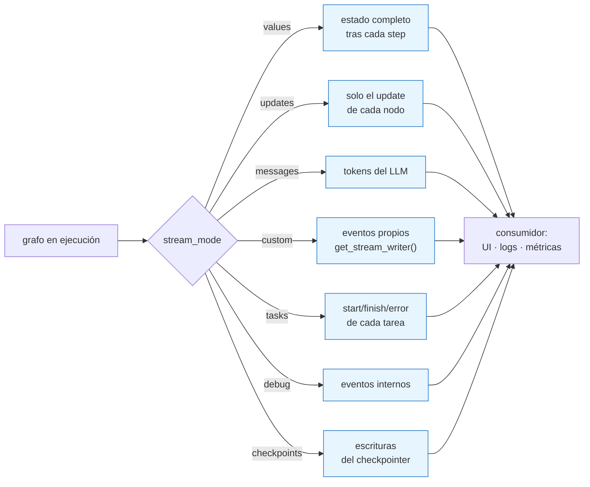
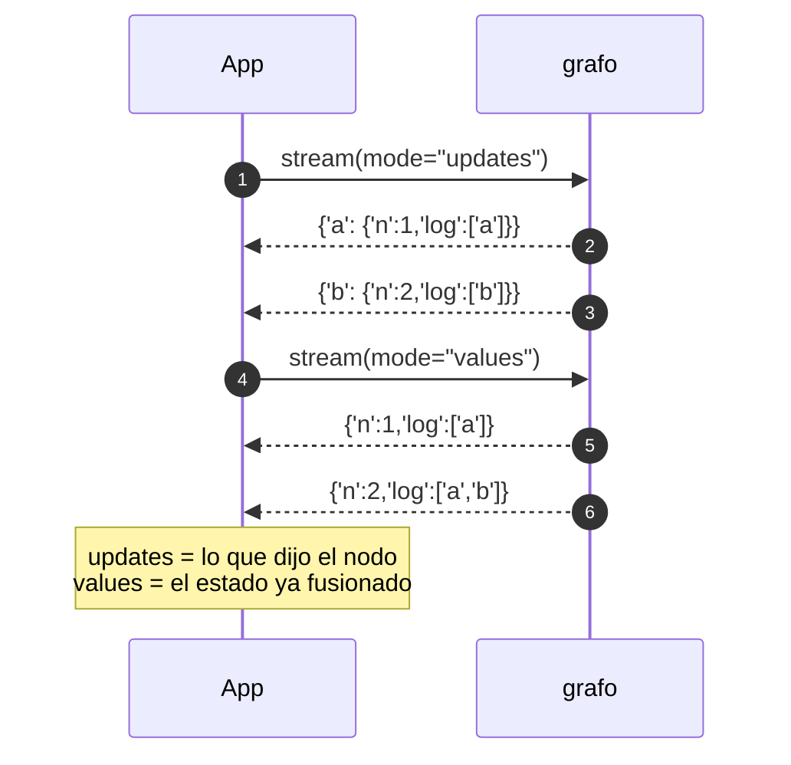

Última modificación: 2026-10-11 | Creado: 2026-10-11

# 09 — Streaming y observabilidad

> Índice: [README](README-20261011.md) · Anterior: [08](08-resiliencia-retries-20261011.md) · Siguiente: [10](10-patrones-avanzados-20261011.md)

---

## 1. Qué es y para qué

`invoke` devuelve **solo** el estado final. En un grafo largo eso es incómodo: no sabes
qué está pasando mientras corre. **`stream`** emite el progreso **por partes**, con
distintos niveles de detalle. Es la base de:

- **Observabilidad**: ver qué nodo corre, con qué entrada/salida.
- **UI**: pintar progreso ("analizando seguridad", "publicando…").
- **Depuración**: localizar qué paso produce qué.
- **Integración con LLMs**: emitir *tokens* a medida que se generan.

Hay **modos de streaming** (qué se emite) y **formatos de salida** (cómo se emite).



---

## 2. API de LangGraph

```python
for chunk in grafo.stream(input, config, stream_mode="updates"):
    ...
```

`stream_mode` puede ser un string o una **lista** de strings (se recibe el modo como
segundo elemento de la tupla). Modos verificados en `langgraph` 1.2.14:

```
StreamMode = Literal['values', 'updates', 'checkpoints', 'tasks', 'debug', 'messages', 'custom']
```

| Modo | Emite | Cuándo usarlo |
|---|---|---|
| `values` | El **estado completo** tras cada step | Ver la evolución del estado. |
| `updates` | Solo la **actualización** de cada nodo | Ver qué escribió cada nodo. |
| `messages` | Tokens/`AIMessage` de LLMs con `stream` | Chat en tiempo real. |
| `custom` | Lo que emita `get_stream_writer()` desde un nodo | Progreso propio ("3/10 ficheros"). |
| `tasks` | Ciclo de vida de tareas (start/finish/error) | Saber qué tarea corre. |
| `debug` | Eventos internos detallados | Depurar el motor. |
| `checkpoints` | Eventos de checkpoint | Persistencia/auditoría fina. |

También existe `astream`/`astream_events` para async y eventos con más estructura.

---

## 3. Ejemplo mínimo

```python
from typing import Annotated, TypedDict
import operator
from langgraph.graph import StateGraph, START, END


class State(TypedDict, total=False):
    n: int
    log: Annotated[list[str], operator.add]


def a(state): return {"n": 1, "log": ["a"]}
def b(state): return {"n": 2, "log": ["b"]}


g = StateGraph(State)
g.add_node("a", a)
g.add_node("b", b)
g.add_edge(START, "a")
g.add_edge("a", "b")
g.add_edge("b", END)
app = g.compile()

print("values :", list(app.stream({}, stream_mode="values")))
# [{'n': 1, 'log': ['a']}, {'n': 2, 'log': ['a', 'b']}]

print("updates:", list(app.stream({}, stream_mode="updates")))
# [{'a': {'n': 1, 'log': ['a']}}, {'b': {'n': 2, 'log': ['b']}}]

print("debug  :", [list(s.keys()) for s in app.stream({}, stream_mode="debug")][:2])
# [['step', 'timestamp', 'type', 'payload'], ['step', 'timestamp', 'type', 'payload']]
```

Salidas verificadas en 1.2.14. Compara `values` (estado entero) con `updates` (solo lo
que escribió cada nodo): el segundo es mucho más útil para **logs**.



---

## 4. Matices y avanzado

### 4.1 Progreso propio con `get_stream_writer`

Si quieres emitir eventos de negocio (no del motor), usa el escritor de stream dentro
del nodo:

```python
from langgraph.config import get_stream_writer

def persona(state):
    writer = get_stream_writer()
    writer({"reviewer": state["reviewer"], "estado": "empieza"})
    ...
    writer({"reviewer": state["reviewer"], "estado": "termina", "hallazgos": 3})
    return {"findings": [...]}
```

Y se consume con `stream_mode="custom"`. Es la forma limpia de instrumentar sin acoplar
el nodo a un logger concreto.

```mermaid
flowchart LR
    N["nodo persona"] -->|writer(evento)| BUS["canal custom"]
    BUS --> C["consumidor<br/>stream(mode='custom')"]
    N -.->|"return {findings}"| ST["estado del grafo"]
    ST -.->|"mode='updates'"| C2["consumidor"]
    classDef propio fill:#d3f9d8,stroke:#2f9e44;
    class BUS,C propio
```

### 4.2 `messages` y el streaming de LLMs

El modo `messages` emite `(token, metadata)` a medida que un LLM genera. Requiere que el
modelo se invoque dentro del grafo de forma que LangGraph pueda interceptarlo. Es lo que
hace que un chat se sienta "vivo".

### 4.3 Formato de salida: sync, async y eventos

| Método | Formato |
|---|---|
| `stream(...)` | Generador síncrono. |
| `astream(...)` | Generador asíncrono. |
| `stream_events(...)` / `astream_events(...)` | Eventos con más metadatos (nodos, LLM, tools). |

`stream_mode` puede combinarse: `stream_mode=["updates", "custom"]` devuelve tuplas
`(modo, payload)`.

### 4.4 Streaming no sustituye al logging

`stream` es para **consumidores** (una UI, un proceso). El logging estructurado sigue
siendo necesario para producción. En `reviews`, el `logger` de cada nodo es la traza
básica; el streaming sería la capa de UX si algún día hay interfaz.

### 4.5 Trazas de verdad: LangSmith

La observabilidad "de verdad" (árbol de spans por nodo, entradas/salidas, coste en
tokens, latencia) la da **LangSmith** u otra plataforma OTel-compatible. Se activa por
variables de entorno y no requiere tocar el grafo. El diseño del repo lo deja anotado
como pendiente no bloqueante (`docs/pendiente-fase1-20261011.md`, "Observabilidad").

### 4.6 Qué instrumentar en un agente como este

| Métrica | Por qué |
|---|---|
| Hallazgos por severidad | Calidad de las personas. |
| Tasa de descartados por humanos | Falsos positivos. |
| Tokens / coste por review | Sostenibilidad. |
| Latencia por nodo | Dónde se va el tiempo. |
| % de reviews degradadas | Salud de la ingesta. |

Métricas como "tasa de aceptación" retroalimentan la política y las personas; sin ellas,
el agente no mejora.

### 4.7 El detalle que no se ve: `checkpoints` para auditoría

El modo `checkpoints` emite eventos de escritura del checkpointer. Es útil para auditar
"qué se guardó y cuándo", especialmente en HITL: qué se pausó, qué se reanudó, con qué
estado.

---

## 5. Dónde aparece en `reviews`

Hoy el repo **no** usa `stream`: su interfaz es un worker que no necesita progreso en
vivo. La observabilidad se hace con:

- **Logging por nodo**: cada nodo de `src/agent_review/graph/build.py` registra lo relevante
  (merge de duplicados, publicaciones, fuentes ausentes).
- **Un worker que registra cada review procesada** (`src/agent_review/worker/main.py`).

Ejemplo representativo de logging en el nodo `merge`:

```startLine:195:199:src/agent_review/graph/build.py
        merged = list(seen.values())
        deduped = len(state.get("findings", [])) - len(merged)
        if deduped:
            logger.info("Merge: %d hallazgos duplicados eliminados", deduped)
        return {"merged": merged}
```

Y el punto de entrada del worker, donde se resumen los resultados:

```startLine:179:205:src/agent_review/worker/main.py
    config: RunnableConfig = {"configurable": {"thread_id": request.thread_id}}
    resumed = _completed_snapshot(graph, config)
    if resumed is not None:
        logger.info(
            "Review %s ya completada en su hilo; no se re-ejecuta ni se re-publica",
            request.review_key,
        )
        return outcome_from_state(cast("ReviewState", resumed))
    result = cast("ReviewState", graph.invoke({"request": request, "findings": []}, config=config))
    outcome = outcome_from_state(result)
    if outcome.complete:
        logger.info("Review completada %s", request.review_key)
    else:
        # No se hizo el analisis declarado: no es una review completada. No se
        # reencola: la ingesta diferida ya espero al artefacto (barrera/TTL), asi
        # que reintentar aqui solo duplicaria la publicacion.
        logger.warning(
            "Review INCOMPLETA %s; sin cobertura de: %s",
            request.review_key,
            ", ".join(
                f"{name}={status.value}" for name, status in outcome.unavailable_sources.items()
            ),
        )
    return outcome
```

El worker usa `invoke`, no `stream`, porque su consumidor no es una UI. Si mañana se
añade una interfaz web para ver el progreso de una review, el cambio sería sustituir
`invoke` por `stream` (módulos 09 y 05 conviven sin fricción: el checkpointer sigue
igual).

> La **instrumentación de coste** ya existe dentro de la persona LLM
> (`llm_budget_tokens_per_pr`), y el diseño de un `reviewer` LLM real podría apoyarse en
> el modo `messages` para trazar tokens.

---

## 6. Experimento propuesto

1. **Compara modos.** Ejecuta el ejemplo §3 con `stream_mode="tasks"` y con `"debug"`.
   Mira cuánta información sale de cada uno y decide cuál usarías para producción y
   cuál solo para depurar.
2. **Escribe tu propio progreso.** Añade un `get_stream_writer()` en un nodo de un grafo
   de juguete y consume `stream_mode="custom"`. Luego piensa dónde lo pondrías en
   `reviews` (¿en `persona`? ¿en `publish`?).
3. **Instrumenta la latencia.** Mide el tiempo de cada step con `stream_mode="updates"`
   y `time.perf_counter()`. ¿Qué nodo crees que dominará? (Pista: las personas LLM.)
4. **Prueba `stream_mode=["updates","custom"]`** y observa las tuplas `(modo, payload)`.
   Es la forma de tener logs y progreso a la vez.

---

> Siguiente: [10 — Patrones avanzados](10-patrones-avanzados-20261011.md)
