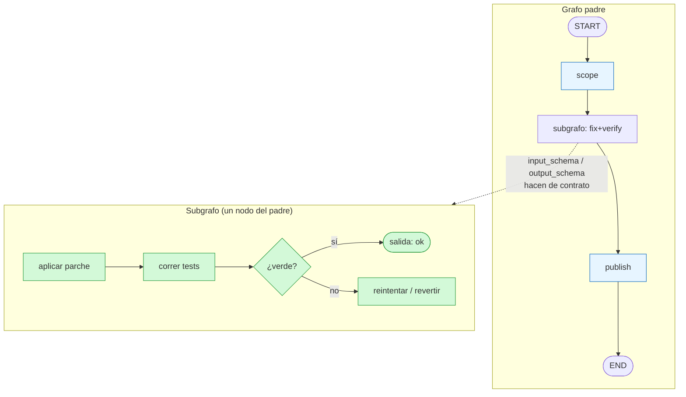
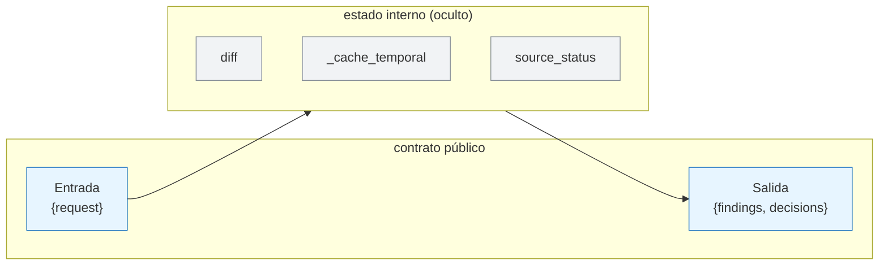
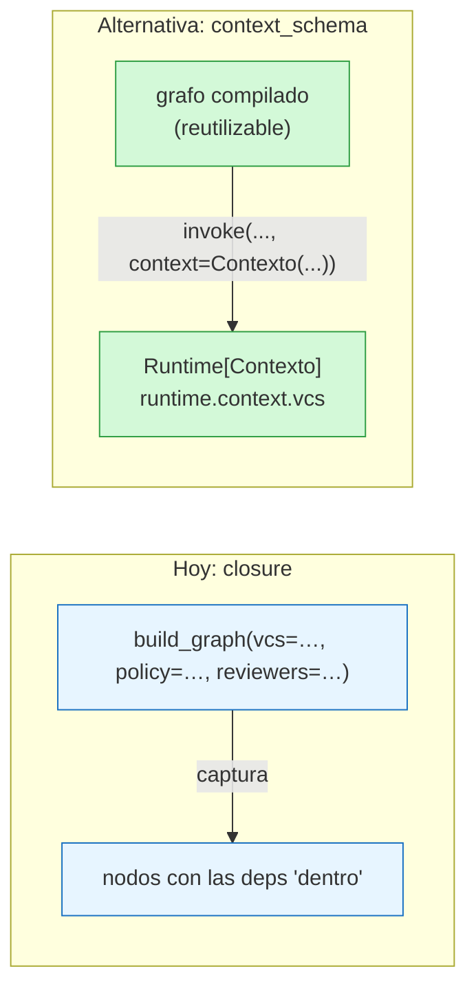
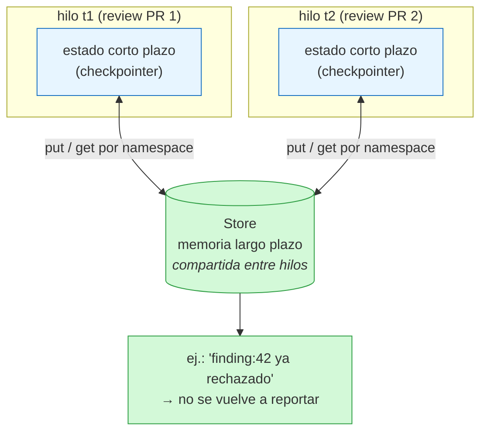

Última modificación: 2026-10-11 | Creado: 2026-10-11

# 10 — Patrones avanzados

> Índice: [README](README.md) · Anterior: [09](09-streaming-y-observabilidad.md)

Este módulo reúne las capacidades que **todavía no usa** `reviews` pero que conviene
conocer: cuando llegue la Fase 3 (sandbox, verificación) y la Fase 4 (memoria, métricas)
serán exactamente las piezas que necesitarás.

---

## 1. Subgrafos: un grafo como nodo

Un grafo compilado **es** un callable válido como nodo de otro grafo. Así se componen
arquitecturas por capas:

```python
sub = StateGraph(SubState)
sub.add_node(...)
sub_grafo = sub.compile()

padre = StateGraph(PadreState)
padre.add_node("fase_fix", sub_grafo)   # el subgrafo es un nodo
```

Dos formas de conectarlos:

1. **Esquema compartido**: el subgrafo usa las mismas claves que el padre y comparte
   estado directamente.
2. **Esquema distinto**: el subgrafo tiene su propio `State`, y las claves comunes hacen
   de "interfaz". Puedes declarar `input_schema`/`output_schema` para controlar qué
   entra y qué sale.

**Cuándo merece la pena en este proyecto:** el bucle de *fix* + *verificación* de la
Fase 3 es un candidato natural a subgrafo ("aplicar parche → correr tests → reintentar o
compensar"), con estado propio (`fix_attempts`, `test_result`) y un contrato claro hacia
el grafo principal.



---

## 2. `input_schema` / `output_schema`: encapsular el contrato

```python
class Interno(TypedDict, total=False):
    diff: str
    findings: list
    _cache_temporal: dict        # no quieres exponerlo

class Entrada(TypedDict):
    request: ReviewRequest

class Salida(TypedDict):
    findings: list
    decisions: list

grafo = StateGraph(Interno, input_schema=Entrada, output_schema=Salida).compile()
```

- `invoke` acepta solo `Entrada` y devuelve solo `Salida`.
- Las claves internas quedan ocultas.
- Es la forma de que un subgrafo tenga **interfaz pública** estable aunque su estado
  interno evolucione.

En `reviews`, el "contrato público" hoy es `outcome_from_state(state) -> ReviewOutcome`;
declarar un `output_schema` sería la versión formal de lo mismo.



---

## 3. `context_schema`: inyectar dependencias sin meterlas en el estado

Los recursos (clientes HTTP, conexiones, configuración, el reloj) **no** deben vivir en
el estado (no son serializables, ver módulo 04). La forma limpia es el **contexto**:

```python
from dataclasses import dataclass

@dataclass
class Contexto:
    vcs: VcsPort
    policy: PolicyEngine
    clock: Callable[[], datetime]

grafo = StateGraph(State, context_schema=Contexto).compile()
grafo.invoke(input, config, context=Contexto(vcs=..., policy=...))
```

Los nodos acceden al contexto con la firma extendida:

```python
from langgraph.runtime import Runtime

def nodo(state: State, runtime: Runtime[Contexto]) -> dict:
    vcs = runtime.context.vcs
    ...
```

**Relación con `reviews`:** hoy las dependencias se inyectan por **closure** —
`build_graph(vcs=..., reviewers=..., policy=...)` las captura en las funciones internas—
lo que funciona perfectamente para un grafo de un solo repositorio. `context_schema` es
la alternativa "oficial" cuando quieres que el grafo sea **reutilizable** con distintas
dependencias sin reconstruirlo. Es una refactorización muy natural si algún día el repo
pasa a multi-repo (el diseño lo lista como fuera de alcance de v1).



`Runtime` (verificado en 1.2.14) expone además `store`, `stream_writer`,
`execution_info`, `heartbeat`, etc.

---

## 4. Memoria de largo plazo: `Store`

El checkpointer guarda el estado **de un hilo**. El **`Store`** guarda hechos **entre
hilos**:

```python
from langgraph.store.memory import InMemoryStore

store = InMemoryStore()
grafo = builder.compile(checkpointer=saver, store=store)

# desde un nodo, vía runtime.store (o get_store()):
runtime.store.put(("feedback", repo), "finding:42", {"outcome": "rejected"})
```

Casos de uso en un agente de review:

- **Recordar rechazos**: "este tipo de hallazgo ya se rechazó en este repo" → baja la
  severidad o deja de reportarlo.
- **Preferencias del equipo**: idioma, tono, rutas que se ignoran siempre.
- **Memoria de políticas**: qué reglas han cambiado y con qué efecto.

`InMemoryStore` para desarrollo; `PostgresStore` para producción. Esto es la base del
aprendizaje del agente (diseño §12: "guardar hallazgos aceptados/rechazados"). Hoy el
repo **no lo usa**; es una mejora de Fase 4.



---

## 5. `Durability`: el dial de persistencia

`invoke(..., durability=...)` controla **cuándo** se persiste:

| Valor | Significado |
|---|---|
| `"sync"` | Persiste antes de continuar (máxima durabilidad). |
| `"async"` | Persiste en segundo plano (equilibrio). |
| `"exit"` | Persiste al salir (máximo rendimiento, mínima durabilidad). |

**Trade-off explícito**: más durabilidad = más escrituras = más latencia. En `reviews`
la durabilidad importa (un reinicio no debe perder la review), pero para nodos donde el
checkpoint es caro podrías relajarlo. Es una palanca de Fase 3+.

---

## 6. `Command` avanzado: control de flujo desde el nodo

Ya viste `Command(resume=...)` (módulo 06). El tipo completo (firma 1.2.14):

```
Command(*, graph=None, update=None, resume=None, goto=())
```

- `update`: actualiza el estado (como devolver un `dict`).
- `goto`: salta a otro nodo (o a varios, con `Send`).
- `graph`: para navegar a un subgrafo concreto.
- `resume`: reanudar un `interrupt`.

Es la primitiva para **enrutado dinámico desde dentro** de un nodo. La diferencia con
las aristas condicionales (módulo 03): `Command` mantiene la decisión **dentro** del
nodo y puede combinarla con una actualización atómica del estado. Útil cuando la lógica
de decisión y la de trabajo son inseparables.

---

## 7. `Overwrite`: forzar la sustitución

Si una clave tiene reducer pero un nodo concreto quiere **reemplazar**, devuelve
`Overwrite(valor)` (módulo 02). El caso típico: resetear un acumulador tras un reanudado:

```python
def reset(state):
    return {"findings": Overwrite([])}
```

---

## 8. `error_handler` y compensación (patrón *saga*)

`add_node(..., error_handler=...)` permite registrar un nodo que reacciona al fallo de
otro. Enlaza con el patrón **saga / compensación** del diseño (§7): cuando un *fix* con
tests en rojo falla, hay que **revertir** y escalar, dejando el repo intacto. LangGraph
no trae "rollback" automático (no sabe qué revertir), pero el `error_handler` es el
punto donde enchufar la compensación.

```mermaid
flowchart LR
    FIX["aplicar fix"] --> T["correr tests"]
    T -->|verde| OK(["confirmar"])
    T -->|rojo| C["compensar<br/>(revertir parche)"]
    C --> ESC["escalar a humano"]
    T -.->|"fallo del nodo"| EH["error_handler"]
    EH --> C
    classDef ok fill:#d3f9d8,stroke:#2f9e44;
    classDef err fill:#ffe3e3,stroke:#e03131;
    class OK ok
    class C,ESC,EH err```

---

## 9. Otras capacidades que conviene conocer

- **`cache`**: `compile(cache=...)` + `CachePolicy` para cachear resultados de nodos
  costosos y deterministas.
- **`defer=True`** en `add_node`: declarar nodos que no se ejecutan cada pasada.
- **`destinations`** en `add_node`: declarar aristas de forma navegable.
- **`retry_policy` secuencia**: varias políticas por nodo (p. ej. una para errores de
  red, otra para rate limits).
- **`trace_policy`**: control fino de trazado por nodo.
- **`version="v2"`** en `invoke`: compatibilidad de versiones del motor. Evitar mezclar.

---

## 10. Anti-patrones (lo que **no** hacer)

| Anti-patrón | Por qué duele | Alternativa |
|---|---|---|
| Poner clientes/conexiones en el estado | No son serializables y rompen el checkpointer | Contexto o closure |
| Reintentar a ciegas nodos con efectos | Duplica efectos | Idempotencia primero (07) |
| `try/except` que se traga todo en cada nodo | El grafo "termina bien" tras fallar | Dejar propagar; decidir en la capa de la cola (08) |
| Meter lógica de negocio en las aristas condicionales | Se vuelve intestable | Nodo determinista + estado |
| Acumular con `operator.add` y "filtrar" en el mismo campo | Duplicados (02) | Campo acumulado + nodo de reducción |
| Usar `thread_id` aleatorio por invocación | Pierdes reanudación y dedupe | Clave de negocio estable (04) |
| Guardar decisiones humanas como estado duplicado | Se desincroniza | Derivar (`pending_approvals`) |

---

## 11. Mapa hacia las fases del proyecto

Qué concepto de este módulo entra en cada fase futura:

| Fase | Concepto que hará falta |
|---|---|
| 3 — Fix + verificación | Subgrafos, `error_handler`/saga, `SandboxPort` en contexto |
| 4 — Autonomía y memoria | `Store` (feedback), `cache` (nodos caros), métricas |
| Escala a multi-repo | `context_schema` (dependencias por repositorio) |
| Producción seria | `Durability`, trazas LangSmith, poda de checkpoints |

---

## 12. Experimento propuesto

1. **Convierte una persona en subgrafo.** Crea un subgrafo con estado propio
   (`diff`, `persona`, `findings`) y úsalo como nodo en un grafo padre que tenga
   `request`. Verifica qué claves se comparten y cuáles no.
2. **Saca una dependencia al contexto.** Toma el ejemplo de closure actual y reescríbelo
   con `context_schema` para `vcs`. Compara la legibilidad y decide qué preferirías en
   un repo con 10 repositorios.
3. **Prueba `Store`.** Guarda "hallazgo 42 rechazado por alice" y léelo desde otro hilo.
   Diseña cómo lo usaría `reviews` para no volver a reportar un falso positivo conocido.
4. **Experimenta con `durability`.** Mide el tiempo de un grafo de 10 nodos con
   `"sync"` vs `"exit"`. ¿Merece la pena el riesgo para tu caso?

---

> Fin. Volver al [índice](README.md).
