Última modificación: 2026-10-16 | Creado: 2026-10-16

# 11 — Recorrido de una review, caso a caso

Los módulos 01–10 explican cada concepto de LangGraph por separado. Este hace lo
contrario: coge **el grafo real de `reviews`** y lo recorre de principio a fin, paso a
paso, en los casos que se dan de verdad (un PR limpio, un PR con hallazgos, una pausa
para que decida una persona, un arreglo verificado, un fallo a mitad…).

Está pensado para alguien que **acaba de ver LangGraph por primera vez**. Si ya sabes
qué es un `StateGraph`, salta a la [§2](#2-el-grafo-de-reviews-nodo-a-nodo).

Todo lo que se cuenta sale de `src/agent_review/graph/build.py` (el grafo) y de
`src/agent_review/worker/main.py` (quien lo ejecuta).

---

## Índice

1. [LangGraph en cinco ideas](#1-langgraph-en-cinco-ideas)
2. [El grafo de `reviews`, nodo a nodo](#2-el-grafo-de-reviews-nodo-a-nodo)
3. [El estado: la mochila que viaja por el grafo](#3-el-estado-la-mochila-que-viaja-por-el-grafo)
4. [Quién arranca el grafo: el worker y los cuatro estados del hilo](#4-quién-arranca-el-grafo-el-worker-y-los-cuatro-estados-del-hilo)
5. [Caso A — PR sin hallazgos](#5-caso-a--pr-sin-hallazgos)
6. [Caso B — PR con hallazgos en modo *report* (el de hoy)](#6-caso-b--pr-con-hallazgos-en-modo-report-el-de-hoy)
7. [Caso C — Pausa para que decida una persona (HITL)](#7-caso-c--pausa-para-que-decida-una-persona-hitl)
8. [Caso D — Fix aprobado y verificado](#8-caso-d--fix-aprobado-y-verificado)
9. [Caso E — El fix falla y se reintenta (el bucle)](#9-caso-e--el-fix-falla-y-se-reintenta-el-bucle)
10. [Caso F — Algo se rompe a mitad](#10-caso-f--algo-se-rompe-a-mitad)
11. [Caso G — Falta un artefacto del CI (review degradada)](#11-caso-g--falta-un-artefacto-del-ci-review-degradada)
12. [Resumen comparado de los casos](#12-resumen-comparado-de-los-casos)
13. [Experimentos propuestos](#13-experimentos-propuestos)

---

## 1. LangGraph en cinco ideas

LangGraph es una librería para escribir programas como **diagramas de flujo
ejecutables**. En vez de una función larga que hace todo, defines cajas pequeñas
(nodos), flechas entre ellas (aristas) y un objeto compartido (el estado) que pasa de
caja en caja. LangGraph se encarga de ejecutarlo en orden, en paralelo cuando toca, y
de **guardar una foto** después de cada paso para poder pausar y continuar otro día.

### Idea 1 — El estado es un diccionario compartido

```python
class ReviewState(TypedDict, total=False):
    request: ReviewRequest      # qué PR revisar
    diff: str                   # el diff filtrado
    findings: list[Finding]     # hallazgos de las personas
    decisions: list[Decision]   # qué hacer con cada hallazgo
    ...
```

Piensa en una **mochila** que recorre el grafo. Cada nodo mira dentro, hace su
trabajo y mete o cambia algo. `total=False` significa que al principio la mochila está
casi vacía: los campos se van llenando por el camino.

### Idea 2 — Un nodo es una función `estado → cambio parcial`

```python
def merge(state: ReviewState) -> ReviewState:
    merged = _merge_findings(state["findings"], ...)
    return {"merged": merged}          # solo lo que cambia
```

Un nodo **no** devuelve el estado entero, solo las claves que quiere tocar. LangGraph
las fusiona con lo que ya había.

### Idea 3 — Las aristas dicen qué va después

- **Normal**: `add_edge("merge", "policy")` → después de `merge`, siempre `policy`.
- **Condicional**: `add_conditional_edges("fix_wait", _route_fix_wait, …)` → una
  función mira el estado y elige el siguiente nodo.
- **Fan-out con `Send`**: una función devuelve *varios* `Send("persona", …)` y LangGraph
  lanza esa misma caja varias veces **en paralelo**, cada una con su propio
  mini-estado.

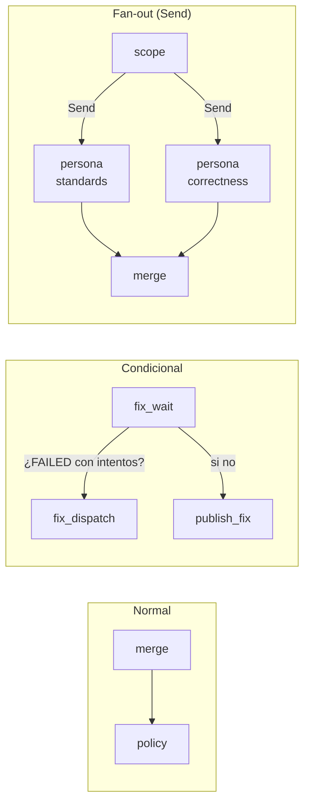

### Idea 4 — Reducers: qué pasa si dos nodos escriben la misma clave

Si dos ramas paralelas escriben `findings` a la vez, ¿cuál gana? Por defecto, la
última sustituye a la anterior (y además LangGraph se queja). Con un **reducer** le
dices cómo combinarlas:

```python
findings: Annotated[list[Finding], operator.add]   # concatena las listas
merged: list[Finding]                               # sin reducer: sustituye
```

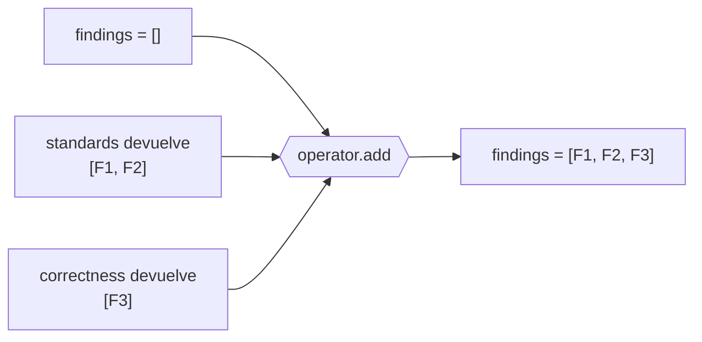

### Idea 5 — Checkpoint, hilo e `interrupt`: pausar sin bloquear

- Al compilar el grafo con un **checkpointer** (en `reviews`, Postgres), LangGraph
  guarda una foto del estado **después de cada paso**.
- Cada ejecución tiene un **`thread_id`** (aquí, la `review_key` del PR). Volver a
  invocar con el mismo `thread_id` continúa esa historia en vez de empezar otra.
- Dentro de un nodo, **`interrupt(valor)`** detiene la ejecución: el `invoke` vuelve
  al llamante, la foto queda en Postgres y el proceso puede seguir con otras cosas.
  Más tarde, `invoke(Command(resume=respuesta), thread_id)` **re-ejecuta ese nodo
  desde su primera línea** y esta vez `interrupt(...)` devuelve `respuesta`.

```mermaid
sequenceDiagram
    participant W as worker
    participant G as grafo
    participant PG as Postgres (checkpoints)
    W->>G: invoke(input, thread_id="pr-42")
    G->>PG: foto tras cada nodo
    G-->>W: interrupt(pregunta) → invoke retorna
    Note over W: el worker sigue con otros PR<br/>(horas o días)
    W->>G: invoke(Command(resume=respuesta), thread_id="pr-42")
    PG-->>G: carga la última foto
    G->>G: re-ejecuta el nodo; interrupt() devuelve respuesta
    G->>PG: sigue hasta END
```

> **Superstep.** LangGraph avanza por "tandas": en cada tanda ejecuta **todos** los
> nodos que estén listos (en paralelo), fusiona sus cambios con los reducers y guarda
> el checkpoint. Las ramas del fan-out corren en la misma tanda; `merge` no empieza
> hasta que **todas** han terminado.

Con esto basta para seguir el resto. Cada idea tiene su módulo propio: estado
([01](01-grafos-y-estado.md)), reducers ([02](02-reducers.md)), fan-out
([03](03-ramificacion-y-fan-out.md)), checkpoints
([04](04-durabilidad-y-checkpoints.md)), re-invocación
([05](05-invocacion-y-reejecucion.md)) e `interrupt` ([06](06-hitl.md)).

---

## 2. El grafo de `reviews`, nodo a nodo

### 2.1 El mapa

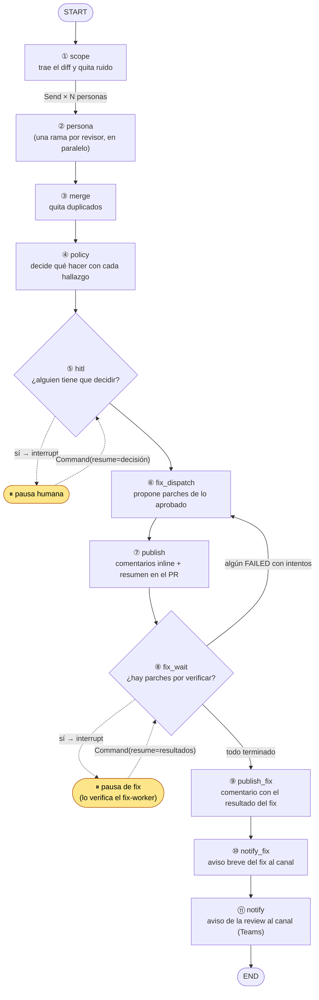

Las flechas punteadas no son aristas del grafo: son la **pausa** (`interrupt`) y la
**reanudación** (`Command(resume=…)`), que ocurren en invocaciones distintas.

Así se declara en el código (`build_graph`, al final):

```python
graph.add_edge(START, "scope")
graph.add_conditional_edges("scope", dispatch, ["persona"])   # fan-out con Send
graph.add_edge("persona", "merge")                            # fan-in
graph.add_edge("merge", "policy")
graph.add_edge("policy", "hitl")
graph.add_edge("hitl", "fix_dispatch")
graph.add_edge("fix_dispatch", "publish")
graph.add_edge("publish", "fix_wait")
graph.add_conditional_edges(
    "fix_wait", _route_fix_wait,
    {"fix_dispatch": "fix_dispatch", "publish_fix": "publish_fix"},
)
graph.add_edge("publish_fix", "notify_fix")
graph.add_edge("notify_fix", "notify")
graph.add_edge("notify", END)
```

Fíjate en algo que sorprende al principio: **no hay aristas que se salten nodos**.
`hitl` siempre va a `fix_dispatch`, aunque no haya nada que arreglar. La decisión de
"no hacer nada" vive **dentro** de cada nodo (devuelve `{}`), no en el dibujo. Así el
grafo es una línea casi recta, fácil de razonar, y cada nodo es un no-op barato
cuando no le toca.

### 2.2 Qué hace cada nodo

| # | Nodo | Lee del estado | Escribe en el estado | Efecto externo | ¿Reintento? |
|---|---|---|---|---|---|
| ① | `scope` | `request` | `request`, `diff`, `findings=[]`, `source_status={}`, `fix_recipes`, `fix_max_attempts` | Lee el diff del VCS | Sí |
| ② | `persona` | `request`, `diff`, `reviewer` | `findings`, `finding_sources`, `source_status` | LLM o salida de PHPStan | Sí; en el último intento degrada a 0 hallazgos |
| ③ | `merge` | `findings`, `finding_sources` | `merged` | — (puro) | No |
| ④ | `policy` | `merged` | `decisions` | — (puro, lee `autonomy.yaml`) | No |
| ⑤ | `hitl` | `decisions`, `human_decisions` | `human_decisions` | `interrupt` | **Nunca** |
| ⑥ | `fix_dispatch` | `merged`, `decisions`, `human_decisions`, `fixes` | `fixes` | LLM fixer, lee ficheros del VCS | Sí |
| ⑦ | `publish` | casi todo | `published`, `inlined_count` | Comenta en el PR | Sí |
| ⑧ | `fix_wait` | `fixes`, `fix_resolution` | `fixes`, `fix_resolution=None` | `interrupt` | **Nunca** |
| ⑨ | `publish_fix` | `fixes`, `merged` | — | Comenta en el PR | Sí |
| ⑩ | `notify_fix` | `fixes` | — | Encola aviso para Teams | Sí |
| ⑪ | `notify` | `published`, `merged`, `decisions` | — | Encola aviso para Teams | Sí |

¿Por qué `hitl` y `fix_wait` **nunca** se reintentan? Porque un reintento volvería a
ejecutar `interrupt` y duplicaría la pausa. ¿Por qué `merge` y `policy` no lo
necesitan? Porque no hablan con nadie de fuera: si fallan, es un bug, y reintentar no
lo arregla. El detalle de la `RetryPolicy` está en el
[módulo 08](08-resiliencia-retries.md).

---

## 3. El estado: la mochila que viaja por el grafo

### 3.1 Cómo se llena

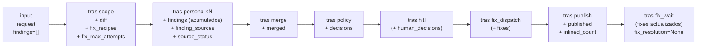

Entre paréntesis, lo que solo aparece en algunos casos.

### 3.2 Reducers de cada clave

| Clave | Cómo se fusiona | Por qué |
|---|---|---|
| `findings` | `operator.add` (concatena) | Varias personas escriben a la vez |
| `finding_sources`, `source_status`, `fixes` | Merge de diccionarios | Cada rama (o cada fix) escribe su propia clave |
| Todas las demás (`merged`, `decisions`, `diff`…) | Sustituye | Solo las escribe un nodo |

Un detalle importante: `merged` es una clave **distinta** de `findings`. Si `merge`
escribiera el resultado deduplicado en `findings`, el reducer `operator.add` lo
**sumaría** a la lista original en lugar de sustituirla. Por eso los hallazgos
"crudos" y los "limpios" viven en claves separadas.

### 3.3 `reviewer`: la clave que solo existe en una rama

`dispatch` crea cada rama con un mini-estado propio:

```python
Send("persona", {"request": request, "diff": state["diff"], "reviewer": reviewer.name})
```

`reviewer` solo existe dentro de esa rama: le dice al nodo `persona` *qué* revisor
le toca. Lo que la rama devuelve (`findings`, …) sí vuelve al estado principal, a
través de los reducers.

---

## 4. Quién arranca el grafo: el worker y los cuatro estados del hilo

El grafo no se ejecuta solo. El **worker** saca trabajos de una cola de Redis y, para
cada uno, llama a `process_request`. Antes de invocar, **mira la foto** del hilo
(`graph.get_state(thread_id)`) y decide cómo llamar:

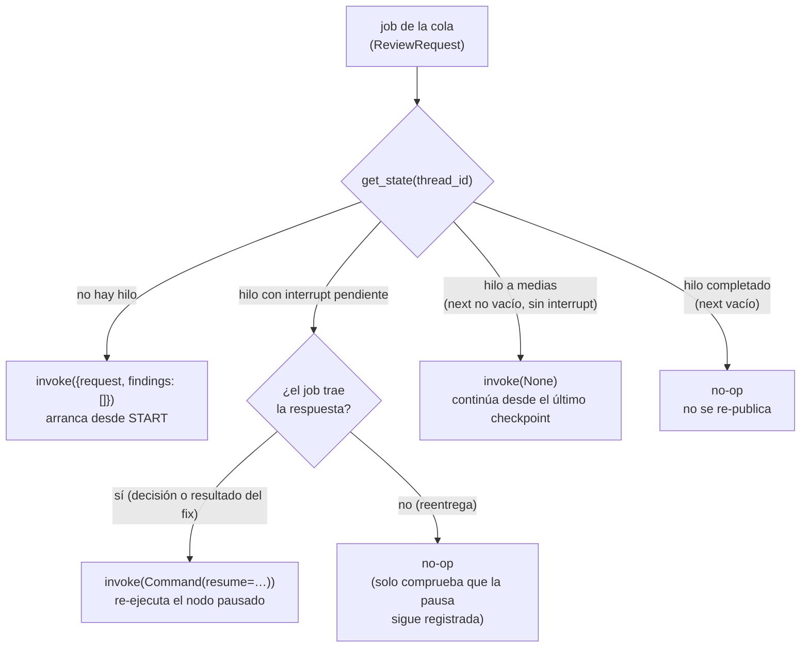

Esto es **la** clave para entender `reviews`: el mismo job puede llegar dos veces
(reintentos, reentregas, un worker que murió) y el grafo nunca repite trabajo
pagado (LLM) ni comentarios en el PR. El porqué de `invoke(None)` frente a
`invoke(input)` está en el [módulo 05](05-invocacion-y-reejecucion.md).

El `thread_id` es la `review_key` del PR: `repo:pr_id:head_sha:pipeline_id`. Un
pipeline nuevo sobre el mismo commit es una review nueva (hilo nuevo); repetir el
mismo pipeline reutiliza el hilo.

### 4.1 Antes del grafo: cómo llega el job

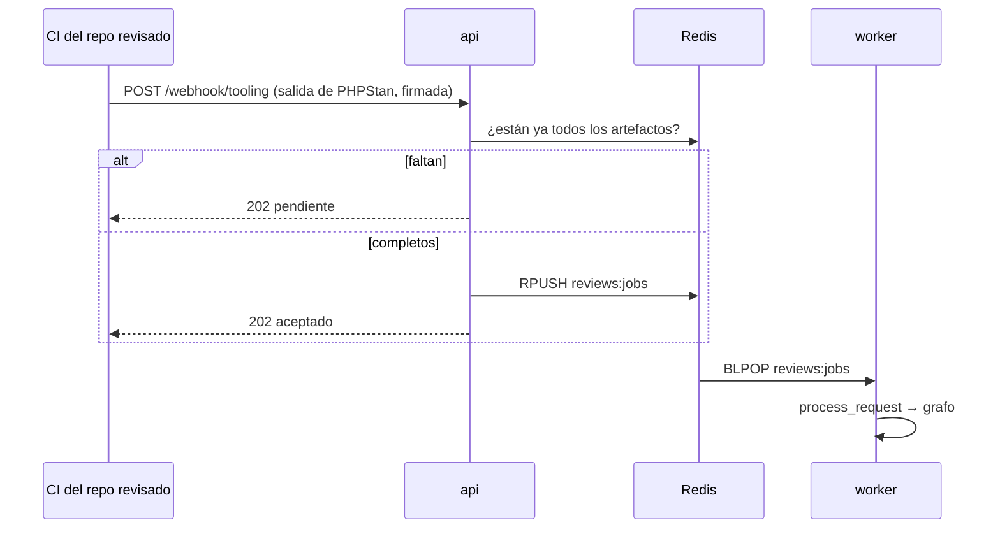

El detalle de la ingesta está en [`arquitectura.md` §4.1](../arquitectura.md#41-ingesta-api).

---

## 5. Caso A — PR sin hallazgos

**Situación:** un PR pequeño y limpio. PHPStan no se queja y el LLM no encuentra nada.

### 5.1 Recorrido

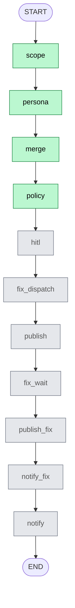

Verde: el nodo hace trabajo. Gris: el nodo se ejecuta pero devuelve `{}` en seguida.

### 5.2 Paso a paso

| Superstep | Nodo(s) | Qué pasa | Estado después |
|---|---|---|---|
| 1 | `scope` | Pide el diff, quita `composer.lock` y demás ruido | `diff` relleno |
| 2 | `persona` ×2 (en paralelo) | `standards` lee PHPStan → `[]`; `correctness` llama al LLM → `[]` | `findings = []` |
| 3 | `merge` | Nada que deduplicar | `merged = []` |
| 4 | `policy` | Nada que decidir | `decisions = []` |
| 5 | `hitl` | `build_approval` → `None`: no hay pendientes | — |
| 6 | `fix_dispatch` | Sin candidatos | — |
| 7 | `publish` | `not findings and not unavailable` → **no comenta nada** | `published` no se escribe |
| 8 | `fix_wait` | Sin `PENDING` → `{}`; `_route_fix_wait` → `publish_fix` | — |
| 9–11 | `publish_fix`, `notify_fix`, `notify` | Nada resuelto; `published` no es `True` → sin aviso | — |

**Resultado:** el PR queda sin comentarios y Teams no recibe nada. Una invocación del
grafo, cero pausas.

> Si una herramienta estática **no** llegó a ejecutarse, "sin hallazgos" no significa
> "PR limpio": ese es el [caso G](#11-caso-g--falta-un-artefacto-del-ci-review-degradada),
> y `publish` sí comenta, con un aviso.

---

## 6. Caso B — PR con hallazgos en modo *report* (el de hoy)

**Situación:** la configuración por defecto (`config/autonomy.yaml`,
`max_autonomy: report`). El agente **informa**, pero nunca pausa ni arregla: el
techo `report` degrada todas las acciones a `report`, incluida `escalate`.

Usaremos un ejemplo concreto. Dos revisores:

- `standards` (PHPStan) encuentra **F1** en `src/Wallet.php:42`, "Call to undefined method".
- `correctness` (LLM) encuentra **F2** en `src/Wallet.php:44`, el mismo título (lo ancló
  dos líneas más abajo), y **F3** en `src/Order.php:10`, "Posible división por cero".

### 6.1 El fan-out en detalle

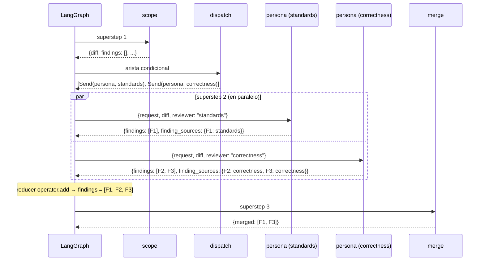

### 6.2 El merge

`merge` agrupa por `(fichero, título)` y fusiona si:

- coinciden fichero, línea y título, **o**
- coinciden fichero y título, vienen de **personas distintas** y están a ≤ 5 líneas.

F1 (standards, línea 42) y F2 (correctness, línea 44) son el mismo problema visto dos
veces → se quedan en uno, el de evidencia más rica. F3 sigue solo. La regla está en
[ADR-0014](../adr/0014-criterio-de-merge-entre-personas.md).

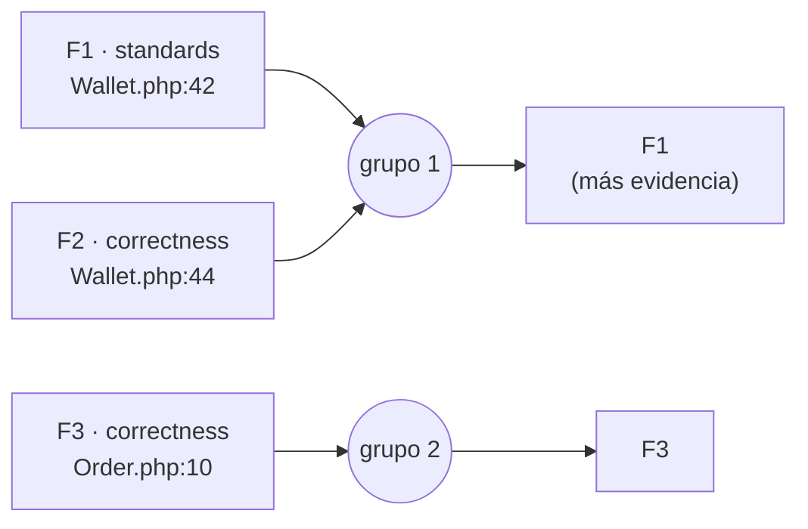

### 6.3 La política

`policy` recorre `merged` y, para cada hallazgo, evalúa las reglas de
`autonomy.yaml` **en orden** (gana la primera que casa). Después aplica el techo:

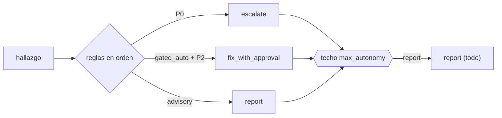

Con el techo en `report`, F1 y F3 salen con `action = report`.

### 6.4 Del `hitl` al final

| Superstep | Nodo | Qué pasa |
|---|---|---|
| 5 | `hitl` | Ninguna decisión es `escalate` ni `fix_with_approval` → no pausa |
| 6 | `fix_dispatch` | Ningún hallazgo aprobado con acción `fix_*` → `{}` |
| 7 | `publish` | Ordena por severidad, resuelve el ancla de cada hallazgo en el diff, publica **un comentario inline por hallazgo** (hasta `max_inline_comments`) y al final **un resumen**. Cada comentario lleva una marca HTML (`<!-- reviews:<hash>:i:<id> -->`, `…:ok`) |
| 8 | `fix_wait` | Sin `PENDING` → pasa a `publish_fix` |
| 9–10 | `publish_fix`, `notify_fix` | Sin fixes → `{}` |
| 11 | `notify` | `published == True` → encola el aviso para Teams con los 5 hallazgos más graves |

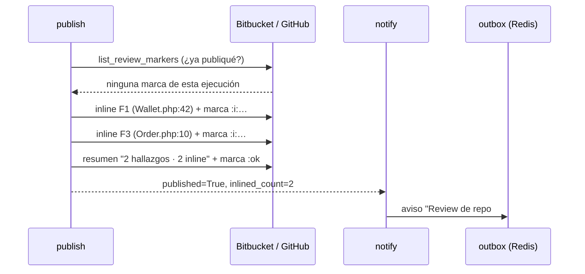

Si un hallazgo no tiene un ancla válida en el diff (por ejemplo, la línea no está en
el cambio), no se pierde: va **solo al resumen**.

**Resultado:** una invocación, cero pausas, comentarios en el PR y aviso en Teams.

---

## 7. Caso C — Pausa para que decida una persona (HITL)

**Situación:** se ha subido el techo (`max_autonomy: fix_with_approval`). Ahora un
hallazgo P0 sale como `escalate` y **el grafo tiene que esperar** a que una persona
diga qué hacer antes de publicar.

### 7.1 Primera invocación: hasta la pausa

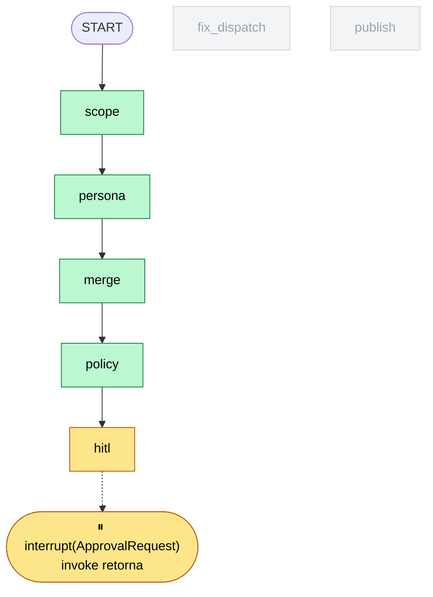

Dentro de `hitl` pasa esto:

```python
def hitl(state):
    if state.get("human_decisions") is not None:
        return {}                         # ya decidió alguien: seguir
    approval = build_approval(state)      # pendientes = escalate / fix_with_approval
    if approval is None:
        return {}                         # nada que preguntar: seguir
    while True:
        resume_value = interrupt(approval)   # ← aquí se detiene la 1.ª vez
        update = apply_hitl(state, resume_value)
        if update:
            return update                 # decisión completa: {"human_decisions": …}
        # decisión incompleta o ilegible: vuelve a pausar
```

Cuando `interrupt` se dispara:

1. LangGraph guarda el checkpoint (el estado tras `policy`, con `next = ("hitl",)`).
2. `graph.invoke(...)` **retorna** al worker. No hay ningún hilo bloqueado esperando.
3. El worker ve que el hilo está pausado y llama a `_on_paused`:
   - registra la pausa en el **inbox** (`reviews:paused:<review_key>`, Redis);
   - encola en la outbox un aviso para Teams con la tarjeta de decisión.
4. El worker pasa al siguiente job de la cola.

**Ojo:** la review **todavía no se ha publicado** en el PR. Nada sale hasta que se
decide.

### 7.2 La espera (fuera del grafo)

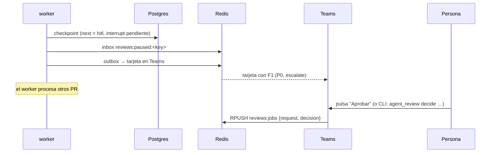

La persona tiene tres respuestas por hallazgo: `approved`, `rejected` (falso
positivo) o `noted` (se atiende fuera). Si nadie decide antes de `DECISION_TTL_S`, el
barrido `sweep_expired` encola él mismo una decisión `expired` firmada por
`system:ttl`: **una pausa nunca se queda colgada para siempre**.

### 7.3 Segunda invocación: la reanudación

El worker saca el job, ve que el hilo tiene un `interrupt` pendiente y que el job
trae `decision`, y llama:

```python
graph.invoke(Command(resume=request.decision), config={"configurable": {"thread_id": …}})
```

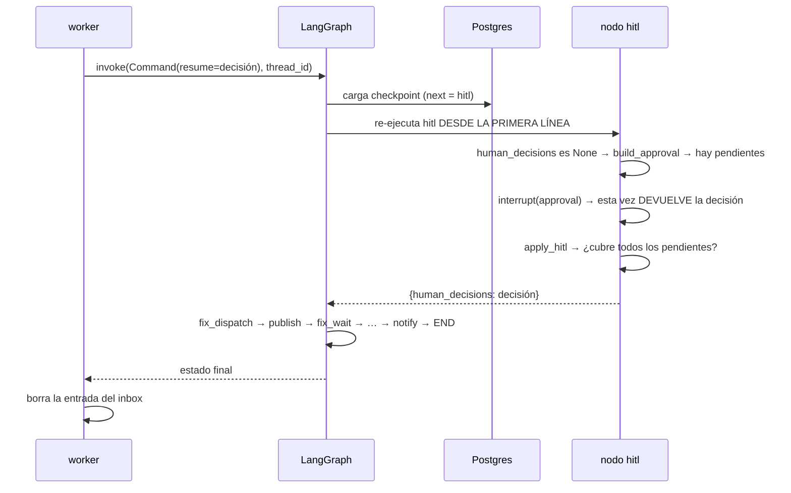

Lo que más confunde al principio: **el nodo no continúa desde la línea del
`interrupt`**, se ejecuta otra vez entero. Por eso todo lo que hay *antes* del
`interrupt` tiene que ser seguro de repetir (aquí lo es: solo lee el estado). Más en
el [módulo 06](06-hitl.md).

### 7.4 Qué publica según la decisión

| Decisión sobre F1 | Inline | Resumen | Línea añadida |
|---|---|---|---|
| `approved` | Sí | Sí | `_Decision: aprobado · ana_` |
| `noted` | Sí | Sí | `_Decision: anotado · ana_` |
| `expired` | Sí | Sí | `_Decision: sin decision (expirado) · system:ttl_` |
| `rejected` | **No** | Sí | "Descartado por una persona: no se anota inline." |

Como F1 era `escalate` (no `fix_*`), `fix_dispatch` no hace nada aunque esté
aprobado. Para que haya fix, el hallazgo tiene que ser `fix_with_approval`: es el
caso D.

### 7.5 Variante: decisión incompleta

Si la decisión no cubre todos los pendientes (o no se puede validar), `apply_hitl`
devuelve `{}` y el `while True` vuelve a llamar a `interrupt`: el hilo **sigue
pausado** con la misma pregunta. No se lanza una excepción a propósito: LangGraph
guarda el valor del resume en el checkpoint y lo re-entregaría en cada intento,
dejando el hilo atascado.

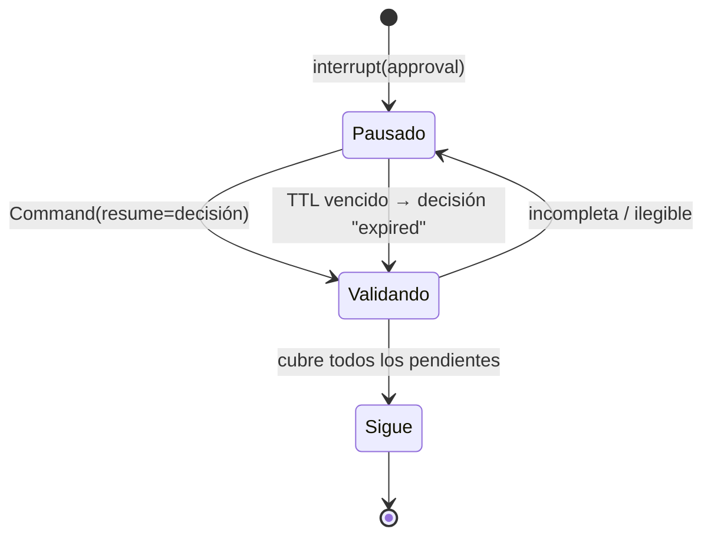

**Resultado:** dos invocaciones del grafo, una pausa humana.

---

## 8. Caso D — Fix aprobado y verificado

**Situación:** F3 ("posible división por cero", P2, `autofix_class: gated_auto`) casa
con la regla `gated_auto + P1/P2 → fix_with_approval`. Una persona lo aprueba. El
agente propone un parche, **otro proceso** lo verifica en un sandbox con los tests del
proyecto y, si pasa, lo publica como sugerencia.

Aquí hay **dos pausas** en el mismo hilo y **tres invocaciones** del grafo.

### 8.1 Vista general en el tiempo

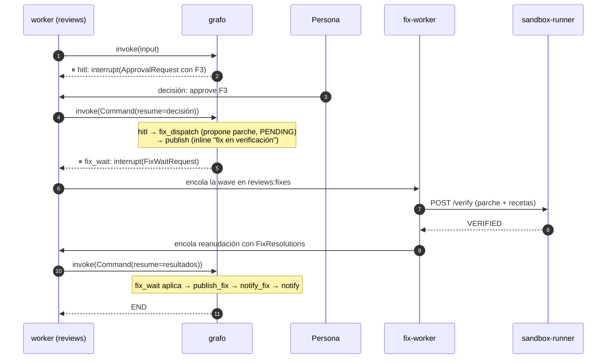

### 8.2 La segunda invocación, nodo a nodo

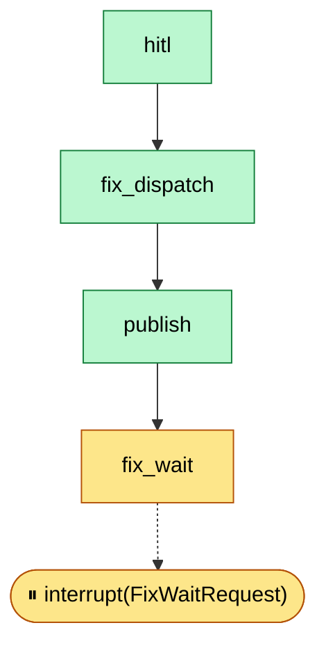

- **`fix_dispatch`** selecciona los candidatos: aprobados por la persona **y** con
  acción `fix_*` (hasta `max_fixes_per_pr`). Para cada uno:
  1. ¿Ruta protegida (`never_auto_paths`) o tema protegido? → `BLOCKED`, ni con
     aprobación.
  2. Pide el fichero al VCS y un parche al LLM *fixer*.
  3. Valida el parche **localmente** (aplica, no se pasa de `max_fix_lines`…) →
     `INVALID_PATCH` si no.
  4. Si vale: `PENDING` con su `VerifyJob`. **No** llama al sandbox.
- **`publish`** publica la review como en el caso B, pero el inline de F3 dice
  *"Fix en verificación (runner); se publicará como respuesta"*.
- **`fix_wait`** ve un `PENDING` y llama a `interrupt(wave)`.

¿Por qué publicar antes de verificar? Porque la verificación tarda (puede rondar los
20 minutos) y no queremos que el PR espere a los tests para ver la review. La
verificación vive en otro proceso, el `fix-worker`, que nunca toca el grafo ni el PR.

### 8.3 La tercera invocación

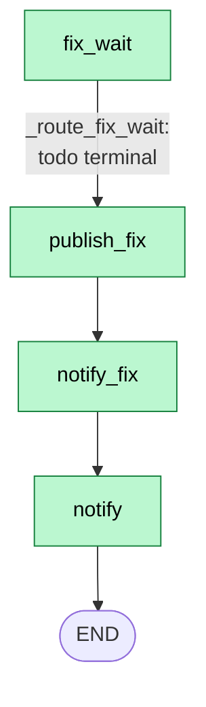

```python
def fix_wait(state):
    resolutions = state.get("fix_resolution")
    if resolutions is None:
        wave = build_fix_wait(state)
        if wave is None:
            return {}
        resolutions = interrupt(wave)       # 2.ª invocación: pausa / 3.ª: devuelve resultados
    applied = apply_resolutions(..., resolutions=...)
    return {"fix_resolution": None, "fixes": applied}
```

Igual que en `hitl`, el nodo se re-ejecuta desde arriba e `interrupt` devuelve ahora
la `FixResolutions`. `apply_resolutions` pasa F3 de `PENDING` a `VERIFIED`. Después:

- `_route_fix_wait`: ¿queda algún `FAILED` con intentos? No → `publish_fix`.
- `publish_fix`: comentario de seguimiento "## Fix verificado" con la sugerencia y la
  marca `:fix` (una sola vez por review).
- `notify_fix`: aviso breve en Teams, "1 fix(es) resuelto(s): verified: 1".
- `notify`: aviso de la review. `published` ya era `True` desde la invocación
  anterior: viaja en el checkpoint.

### 8.4 Los estados de un fix

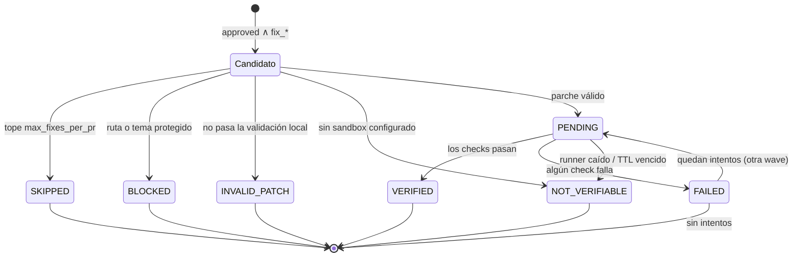

Sin sandbox (`verification_enabled=False`), `fix_dispatch` marca los candidatos
`NOT_VERIFIABLE` directamente y `fix_wait` no llega a pausar: el caso D se queda en
dos invocaciones.

**Resultado:** tres invocaciones, dos pausas (humana y de fix).

---

## 9. Caso E — El fix falla y se reintenta (el bucle)

**Situación:** como el caso D, pero el sandbox devuelve `FAILED` (por ejemplo, un test
rojo) y aún quedan intentos (`max_fix_attempts: 2`).

Aquí aparece el **único ciclo** del grafo: `fix_wait → fix_dispatch`.

```mermaid
flowchart TD
    fix_wait{"fix_wait<br/>aplica: F3 = FAILED (intento 1)"} -->|"_route_fix_wait:<br/>FAILED y 1 < 2"| fix_dispatch
    fix_dispatch["fix_dispatch<br/>re-propone F3 con el log del fallo<br/>→ PENDING (intento 2)"] --> publish
    publish["publish<br/>ve sus marcas en el PR → no re-publica"] --> fix_wait2
    fix_wait2{"fix_wait<br/>PENDING → interrupt"} -.-> P(["⏸ otra wave"])
    P -.->|"resume: VERIFIED o FAILED (intento 2)"| fix_wait3{"fix_wait"}
    fix_wait3 -->|"terminal o sin intentos"| publish_fix
```

Tres detalles que hacen que el bucle sea seguro:

1. **Siempre avanza.** Cada vuelta consume un intento; con `attempts == max` se sale a
   `publish_fix` aunque siga `FAILED`.
2. **`publish` no duplica.** Se vuelve a ejecutar, pero antes lee las marcas del PR
   (`:ok`, `:i:<id>`) y, si ya publicó esta ejecución, devuelve `{}`.
3. **`fixes` se fusiona por `finding_id`.** Un fix que no se re-propone conserva su
   resultado: el reducer `_merge_fixes` solo sustituye las claves que cambian.

Si al final sigue `FAILED`, `publish_fix` publica "## Resultado del fix" con la cola
del log del check que falló, para que nadie aplique el parche a ciegas.

**Resultado:** cuatro invocaciones (una más por wave extra), tres pausas.

---

## 10. Caso F — Algo se rompe a mitad

El grafo tiene **dos capas** de reintento
([ADR-0007](../adr/0007-reintento-en-dos-capas.md)):

```mermaid
flowchart TD
    E["excepción en un nodo"] --> T{"¿transitoria?<br/>(timeout, 429, red…)"}
    T -->|"no"| JOB
    T -->|"sí"| RP{"RetryPolicy del nodo<br/>¿quedan intentos? (máx. 3)"}
    RP -->|"sí"| RETRY["espera (0,5 s, 1 s, 2 s…)<br/>y re-ejecuta SOLO ese nodo"]
    RP -->|"no"| JOB["el invoke falla<br/>→ el worker reencola el job"]
    JOB --> NEXT["siguiente intento del job:<br/>hilo a medias → invoke(None)<br/>continúa desde el último checkpoint"]
    JOB -->|"agotados los intentos del job"| DLQ[("DLQ<br/>reviews:jobs:dead")]
```

### F1 — El LLM de una persona no responde

`persona` tiene `RetryPolicy`. Si en el **último** intento sigue fallando por una causa
transitoria, en vez de lanzar la excepción devuelve `{"findings": []}`: esa persona
aporta cero hallazgos y la review **sigue** con lo que han encontrado las demás. Una
persona caída no tumba la review.

### F2 — El worker muere después de `merge`

```mermaid
sequenceDiagram
    participant W1 as worker (intento 1)
    participant PG as Postgres
    participant W2 as worker (intento 2)
    W1->>PG: checkpoint tras scope
    W1->>PG: checkpoint tras persona ×2 (LLM ya pagado)
    W1->>PG: checkpoint tras merge
    Note over W1: 💥 el proceso muere
    W2->>PG: get_state(thread_id) → next = ("policy",)
    W2->>W2: hilo a medias → invoke(None)
    PG-->>W2: carga el estado tras merge
    W2->>W2: policy → hitl → … → END
```

Gracias al checkpoint, el segundo intento **no** vuelve a llamar al LLM. Si el worker
llamara a `invoke(input)` en lugar de `invoke(None)`, arrancaría desde `START`,
pagaría el LLM otra vez y el reducer `operator.add` **duplicaría** los `findings`.
Este fue un bug real (B2, en [`arquitectura.md` §8](../arquitectura.md#8-registro-de-fallos-corregidos-revisión-de-main-2026-10-11)).

### F3 — `publish` falla a mitad (ya publicó dos inlines)

El reintento vuelve a ejecutar `publish` entero, pero cada inline lleva su marca
`:i:<id>`: los dos ya publicados se reconocen y no se repiten; solo sale lo que
faltaba. Esto es idempotencia de efectos externos, el tema del
[módulo 07](07-idempotencia-y-efectos.md).

### F4 — Teams falla al avisar

El aviso va en su **propio nodo** (`notify`), separado de `publish`, a propósito. Si
falla, el reintento continúa desde el checkpoint *tras* `publish`: se reintenta el
aviso, **no** la publicación. Si el fallo no es transitorio (un bug del canal), se
registra en el log y la review se da por terminada: ya está en el PR.

---

## 11. Caso G — Falta un artefacto del CI (review degradada)

**Situación:** el perfil del repo espera la salida de PHPStan, pero el CI no la manda.
La API no encola la review hasta tener todos los artefactos… salvo que venza el TTL
de la ingesta.

```mermaid
sequenceDiagram
    participant API as api
    participant R as Redis
    participant W as worker
    participant G as grafo
    participant VCS as PR
    API->>R: PendingReview (falta phpstan)
    Note over R: pasa el TTL de ingesta
    W->>R: sweep_pending → encola request con degraded=True
    W->>G: invoke, thread_id = "<review_key>:partial"
    G->>G: persona standards → source_status = MISSING
    G->>VCS: resumen con "Review incompleta" + marca :partial
    Note over API: más tarde llega el artefacto
    API->>R: barrera completa → encola request normal
    W->>G: invoke, thread_id = "<review_key>" (otro hilo)
    G->>VCS: review completa + marca :ok
```

Lo interesante para LangGraph:

- La pasada degradada usa **otro hilo** (`…:partial`). Si compartiera hilo con la
  completa, cuando llegara el artefacto el worker vería el hilo "completado" y no
  haría nada ([ADR-0005](../adr/0005-identidad-de-la-ejecucion.md)).
- `publish` publica **aunque no haya hallazgos**, con un aviso delante: "esta review
  no cubre ese análisis y su ausencia de hallazgos no equivale a un PR limpio".
- Las marcas distinguen `:partial` de `:ok`: una degradada repetida no se re-publica;
  una completa posterior sí, y sustituye a la degradada.

---

## 12. Resumen comparado de los casos

| Caso | `max_autonomy` | Invocaciones | Pausas | Qué aparece en el PR | Aviso en Teams |
|---|---|---|---|---|---|
| A · sin hallazgos | cualquiera | 1 | 0 | Nada | No |
| B · report | `report` | 1 | 0 | Inline + resumen | Sí |
| C · HITL | `fix_with_approval` | 2 | 1 humana | Inline + resumen con la decisión | Tarjeta de decisión + aviso |
| D · fix verificado | `fix_with_approval` | 3 | 1 humana + 1 de fix | Inline "en verificación" + resumen + seguimiento "Fix verificado" | Tarjeta + aviso + aviso del fix |
| E · fix con reintento | `fix_with_approval` | 3 + 1 por wave extra | 1 humana + N de fix | Igual que D, con el log si sigue fallando | Igual que D |
| F · fallo a mitad | cualquiera | +1 por reintento del job | — | Lo mismo que sin fallo, sin duplicados | Lo mismo |
| G · degradada | cualquiera | 1 por pasada (hilos distintos) | — | Resumen "Review incompleta" (`:partial`), luego la completa (`:ok`) | Sí |

Y qué nodos trabajan de verdad en cada caso:

| Nodo | A | B | C | D | E |
|---|:-:|:-:|:-:|:-:|:-:|
| `scope`, `persona`, `merge`, `policy` | ✅ | ✅ | ✅ | ✅ | ✅ |
| `hitl` | · | · | ⏸ | ⏸ | ⏸ |
| `fix_dispatch` | · | · | · | ✅ | ✅ 🔁 |
| `publish` | · | ✅ | ✅ | ✅ | ✅ (luego dedupe) |
| `fix_wait` | · | · | · | ⏸ | ⏸ 🔁 |
| `publish_fix`, `notify_fix` | · | · | · | ✅ | ✅ |
| `notify` | · | ✅ | ✅ | ✅ | ✅ |

✅ trabaja · `·` se ejecuta pero no hace nada · ⏸ pausa · 🔁 se repite en el bucle.

> **Nota sobre `fix_auto`.** La política ya puede devolver `fix_auto`, pero hoy
> `fix_dispatch` solo arregla lo que una persona aprobó, y `fix_auto` no pausa: en la
> práctica se comporta como `report`. La autonomía real es la Fase 4 (ver
> [`arquitectura.md` §6](../arquitectura.md#6-estado-por-fase)).

---

## 13. Experimentos propuestos

1. **Dibuja el grafo tú mismo.** LangGraph lo genera a partir del código:

   ```python
   from agent_review.graph.build import build_graph
   g = build_graph(vcs=..., reviewers=[...], policy=...).compile()
   print(g.get_graph().draw_mermaid())
   ```

   Pega la salida en <https://mermaid.live> y compárala con la [§2.1](#21-el-mapa).

2. **Mira los supersteps.** Con un `InMemorySaver` y adaptadores falsos (los de
   `tests/`), ejecuta con `stream_mode="updates"` y observa qué devuelve cada nodo en
   el caso B. Verás las dos `persona` en el mismo paso y muchos `{}` (ver
   [módulo 09](09-streaming-y-observabilidad.md)).

3. **Provoca una pausa.** Pon `max_autonomy: fix_with_approval`, haz que una persona
   falsa devuelva un P0 y, tras el primer `invoke`, inspecciona
   `graph.get_state(config)`: `next`, `interrupts` y `values["decisions"]`. Después
   reanuda con `Command(resume=HitlDecision(...))`.

4. **Rompe el `invoke(None)`.** En un test, sustituye `invoke(None)` por
   `invoke({"request": …, "findings": []})` sobre un hilo a medias y mira cómo se
   duplican los `findings`. Es el bug B2 reproducido a mano.

5. **Recorre el bucle.** Reanuda `fix_wait` dos veces con una `FixResolutions` que
   diga `FAILED` y comprueba que a la segunda `_route_fix_wait` sale a `publish_fix`.
