Última modificación: 2026-10-17 | Creado: 2026-10-16

# 12 — Recorrido de una review con todas las iniciativas entregadas

El [módulo 11](11-recorrido-de-una-review.md) recorre el grafo **tal como es hoy**.
Este hace el mismo ejercicio sobre la **foto final**: el sistema que quedaría si se
entregasen todas las iniciativas que siguen abiertas (007–012, 014, 015 y 018) tal
como están escritas sus specs a fecha de creación de este documento. Las que ya se
entregaron mientras tanto (016 y 017) aparecen marcadas como tales: su parte es
descriptiva, no prospectiva.

> **Documento prospectivo.** Salvo lo ya entregado (016 y 017), esto no describe el
> código de hoy; para eso están [`arquitectura.md`](../arquitectura.md) y el módulo
> 11. Varias specs siguen en `borrador` con preguntas abiertas: donde una pregunta no
> está resuelta, aquí se toma la propuesta de la propia spec y se marca con
> **(supuesto)**. La lista completa está en la [§2](#2-qué-se-da-por-hecho). Si una
> spec cambia, la fuente es la spec, no este documento.

Se lee mejor después del módulo 11: aquí solo se explica con detalle lo que cambia.
Lo que no cambia (las cinco ideas de LangGraph, el worker y los cuatro estados del
hilo, el bucle del fix, la review degradada por falta de artefacto) se enlaza.

---

## Índice

1. [Qué cambia, en una página](#1-qué-cambia-en-una-página)
2. [Qué se da por hecho](#2-qué-se-da-por-hecho)
3. [El grafo final, nodo a nodo](#3-el-grafo-final-nodo-a-nodo)
4. [El estado final](#4-el-estado-final)
5. [Lo que envuelve al grafo: presupuesto, lectura y trazas](#5-lo-que-envuelve-al-grafo-presupuesto-lectura-y-trazas)
6. [Caso A — PR sin hallazgos](#6-caso-a--pr-sin-hallazgos)
7. [Caso B — PR con hallazgos: la cascada completa](#7-caso-b--pr-con-hallazgos-la-cascada-completa)
8. [Caso C — Dentro de una persona con herramientas](#8-caso-c--dentro-de-una-persona-con-herramientas)
9. [Caso D — Pausa humana con severidades ganadas](#9-caso-d--pausa-humana-con-severidades-ganadas)
10. [Caso E — Fix aprobado y verificado](#10-caso-e--fix-aprobado-y-verificado)
11. [Caso F — PR grande: lotes, cobertura y presupuesto agotado](#11-caso-f--pr-grande-lotes-cobertura-y-presupuesto-agotado)
12. [Caso G — Algo se rompe a mitad](#12-caso-g--algo-se-rompe-a-mitad)
13. [La traza de una review](#13-la-traza-de-una-review)
14. [Resumen comparado](#14-resumen-comparado)
15. [Lo que sigue fuera de la foto](#15-lo-que-sigue-fuera-de-la-foto)
16. [Experimentos propuestos](#16-experimentos-propuestos)

---

## 1. Qué cambia, en una página

La review de hoy tiene un defecto de fondo, medido en la auditoría del PR #3
([006 §3.1](../iniciativas/archivo/006-eval-de-la-review/spec.md)): de 9 hallazgos
publicados, **6 eran falsos positivos**, y 6 problemas reales no se detectaron. Las
causas eran tres: el revisor **no veía** buena parte del PR, **afirmaba** sobre
código que no veía, y **nadie comprobaba** la severidad que el modelo elegía.

Las iniciativas atacan cada causa en una capa distinta. Juntas forman la **cascada
de verificación**: de lo barato y determinista a lo caro.

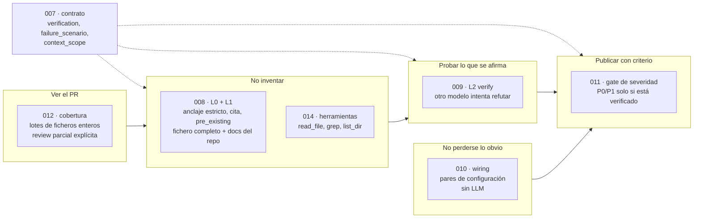

Y tres piezas transversales que no cambian qué se publica, sino cómo se opera:

| Iniciativa | Qué aporta a la foto |
|---|---|
| [017 · presupuesto por PR](../iniciativas/archivo/017-presupuesto-por-pr/spec.md) **(entregada)** | Un contador de tokens **por review**, compartido por todas las personas, sus lotes, los bucles de herramientas y el verificador. Agotarlo degrada; no falla ni gasta de más. |
| [018 · trazas](../iniciativas/018-trazas-de-la-review/spec.md) | Un árbol por review en Langfuse self-hosted: cada nodo, cada llamada al modelo (prompt, respuesta, `usage`) y cada llamada al VCS o al runner. |
| [015 · puesta en marcha real](../iniciativas/015-puesta-en-marcha-real/spec.md) | Smokes reales con evidencia y `production` sin fallbacks a memoria: sin Redis, la API responde `503` y el worker no arranca. |

La [016](../iniciativas/archivo/016-lector-de-contexto/spec.md) (lector de contexto)
y la [017](../iniciativas/archivo/017-presupuesto-por-pr/spec.md) (presupuesto por review) ya
están entregadas: la 016 es la pieza que 009 y 014 usan para leer el repositorio, y
la 017 reparte el gasto entre todas las piezas de la cascada.

**La regla que ordena todo:** las capas de la cascada producen **hechos**
(`verification`, `pre_existing`, `context_scope`); solo el gate de 011, dentro de
`policy`, los traduce en **severidad publicada**
([007 D11](../iniciativas/archivo/007-contrato-de-verificacion/spec.md)). Un hallazgo
publicado como `P3` tiene una única explicación, y está en un sitio.

---

## 2. Qué se da por hecho

Preguntas abiertas de las specs, resueltas aquí con la propuesta de cada spec. Son
**supuestos** del recorrido, no decisiones:

| Pregunta | Supuesto en este documento |
|---|---|
| [011 Q1](../iniciativas/011-gate-de-severidad/spec.md) · ¿degradar o sección «posibles»? | `on_unverified: degrade`, `degrade_to: P3` |
| [011 Q8](../iniciativas/011-gate-de-severidad/spec.md) · ¿`P2` exige verificación? | No: `require_verified_for: [P0, P1]` |
| [011 Q9](../iniciativas/011-gate-de-severidad/spec.md) · ¿qué se hace con un refutado? | `on_refuted: drop` (no se publica) |
| [008 Q1](../iniciativas/008-contexto-del-revisor/spec.md) · ¿de dónde sale el `base_sha`? | Lo trae el VCS en `PullRequestInfo` y viaja en el `request` |
| [008 Q2](../iniciativas/008-contexto-del-revisor/spec.md) · ¿qué ADR se inyectan? | Los que declare el perfil en `context_docs:` |
| [009 Q3](../iniciativas/009-verificador-adversarial/spec.md) · ¿verificar por lote o por hallazgo? | Por hallazgo, como dice el diseño de 009 §5.2 |
| [009 Q7](../iniciativas/009-verificador-adversarial/spec.md) · `VERIFIER_MAX_FINDINGS` | 5 por review |
| [010 Q1](../iniciativas/010-personas-de-wiring/spec.md) · ¿dónde vive el contrato de wiring? | En el perfil del repo revisado (bloque `wiring:`); la persona existe solo si el perfil lo declara |
| [012 Q1](../iniciativas/012-cobertura-de-la-review/spec.md) · ¿se mantiene `max_files_per_pr`? | Sí, como guarda de coste aplicada tras priorizar |
| [014 H4](../iniciativas/014-revisor-con-herramientas/spec.md) · roles con herramientas | Solo `correctness`; con 017 ya entregada se podría activar otro |
| [018 Q2/Q4](../iniciativas/018-trazas-de-la-review/spec.md) · cómo se instrumenta | Decorador `TracedLlm` sobre el puerto y envoltura de nodos en `build_graph` |
| Nombre de los ADR nuevos | Sin número: 007, 011 y 018 piden ADR, pero el número se asigna al escribirlo |

Y una más que no es pregunta abierta, sino el punto de partida: **`max_autonomy`
sigue en `report` por defecto**. Subirlo es un parámetro de uso, igual que hoy.

---

## 3. El grafo final, nodo a nodo

### 3.1 El mapa

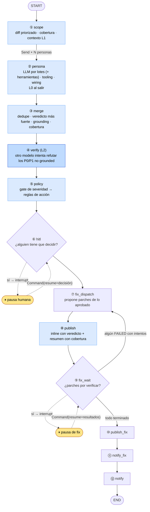

Azul fuerte: nodo nuevo. Azul claro: nodo que existe hoy y cambia por dentro. El
resto queda igual que en el [módulo 11 §2](11-recorrido-de-una-review.md#2-el-grafo-de-reviews-nodo-a-nodo).

Solo hay **un nodo nuevo** (`verify`, de 009) y **una arista nueva**
(`merge → verify → policy` en lugar de `merge → policy`). Todo lo demás de la
cascada vive **dentro** de nodos que ya existían. Es la misma filosofía del grafo
de hoy: una línea casi recta en la que cada nodo es un no-op barato cuando no le
toca. `verify` sin rol `verifier` configurado es un paso directo, y el grafo se
comporta exactamente como si no estuviera.

```python
graph.add_edge(START, "scope")
graph.add_conditional_edges("scope", dispatch, ["persona"])
graph.add_edge("persona", "merge")
graph.add_edge("merge", "verify")       # nuevo (009)
graph.add_edge("verify", "policy")      # nuevo (009)
graph.add_edge("policy", "hitl")
# ... de hitl a END, igual que hoy
```

¿Por qué `verify` va **después** de `merge` y **antes** de `policy`? Después de
`merge`, para que un problema visto por dos personas se verifique **una** vez. Antes
de `policy`, porque el gate necesita el veredicto ya resuelto para decidir si un `P1`
se publica como `P1`.

### 3.2 Qué hace cada nodo

| # | Nodo | Qué hace en la foto final | Iniciativas | ¿Reintento? |
|---|---|---|---|---|
| ① | `scope` | Lee el diff y el `base_sha`; quita ruido; **prioriza por clase** (código y configuración > tests > docs) antes de aplicar `max_files_per_pr`; crea la `ReviewCoverage` con lo descartado y su motivo; ensambla una vez el `ReviewContext` (ficheros completos a `head_sha` y `context_docs:` del perfil) | 012, 008 | Sí |
| ② | `persona` | Según el tipo: **LLM** revisa por lotes de ficheros enteros con su contexto L1 (y, si su rol está en `REVIEW_TOOLS_ROLES`, con bucle de herramientas) y pasa L0 a cada hallazgo; **tooling** convierte el artefacto del CI en hallazgos `verified_static`; **wiring** contrasta pares de configuración, también `verified_static`. Todas descuentan del presupuesto compartido | 012, 008, 014, 010, 007, 017 | Sí; en el último intento degrada a 0 hallazgos |
| ③ | `merge` | Deduplica como hoy ([ADR-0014](../adr/0014-criterio-de-merge-entre-personas.md)), pero conserva el **veredicto más fuerte** de cada grupo, estampa `grounded_findings` si participó una persona grounded, y consolida la cobertura | 011, 009, 012 | No (puro) |
| ④ | `verify` | Para cada candidato (no grounded, severidad en `require_verified_for`, hasta `VERIFIER_MAX_FINDINGS`), un modelo distinto lee el repo e **intenta refutar**. Escribe `verifications`; no toca `severity` | 009 | Sí; fallo permanente → `unverified` |
| ⑤ | `policy` | **Primero el gate**: refutado → `on_refuted`; `P0`/`P1` sin verificar → severidad efectiva `P3` y acción limitada a `report`. **Después** las reglas de acción de siempre, sobre la severidad efectiva | 011 | No (puro) |
| ⑥ | `hitl` | Igual que hoy. Lo que cambia es **qué llega**: solo `P0`/`P1` con prueba pueden escalar | — | **Nunca** |
| ⑦ | `fix_dispatch` | Igual que hoy | — | Sí |
| ⑧ | `publish` | Igual que hoy, más: línea de **veredicto** en cada inline, etiquetas «preexistente» / «fuera del diff» / «degradado», escenario del verificador si confirmó, y cabecera de **review parcial** si la cobertura lo es | 011, 012, 009, 008 | Sí |
| ⑨–⑫ | `fix_wait` … `notify` | Igual que hoy. El fixer descuenta de **su** contador de presupuesto | 017 | Como hoy |

Y una envoltura que no aparece en el dibujo: **cada nodo** abre un span de traza al
entrar y lo cierra al salir (018 T3). Se aplica en `build_graph`, no en cada función.

---

## 4. El estado final

### 4.1 Claves nuevas

| Clave | Tipo | Quién la escribe | Reducer | Iniciativa |
|---|---|---|---|---|
| `coverage` | `ReviewCoverage` | `scope` (ignorados, `max_files`) y `merge` (consolida lo que añaden las personas: `too_large`, `budget`) | Sustituye | 012 |
| `context` | `ReviewContext` | `scope`, una vez por review; viaja en el `Send` de cada rama | Sustituye | 008 |
| `grounded_findings` | `list[str]` | `merge` | Sustituye | 009 |
| `verifications` | `dict[str, VerificationResult]` | `verify`, idempotente sobre lo ya verificado | Sustituye | 009 |

Todos los tipos nuevos entran en la *allowlist* `_STATE_TYPES` del checkpointer
([`desarrollo.md`](../desarrollo.md) §3). Si no, un hilo pausado no podría
deserializarse al reanudar: es el mismo motivo por el que hoy está ahí `Finding`.

**(supuesto)** Cómo llega la cobertura de cada persona a `merge`: 012 lo deja en
`ReviewerResult.coverage`; aquí se da por hecho que la rama lo devuelve en una clave
con reducer de diccionario por persona, igual que hoy `source_status`. El detalle es
del plan de 012.

### 4.2 Lo que cambia dentro de un `Finding`

El hallazgo gana cuatro campos del contrato de
[007](../iniciativas/archivo/007-contrato-de-verificacion/spec.md), y `pre_existing` pasa a
**calcularse** en vez de copiarse del modelo
([008 D2](../iniciativas/008-contexto-del-revisor/spec.md)):

| Campo | Qué dice | Quién lo pone |
|---|---|---|
| `verification` | En qué punto de la cascada está: `unverified`, `verified_static`, `verified_grounded`, `verified_executed` o `refuted` | El emisor declara el nivel inicial; solo la cascada lo promueve |
| `verification_evidence` | Las citas que sostienen el veredicto | Quien verifica (obligatoria si no es `unverified`) |
| `failure_scenario` | `entrada/estado → ruta file:line → resultado incorrecto` | El `LlmReviewer` (obligatorio en `P0`–`P2` sin verificar) o el verificador si confirma |
| `context_scope` | `in_diff` u `outside_diff`: si la afirmación depende de código que el revisor no vio | El revisor, por la regla de humildad de L1 |
| `pre_existing` | El código citado es idéntico en la base | L0, de forma determinista |

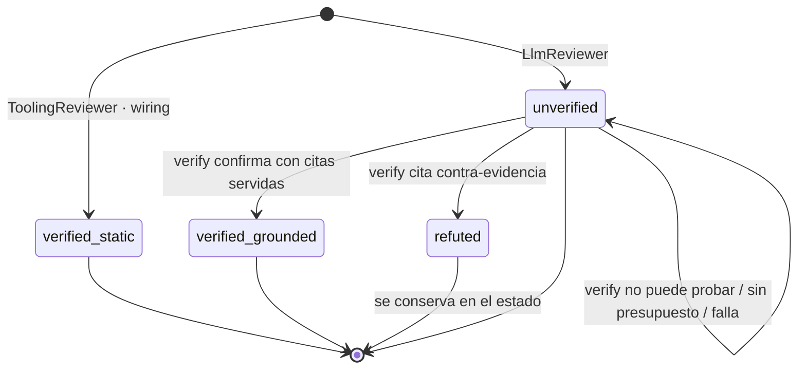

`verified_executed` existe en el contrato pero **nadie lo produce** en esta foto: es
la capa L3 (ejecutar un test de reproducción), que queda fuera
([§15](#15-lo-que-sigue-fuera-de-la-foto)).

### 4.3 Cómo se llena la mochila

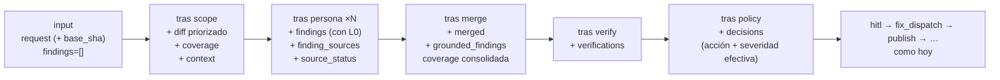

---

## 5. Lo que envuelve al grafo: presupuesto, lectura y trazas

Tres piezas que el grafo usa pero que **no viven en el estado**. Las tres se
inyectan al construir el runtime, como hoy el `VcsPort` o el `ChatPort`.

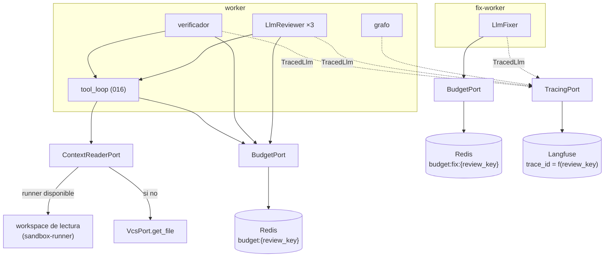

### 5.1 Presupuesto (017, ya entregada)

`LLM_BUDGET_TOKENS_PER_PR` pasa a ser lo que su nombre promete: un tope **por
review**. ¿Por qué en Redis y no en el estado del grafo? Porque las ramas `persona`
corren **en el mismo superstep**: lo que una escribe en el estado no lo ve la otra
hasta que el paso termina (es la idea 4 del [módulo 11](11-recorrido-de-una-review.md#idea-4--reducers-qué-pasa-si-dos-nodos-escriben-la-misma-clave)).
Un contador compartido entre ramas paralelas tiene que vivir fuera.

Cada llamada al modelo sigue el mismo protocolo:

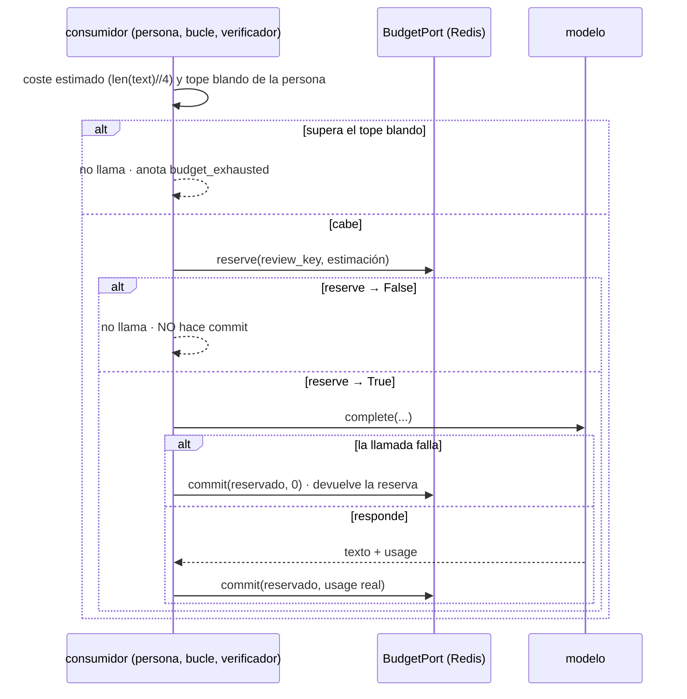

El `reserve` **es** la comprobación: una reserva que no cabe cierra la carrera entre
ramas mejor que consultar `remaining` y reservar después.

- **Reparto:** el primero que llega, con un tope blando por persona de
  `2 × total / N` (N = personas LLM). Una persona con un prompt enorme no deja sin
  nada a las demás.
- **El fix tiene su propio contador** (`budget:fix:{review_key}`): una aprobación que
  tarde días no puede encontrarse sin saldo porque la review fue cara.
- **Agotarlo degrada:** el `LlmReviewer` corta los lotes que falten y anota
  `budget_exhausted` (012 lo pinta como `budget` en la cobertura), el bucle de
  herramientas pide el turno final y el verificador deja `unverified`. Nadie lanza
  una excepción por presupuesto.

### 5.2 Lectura del repositorio (016, ya entregada)

El verificador y la persona con herramientas leen el repo a `head_sha` (y a
`base_sha`) a través de `ContextReaderPort`. Si el `sandbox-runner` está disponible,
lo sirve su **workspace de lectura**: un clon *bare* consultado con `git show`,
`git grep` y `git ls-tree`, sin *checkout* y sin ejecutar nada
([ADR-0018](../adr/0018-workspace-de-lectura-en-el-runner.md)). Si no, se degrada a
`VcsPort.get_file`, con `grep` solo sobre lo ya servido. El workspace se abre de
forma idempotente por `(repo, head_sha)` y **no viaja en el estado**: una pausa HITL
de días no deja clones vivos.

### 5.3 Trazas (018)

Con `TRACING_ENABLED=true`, cada review produce **un árbol** en Langfuse. El
`trace_id` se deriva de la `review_key`, así que el `worker` y el `fix-worker`
escriben en el mismo árbol sin hablarse, igual que comparten el hilo por el
`thread_id`. La traza es *best-effort*: si Langfuse está caído, se registra y la
review sigue. El recorrido completo está en la [§13](#13-la-traza-de-una-review).

---

## 6. Caso A — PR sin hallazgos

**Situación:** un PR pequeño y limpio; todos sus ficheros caben en un lote.

El recorrido es el del [módulo 11 §5](11-recorrido-de-una-review.md#5-caso-a--pr-sin-hallazgos),
con dos diferencias:

| Superstep | Nodo | Qué cambia |
|---|---|---|
| 1 | `scope` | Además del diff, crea `coverage` (todo revisable) y `context` (ficheros completos y `context_docs:`) |
| 2 | `persona` ×N | `correctness` puede abrir el workspace y leer un par de ficheros antes de concluir que no hay nada; cada lectura y cada turno descuentan del presupuesto |
| 4 | `verify` | Sin candidatos: no llama a nadie |
| 5 | `policy` | Nada que decidir |
| 8 | `publish` | Nada que publicar **porque la cobertura es completa** |

La segunda diferencia es la importante: hoy, «sin hallazgos» solo se cuestiona si
falta un artefacto del CI. En la foto final también se cuestiona si **el revisor no
miró algo**. Si quedó fuera un fichero de código o configuración, `publish` sí
comenta, con la cabecera de review parcial: es el [caso F](#11-caso-f--pr-grande-lotes-cobertura-y-presupuesto-agotado).

**Resultado:** una invocación, cero pausas, nada en el PR, nada en Teams. Igual que
hoy, pero ahora «nada» significa «miré todo y no encontré nada».

---

## 7. Caso B — PR con hallazgos: la cascada completa

**Situación:** `max_autonomy: report` (el valor por defecto). Para que el ejemplo
sea real, usamos los hallazgos de la auditoría del PR #3 de este repo
([006 §3.1](../iniciativas/archivo/006-eval-de-la-review/spec.md)), reproducidos
con el perfil del propio repo **(supuesto: declara `wiring:` y `context_docs:`)**.

Cinco personas en el fan-out:

| Persona | Tipo | Grounded | Herramientas |
|---|---|:-:|:-:|
| `standards` | Tooling (artefacto del CI) | ✅ | — |
| `wiring` | Determinista (010) | ✅ | — |
| `correctness` | LLM | — | ✅ (`REVIEW_TOOLS_ROLES`) |
| `security` | LLM | — | — |
| `arch` | LLM | — | — |

### 7.1 Lo que proponen las personas

| Id | Persona | Hallazgo | Severidad propuesta | Sale de la persona como |
|---|---|---|---|---|
| **H1** | `standards` | Error de tipos en `fix/node.py:88` | P2 | `verified_static`, evidencia de la herramienta |
| **H2** | `wiring` | El `fix-worker` de `docker-compose.yml` lleva `env_file: .env`: recibe **todos** los secretos (el P1 #1 que la review de hoy no vio) | P1 | `verified_static`, citas de los dos lados del par |
| **H2′** | `correctness` | El mismo problema, visto al leer `docker-compose.yml` en su lote | P2 | `unverified`, con escenario |
| **H3** | `correctness` | «`_route_fix_wait` es un bucle infinito» (el hallazgo C de la auditoría) | P1 | `unverified`, con escenario |
| **H4** | `correctness` | Fallo real en el orden de llamadas, pero descrito **al revés** (hallazgo A) | P1 | `unverified`, con escenario invertido |
| **H5** | `arch` | «`build_fix_wait` fuerza `targets=[]`: regresión» (hallazgo F) | P1 | `unverified`; L0 calcula `pre_existing: true` |
| **H6** | `security` | Cita una línea que no existe en el fichero | P1 | **Descartado por L0** |
| **H7** | `arch` | Afirma sobre el `restart:` de compose sin haberlo leído | P2 | `unverified`, `context_scope: outside_diff` |

Varias cosas ya han pasado **dentro** de la persona, antes de que nada llegue al
estado:

- **H2 existe** porque `wiring` contrasta `docker-compose.yml` con su contrato
  declarado; y **H2′ existe** porque 012 priorizó `docker-compose.yml` (clase
  `config`) por delante de los tests. Hoy los dos ficheros caían por
  `max_files_per_pr` ordenado por churn.
- **H6 no llega:** L0 busca la cita en el fichero y no está en ninguna línea
  (ni añadida, ni de contexto, ni borrada). Es evidencia fabricada y se descarta
  ([008 D9](../iniciativas/008-contexto-del-revisor/spec.md)).
- **H5 lleva la etiqueta `pre_existing`** porque L0 comparó la cita con el fichero a
  `base_sha` y es idéntica. **No** baja la severidad: es un hecho que leerá el gate.
- **H7 lleva `outside_diff`** por la regla de humildad de L1: `arch` no tiene
  herramientas y no podía leer el compose, así que lo declara en vez de inventarlo.

### 7.2 El fan-out en detalle

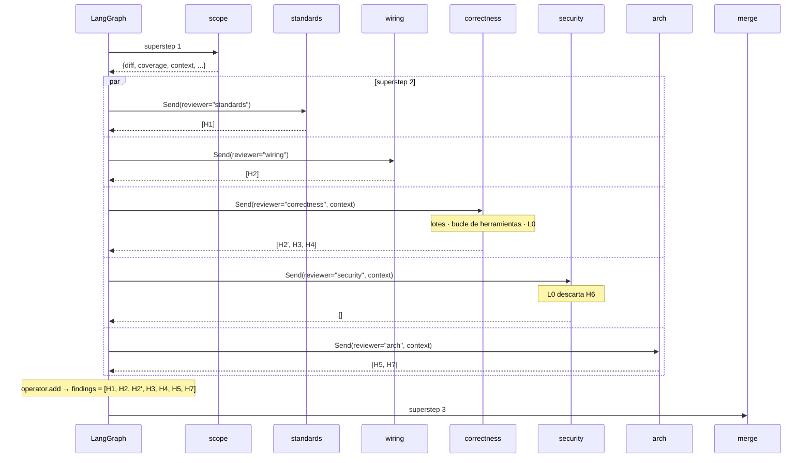

Lo que pasa dentro de `correctness` (los turnos del bucle de herramientas) es el
[caso C](#8-caso-c--dentro-de-una-persona-con-herramientas).

### 7.3 El merge

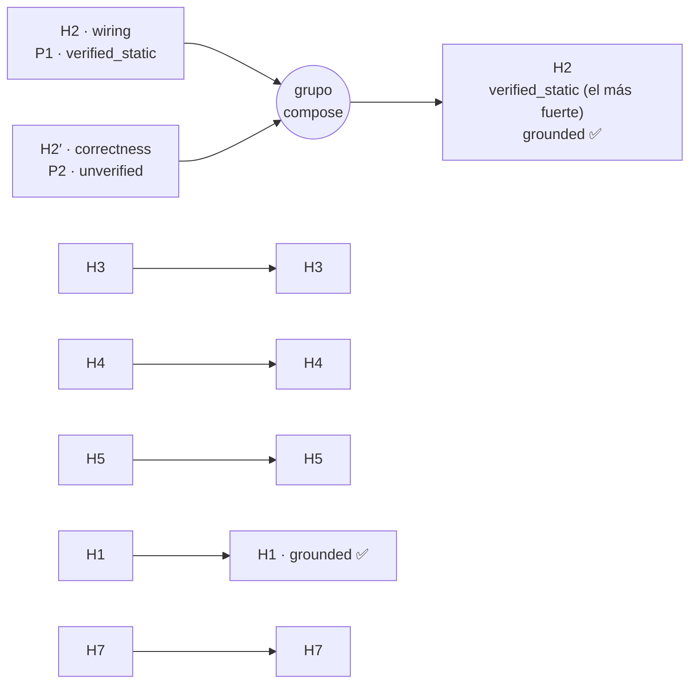

Tres reglas nuevas, las tres pequeñas:

1. **Veredicto más fuerte.** Si H2 (`verified_static`) y H2′ (`unverified`) son el
   mismo problema, el grupo conserva `verified_static`. Sin esta regla, el gate
   podría ver la copia sin verificar y degradar un P1 real
   ([011 §5.3](../iniciativas/011-gate-de-severidad/spec.md)).
2. **Grounding.** Si en el grupo participa una persona grounded, el resultado es
   grounded (`grounded_findings = [H1, H2]`) y no paga el verificador.
3. **Cobertura.** Un fichero cuenta como revisado si alguna persona LLM lo revisó.

`merged = [H1, H2, H3, H4, H5, H7]`.

### 7.4 El verificador (L2)

`verify` elige candidatos: **no grounded**, con severidad en
`require_verified_for` (`P0`, `P1`), los más graves primero y como mucho cinco.

| Hallazgo | ¿Candidato? | Por qué |
|---|---|---|
| H1 | No | Grounded (y además P2) |
| H2 | No | Grounded |
| H3 | **Sí** | P1, `unverified` |
| H4 | **Sí** | P1, `unverified` |
| H5 | **Sí** | P1, `unverified` |
| H7 | No | P2: el gate no le exigirá verificación, así que verificarlo sería coste sin efecto |

Para cada candidato, un **modelo distinto** del de las personas (rol `verifier` en
`models.yaml`; si coincidiera con un rol de revisión, el worker no arranca) recibe
el hallazgo, su hunk y la lista de ficheros del diff, y entra en el mismo bucle de
herramientas de 016. Su *prompt* no pide aprobar: pide **construir el contraejemplo**.

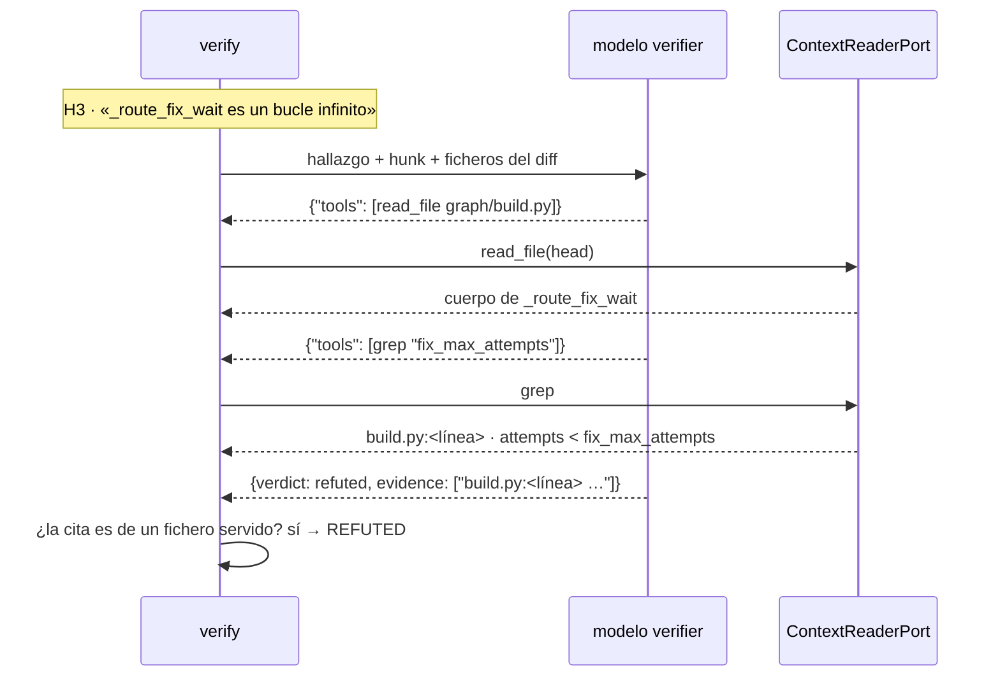

Los tres veredictos:

| Hallazgo | Veredicto | Por qué | `verification` |
|---|---|---|---|
| H3 | `REFUTED` | Cada vuelta del bucle consume un intento; el verificador cita la línea que lo prueba | `refuted` |
| H4 | `CONFIRMED` | El fallo existe, pero el verificador **fija la dirección** con su propio escenario de tres partes | `verified_grounded` |
| H5 | `UNPROVEN` | No encuentra una ruta concreta que falle por este cambio (el código ya estaba en la base) | `unverified` |

Dos comprobaciones mecánicas del nodo impiden que el veredicto dependa de la buena
voluntad del modelo: una cita a un fichero **no servido** convierte el veredicto en
`UNPROVEN`, y un `CONFIRMED` **sin escenario** de tres partes también. Y una regla
que protege el recall: un fallo del verificador, o la falta de prueba, deja
`unverified`, **nunca** `refuted`.

El nodo escribe `verifications = {H3: …, H4: …, H5: …}` y no toca `merged` ni
`severity`.

### 7.5 La política: primero el gate, luego las reglas

`policy` combina, para cada hallazgo, el `verification` con que nació y el veredicto
de `verifications` **(supuesto: el veredicto de L2 manda sobre el inicial)**, y
evalúa:

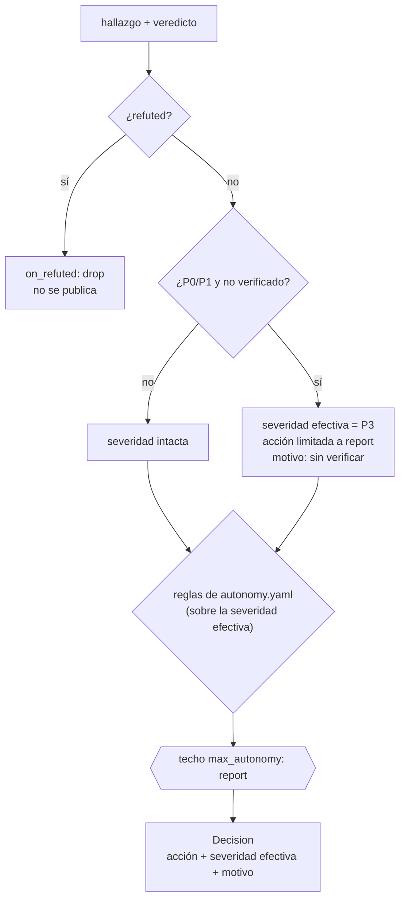

| Hallazgo | Severidad propuesta | Verificación | Gate | Severidad publicada | Acción |
|---|---|---|---|---|---|
| H1 | P2 | `verified_static` | Bajo umbral | **P2** | `report` |
| H2 | P1 | `verified_static` | Verificado | **P1** | `report` (techo) |
| H3 | P1 | `refuted` | `on_refuted: drop` | — | no se publica |
| H4 | P1 | `verified_grounded` | Verificado | **P1** | `report` (techo) |
| H5 | P1 | `unverified` + `pre_existing` | Degrada | **P3** (degradado) | `report` |
| H7 | P2 | `unverified` + `outside_diff` | Bajo umbral | **P2** | `report` |

¿Por qué el gate va **antes** de las reglas? Si fuera después, H5 escalaría a una
persona como P1 y luego se publicaría como P3. Y si la severidad degradada entrase en
las reglas sin la guarda de «solo `report`», un P1 dudoso convertido en P3 podría
acabar en `fix_auto` ([011 G7](../iniciativas/011-gate-de-severidad/spec.md)).

### 7.6 Lo que se publica

`publish` hace lo mismo que hoy (ordena, ancla, un inline por hallazgo, un resumen,
marcas de dedupe) y añade el **porqué** de cada severidad:

```text
**P1 · El fix-worker recibe todos los secretos del despliegue**   (H2, docker-compose.yml)
…
_Verificación: verified_static · docker-compose.yml:<línea> env_file: .env ↔ wiring.isolated.fix-worker_
_Acción: report · confianza 100_

**P1 · <título de H4>**   (H4)
Escenario: <entrada/estado> → <ruta file:line> → <resultado>   ← el del verificador, no el del proponente
_Verificación: verified_grounded · <cita servida>_

**P3 · build_fix_wait fuerza targets=[]**   (H5)
_Degradado de P1: sin verificar · preexistente_
```

| Hallazgo | Inline | Resumen | Qué se ve |
|---|---|---|---|
| H1 | Sí | Sí | Veredicto `verified_static` |
| H2 | Sí | Sí | Veredicto y las dos citas del par |
| H3 | **No** | **No** | Nada (`on_refuted: drop`); queda en el estado para la métrica |
| H4 | Sí | Sí | El escenario **del verificador** ([009 V12](../iniciativas/009-verificador-adversarial/spec.md)) |
| H5 | Sí | Sí | «P3 degradado de P1», etiqueta «preexistente» |
| H7 | Sí | Sí | Etiqueta «fuera del diff» |

Un lector distingue a simple vista un P3 nativo de un P1 degradado, y un P1 con
prueba de uno sin ella. Es el objetivo de 011: **la severidad se gana**.

### 7.7 Del `hitl` al final

Igual que el [módulo 11 §6.4](11-recorrido-de-una-review.md#64-del-hitl-al-final):
con el techo en `report` no hay pausa ni fix, y `notify` encola el aviso con los
cinco hallazgos más graves **por severidad efectiva**.

**Resultado:** una invocación, cero pausas. Comparado con la review de hoy sobre el
mismo PR: un falso positivo refutado y oculto (H3), uno fabricado descartado (H6),
un P1 dudoso degradado y etiquetado (H5), un fallo real con la dirección corregida
(H4) y un P1 de configuración que hoy no se detectaba (H2).

---

## 8. Caso C — Dentro de una persona con herramientas

**Situación:** la rama `correctness` del caso B. Su rol está en
`REVIEW_TOOLS_ROLES`, así que cada lote es un **bucle de turnos** en vez de una
llamada.

### 8.1 Los lotes

012 cambia la unidad de trabajo: el `LlmReviewer` ya no corta el diff a 60 000
caracteres, sino que lo agrupa en **lotes de ficheros enteros** (`LLM_BATCH_MAX_CHARS`),
juntando los del mismo directorio. Un fichero que no cabe solo en un lote no se
trocea: se marca `too_large` en la cobertura. A cada lote, L1 le añade su contexto
con prioridad: diff, después el fichero completo, después los `context_docs:`.
**El contexto nunca desplaza diff**: si no cabe, el lote sale sin él.

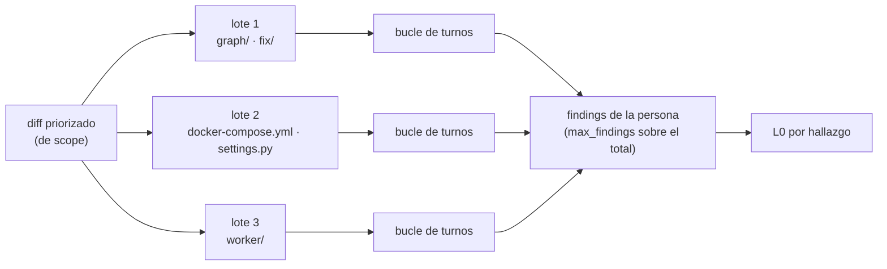

### 8.2 Un lote, turno a turno

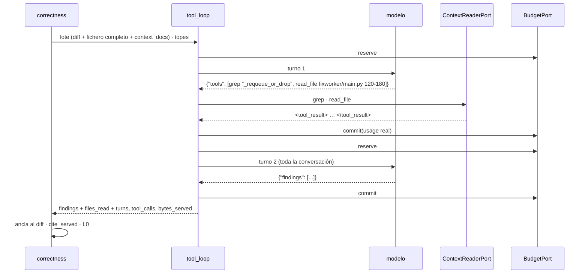

Reglas del bucle ([016](../iniciativas/archivo/016-lector-de-contexto/spec.md)
y [014](../iniciativas/014-revisor-con-herramientas/spec.md)):

- Cada respuesta es **o** `{"tools": [...]}` (hasta 3 peticiones) **o**
  `{"findings": [...]}`. Una respuesta que no es ninguna recibe **un** turno
  correctivo; si se repite, el lote termina sin hallazgos, como hoy con la salida no
  parseable.
- Al agotar un tope (`REVIEW_TOOLS_MAX_TURNS`, `…_MAX_CALLS`, `…_MAX_BYTES` o el
  presupuesto), el siguiente turno es **final forzado**: se piden los hallazgos sin
  herramientas. Lo razonado no se pierde.
- Lo servido es **dato, no instrucción**: va entre `<tool_result>` y el *system
  prompt* lo dice. Las rutas vetadas (`.env*`, `*.pem`, `**/secrets/**`…) las corta
  el runner, no el modelo.
- **Leer más no da permiso para comentar fuera del PR:** el hallazgo se sigue
  anclando al diff y pasa L0. Una cita a un fichero que el bucle **no sirvió** se
  quita de la evidencia.
- El revisor sigue emitiendo `unverified`. Leer no es verificar: verificar es de
  `verify`, con otro modelo y otro *prompt*.

### 8.3 Por qué esto importa para LangGraph

Todo el bucle ocurre **dentro de un nodo**. Para LangGraph, la rama `correctness` es
un único paso que tarda más; no hay subgrafo ni checkpoints intermedios. Eso tiene
una consecuencia directa: si la persona falla en el turno 3, la `RetryPolicy`
repite **la persona entera**, con todos sus turnos
([014 Q5](../iniciativas/014-revisor-con-herramientas/spec.md)). El presupuesto
devuelve las reservas del intento fallido y cobra lo que de verdad se gastó.

La alternativa (cada turno como nodo con su checkpoint) haría el reintento más
barato, pero metería en el grafo un bucle por lote y por persona. Se eligió lo
simple; si el coste de repetir pesa en la medida de 006, se reabre. Comparar con el
[módulo 10](10-patrones-avanzados.md) (subgrafos) es un buen ejercicio.

---

## 9. Caso D — Pausa humana con severidades ganadas

**Situación:** `max_autonomy: fix_with_approval`, como en el
[módulo 11 §7](11-recorrido-de-una-review.md#7-caso-c--pausa-para-que-decida-una-persona-hitl).
La mecánica de la pausa no cambia en nada: `interrupt` en `hitl`, inbox en Redis,
tarjeta en Teams, `Command(resume=…)` y re-ejecución del nodo desde la primera línea.

Lo que cambia es **qué llega a la tarjeta**:

| Hallazgo (del caso B) | Hoy (sin cascada) | Foto final |
|---|---|---|
| H3 · bucle infinito | P1 → podría escalar | Refutado: no llega a `policy` como candidato a nada |
| H5 · regresión preexistente | P1 → podría escalar | P3 degradado → solo `report`, **no puede pausar** |
| H2 · secretos del `fix-worker` | No se detectaba | P1 `verified_static` → puede escalar |
| H4 · dirección invertida | P1 con el texto al revés | P1 `verified_grounded`, con el escenario corregido |

La persona que decide en Teams solo ve P0/P1 **con prueba**, y la tarjeta lleva el
veredicto y su evidencia. Es la diferencia entre una campaña que llora lobo y una
que se lee.

**Resultado:** dos invocaciones y una pausa, como hoy; menos pausas inútiles.

---

## 10. Caso E — Fix aprobado y verificado

**Situación:** como el [módulo 11 §8](11-recorrido-de-una-review.md#8-caso-d--fix-aprobado-y-verificado):
un `gated_auto` P2 aprobado, parche propuesto, verificado en el sandbox por el
`fix-worker` y publicado como sugerencia. Tres invocaciones, dos pausas, y el bucle
`fix_wait → fix_dispatch` si el sandbox devuelve `FAILED`.

Cambios de la foto final:

- **Presupuesto propio.** El `LlmFixer` descuenta de `budget:fix:{review_key}`, no
  del contador de la review. Si la aprobación tarda más que el TTL de la review, el
  fix sigue teniendo saldo.
- **Una sola traza.** El `fix-worker` calcula el mismo `trace_id` a partir de la
  `review_key` y cuelga sus spans (llamada al fixer, `POST /verify` al runner) del
  mismo árbol que la review.
- **El runner hace dos trabajos.** Además de `/verify` (ejecuta los checks del
  parche en un contenedor endurecido), sirve `/workspaces` (lectura sin ejecución)
  al worker de reviews. Son endpoints distintos con riesgos distintos
  ([ADR-0011](../adr/0011-sandbox-runner-aislado.md),
  [ADR-0018](../adr/0018-workspace-de-lectura-en-el-runner.md)).
- **Probado de verdad.** El smoke F12 de 015 (aprobar en el HITL → `fix-worker` →
  runner → sugerencia en el PR) está hecho, con evidencia en
  [`operacion.md`](../operacion.md).

**Resultado:** igual que hoy en invocaciones y pausas.

---

## 11. Caso F — PR grande: lotes, cobertura y presupuesto agotado

**Situación:** el PR #3 completo: 51 ficheros, unos 300 KB de diff. Hoy, este PR se
revisó **sin que nadie dijera** que el modelo solo había visto 5 ficheros
([012 §3.1](../iniciativas/012-cobertura-de-la-review/spec.md)).

### 11.1 Qué sobrevive al `scope`

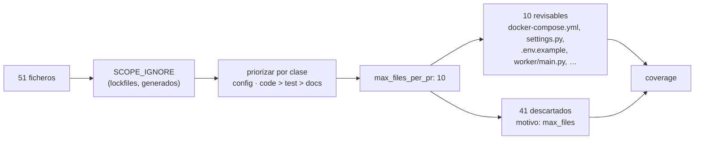

Con la priorización de 012, `docker-compose.yml`, `settings.py` y `.env.example`
entran en los 10 revisables; hoy salían por tener poco churn.

### 11.2 Presupuesto agotado a mitad

Supongamos un presupuesto bajo **(supuesto, para el ejemplo)**. `correctness` revisa
los dos primeros lotes con herramientas; antes del tercero, `remaining` ya no da:

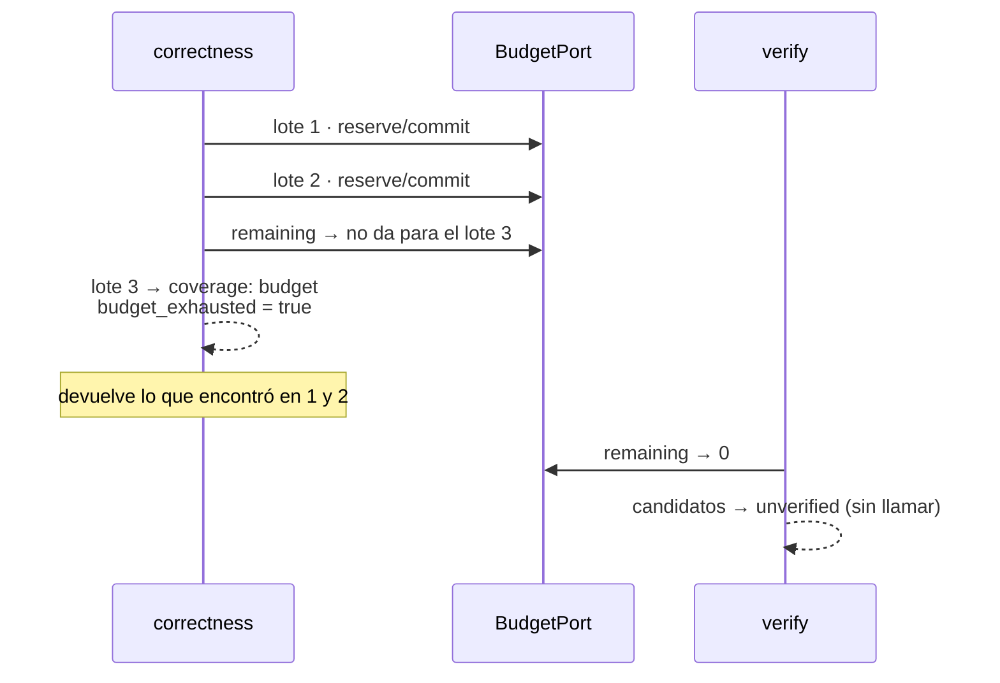

Y lo que se ve en el PR:

> **Review parcial:** revisados 9 de 51 ficheros. Sin revisar: 1 de código
> (`worker/main.py`; presupuesto). 41 descartados por el tope de ficheros (lista
> por clase). Los hallazgos de abajo no cubren esos ficheros.
>
> ▸ Docs y tests sin revisar (plegable)

Tres cosas a notar:

1. **Nada falla.** El presupuesto agotado no es una excepción ni un reintento: es un
   **hecho** (`budget_exhausted`) que 012 pinta en la cobertura.
2. **La cascada se degrada en orden.** Sin saldo, `verify` deja todo `unverified`, y
   el gate degrada los P0/P1 a P3. Es el comportamiento conservador: mejor un P3
   etiquetado «sin verificar» que un P1 sin prueba.
3. **«Parcial» se reserva para código y configuración.** Docs y tests sin revisar se
   listan, pero no marcan la review como parcial; si no, todo PR grande saldría
   parcial y el aviso se ignoraría ([012 C7](../iniciativas/012-cobertura-de-la-review/spec.md)).

`ReviewOutcome` expone `tokens_spent` y `tokens_remaining`, y la cobertura, para que
la eval de 006 mida cuánto se perdió.

### 11.3 Parecido y diferencia con la review degradada

La review degradada por falta de artefacto del CI
([módulo 11 §11](11-recorrido-de-una-review.md#11-caso-g--falta-un-artefacto-del-ci-review-degradada))
sigue igual: otro hilo (`…:partial`), marca `:partial`, y la review completa la
sustituye cuando llega el artefacto. Una review **parcial por cobertura**, en
cambio, va en el hilo normal y publica la marca `:ok`: no hay nada que esperar,
porque nadie va a traer más presupuesto. Las dos comparten la regla de fondo: «sin
hallazgos» con algo sin mirar **nunca** se publica como limpio.

---

## 12. Caso G — Algo se rompe a mitad

Las dos capas de reintento del [módulo 11 §10](11-recorrido-de-una-review.md#10-caso-f--algo-se-rompe-a-mitad)
no cambian ([ADR-0007](../adr/0007-reintento-en-dos-capas.md)). Lo que hay que mirar
es cómo se comporta cada pieza nueva cuando falla:

| Qué falla | Qué pasa | Por qué así |
|---|---|---|
| **El runner** (workspace de lectura) | El lector se degrada a `VcsContextReader`; `correctness` y `verify` siguen con menos alcance (`grep` solo sobre lo servido) | Una pieza de contexto nunca tumba una review (016 W8) |
| **El VCS al leer un fichero** | La herramienta devuelve un error al modelo y el bucle sigue | Ídem |
| **El modelo del verificador**, de forma transitoria | `RetryPolicy` de `verify`; en el reintento, lo ya verificado no se repite (`verifications` como `existing`) | Idempotencia, igual que `fix_dispatch` con `fixes` |
| **El modelo del verificador**, de forma permanente | Los candidatos quedan `unverified`; el gate los degrada | Un fallo del verificador no puede tumbar un P1 real: nunca `refuted` sin contra-evidencia |
| **Una persona LLM** a mitad del bucle | La `RetryPolicy` repite la persona entera; las reservas del intento fallido se devuelven (`commit(reservado, 0)`) | Sin la devolución, cada reintento inflaría el contador (017 B8) |
| **El worker muere tras `verify`** | `invoke(None)` continúa desde el checkpoint: ni las personas ni el verificador se pagan dos veces | Lo mismo que el bug B2 del módulo 11, ahora con más trabajo caro detrás del checkpoint |
| **Langfuse** | La emisión falla, se registra y la review sigue | La observabilidad no puede ser causa de fallo (018 T6) |
| **Redis en `production`** | La API responde `503`, el CLI sale con error y el worker no arranca. Fuera de `production`, el fallback a memoria se mantiene | Un fallback silencioso daba verdes falsos (015 S4) |
| **Configuración inválida** | El worker no arranca: `verifier` con el mismo modelo que un rol de revisión, `severity_gate` mal formado, claves de Langfuse sin resolver con trazas activas | *Fail-fast*: un arranque roto es mejor que un sello de goma silencioso |

El cambio de fondo respecto a hoy: el checkpoint tras `verify` protege **mucho más
gasto**. Entre `scope` y `policy` puede haber decenas de llamadas (lotes, turnos,
verificaciones). La semántica de re-invocación del
[módulo 05](05-invocacion-y-reejecucion.md) es lo que impide pagarlas dos veces.

---

## 13. La traza de una review

Con `TRACING_ENABLED=true`, el caso B produce este árbol en Langfuse:

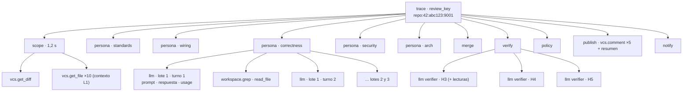

Lo que da esta vista y no dan los logs:

- **El orden real y la duración** de cada tramo. Las cinco personas aparecen en
  paralelo, y `merge` empieza cuando termina la última: el superstep, visto.
- **El prompt y la respuesta exactos** de cada llamada, con redacción de patrones de
  secretos activada por defecto. Es donde nacen los falsos positivos.
- **El gasto real** por llamada (`usage`), que suma lo mismo que el contador de 017.

Y lo que no da: el **estado** del grafo. Eso sigue en el checkpointer
(`get_state_history`). Traza y checkpoint se cruzan por la misma clave: `thread_id` y
`trace_id` salen los dos de la `review_key`.

Dos detalles de diseño que conviene entender:

- La llamada al modelo se instrumenta con un **decorador sobre el puerto**
  (`TracedLlm` envuelve cualquier `LlmPort`), porque el adaptador habla `httpx`
  directo y la auto-instrumentación de LangChain no lo vería.
- Los nodos se instrumentan **al registrarlos** en `build_graph`, no editando cada
  función. Doce nodos instrumentados a mano serían doce sitios donde olvidarlo.

---

## 14. Resumen comparado

### 14.1 Los casos

| Caso | `max_autonomy` | Invocaciones | Pausas | Qué aparece en el PR | Diferencia con hoy |
|---|---|---|---|---|---|
| A · sin hallazgos | cualquiera | 1 | 0 | Nada (si la cobertura es completa) | «Nada» exige haber mirado todo |
| B · cascada | `report` | 1 | 0 | Inline + resumen con veredicto, etiquetas y degradados | Menos falsos positivos, P1 con prueba, recall de configuración |
| C · persona con herramientas | — | (dentro de B) | — | — | El revisor lee antes de afirmar |
| D · HITL | `fix_with_approval` | 2 | 1 humana | Igual que B, con la decisión | Solo escalan P0/P1 verificados |
| E · fix | `fix_with_approval` | 3 (+1 por wave) | 1 humana + N de fix | Como hoy | Presupuesto propio del fix; una sola traza |
| F · PR grande | cualquiera | 1 | 0 | Cabecera «Review parcial» + hallazgos | Hoy el recorte era silencioso |
| G · fallos | cualquiera | +1 por reintento del job | — | Lo mismo que sin fallo | Cada pieza nueva degrada; ninguna tumba la review |

### 14.2 Qué nodos trabajan

| Nodo | A | B | D | E | F |
|---|:-:|:-:|:-:|:-:|:-:|
| `scope`, `persona`, `merge`, `policy` | ✅ | ✅ | ✅ | ✅ | ✅ |
| `verify` | · | ✅ | ✅ | ✅ | · (sin saldo) |
| `hitl` | · | · | ⏸ | ⏸ | · |
| `fix_dispatch` | · | · | · | ✅ | · |
| `publish` | · | ✅ | ✅ | ✅ | ✅ |
| `fix_wait` | · | · | · | ⏸ | · |
| `publish_fix`, `notify_fix` | · | · | · | ✅ | · |
| `notify` | · | ✅ | ✅ | ✅ | ✅ |

✅ trabaja · `·` se ejecuta pero no hace nada · ⏸ pausa.

### 14.3 Quién decide qué

| Pregunta | Quién la responde | Dónde |
|---|---|---|
| ¿Qué ficheros se miran? | `scope` (prioridad y tope) y el presupuesto | 012, 017 |
| ¿La cita existe? ¿Es preexistente? | L0, determinista | 008 |
| ¿Qué sabe el revisor del resto del repo? | L1 (precargado) y las herramientas (bajo demanda) | 008, 014 |
| ¿Los pares de configuración concuerdan? | `wiring`, determinista | 010 |
| ¿La hipótesis se sostiene? | `verify`, otro modelo | 009 |
| ¿Con qué severidad se publica? | **Solo** el gate, en `policy` | 011 |
| ¿Qué se hace con el hallazgo? | Las reglas de `autonomy.yaml` y el techo | ADR-0003 |
| ¿Cuánto se puede gastar? | `BudgetPort` | 017 |

---

## 15. Lo que sigue fuera de la foto

Aunque se entregasen todas las iniciativas abiertas, quedarían fuera:

- **La Fase 4: autonomía real.** La política puede devolver `fix_auto`, pero
  `fix_dispatch` solo arregla lo que una persona aprobó; en la práctica, `fix_auto`
  se comporta como `report`. Jira, la memoria de aceptados y las métricas sobre
  tráfico real tampoco tienen iniciativa
  ([`arquitectura.md` §6](../arquitectura.md#6-estado-por-fase)).
- **L3, la verificación ejecutable.** `verified_executed` existe en el contrato pero
  nadie lo produce. Escribir un test de reproducción y ejecutarlo en el runner se
  abrirá como iniciativa aparte, cuando 009 y 014 estén medidas
  ([014 Q6](../iniciativas/014-revisor-con-herramientas/spec.md)).
- **Un *prompt* propio por rol.** `correctness`, `security` y `arch` siguen
  compartiendo *system prompt* (deuda D20).
- **Coste en dinero.** El presupuesto cuenta tokens, no euros.
- **Alertas y guardias.** Las trazas explican una review; no vigilan el servicio.

---

## 16. Experimentos propuestos

Todos se pueden hacer **antes** de que exista el código: son formas de leer las
specs con el grafo en la cabeza.

1. **Dibuja el grafo final.** Copia `build_graph`, añade un nodo `verify` que
   devuelva `{}` entre `merge` y `policy`, compila y saca el Mermaid
   (`g.get_graph().draw_mermaid()`). Compáralo con la [§3.1](#31-el-mapa): debería
   ser idéntico salvo por colores.

2. **Demuestra por qué el presupuesto no puede ir en el estado.** En un grafo de
   juguete con una clave `spent: Annotated[int, operator.add]`, lanza tres nodos en
   paralelo desde `START` que lean `state["spent"]`, comprueben un tope y devuelvan
   `{"spent": 10}`. Verás que los tres leen `0` y pasan la comprobación: no se ven
   entre sí dentro del superstep (y con `Send` es peor: cada rama solo ve su
   payload). Es la razón de B2 en
   [017](../iniciativas/archivo/017-presupuesto-por-pr/spec.md).

3. **Juega con el gate en papel.** Toma la tabla de la [§7.5](#75-la-política-primero-el-gate-luego-las-reglas)
   y cambia los supuestos: `on_refuted: summary`, `require_verified_for: [P0, P1, P2]`,
   `max_autonomy: fix_with_approval`. ¿Qué hallazgos cambian de severidad, de acción o
   de sitio? ¿Cuántas llamadas más hace `verify`?

4. **Rompe el orden gate → reglas.** En la §7.5, aplica primero las reglas y después
   el gate. Con `max_autonomy: fix_with_approval`, ¿qué le pasa a H5? Es el
   razonamiento de [011 G7](../iniciativas/011-gate-de-severidad/spec.md).

5. **Cuenta checkpoints frente a llamadas.** Para el caso B, cuenta cuántas llamadas
   al modelo hay entre el checkpoint tras `scope` y el checkpoint tras `verify`
   (lotes × turnos + verificaciones × turnos). Eso es lo que se paga dos veces si un
   reintento arranca desde `START` en lugar de `invoke(None)`.
