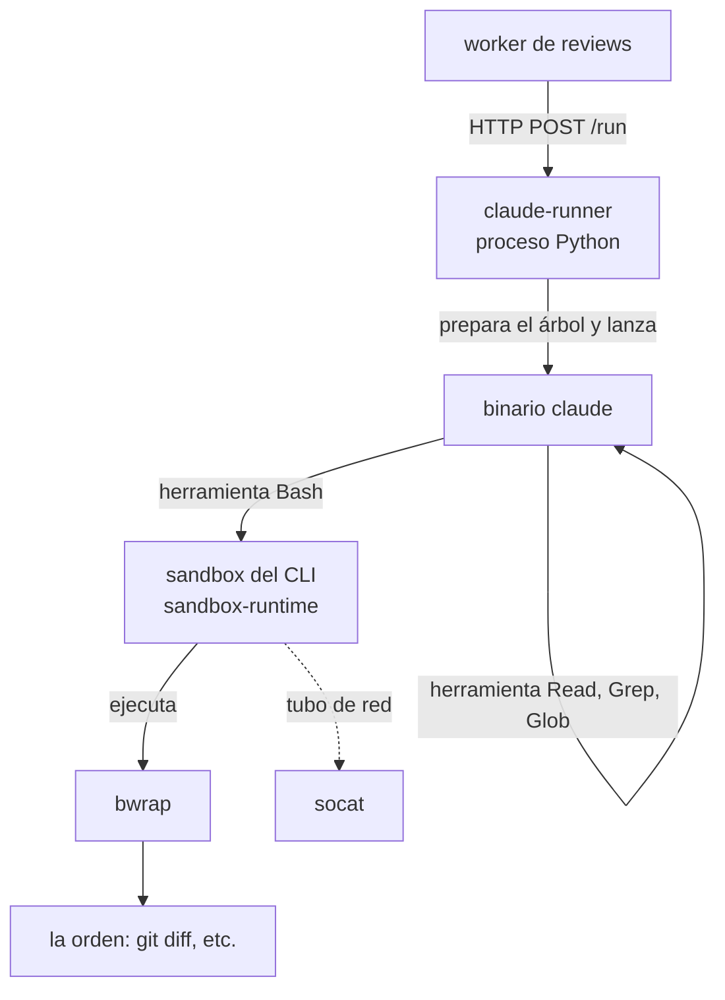
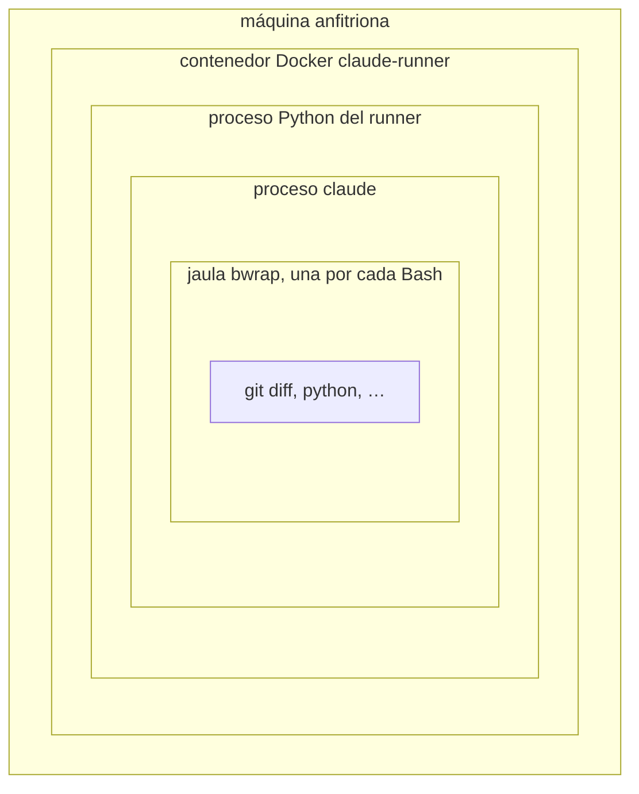
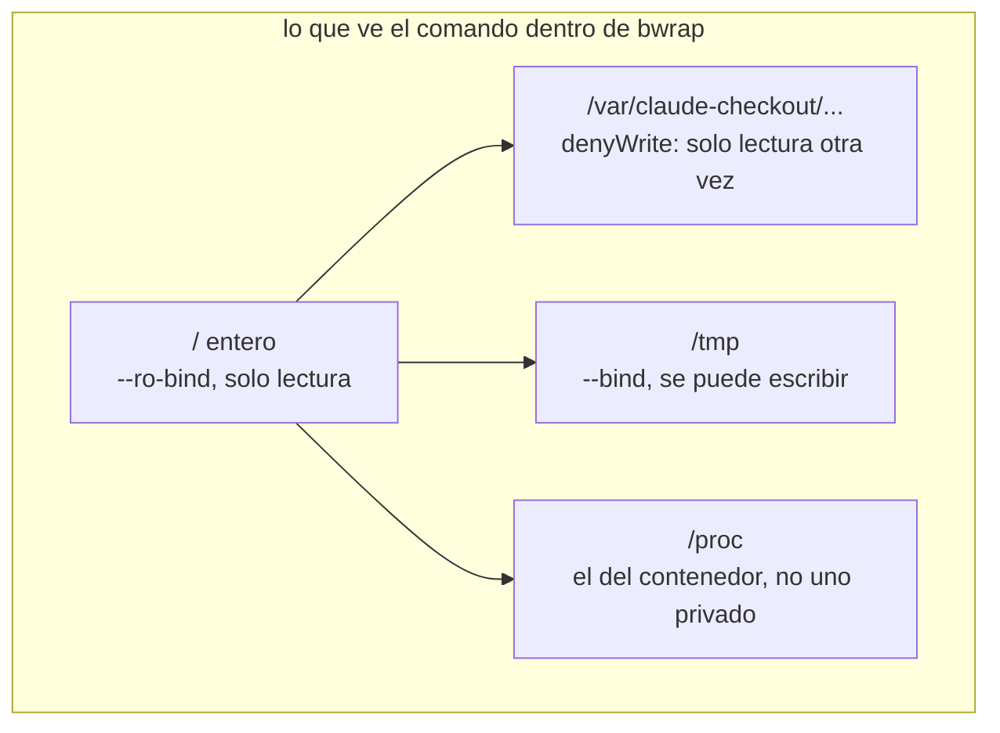
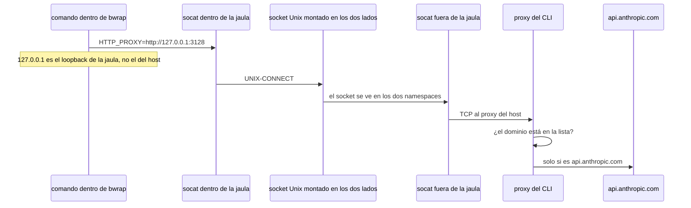
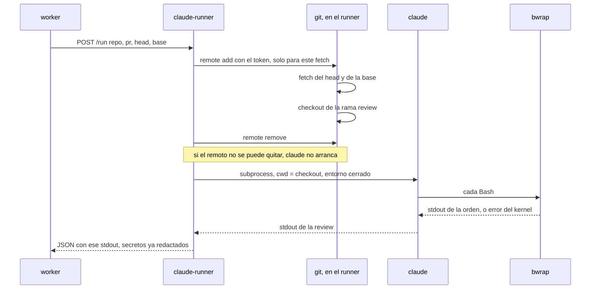

Última modificación: 2026-10-24 | Creado: 2026-10-24

# 13 — La jaula: bwrap, el sandbox del CLI y el runner

> Índice: [README](README.md). Este texto no sigue la serie de LangGraph.
> Léelo cuando quieras entender qué impide que un comando de la review
> reescriba el PR o hable con otro sitio que no sea Anthropic.

La decisión de producto está en
[ADR-0033](../adr/0033-skill-fuera-del-nucleo.md). Aquí va el mecanismo, de
fuera hacia dentro, para alguien que todavía no ha montado un namespace.

---

## 1. El problema, en una frase

Claude revisa el código de un PR ajeno y, para hacerlo, ejecuta órdenes de
shell (`git diff`, `git log`, un script de la skill). Esas órdenes corren en
nuestra máquina. Hay que dejarles leer el árbol y hablar con la API del
modelo, y cerrarles el resto: escribir el checkout, hacer push, abrir una
conexión a otro dominio.

Eso no lo decide un `if` de Python. Lo decide el sistema operativo, metiendo
el proceso en una **jaula**: una vista recortada del disco, de la red y de
los demás procesos. Si el programa intenta salir, el kernel responde
`Read-only file system` o `Network is unreachable`. No hay un permiso que
«olvidar quitar».

---

## 2. Los tres nombres

En este repo no existe un ejecutable llamado `sandbox-cli`. Lo que sí hay son
tres piezas, y conviene no mezclarlas:

| Nombre que oirás | Qué es de verdad | Quién lo escribió |
|---|---|---|
| **runner** (`claude-runner`) | Un proceso Python nuestro. Prepara el checkout, escribe la config y lanza el binario `claude`. | Este repo (`src/agent_review/claude_runner/`) |
| **sandbox del CLI** | El código, dentro de `claude`, que decide *cómo* enjaular cada orden de `Bash`. El paquete abierto es `@anthropic-ai/sandbox-runtime`. | Anthropic, dentro del binario `claude` |
| **`bwrap`** | El programa de Linux que construye la jaula. El paquete apt se llama `bubblewrap`; el comando del `PATH` es `bwrap`. | El proyecto bubblewrap (el mismo que usa Flatpak) |

Hay un cuarto nombre que aparece al lado y sin el cual la red de la jaula no
existe: **`socat`**. Es un tubo. Copia bytes de un extremo a otro. No decide
política; solo une la jaula con un proxy que sí la decide.

El orden de mando es este: el runner arranca a `claude`; `claude` solo mete
en la jaula las órdenes de la herramienta `Bash`; para cada una, el sandbox
del CLI construye una línea de argumentos y ejecuta `bwrap`; `bwrap` pide al
kernel los namespaces y los montajes.



`Read`, `Grep` y `Glob` no pasan por `bwrap`. La jaula cubre el shell y los
procesos que ese shell arranque. Lo dice la documentación del CLI: el sandbox
envuelve comandos de shell, y las herramientas de fichero del propio Claude
siguen sus reglas de permiso, fuera de la jaula.

---

## 3. Cajas, una dentro de otra

Hay cuatro sitios donde puede vivir un proceso. Cada uno es más pequeño que
el anterior.



Cada caja cierra una cosa distinta:

1. **El contenedor** aísla este servicio del resto de Compose: su disco son
   dos volúmenes (`claude_checkout`, `claude_session`), no publica puertos y
   vive en la red interna `reviews`.
2. **El proceso Python** es quien habla HTTP con el worker, clona el repo y
   decide el entorno del hijo.
3. **`claude`** es el agente. Mantiene la conversación con
   `api.anthropic.com` y pide herramientas.
4. **La jaula** existe solo mientras corre una orden de `Bash`. Al terminar
   la orden, `bwrap` desaparece (`--die-with-parent`: si el padre muere, la
   jaula muere con él).

La jaula de `Bash` es la caja 4. El contenedor no lo es. Más abajo se ve por
qué el contenedor, además, va con el cinturón de Docker aflojado.

---

## 4. Qué es una jaula, sin metáfora de más

Un proceso normal ve el ordenador entero: el mismo árbol de directorios, las
mismas tarjetas de red, la misma lista de procesos. Linux puede darle **otra
vista**, sin copiar el disco. Esa vista se llama **namespace** (espacio de
nombres): un diccionario privado de «qué significa `/`, qué significa la red,
qué significa el pid 1».

`bwrap` es un programa pequeño que pide varios namespaces a la vez y, antes
de ejecutar tu comando, deja montado el escenario. No es un demonio. No hay
un sandbox residente esperando órdenes. Cada `Bash` es un `bwrap` nuevo que
vive lo que viva el comando.

Comparado con Docker: Docker también usa namespaces, pero arrastra una
imagen, un demonio y un ciclo de vida de contenedor. `bwrap` no construye
una imagen. Reutiliza los ficheros que ya están en disco y solo cambia *cómo
se ven*. Por eso un `git diff` dentro de la jaula lee los mismos bytes que
hay en `/var/claude-checkout/...`, y un `echo > fichero` en un sitio de solo
lectura falla sin haber tocado nada.

---

## 5. Los namespaces que usa esta jaula

Cinco, en el idioma de lo que el proceso puede o no puede hacer:

| Namespace | Flag típico de `bwrap` | Qué ve el comando |
|---|---|---|
| Montaje | `--ro-bind`, `--bind`, `--tmpfs` | Un árbol de directorios distinto |
| Usuario | `--unshare-user` | Cree ser root. En el host sigue siendo el usuario del contenedor |
| Red | `--unshare-net` | Solo el loopback. No hay interfaz hacia fuera |
| Procesos | `--unshare-pid` | No ve los procesos del host. Su mundo empieza en un pid 1 propio |
| Capacidades | `--cap-drop ALL` | Aunque «sea root» dentro, no tiene poderes de root (montar, cambiar el reloj, etc.) |

El de **usuario** es el que más confunde, y es el que rompe dentro de Docker.

Dentro de la jaula el proceso necesita poder montar y crear los otros
namespaces. En Linux eso exige privilegio. El truco del user namespace es
regalarle un root *de mentira*, válido solo dentro de esa habitación. Fuera,
el kernel sigue viendo al mismo usuario sin privilegios. `bwrap` puede hacer
esto sin ser setuid y sin ser root de verdad. Por eso Flatpak y este sandbox
funcionan en un portátil normal.

Dentro de un contenedor la habitación de mentira hay que crearla **otra
vez**, anidada. El perfil por defecto de Docker lo prohíbe de dos maneras a
la vez:

- **seccomp** es una lista de syscalls prohibidas. Crear un user namespace
  está en esa lista.
- **AppArmor** es un perfil del kernel que, en Ubuntu reciente, impide a un
  proceso sin privilegios crear user namespaces.

Con uno solo de los dos todavía activo, `bwrap` arranca y muere con
`bwrap: No permissions to create a new namespace`. Por eso el servicio
Compose lleva los dos a la vez:

```yaml
security_opt:
  - apparmor=unconfined
  - seccomp=unconfined
```

Eso no refuerza el contenedor. Lo debilita, a propósito, para que la jaula
interior pueda construirse. Si una orden consiguiera salir de `bwrap`,
caería en un contenedor sin esos dos perfiles, con los volúmenes del runner
y sin puertos publicados. El cierre de `Bash` sigue siendo `bwrap`.

---

## 6. Cómo se monta el disco

«Montar» aquí no es instalar un paquete. Es enganchar un directorio en un
punto del árbol, como cuando enchufas un USB y aparece en `/media/usb`.

`bwrap` hace tres enganches, y el orden importa: **el último que cae encima
de una ruta es el que se ve**.

| Argumento | Efecto | Analogía |
|---|---|---|
| `--ro-bind / /` | El disco entero se ve, y está congelado | Una fotocopia protegida contra escritura de todo el armario |
| `--bind /tmp /tmp` | Ese trozo se ve y se puede escribir | Un cajón real, el único donde se puede meter papel |
| `--ro-bind /dev/null /ruta/secreta` | Esa ruta existe pero leerla da vacío | Tapar un documento con una hoja en blanco clavada encima |
| `--tmpfs /alguna/carpeta` | La carpeta pasa a ser RAM vacía | Sustituir un cajón por uno de pega, vacío, que se tira al salir |
| `--dev /dev` | Aparecen `null`, `zero`, `urandom` | El proceso sigue pudiendo tirar datos a la basura y pedir aleatorios |

No se copia el repositorio. `--ro-bind` enseña los mismos inodos. Un `cat`
dentro lee el fichero real. Un `>` sobre ese fichero lo rechaza el kernel
porque el montaje es de solo lectura.

La config que escribe este runner es corta. Vive en
`runner_sandbox_settings` (`src/agent_review/claude_runner/main.py`):

```json
{
  "sandbox": {
    "enabled": true,
    "failIfUnavailable": true,
    "allowUnsandboxedCommands": false,
    "enableWeakerNestedSandbox": true,
    "filesystem": {
      "denyWrite": ["/var/claude-checkout"],
      "allowWrite": ["/tmp"]
    },
    "network": {
      "allowedDomains": ["api.anthropic.com"],
      "strictAllowlist": true
    }
  }
}
```

Traducida a montajes, la idea queda así. El sandbox del CLI parte de «todo
el disco en solo lectura» y luego abre agujeros de escritura. Por defecto
uno de esos agujeros es el directorio de trabajo, o sea el checkout. Nosotros
volvemos a tapar ese agujero: `denyWrite` apunta al **padre** del checkout
(`/var/claude-checkout`). Un montaje de solo lectura sobre un antepasado tapa
el árbol aunque más abajo alguien hubiera permitido escribir el cwd. `/tmp`
sí queda escribible, porque la skill y `git` necesitan sitio para temporales.



`failIfUnavailable: true` cambia el sitio del fallo. Si `bwrap` o `socat` no
están, o el namespace no se puede crear, el CLI se detiene en vez de ejecutar
el comando sin jaula. Este proceso, además, ni siquiera llega a
servir: al arrancar busca `bwrap` y `socat` en el `PATH` y aborta si falta
uno (`require_sandbox_binaries`).

`allowUnsandboxedCommands: false` cierra la trampilla del propio CLI. Cuando
un comando falla dentro de la jaula, Claude a veces pide reintentarlo *fuera*.
En el modo `dontAsk` que usa este runner, esa petición se niega. No hay un
humano en el terminal para decir que sí, y no queremos que el modelo se la
conceda solo.

---

## 7. La red: por qué existe socat

`--unshare-net` es todo o nada. El proceso se queda con una red privada en la
que solo existe `lo`, el loopback. No hay ruta, no hay DNS hacia fuera, un
`curl --noproxy '*'` falla. Eso es demasiado cerrado: el modelo tiene que
poder llegar a `api.anthropic.com`. Y es demasiado abierto si simplemente
quitáramos el flag: el comando podría hablar con el hosting de Git.

Linux no filtra «este dominio sí, este no» dentro del namespace. El filtro
vive **fuera**, en un proxy, y `socat` es el pasillo hasta ese proxy. El
sandbox del CLI lo monta en dos tramos:



Paso a paso:

1. Fuera de la jaula, un `socat` escucha en un fichero socket
   (`claude-http-….sock`) y reenvía al proxy HTTP que ha levantado el propio
   CLI.
2. `bwrap` hace `--bind` de ese socket para que se vea dentro.
3. Dentro, otro `socat` escucha en el puerto `3128` de **su** loopback y
   conecta al socket.
4. `bwrap` inyecta `HTTP_PROXY` y `HTTPS_PROXY` apuntando a
   `http://127.0.0.1:3128`. Las herramientas que respetan el proxy salen por
   ahí.
5. El proxy mira el dominio. Con `strictAllowlist` y un solo nombre, lo que
   no sea `api.anthropic.com` no pasa.

Hay un segundo tubo igual, en el puerto `1080`, para SOCKS (lo usa `git` por
SSH). En nuestra config da igual: el checkout ya no tiene remoto cuando
arranca `claude`, y el hosting de Git no está en la lista.

Un programa que ignore el proxy y abra un TCP por su cuenta no encuentra
tarjeta de red. No «se salta la lista». Se queda sin ruta. La lista solo la
consultan quienes aceptan pasar por el proxy.

El `localhost` de dentro no es el `localhost` del contenedor. Un servidor que
escuche en el host, en el contenedor o en otro servicio de Compose es
invisible para la jaula.

---

## 8. Qué hace el runner antes de soltar a Claude

`claude-runner` es un servicio del perfil Compose `claude`. Su comando es
`python -m agent_review.claude_runner.main`. Al arrancar, en este orden:

1. Exige el ejecutable `claude`, `bwrap` y `socat`. Si falta uno, el proceso
   no sirve.
2. Escribe `settings.json` en un directorio de config **fuera** del checkout
   (`…/claude-config`, al lado de `/var/claude-checkout`). Ahí también copia
   la skill `ce-code-review` que vino en la imagen. El árbol del PR no puede
   colar su propio `.claude/`.
3. Borra del entorno del proceso los tokens que ya leyó (`GITHUB_TOKEN`,
   `TWG_BBC_TOKEN`, `CLAUDE_GIT_TOKEN`, el token del runner, …). Un `Read` de
   `/proc/1/environ` no debe encontrarlos.
4. Se queda escuchando HTTP en el puerto interno `8098`. Sin `ports` en
   Compose: solo lo alcanza el worker, por la red de Compose.

Cuando el worker pide `POST /run`, el runner todavía no llama a `claude`.
Primero prepara el árbol (`claude_runner/checkout.py`):



El token de Git existe unos segundos, dentro de la URL del remoto, en el
proceso Python. Sale antes de crear el subproceso. El hijo no hereda el
entorno del padre: se construye una lista blanca (`CHILD_ENV_ALLOW` en
`adapters/claude_cli.py`) y encima se añaden tres cosas a propósito:

- `CLAUDE_CONFIG_DIR`, para que lea el `settings.json` de la jaula y no el
  del repo.
- `DISABLE_UPDATES=1`, para que una review no se baje otro binario `claude`.
- `CLAUDE_CODE_OAUTH_TOKEN`, si hay sesión vigente. Es lo que autoriza al CLI
  contra Anthropic. No viaja en Redis ni en el aviso de Teams.

El argv fija el resto del contrato: prompt
`/ce-code-review mode:agent base:<sha>`, herramientas `Read,Grep,Glob,Bash`,
denegadas `Edit`, `Write`, `NotebookEdit`, `WebFetch` y `WebSearch`, modo
`dontAsk`, y `--setting-sources user` para no cargar la config del árbol.

`Bash` está permitido. Denegarlo entero, en `dontAsk`, también le quita a
Claude el `git` de lectura, y la review deja de poder mirar el diff. La red
y la escritura las cierra la jaula, no la lista de herramientas.

---

## 9. Un `git diff`, contado del todo

Supón que la skill quiere ver qué cambió un fichero.

1. El proceso `claude` (fuera de la jaula) decide usar la herramienta `Bash`
   con el comando `git diff base -- src/foo.py`.
2. El sandbox del CLI compone la línea de `bwrap`: sesión nueva, morir con
   el padre, user namespace, sin capacidades, sin red, disco en solo
   lectura, `/tmp` escribible, el checkout tapado por `denyWrite`, proxy por
   el socket, y al final el shell con el comando.
3. El kernel crea los namespaces. El proceso de dentro ya no es el de fuera.
4. `git` abre el fichero. El montaje deja leer. `git` escribe el resultado
   por stdout, que vuelve a `claude` por la tubería normal. Eso no es red.
5. Si `git` intentara `git push`, no hay remoto (el runner lo quitó) y, si
   lo hubiera, la conexión no tiene interfaz salvo el proxy, y el proxy no
   deja el dominio del hosting.
6. Si el comando intentara `sed -i` sobre un fuente, el `open` para escritura
   cae en un montaje `--ro-bind` y el kernel devuelve sistema de ficheros de
   solo lectura.
7. `bwrap` termina. El checkout de fuera sigue igual.

La imagen de la etapa `claude-runner` del `Dockerfile` instala tres paquetes
que el resto de servicios no llevan: `claude-code` (el comando es `claude`,
no `claude-code`), `bubblewrap` y `socat`. El worker publica con otro token
y no debe tener ese binario.

---

## 10. Lo que la jaula no tapa

Conviene decirlo con el mismo detalle, porque si no la jaula parece más
hermética de lo que es.

- **Las herramientas `Read`, `Grep` y `Glob` corren en el proceso `claude`,
  no dentro de `bwrap`.** Un `denyWrite` no les afecta: ya están denegadas
  las herramientas de edición por el argv. Un `denyRead` del sandbox tampoco
  las pararía; nuestra config ni siquiera declara `denyRead`.
- **La conversación con el modelo sale del proceso `claude`, fuera de la
  jaula.** El contenedor sí tiene red hacia `api.anthropic.com`. La lista de
  dominios obliga a los comandos de `Bash`, que es de donde vendría un
  `curl` inventado por el modelo.
- **Leer, dentro de la jaula, está muy abierto.** El `--ro-bind / /` deja
  ver casi todo el contenedor, ficheros de credenciales incluidos, salvo lo
  que se tape con un `denyRead`. Este runner no tapa lecturas. El token de
  Git no está en un fichero del checkout: se usó y se borró el remoto. El
  token de sesión sí está en el entorno de `claude`, y un `Bash` puede
  heredarlo. Lo que la jaula impide es *enviarlo* a otro sitio: no hay ruta
  más que el proxy, y el proxy solo habla con Anthropic.
- **El filtro seccomp de sockets Unix es opcional** en el sandbox del CLI.
  Bloquea `socket(AF_UNIX)`, que es otro camino (un socket de fichero no lo
  corta `--unshare-net`). La documentación del CLI dice que, si falta, se
  instala con el paquete npm `@anthropic-ai/sandbox-runtime`. Esta imagen
  instala `bubblewrap` y `socat` por apt y no ese paquete npm. No afirmes
  que el binario apt trae el filtro: este repo no lo comprueba.
- **`/proc` fresco no se puede montar dentro de este contenedor.** Quitar
  seccomp y AppArmor deja crear el user namespace, y `bwrap` igual muere con
  `Can't mount proc`. `enableWeakerNestedSandbox` está activo: la jaula
  reutiliza el `/proc` del contenedor y ve su lista de procesos. La red y
  `denyWrite` no cambian. Si el log vuelve a decir `Can't mount proc`, el
  `settings.json` de esa imagen no trae el flag. Recrear `claude-runner`
  desde un build que sí lo escriba. Reintentar el job no lo arregla.

---

## 11. El otro runner, el de los fixes

Hay un servicio que se llama parecido y no usa nada de esto:
**`sandbox-runner`**. Verifica un parche de fix dentro de un contenedor
Docker rootless, con la imagen de CI del repo fijada por digest. Habla
`POST /verify`, ejecuta recetas declaradas (`tests`, `lint`, …) y destruye
el contenedor al acabar. Lo describe el
[ADR-0011](../adr/0011-sandbox-runner-aislado.md).

| | `claude-runner` | `sandbox-runner` |
|---|---|---|
| Para qué | Que Claude lea el PR y devuelva hallazgos | Que un parche de fix pase los tests |
| Jaula | `bwrap` alrededor de cada `Bash` | Un contenedor Docker por verificación |
| Disco | Checkout de solo lectura en un volumen | Clon dentro del contenedor, se tira al final |
| Red de la orden | Proxy con un solo dominio | `setup_network` con red para instalar; los checks con `--network none` |
| Quién lo llama | El worker, antes del grafo | El `fix-worker`, después de aprobar un fix |

Si en un log ves `bwrap`, estás en el primero. Si ves `POST /verify` o una
imagen `sha256:…`, estás en el segundo.

---

## 12. Dónde está cada pieza en el repo

| Pieza | Dónde |
|---|---|
| Config de la jaula | `src/agent_review/claude_runner/main.py`, `runner_sandbox_settings` |
| Exigir `bwrap` y `socat` al arrancar | la misma, `require_sandbox_binaries` |
| Checkout, token solo durante el fetch, remoto quitado | `src/agent_review/claude_runner/checkout.py` |
| Argv, lista blanca de entorno, `Bash` permitido | `src/agent_review/adapters/claude_cli.py` |
| Paquetes de la imagen | `Dockerfile`, etapa `claude-runner` |
| `apparmor=unconfined` y `seccomp=unconfined` | `docker-compose.yml`, servicio `claude-runner` |
| Por qué el contenedor no es la jaula | [ADR-0033](../adr/0033-skill-fuera-del-nucleo.md) |
| Cómo operarlo y el síntoma del namespace | [operación](../operacion.md), servicio `claude-runner` y la fila de la DLQ «Stdout de Claude invalido» |
| Cómo está montado el subproceso | [desarrollo](../desarrollo.md), sección «El CLI de Claude» |

El detalle fino de los flags (`--ro-bind`, el puente de `socat`, el filtro
de dominios en el proxy) es del paquete `@anthropic-ai/sandbox-runtime`, no
de este repo. La documentación del CLI lo resume en la página *Configure the
sandboxed Bash tool*. Si una frase de este texto y el código de ese paquete
discrepan, manda el paquete: aquí se describe el mecanismo que este runner
pide, no una copia vigilada de cada versión del CLI.
