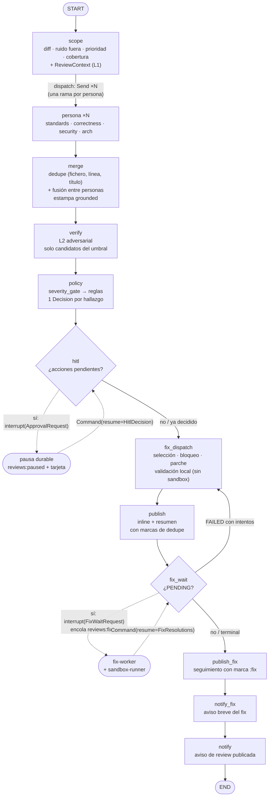
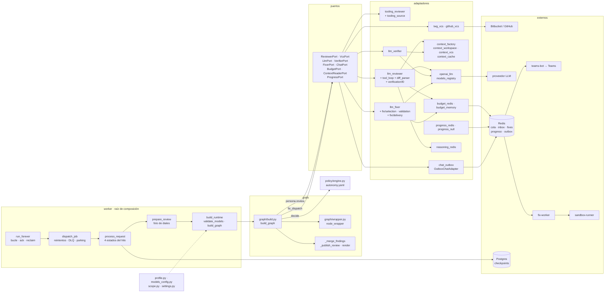
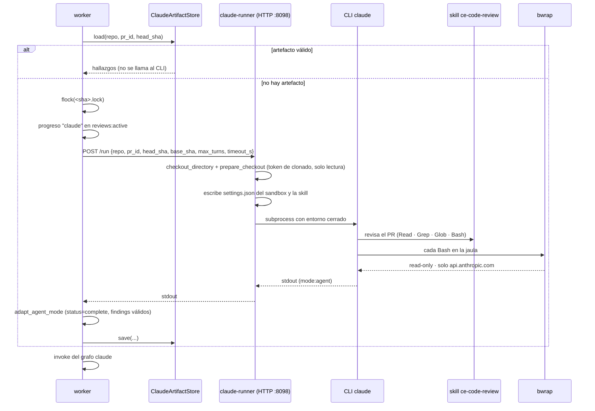
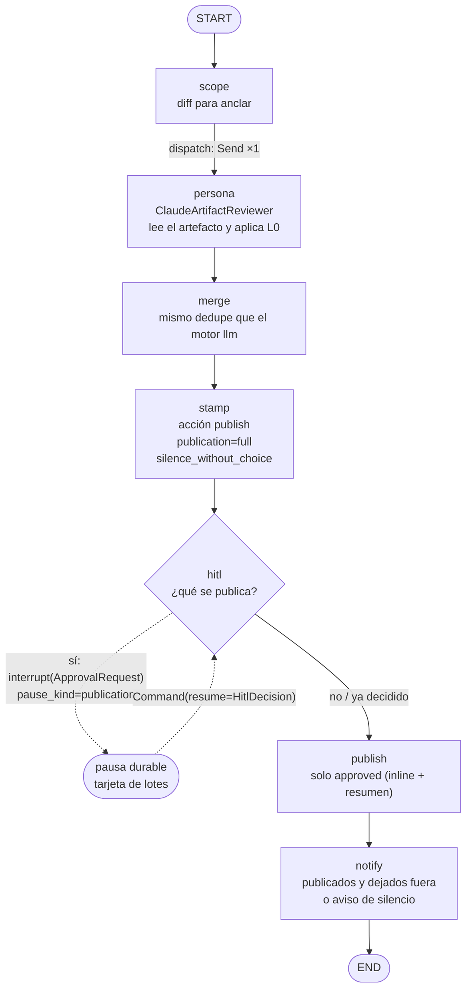
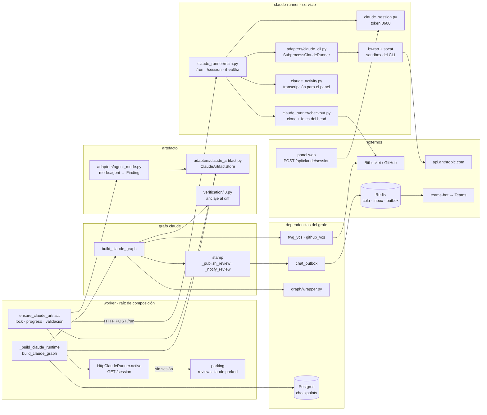
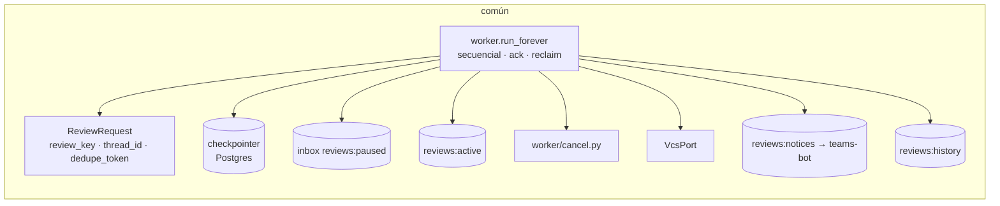

Última modificación: 2026-10-29 | Creado: 2026-10-24

# 14 — El grafo por motor, y los módulos que intervienen

> Índice: [README](README.md). El recorrido caso a caso está en
> [11](11-recorrido-de-una-review.md); aquí el foco es **quién hace qué**: el
> dibujo de cada grafo y, debajo de cada nodo, el módulo real que lo ejecuta.

`REVIEW_ENGINE` elige entre dos grafos distintos que comparten worker, cola,
checkpointer, canal y contrato de salida (`Finding`, `Decision`, `FixResult`):

| Motor | Constructor | Nodos | ¿Política? | ¿Fix? |
|---|---|---|---|---|
| `llm` (por defecto) | `build_graph` (`src/agent_review/graph/build.py:696`) | 12 | Sí, `autonomy.yaml` | Sí, con `fix-worker` |
| `claude` | `build_claude_graph` (`src/agent_review/graph/build.py:1167`) | 7 | No: sello fijo | No |

Los dos devuelven el mismo `ReviewState`, así que `process_request`,
`outcome_from_state` y el panel no saben cuál está corriendo.

---

## 1. Motor `llm`

### 1.1 El grafo

Detalles que el dibujo no puede contar y cambian el comportamiento:

- **`hitl` y `fix_wait` pausan dentro del nodo** (`interrupt`), no son aristas
  condicionales: el nodo se vuelve a ejecutar al reanudar y es idempotente.
- **`fix_dispatch` corre siempre**, también sin candidatos (no-op). Con
  `SANDBOX_ENABLED=false` o sin runner, marca los fixes `NOT_VERIFIABLE` y
  `fix_wait` no llega a pausar.
- **`fix_wait → fix_dispatch`** es el bucle de reintento: solo vuelve si queda un
  `FAILED` con `attempts < fix_max_attempts` (`_route_fix_wait`,
  `src/agent_review/graph/build.py:2029`).
- **`RetryPolicy`** (`is_transient`) está en `scope`, `persona`, `verify`,
  `fix_dispatch`, `publish`, `publish_fix`, `notify_fix` y `notify`. **No** en
  `merge` ni `policy` (puros) ni en `hitl`/`fix_wait` (un reintento duplicaría la
  pausa).
- Todos los nodos pasan por `graph/wrapper.node_wrapper` (progreso en
  `reviews:active:<review_key>` y cancelación cooperativa **entre** nodos).

### 1.2 Los módulos

### 1.3 Nodo → módulo, uno a uno

| Nodo | Qué lo implementa | Piezas que toca |
|---|---|---|
| `scope` | cierre `scope` de `build_graph` | `VcsPort.get_diff`; `scope.prioritize_diff` + `merge_ignore_patterns` + `merge_file_classes` (con `scope.classes` del perfil); `scope.assemble_review_context` (`008`) con `doc_paths` del perfil; `policy.guards["max_fix_attempts"]`; `budget_total` de `Settings` |
| `dispatch` | cierre `dispatch` | un `Send` por `ReviewerPort`; no ejecuta nada |
| `persona` | `ToolingReviewer` y `LlmReviewer` | `tooling_source.FileToolingOutputSource` (PHPStan); `llm_reviewer` (lotes, L0 con `verification/l0.py`, `adapters/diff_parser.py`, `tool_loop` + `context_factory`, `openai_llm`, `budget_*`, `reasoning_redis`); `models_registry.port_for(rol)`; `text_utils`; cobertura y `budget_exhausted` |
| `merge` | `_merge_findings` | `ADR-0014`; `grounded_findings` (ids que fusionaron a una persona `grounded`, p. ej. la estática) |
| `verify` | cierre `verify` | `LlmVerifier` + lector de contexto + presupuesto compartido; `_verification_candidates` (umbral `severity_gate.require_verified_for` o `VERIFIER_REQUIRE_VERIFIED_FOR`, tope `VERIFIER_MAX_FINDINGS`); `_adjudicate` (cita servida + escenario de tres partes) |
| `policy` | `PolicyEngine` | `config/autonomy.yaml`: gate de severidad (`ADR-0024`) → reglas → `Decision` con `matched_rule` y `policy_version`; techo `max_autonomy` |
| `hitl` | cierre `hitl` + `build_approval` | `interrupt(ApprovalRequest)`; worker: `paused_store` (`reviews:paused`), `chat.notify_decision_pending`; decisión desde `teams-bot`, panel (`web/`), CLI o `POST /decision` (`decision.py`); reanudación `Command(resume=HitlDecision)` |
| `fix_dispatch` | `fix.dispatch_fixes` | `fix/selection.select_candidates` (aprobados con `fix_*`, tope `max_fixes_per_pr`); `fix/node.blocked_reason` (ruta never-auto y tema protegido, `ADR-0009`); `FixerPort` (`llm_fixer` + `fix/patch`); `fix/validation.validate_patch`; deja `PENDING` con `VerifyJob` o terminal |
| `publish` | `_publish_review` | `VcsPort.resolve_inline_anchor` / `post_inline_comment` / `post_comment`; `parse_unified_diff`; `fix/delivery` (`DiffFormatter`/`SuggestionFormatter`); marcas `<!-- token:ok -->`, `:partial`, `:i:<hash>`; cabeceras de review incompleta/parcial |
| `fix_wait` | cierre `fix_wait` + `build_fix_wait` | `interrupt(FixWaitRequest)`; worker `_enqueue_wave` → `FixJob` en `reviews:fixes`; `fix-worker` (`fixworker/main.py`) → `http_sandbox` → `sandbox_runner` (`/verify`, `sandbox_runner/verifier.py`, `recipes.py`); vuelve `FixResolutions`; TTL `FIX_VERIFY_TTL_S` (`sweep_fix_expired`) |
| `publish_fix` | cierre `publish_fix` | `VcsPort.post_comment` con marca `:fix`; `_render_fix_followup` |
| `notify_fix` | cierre `notify_fix` | `ChatPort.notify` → `OutboxChatAdapter` → `RedisChatOutbox` (`reviews:notices`) |
| `notify` | `_notify_review` | mismo `ChatPort`; solo avisa si `published` es `True` (un fallo de Teams no repite `publish`) |

**Fuera del grafo, alrededor de él:** `worker/main.py` (cola `reviews:jobs`,
checkpointer Postgres, barridos `sweep_pending` / `sweep_expired` /
`sweep_fix_expired`, `reconcile_paused`, poda, latido), `settings.py`,
`profile.py`, `models_config.py` + `config/models.yaml`, `idempotency.py` y
`trace.py` (lectura del recorrido para el panel).

---

## 2. Motor `claude`

### 2.1 Antes del grafo: el artefacto

El grafo no llama al modelo. El worker pide una ejecución del CLI y guarda su
stdout validado; el grafo solo lee ese fichero.

Errores que el worker distingue antes de entrar al grafo (`ports/claude.py`):

| Respuesta / caso | Excepción | Qué hace el worker |
|---|---|---|
| `GET /session` → no | — | parking `session`; avisa con enlace al panel |
| `429` cupo | `ClaudeQuotaExceeded` (permanente) | parking `quota`, sin reintento; 900 s de enfriamiento para los siguientes |
| `504` techo | `ClaudeCeiling` (permanente) | parking `ceiling`, sin reintento ni publicación |
| `408` tiempo de pared | `ClaudeTimeout` (transitorio) | reintento del job |
| `502`, binario ausente | `ClaudeProcessCrashed` (transitorio) | reintento del job |
| stdout no validable | `ClaudeInvalidOutput` (transitorio) | no guarda artefacto, reintenta y avisa la primera vez |

El techo y el cupo salen del **desenlace estructurado** del CLI: el evento
`result` y su `subtype`. No se buscan palabras en el texto, porque el informe de
la review puede citarlas: una review de este repo nombra `error_max_turns` y se
parkeaba como `ceiling` con el CLI en `subtype: success`.

El runner no escribe el artefacto ni conoce el grafo: quien lo guarda es el
worker, con el stdout redactado que le devuelve `POST /run`.

### 2.2 El grafo

Diferencias que importan:

- **No hay `verify`, `policy`, `fix_dispatch`, `fix_wait`, `publish_fix` ni
  `notify_fix`.** El CLI ya revisó; aquí solo se publica lo elegido.
- **`stamp` no consulta la política**: marca todo con `action=publish`,
  `publication=full` y `pause_kind=publication`. Por eso, con hallazgos, `hitl`
  **siempre** pausa: la pregunta es cuáles se escriben en el PR.
- **`silence_without_choice`**: si no queda nada `approved` y no hay fuente
  estática sin cubrir, `publish` **no escribe** en el PR (ni inline ni resumen) y
  `notify` manda un aviso corto. El `expired` del TTL reanuda como `dropped`.
- **`dropped` ≠ `rejected`**: `dropped` no se publica ni en el resumen; `rejected`
  sí aparece en el resumen.
- La tarjeta de Teams, al ver `pause_kind=publication`, ofrece lotes (solo
  bloqueantes, todos, ninguno) y marcado suelto (`teams_bot/cards.py`).

### 2.3 Los módulos

### 2.4 Nodo → módulo, uno a uno

| Nodo | Qué lo implementa | Piezas que toca |
|---|---|---|
| `scope` | cierre `scope` de `build_claude_graph` | solo `VcsPort.get_diff` + `prioritize_diff` (ruido y clases). **No** arma `ReviewContext`: el CLI ya leyó el repo |
| `dispatch` | cierre `dispatch` | un `Send` con la persona `claude` |
| `persona` | `ClaudeArtifactReviewer` | `ClaudeArtifactStore.load` → `parse_findings` (`domain/contracts.validate_finding`) → `evaluate_l0`: se descarta la cita que no ancla en el diff y se corrige `file`/`line`/`pre_existing`. Sin artefacto válido lanza `ClaudeArtifactMissing` (no es «review limpia») |
| `merge` | `_merge_findings` | mismo código que el motor `llm`; sin personas `grounded` |
| `stamp` | cierre `stamp` | `Decision(action=publish, publication=full, matched_rule="claude", policy_version="claude")`, `silence_without_choice=True`, `pause_kind="publication"`. No lee `autonomy.yaml` |
| `hitl` | cierre `hitl` + `build_approval` | `interrupt(ApprovalRequest)` con `pause_kind=publication`; `paused_store`; tarjeta de lotes en `teams_bot/cards.py` + `teams_bot/decisions.py`; bandeja/detalle del panel; reanudación `Command(resume=HitlDecision)` |
| `publish` | `_publish_review` | `max_inline=20` fijo, `delivery=None`; publica solo `approved` cuando hay decisión humana; si no queda nada, no escribe; cabecera de review parcial por cobertura |
| `notify` | `_notify_review` / `_notify_silence` | `ChatPort.notify` con `_render_publication_notice` («se publicaron N; M quedaron fuera») o el aviso de silencio |

**Alrededor, y solo en este motor:** `claude_runner/` (servicio HTTP, checkout,
subproceso y jaula), `claude_session.py` (el panel escribe el token, el runner lo
lee), `claude_activity.py` (transcripción que el panel sigue por
`GET /api/reviews/{key}/claude/events`), `worker.park_claude_job` y
`queue.release_parked`, y `claude_artifact_root` como volumen compartido del
worker.

---

## 3. Lo que comparten los dos motores

Se puede cambiar de motor sin tocar cola, checkpointer, dedupe, panel ni canal:
solo cambia el grafo que se compila y, en `claude`, que antes haya artefacto.

---

## 4. Comparación en una tabla

| | `llm` | `claude` |
|---|---|---|
| Quién revisa | personas del fan-out (`ToolingReviewer` + `LlmReviewer` por rol) | el CLI `claude` en `claude-runner`, fuera del worker |
| Modelo | `models.yaml` → `ModelRegistry.port_for(rol)` | sesión del operador (token OAuth) |
| Contexto | L1 (`ReviewContext`) + L0 + bucle de herramientas | lo lee el CLI; L0 solo ancla al diff |
| Juicio de severidad | `verify` (L2) + `severity_gate` | no hay: la severidad la trae el artefacto |
| Decisión de publicar | reglas de `autonomy.yaml` | sello fijo + elección humana |
| Arreglo | `fix_dispatch` + `fix-worker` + sandbox | no existe |
| Cuándo pausa | solo si hay `escalate` / `fix_with_approval` | si hay hallazgos (elegir qué se publica) |
| PR sin hallazgos | no escribe nada en el PR (ni resumen) y no avisa | no escribe y manda un aviso corto de silencio |
| Cobertura | por lotes: review parcial explícita | la del artefacto |
| Coste | presupuesto por review + tope por persona | cupo y techo del CLI (`max_turns`, `timeout_s`) |

---

## 5. Dónde mirar

| Quiero ver… | Fichero |
|---|---|
| Aristas y nodos, tal cual | `src/agent_review/graph/build.py:1124` (llm) y `:1304` (claude) |
| Montaje del runtime de cada motor | `worker/main.py:build_runtime` y `_build_claude_runtime` |
| Cuándo entra el artefacto | `worker/main.py:ensure_claude_artifact` |
| Contrato del stdout de Claude | `adapters/agent_mode.py` y `domain/contracts.py` |
| Contrato del CLI y la jaula | `adapters/claude_cli.py`, `claude_runner/main.py`, `docs/edu/13-jaula-bwrap-y-runner.md` |
| Política | `config/autonomy.yaml`, `policy/engine.py`, `ADR-0024` |
| Modelos | `config/models.yaml`, `models_registry.py`, `ADR-0015` |
