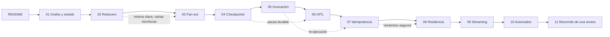
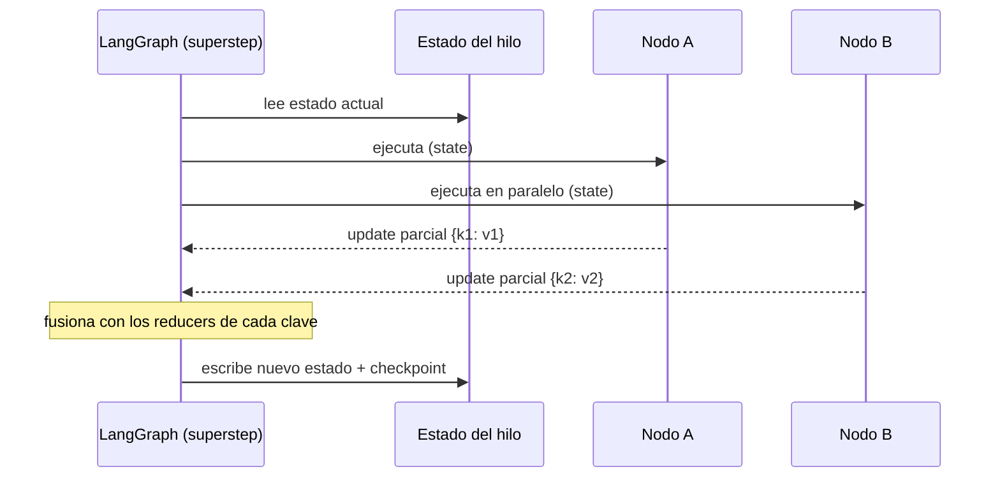
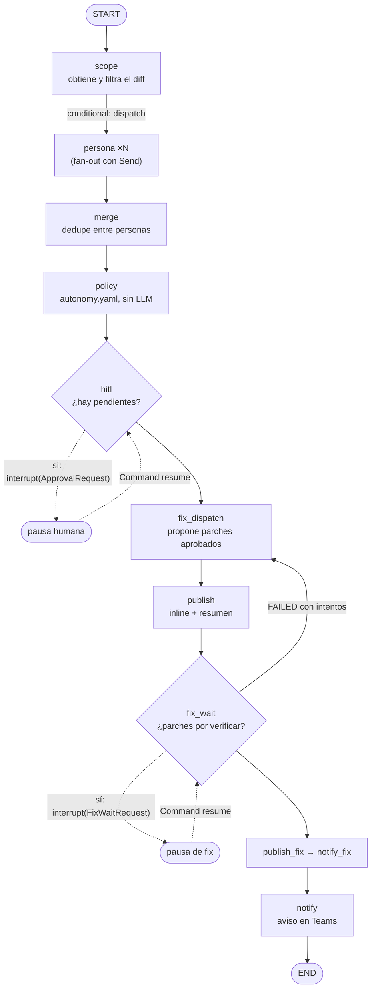
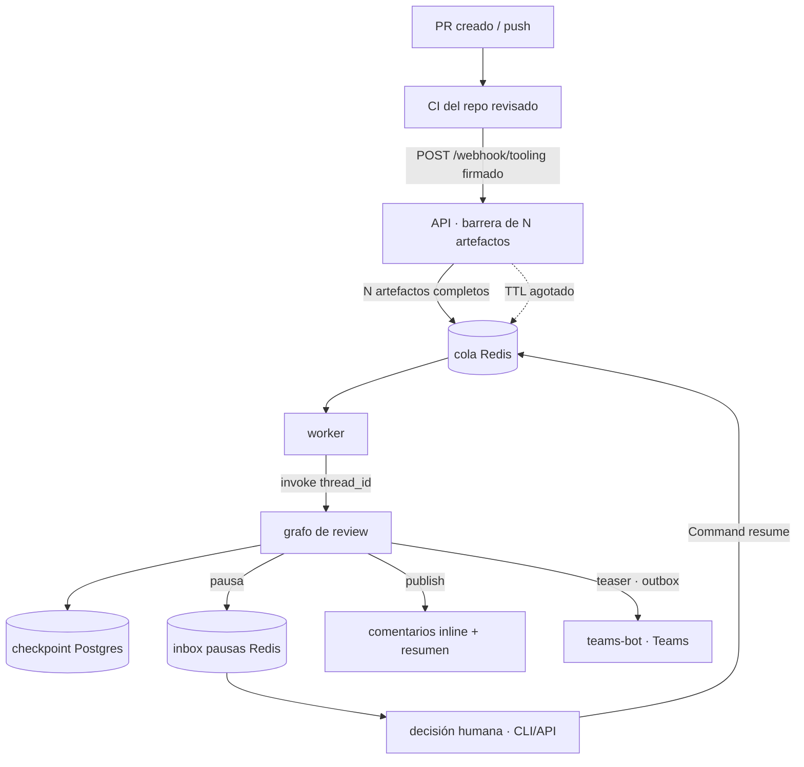

Última modificación: 2026-10-16 | Creado: 2026-10-11

# Documentación educativa de LangGraph

Esta carpeta es material **formativo**, no especificación de producto. Explica los
**conceptos** de LangGraph que este proyecto usa (y unos cuantos que todavía no usa
pero que conviene conocer), y lo hace **de forma general**: cada idea se define y se
ilustra con un ejemplo mínimo, y **después** se señala dónde aparece en `reviews`.

El objetivo declarado del proyecto es *aprender LangGraph* construyendo un agente de
code review. Por eso estos documentos están escritos para leerse de principio a fin en
el orden del índice, pero cada uno es autónomo.

---

## Cómo leer esto

Cada módulo sigue la misma estructura, para que puedas ir directo a lo que buscas:

1. **Qué es / para qué** — definición y modelo mental.
2. **API de LangGraph** — las clases y funciones concretas.
3. **Ejemplo mínimo** — código reducido, autocontenido.
4. **Matices y avanzado** — lo que distingue "usarlo" de "entenderlo".
5. **Dónde aparece en `reviews`** — referencias a ficheros reales del repo.
6. **Experimento propuesto** — algo que puedes ejecutar para comprobar la idea.

### Ruta de lectura

Cada módulo se apoya en el anterior; este es el camino recomendado (las flechas
punteadas son "temas relacionados", no requisitos estrictos):

### Anatomía de un superstep

Todo el sistema gira alrededor de una idea: **un nodo lee el estado, devuelve un
cambio parcial, y LangGraph fusiona**. Este es el latido que se repite en cada paso:

Casi todos los ejemplos se han probado con la versión instalada en este repo:

| Paquete | Versión |
|---|---|
| `langgraph` | 1.2.14 |
| `langgraph-checkpoint` | 4.2.0 |
| `langgraph-checkpoint-postgres` | 3.1.2 |
| `langgraph-prebuilt` | 1.1.0 |

> **Nota sobre versiones.** LangGraph cambia rápido. Cuando un detalle dependa de la
> versión lo diré explícitamente con la coletilla `(verificado en 1.2.14)`. Si algo no
> cuadra con tu versión, el sitio canónico es la documentación oficial
> (<https://langchain-ai.github.io/langgraph/>) y, mejor aún, `inspect.signature` sobre
> el objeto real.

---

## Mapa de conceptos

Tabla de "quiero entender X → módulo donde vive X".

| Concepto | Módulo |
|---|---|
| Grafo, nodo, arista, `START`/`END` | [01 — Grafos y estado](01-grafos-y-estado.md) |
| `StateGraph`, `CompiledStateGraph`, `compile()` | [01 — Grafos y estado](01-grafos-y-estado.md) |
| `TypedDict` de estado, `total=False` | [01 — Grafos y estado](01-grafos-y-estado.md) |
| **Reducers** (`Annotated`, `operator.add`) | [02 — Reducers y contratos de estado](02-reducers.md) |
| Reducer que también "sustituye" (dict merge) | [02 — Reducers y contratos de estado](02-reducers.md) |
| Aristas normales vs condicionales (`add_edge`, `add_conditional_edges`) | [03 — Ramificación y fan-out](03-ramificacion-y-fan-out.md) |
| **Fan-out / fan-in**, map-reduce con `Send` | [03 — Ramificación y fan-out](03-ramificacion-y-fan-out.md) |
| `Send` (dispatch dinámico, estado por rama) | [03 — Ramificación y fan-out](03-ramificacion-y-fan-out.md) |
| **Checkpointer**, `thread_id`, persistencia | [04 — Durabilidad y checkpoints](04-durabilidad-y-checkpoints.md) |
| `InMemorySaver`, `PostgresSaver`, `setup()` | [04 — Durabilidad y checkpoints](04-durabilidad-y-checkpoints.md) |
| **Serde** y allowlist de tipos (`JsonPlusSerializer`) | [04 — Durabilidad y checkpoints](04-durabilidad-y-checkpoints.md) |
| `get_state`, `StateSnapshot`, `next` | [04 — Durabilidad y checkpoints](04-durabilidad-y-checkpoints.md) |
| **Semántica de re-invocación** (`invoke` con input vs `invoke(None)`) | [05 — Invocación y semántica de re-ejecución](05-invocacion-y-reejecucion.md) |
| `Command` (`update`, `goto`, `resume`) | [05](05-invocacion-y-reejecucion.md) / [06](06-hitl.md) |
| **HITL**, `interrupt`, `Command(resume=...)` | [06 — Human-in-the-loop](06-hitl.md) |
| Pausa durable, `Interrupt`, reanudar desde el nodo | [06 — Human-in-the-loop](06-hitl.md) |
| `interrupt_before`/`interrupt_after` (estático) vs `interrupt()` (dinámico) | [06 — Human-in-the-loop](06-hitl.md) |
| Idempotencia y deduplicación de efectos externos | [07 — Idempotencia y efectos](07-idempotencia-y-efectos.md) |
| **RetryPolicy**, fallos transitorios, DLQ | [08 — Resiliencia](08-resiliencia-retries.md) |
| Timeouts, cache, `error_handler` | [08 — Resiliencia](08-resiliencia-retries.md) |
| **Streaming** (`values`, `updates`, `messages`, `custom`) | [09 — Streaming y observabilidad](09-streaming-y-observabilidad.md) |
| Subgrafos, `input_schema`/`output_schema`, nodos como grafos | [10 — Patrones avanzados](10-patrones-avanzados.md) |
| `context_schema`, `store`, `durability`, `Overwrite` | [10 — Patrones avanzados](10-patrones-avanzados.md) |
| **El grafo de `reviews` recorrido caso a caso** (sin hallazgos, report, HITL, fix, fallos, degradada) | [11 — Recorrido de una review](11-recorrido-de-una-review.md) |

---

## El grafo de este proyecto, de un vistazo

Es el mejor mapa mental antes de empezar: todo lo demás explica una pieza de esto.

Lo que este dibujo ya encierra (y cada módulo desarrolla):

- **Estado con contrato** (módulo 1–2): los nodos leen y escriben un `TypedDict`
  tipado; los reducers deciden cómo se fusionan las escrituras concurrentes.
- **Fan-out/fan-in** (3): `dispatch` devuelve varios `Send`, uno por persona.
- **Checkpointer** (4): el `thread_id` da identidad a la ejecución y la hace
  reanudable.
- **HITL** (6): `interrupt` pausa sin bloquear el worker; la decisión humana reanuda.
- **Idempotencia** (7): aunque el grafo se re-ejecute, los efectos externos
  (comentarios en el PR) no se duplican.

El recorrido completo de este grafo, caso a caso, está en
[11 — Recorrido de una review](11-recorrido-de-una-review.md).

---

## Convenciones de estos documentos

- Bloques de código **autocontenidos** salvo que se diga lo contrario: puedes
  copiarlos a un `.py` y ejecutarlos.
- Las referencias a código del repo son del tipo `src/agent_review/graph/build.py` (a veces
  con `:línea`).
- Cuando muestro una **línea de tiempo de ejecución** indico qué nodos corren.
- Los "experimentos propuestos" son la parte importante: LangGraph se entiende
  rompiéndolo, no leyéndolo.

---

## El ciclo de vida completo: del PR al comentario

El grafo es solo una pieza. El sistema entero —con la barrera de ingesta del CI, la
cola, el checkpointer y el HITL— se ve así (los módulos que cubren cada tramo, entre
paréntesis):

## Glosario mínimo

| Término | Significado |
|---|---|
| **Nodo (node)** | Una función que recibe el estado y devuelve una actualización parcial. |
| **Arista (edge)** | Transición entre nodos. Normal (fija) o condicional (calculada). |
| **Superstep** | Una "tanda" de ejecución: LangGraph ejecuta en paralelo todos los nodos habilitados y luego fusiona sus updates. |
| **Reductor (reducer)** | Función que combina el valor previo de una clave con el nuevo cuando hay varias escrituras. |
| **Checkpoint** | Foto serializada del estado en un momento, ligada a un `thread_id`. |
| **Hilo (thread)** | Secuencia de checkpoints identificada por `thread_id`; la "sesión" de una ejecución. |
| **Fan-out / fan-in** | Abrir N ramas y luego convergerlas. |
| **HITL** | *Human-in-the-loop*: el grafo pausa para pedir/recibir intervención humana. |
| **Serde** | Serializador/deserializador de los tipos que viajan en el estado. |
