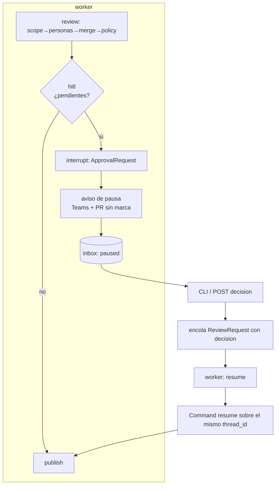

Última modificación: 2026-10-11 | Creado: 2026-10-11

# Fase 2 — HITL: pausar, decidir y reanudar

Especificación del bucle humano-máquina. El grafo deja de ser un pipeline de una
pasada: ante un hallazgo que la política marca como pendiente, **se pausa de forma
durable**, recibe una decisión humana por un canal externo y **reanuda el mismo
hilo** sin duplicar publicación. Sigue sin escribir una línea de código: eso es la
Fase 3.

Complementa `docs/diseno-agente-code-review-20261010.md` (§3, §4, §5, §13) y
`docs/pendiente-fase1-20261011.md`. El estado vivo está en `tasks/plan.md`.

---

## 1. Objetivo

Que exista el bucle completo **pausa → decisión → reanudación** y que sea
**durable**: sobrevive a un reinicio del worker, no se pierde la decisión y no se
re-publica lo ya publicado.

### No-objetivo (explícito)

| Fuera | Por qué |
|---|---|
| Ejecutar cualquier `fix_*` | El diseño §13 no da capacidad de escritura hasta probar la Fase 3 |
| Bot de Azure / Adaptive Cards (Opción A) | La Opción B primero: cero infra nueva |
| Jira como workitem/decision | Fase 4 |
| Webhook de PR como disparo | Sigue retirado (ingesta diferida) |
| Arreglar que un crash a media review re-ejecute `scope` | Deuda preexistente, no la introduce la Fase 2 (§7) |

---

## 2. Decisiones tomadas

| # | Decisión | Valor | Nota |
|---|---|---|---|
| D1 | Go de Fase 2 | **Sí** | El formato inline (P3) se valida con la primera review pausada real |
| D2 | Canal primario | **CLI + `POST /reviews/{key}/decision`**, comentario de PR después | No toca `twg`; el adaptador solo lee comentarios generales hoy (§7) |
| D3 | Autoridad humana | **La decisión manda sobre el `clamp` y sobre `never_auto_paths`, también en Fase 3** | Ratificado sin segunda señal; riesgo asumido en §2.1 |
| D4 | Transporte | **Cola única**, resume ejecutado por el **worker** | Un consumidor, una DLQ, hereda reintentos |

### 2.1 D3 ratificado: la decisión humana es suficiente (incluso en Fase 3)

Aprobar por encima de `never_auto_paths`/`protected_subject` **no es peligroso en
Fase 2** porque nada se ejecuta: es un registro con `actor`. El freno
"`protected_subject` bloquea el autofix siempre" (diseño §8) sí queda relativizado,
y **se ratifica (2026-10-11): la decisión humana bastará también en Fase 3**, sin
segunda señal.

**Riesgo asumido explícitamente:** cuando exista el ejecutor de fixes, **un único
actor** podrá autorizar escritura en rutas nunca-auto (auth, cripto, migraciones,
`docker/**`, el propio `.github/**`). Eso es, literalmente, superficie de
supply-chain: quien tenga el token de decisión tiene el repo. Mitigaciones que
**permanecen** (no sustituyen a la segunda señal, pero acotan el daño):

1. El token de decisión se trata como secreto de alto valor (igual que el de push
   de Fase 3), con rotación y scope mínimo.
2. Cada decisión queda auditada (`actor`, `finding_id`, `note`, `decided_at`).
3. Se decide por `finding_id` concreto: **nunca** un bypass en bloque.
4. El clamp de política sigue siendo el único dial que *crea* pendientes; la
   decisión solo responde a los que ya existen, no inventa acciones nuevas.

> Si en Fase 3 se detecta uso indebido, la revisión de esta decisión es el primer
> punto del orden del día, no un parche sobre el ejecutor.

---

## 3. Contrato

### 3.1 Modelos nuevos (`domain/hitl.py`)

```python
class DecisionOutcome(StrEnum):
    APPROVED = "approved"   # autoriza el arreglo (lo ejecuta la Fase 3)
    REJECTED = "rejected"   # descarta el hallazgo (falso positivo o no aplica)
    NOTED = "noted"         # se atiende fuera del agente (deuda, ticket)
    EXPIRED = "expired"     # nadie decidio dentro del TTL

class FindingDecision(BaseModel):
    finding_id: str
    outcome: DecisionOutcome
    note: str = ""

class HitlDecision(BaseModel):
    review_key: str
    actor: str
    decided_at: datetime
    decision_id: str                 # idempotencia del resume
    items: list[FindingDecision]
```

`HitlDecision` viaja **en** el job (`ReviewRequest.decision`, §4.3). No hay un tipo
"job" nuevo: un `ReviewRequest` con `decision` es una reanudación.

### 3.2 Payload del `interrupt`

```python
class PendingDecision(BaseModel):
    finding_id: str
    proposed_action: FindingAction   # escalate | fix_with_approval
    reason: str
    matched_rule: str
    policy_version: str
    title: str
    file: str
    line: int
    severity: Severity

class ApprovalRequest(BaseModel):
    review_key: str
    repo: str
    pr_id: int
    head_sha: str
    pending: list[PendingDecision]
    command_hint: str                # "reviews decide <review_key> ..."
```

El payload es lo que el nodo `hitl` pasa a `interrupt(...)`. Es también lo que se
publica (sin marca de dedupe) en el aviso de pausa y lo que expone la API para
que el CLI construya la decisión.

### 3.3 Estado y resultado

- `ReviewState.human_decisions: HitlDecision | None` — sin reducer.
- `ReviewOutcome`: añade `human_decisions: HitlDecision | None` y
  `paused: bool`. `complete` mantiene su significado actual (cobertura de tooling).
- `ReviewRequest.decision: HitlDecision | None = None`. `thread_id`, `review_key`,
  `dedupe_token` siguen derivándose de la identidad (`repo:pr:sha[:pipeline]`), así
  que la reanudación **reutiliza el hilo de la review**.

### 3.4 Inbox de pausas (Redis)

Espejo de `PendingReview` para decisiones pendientes:

```python
class PausedReview(BaseModel):
    review_key: str
    request: ReviewRequest
    approval: ApprovalRequest
    created_at: datetime
    ttl_s: float
```

Clave `reviews:paused:<review_key>`. Lo escribe el worker al pausar, lo leen la API
y el CLI, y se borra al reanudar. Redis es la **caché de descubrimiento**; la
verdad durable es el checkpoint en Postgres (misma asimetría que la ingesta de
Fase 1, ver §9).

---

## 4. Diseño

### 4.1 Flujo



### 4.2 Grafo

`policy → hitl → publish`. El nodo `hitl`:

1. Toma las `Decision` con acción en `PENDING_ACTIONS`.
2. Si no hay ninguna, devuelve `{}` y el grafo sigue a `publish` como en Fase 1.
3. Si hay, llama a `interrupt(ApprovalRequest(...))`. `invoke` **retorna** con el
   hilo pendiente; el worker no se bloquea.

Tras la reanudación, `hitl` recibe la decisión como valor de `interrupt`, la
escribe en `human_decisions` y el grafo continúa a `publish`. **La decisión no
vuelve a pasar por la política**: el `clamp` no la degrada (D3).

### 4.3 Worker: tres estados del hilo

`_completed_snapshot` hoy solo distingue "completado" de "ejecutar". La Fase 2
introduce el estado intermedio y su manejo explícito (verificado en
`langgraph` 1.2.14 / `checkpoint-postgres` 3.1.2). El helper pasa a llamarse
`_thread_snapshot` (devuelve el snapshot, no solo los `values`):

| `snapshot` | Significa | Acción |
|---|---|---|
| `interrupts` no vacío | **Pausada** esperando decisión | Si el job trae `decision` → `invoke(Command(resume=decision))`; si no → **no-op** (no re-ejecutar `scope` ni personas) |
| `next` no vacío, sin `interrupts` | Crash a media ejecución | Comportamiento actual: re-`invoke` con input (dedupe por marcas) |
| `next` vacío con `values` | Completada | No-op (actual) |
| Sin estado | Nueva | `invoke` normal (actual) |

> **Sin esto hay una fuga de coste real:** una reentrega del job mientras la review
> está pausada re-invoca con input y, como `interrupt` está *antes* de `publish`,
> vuelve a pausar… pero **re-ejecuta `scope` y las personas** (tokens incluidos).
> Reproducido con un grafo mínimo: `next` se mantiene en el nodo de `interrupt`,
> la decisión pendiente no se pierde, pero el trabajo se repite.
>
> **Implementación (T5):** `process_request` resuelve el estado con
> `_thread_snapshot`, despacha a `_resume_paused` si hay `interrupts` y trata la
> reentrega completada como no-op. `paused` se propaga explícito a
> `outcome_from_state`: el `__interrupt__` no vive en `snapshot.values`, así que la
> mera lectura del estado no lo delataría. Los tipos HITL (`ApprovalRequest`,
> `HitlDecision`, …) están en la allowlist del serde (`checkpointer.py`) para que
> el roundtrip del hilo pausado no dependa del msgpack permisivo.

### 4.4 Reanudación

El `Command(resume=...)` se ejecuta en el **worker** (D4): ya tiene el grafo y el
checkpointer, y hereda reintentos/DLQ. El proceso que decide (CLI/API) **no**
construye el grafo. Escenario de durabilidad:

```
worker A: invoke → pausa → aviso + inbox → ack
worker A: muere (restart: unless-stopped)
worker B: arranca, mismo Postgres → inbox intacto en Redis
decision → cola → worker B: Command(resume) sobre el hilo → publish → borra inbox
```

### 4.5 Publish con decisión

- `rejected`: el hallazgo **no** genera inline; figura en el resumen como
  `descartado por <actor>`.
- `approved` / `noted` / `expired`: inline normal (Fase 1) con una línea
  `Decisión: <outcome> · <actor>`. `approved` en ruta no-auto incluye el aviso de
  que el cambio se aplicará en Fase 3.
- El pie de dedupe (`:ok` / `:partial`) se escribe **solo** aquí, tras reanudar.
  **El aviso de pausa nunca lleva la marca**: si la llevara, el `publish` lo
  leería como review publicada y no publicaría nada.

### 4.6 Ingress: decisión por CLI / HTTP

- `POST /reviews/{review_key}/decision` (bearer `REVIEWS_DECISION_TOKEN`; en
  `development` se relaja como el secreto de tooling). Cuerpo: `actor` + `items`.
- Valida contra el inbox: el `review_key` debe existir y cada `finding_id` debe
  estar en `pending`. Rechaza (`409`) si no está pausada o el `finding_id` no
  pertenece a ella. La validación se comparte con el CLI en `reviews/decision.py`.
- Encola `ReviewRequest(... decision=...)` en la cola única. El endpoint usa el
  converter `{review_key:path}`: la clave lleva `/` (`cqm/emotivoo-v2:42:sha:7`) y
  sin él el routing cortaría en el primer segmento.

### 4.7 Expiración

Un hilo pausado no puede quedarse eterno (bloat de checkpoints + decisión zombi).
Al superar `DECISION_TTL_S` (por defecto 7 días), el barrido reencola una
reanudación con `DecisionOutcome.EXPIRED` para todos los pendientes: la review se
publica como en Fase 1 («sin decisión»), nunca desaparece.

**Implementación (T7):** `worker.sweep_expired` recorre el inbox, construye una
`HitlDecision(actor="system:ttl")` con `expired` para cada pendiente y la encola
(el resume limpia el inbox, igual que una decisión humana); `run_forever` lo llama
en el mismo barrido periódico que los TTL de ingesta. El aviso de pausa sale por
Teams (`notify_decision_pending`) con `render_pause_notice`, **sin** marca de
dedupe; el worker escribe además la pausa en el inbox antes de avisar.

### 4.8 Poda

`PostgresSaver.delete_thread` existe. Se podan hilos **completados** más antiguos
que `CHECKPOINT_RETENTION_DAYS` (por defecto 30). Nunca se poda un hilo pausado.
La dedupe sobrevive a la poda porque vive en las marcas del PR, no en el
checkpoint (buena separación que hay que no romper).

**Implementación (T8):** `checkpointer.prune_completed_threads` recorre
`saver.list`, se queda con la última tupla de cada hilo, lo marca completado si no
tiene un `__interrupt__` pendiente (o si ya trae `__resume__`) y lo borra solo si
superó la retención. Los pausados se excluyen por doble vía: la lista
`paused_threads` (del inbox) y la propia detección de `__interrupt__`, de modo que
un olvido no puede borrar una review indecidible. `older_than_days <= 0` desactiva
la poda (no hay «podar todo» accidental). El worker lo llama en el barrido
periódico; `/reviews/{key}` expone `PAUSED` desde el inbox — el API no habla con
el checkpointer (§4.9).

### 4.9 El `CheckpointerPort` no se extrae en esta fase

`tasks/plan.md` lo listaba como primer trabajo. **Se retira del alcance**, con
motivo: el transporte elegido (D4) ejecuta el resume en el worker, que ya posee el
checkpointer; y el ingress lee el **inbox** (Redis), no Postgres. El escenario que
lo justificaba («la reanudación llegará desde otro proceso») queda **disuelto**:
ningún otro proceso necesita el saver. Extraer el puerto ahora sería abstracción
sin segundo cliente que la paguen. Se reabre si el resume se mueve a la API o si
aparece un segundo consumidor.

---

## 5. Comandos

```bash
# Levantar (igual que Fase 1)
docker compose up --build -d

# Ver reviews pausadas y sus hallazgos pendientes
reviews list
python -m reviews.cli list            # equivalente sin entry point

# Decidir (una o varias)
reviews decide <review_key> --actor alice --approve <finding_id>
reviews decide <review_key> --actor alice --reject <finding_id> --note "falso positivo"
reviews decide <review_key> --actor alice --approve f1 --noted f2

# Verificación
make ci                               # ruff + mypy + pytest
```

`reviews` se declara como `[project.scripts]` en `pyproject.toml`.

---

## 6. Estructura

```
src/reviews/domain/hitl.py        # DecisionOutcome, FindingDecision, HitlDecision,
                                  # PendingDecision, ApprovalRequest
src/reviews/domain/paused.py      # PausedReview
src/reviews/paused_store.py       # PausedStore (Redis + memoria), clave reviews:paused:*
src/reviews/cli.py                # entry point `reviews`
```

Se tocan, además: `domain/models.py`, `graph/build.py`, `worker/main.py`,
`api/main.py`, `policy/engine.py`, `settings.py`.

---

## 7. Riesgos y deudas conocidas

| Riesgo | Detalle | Mitigación |
|---|---|---|
| Reentrega estando pausado | Re-ejecuta `scope`/personas (coste) | Rama explícita en `process_request` (§4.3) |
| Aviso de pausa con marca | El `publish` lo leería como review publicada | El aviso no lleva token; test dedicado |
| Decisión duplicada | Doble clic / reintento | `decision_id` + estado del hilo (si ya no hay `interrupts`, no-op) |
| Redis cae y se pierde el inbox | La review queda pausada e indecidible por la API | Conocido y aceptado (misma asimetría que la ingesta); verdad en Postgres. Endurecer a Postgres si duele (§11) |
| Canal de PR | `list_review_markers` lee solo comentarios generales; los inline cuelgan de un `parent` que el adaptador no expone | Fuera de D2; se implementa solo si se elige el canal de PR |
| `_lower_cap` desconoce `ESCALATE` | `MAX_AUTONOMY_OVERRIDE=escalate` con un YAML no-`escalate` → `KeyError` en el arranque (`rank[candidate]`). `_cap` no cae: hace early return con `escalate` | T1 lo blinda |
| Crash a media review re-ejecuta `scope`/personas | Preexistente; `invoke(None)` lo evitaría | Fuera de alcance; anotado como deuda |

---

## 8. Boundaries

- **Siempre**: validar la decisión contra el inbox; registrar `actor`; no dejar que
  la decisión mute el `clamp` de la política; test por cada transición de estado.
- **Preguntar**: cambiar el vocabulario de `DecisionOutcome`; añadir Jira; subir el
  techo a `fix_auto`; exponer el endpoint sin token; tocar el formato inline.
- **Nunca**: ejecutar `fix_*`; publicar sin token de dedupe; marcar `:ok` en el
  aviso de pausa; borrar un hilo pausado; interpretar la ausencia de decisión como
  aprobación.

---

## 9. Testing

| Nivel | Qué cubre |
|---|---|
| Unit | Contrato (`HitlDecision`/`ApprovalRequest`); `PausedStore`; `_cap` con `escalate`; render de decisión en `publish` |
| Grafo | `policy → hitl`: pausa solo con pendientes; sin pendientes no pausa; resume escribe `human_decisions` |
| Worker | Reentrega pausada es no-op; resume con `Command`; completada es no-op; crash-retry intacto |
| Durabilidad | Compartir el saver entre dos compilaciones del grafo simula el reinicio; integración con Postgres (marcada) |
| E2E | `artefacto → pausa → decisión → resume → inline+resumen`, sin duplicar |

Restricción de estilo: reproducir el camino de pausa **no** debe depender de
`twg` real ni de red (VCS falso, como en `tests/test_checkpointer.py`).

---

## 10. Criterios de hecho

1. Un hallazgo `escalate` **pausa** el grafo; el estado sobrevive a recompilar el
   grafo con el mismo checkpointer (simula reinicio del worker).
2. Una decisión válida reanuda el mismo hilo y publica inline + resumen **sin
   duplicar** (ni inline repetido ni resumen repetido).
3. Decidir dos veces el mismo `finding_id` es **no-op** (ni error ni duplicado).
4. Un `finding_id` que no está en `pending` → `409`, sin tocar el grafo.
5. La reentrega del job de review estando pausada **no re-ejecuta** `scope` ni las
   personas.
6. El aviso de pausa **no** lleva el pie de dedupe; el resumen posterior sí.
7. `max_autonomy` es el único dial que decide si una acción pausa.
8. **Cero** `Decision.action` con `fix_*` ejecutada en toda la fase.

---

## 11. Decisiones cerradas (2026-10-11)

1. **D3 ratificado sin segunda señal, también en Fase 3.** Riesgo asumido en §2.1.
2. **Inbox en Redis** en Fase 2 (coherente con la ingesta); a Postgres solo si el
   canal de Teams se suma o la fragilidad duele.
3. **`max_autonomy: fix_with_approval`.** El pendiente cubre tanto el fix que quería
   ser automático como el que pedía aprobación; el render de §4.5 informa cuál de
   los dos es.
4. **Publicar al decidir, no al pausar.** Al pausar solo sale el aviso; los
   hallazgos se publican tras la reanudación.
5. **El CLI/API solo encola la decisión**; escribir en el PR es del worker al
   publicar. El CLI no toca el PR.
