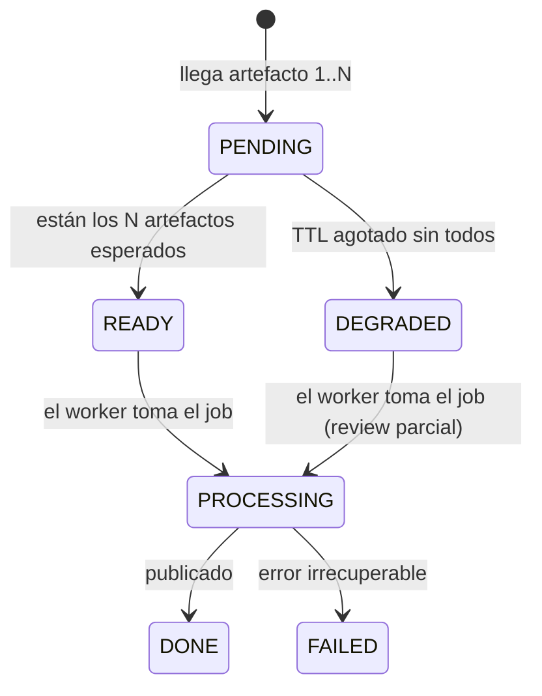

Última modificación: 2026-10-11 | Creado: 2026-10-11

# Ingesta diferida: por qué el agente espera al CI

Cómo y por qué la review no se dispara con el PR sino cuando el CI deposita el
artefacto que necesita; y por qué ese artefacto es un **puente desechable** y no la
cimentación del sistema.

Complementa `docs/diseno-agente-code-review-20261010.md` (§6.2, §9, §13, §15).

---

## 1. El problema que resuelve

El disparo por webhook de PR llegaba **antes** de que el CI produjese el artefacto de
PHPStan. El worker lo leía una sola vez, no lo encontraba y publicaba una review que
*parecía* limpia sin serlo: un fallo de integración disfrazado de "PR sin hallazgos".

```
t0    PR creado ──webhook──► api ──encola──► worker
t0+ε  worker procesa → artefacto NO existe → MISSING → 0 hallazgos   ← review enganosa
t15   CI de emotivoo-v2 corre PHPStan y publica la salida            ← llega tarde
```

La causa no era un problema de *timing*: era un **error de diseño**. «PR creado» no
significa «los datos de la review están listos». Son dos eventos distintos.

| Evento | Significa | ¿Artefacto listo? |
|---|---|---|
| `pullrequest:created` / `:updated` | Hay diff nuevo | No |
| Fin del CI del repo | PHPStan ya produjo su salida | Sí |

La solución: **encolar la review solo cuando el dato que necesita ya está dentro**.

---

## 2. Cómo funciona (implementado)

### 2.1 Flujo

```
CI de emotivoo-v2 (paso PHPStan)
   │  POST /webhook/tooling {repo, pr_id, head_sha, tool, payload}  (firmado)
   ▼
api ──► ¿repo == BITBUCKET_WORKSPACE/BITBUCKET_REPO? ──no──► 400
   │
   ├──► claim(ingest_key) ──► persistir payload ──► upsert PendingReview
   │                              ¿están los N artefactos? ──no──► esperar (TTL)
   │                                                   │ sí
   └──────────────► claim(review_key) ──► enqueue ──► worker
                                              scope(twg diff) → persona(tooling)
                                              → merge → policy → hitl → publish → notify
```

Si falla el paso que protege una clave (persistir, `observe`, encolar), la API la
libera (`IdempotencyStore.release`) antes de devolver el error: el reintento del CI
vuelve a entrar en vez de recibir `duplicado` con el artefacto o la review perdidos
(B7 de la revisión de `main`). El filtro de `repo` existe porque el adaptador de
Bitbucket ignora el `repo` del job y siempre usa el configurado: sin él, el CI de
otro repo haría revisar y comentar el PR con el mismo número del repo configurado
(B6). Sin `BITBUCKET_WORKSPACE`/`BITBUCKET_REPO` no se filtra.

La carrera desaparece por construcción: la review se encola con el artefacto ya presente.

### 2.2 Estados de la review

`PendingReview`, por `(repo, pr_id, head_sha)`:



- **Barrera de N.** Espera los artefactos **declarados en el perfil**, no todos los
  posibles. En Fase 1 solo hay `typecheck`, así que N=1.
- **TTL.** `ttl_ready` (20 min): si no llegan todos, la review pasa a `DEGRADED` y se
  ejecuta con lo que haya, publicando el aviso de "Review incompleta". `ttl_pending`
  (24 h): si no llega ninguno, se descarta el `PendingReview` (evita zombies).
- Una review `DEGRADED` es **válida pero incompleta**: la ausencia de hallazgos de una
  herramienta **nunca** se lee como "sin errores".

### 2.3 Idempotencia: dos claves

Varios eventos comparten `head_sha` (push, varios pasos de CI, reintento del pipeline),
así que una sola clave rechazaría reviews legítimas como duplicadas. Se separan:

| Clave | Ámbito | Propósito |
|---|---|---|
| `ingest_key = repo:pr:sha:tool` | Por artefacto | El evento de CI se ingesta una vez |
| `review_key = repo:pr:sha:pipeline` | Por ejecución | Un `pipeline_id` nuevo = una review nueva |

El hilo del checkpointer (`thread_id`) es la `review_key`, salvo en la pasada
**degradada** que encola el barrido de TTL: esa lleva el sufijo `:partial`
(`ReviewRequest.degraded`). Si el artefacto llega tarde, la barrera pasa a `READY`,
la API encola la misma ejecución sin degradar y el worker la procesa en un hilo
nuevo: se publica la review completa, que sustituye al aviso de la parcial. Con un
solo hilo para las dos, el worker veía el hilo ya terminado y no hacía nada (B4 de
la revisión de `main`). Las dos pasadas comparten `review_key` y token de dedupe, así
que los inline ya publicados no se repiten.

---

## 3. El contrato del CI del repo revisado

**Es lo único de este diseño que vive fuera del repo, y es opcional** (ver §4). Hoy el
step de PHPStan de `emotivoo-v2` publica el artefacto en Bitbucket
(`var/tooling/...`, `capture-on: always`). Si sigue así, el pipeline sube la salida
**a un sitio que nadie lee** y toda review acaba degradada por TTL.

El step debe hacer `POST` al agente, además de (o en vez de) subirlo a Bitbucket:

```bash
# El cuerpo se construye UNA vez: la firma es sobre los bytes exactos que se envían.
jq -n \
  --arg repo "$BITBUCKET_REPO_FULL_NAME" \
  --argjson pr_id "$BITBUCKET_PR_ID" \
  --arg head_sha "$BITBUCKET_COMMIT" \
  --arg pipeline_id "$BITBUCKET_BUILD_NUMBER" \
  --arg payload "$(cat var/tooling/report.json)" \
  '{repo: $repo, pr_id: $pr_id, head_sha: $head_sha, pipeline_id: $pipeline_id,
    tool: "phpstan", payload: $payload}' > /tmp/agent-body.json

SIGNATURE=$(openssl dgst -sha256 -hmac "$TOOLING_WEBHOOK_SECRET" -r /tmp/agent-body.json | cut -d' ' -f1)

curl -sS -X POST "$REVIEWS_URL/webhook/tooling" \
  -H "Content-Type: application/json" \
  -H "X-Reviews-Signature: $SIGNATURE" \
  --data-binary @/tmp/agent-body.json || true
```

| Aspecto | Valor / regla |
|---|---|
| `head_sha` | `BITBUCKET_COMMIT` (en build de PR, el commit *source* head) |
| `pr_id` | `BITBUCKET_PR_ID`. **No** existe en builds de rama: si falta, el agente responde `400` |
| `pipeline_id` | `BITBUCKET_BUILD_NUMBER`; distingue un re-run del mismo commit |
| `repo` | `workspace/repo`; debe coincidir con `BITBUCKET_WORKSPACE/BITBUCKET_REPO` o el agente responde `400` |
| `tool` | Debe coincidir con `expected_tools` del `repo_profile` |
| Firma | HMAC-SHA256 del **cuerpo crudo**; cabecera `X-Reviews-Signature` |
| Secreto | Variable `secured` de Bitbucket == `TOOLING_WEBHOOK_SECRET` del agente |
| Red | `REVIEWS_URL` alcanzable desde el runner |
| Fallo del `POST` | **No** debe poner rojo el pipeline: envolver en `\|\| true` y loguear |

> El `POST` no es un check de merge: si el agente está caído, el PR debe seguir su
> curso. La review se recupera por el barrido de TTL o en el siguiente push.

`payload` es la salida **cruda** de la herramienta, como string (no re-serializada ni
recortada): el agente la parsea igual que hoy leería el fichero.

---

## 4. Decisión: el artefacto es un puente desechable, no la cimentación

Esta sección responde a una pregunta legítima: *«¿para qué ingerir la salida de PHPStan
si, cuando el agente recibe la llamada, ese pipeline ya pasó?»*.

**En un PR sano, la persona `standards` sobre el artefacto del CI aporta cero señal
nueva.** En `emotivoo-v2`, `make stan` y `make deptrac` son checks **bloqueantes**:

- Pipeline verde ⇒ PHPStan nivel max **sin errores** ⇒ artefacto **vacío**.
- El único valor marginal es anotar inline lo que el CI reporta como step rojo. Poco, y
  no justifica tratarlo como pieza estructural.

Por tanto:

1. **El artefacto se mantiene como puente barato de Fase 1.** Ya está implementado,
   coste cero, no abre sandbox.
2. **La integración del CI (§3) deja de ser bloqueante.** La Fase 1 entrega valor con
   las personas LLM y los checks que no corren en CI, aunque el `POST` no exista.
3. **No se endurece la ingesta.** `PendingReview`, la barrera de N y los TTL existen
   **solo** porque la salida llega de fuera y llega tarde. No añadir features aquí.
4. **La inversión de valor va a la ejecución, no al transporte**: personas LLM
   (semántica que la estática no ve), checks fuera de CI (Rector, mutation) y, en
   Fase 3, verificar cambios propios.

La capacidad que **sí** es estructural es **ejecutar** (la verificación de un cambio no
puede usar un artefacto de un `head_sha` viejo). Converge en un único puerto
`CheckRunner`/`ExecResult` (`docs/diseno-agente-code-review-20261010.md` §9.4):

```
CheckRunner (port)  run(recipe, repo, rev) -> ExecResult
   ├── SandboxCheckRunner     # ejecuta las recipes del perfil con la imagen del CI (Fase 3)
   └── CiArtifactCheckRunner  # lee el artefacto del CI (puente Fase 1, desechable)
```

### Criterio de retirada del puente

Se retira cuando se cumplan **las tres**:

1. Existe `SandboxCheckRunner` ejecutando las recipes del perfil con la imagen del CI.
2. El nodo `verify` (Fase 3) ya usa `CheckRunner`.
3. Alguien ha medido que la señal en modo ejecución es igual o mejor que en modo
   artefacto (hoy, en un PR verde, es idéntica).

Hasta entonces, el artefacto es un ahorro de coste, no una decisión de arquitectura.
