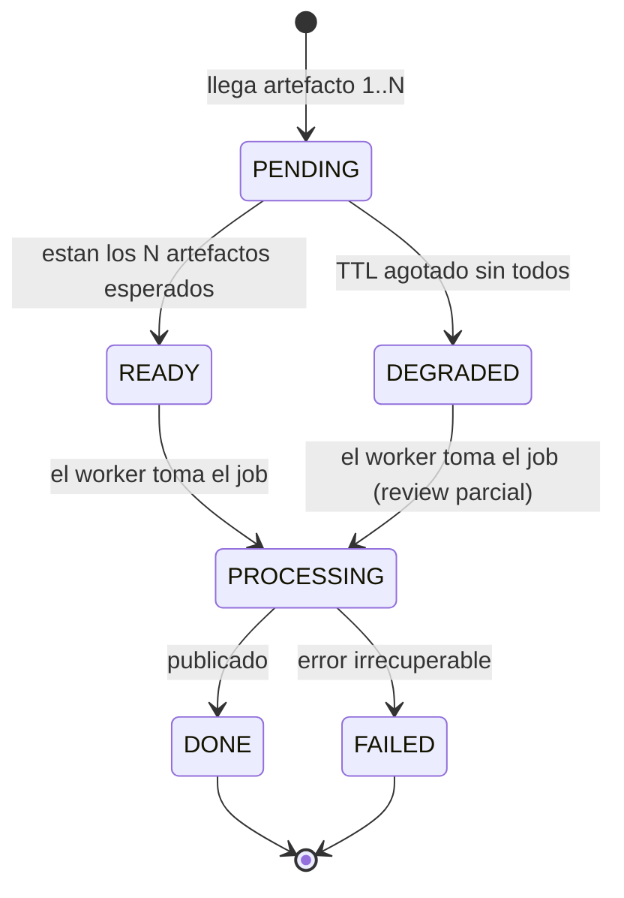

Última modificación: 2026-10-11 | Creado: 2026-10-11

# Ingesta diferida: cómo el agente espera al CI

Complementa `docs/diseno-agente-code-review-20261010.md` (§6.2, §9.1, §15) y
`tasks/plan.md` (Task 6b). Resuelve una carrera que hoy es **determinista**: el
agente procesa la review antes de que exista el artefacto del CI, y publica una
review que *parece* limpia sin serlo.

---

## 1. El problema

Hoy el disparador es el webhook de PR. La API encola de inmediato:

```python
review_request = ReviewRequest(repo=repo, pr_id=pr_id, head_sha=head_sha)
if not store.claim(review_request.idempotency_key):
    return JSONResponse({"status": "duplicado", ...})
queue.enqueue(review_request)
```

Y el worker lee el artefacto **una sola vez**, sin esperar ni reintentar:

```python
try:
    return ToolingSourceStatus.PRESENT, path.read_text(encoding="utf-8")
except OSError:
    logger.error("Salida de %s ausente en %s", tool, path)
    return ToolingSourceStatus.MISSING, None
```

Secuencia real con un PR nuevo:

```
t0    PR creado ──webhook──► api ──encola──► worker
t0+ε  worker procesa → artefacto NO existe → MISSING → 0 hallazgos
t15   CI de emotivoo-v2 corre PHPStan y publica la salida   ← llega tarde
```

El resultado es el peor posible: la review **se publica igual** (el nodo `publish`
detecta `unavailable` y añade un aviso), pero el aviso compite con el ruido y el
valor ya se ha perdido. Un fallo de integración se disfraza de "PR sin hallazgos".

---

## 2. La causa: el disparador no corresponde al dato

"PR creado" significa *hay algo que revisar*. **No** significa *los datos de la
revisión están listos*. Son dos eventos distintos y el diseño los confundió:

| Evento | Significa | ¿Artefacto listo? |
|---|---|---|
| `pullrequest:created` / `:updated` | Hay diff nuevo | No |
| Fin del CI del repo | PHPStan (y demás checks) ya produjeron salida | Sí |

En Fase 1 el agente depende de un **artefacto externo**. Su disparador natural no
es el PR, sino **el fin del CI que produce ese artefacto**.

---

## 3. Decisión: disparar por "CI terminó"

### 3.1 Qué evento usar

Tres mecanismos posibles, de más simple a más frágil:

| Opción | Cómo | Ventaja | Coste |
|---|---|---|---|
| **A — El CI publica el artefacto en el agente** | El step de CI hace `POST /webhook/tooling` con `{repo, pr_id, head_sha, tool, payload}` | Un único evento = "CI terminó" + "artefacto listo" + identidad. Sin descarga. | Acopla el CI del repo revisado al agente (URL + secreto) |
| **B — Webhook de estado de build** | Suscribir `repo:commit_status_updated`; al pasar a `SUCCESSFUL`/`FAILED`, descargar el artefacto | Desacopla: el CI no conoce al agente | La comunidad reporta que **no siempre dispara** ([Atlassian Community](https://community.atlassian.com/forums/Bitbucket-questions/Webhooks-on-build-start-update-won-t-fire/qaq-p/2526022)); requiere descarga de artefacto |
| **C — SondEO** | Un barrido periódico consulta `twg bb pull-requests get <id> --statuses` o `twg bb pipeline query` | Sin webhooks nuevos; `twg` ya lo soporta | Consume un slot de worker o un scheduler; latencia |

**Recomendación: A para Fase 1, C como red de seguridad.** La opción A es la más
limpia porque colapsa tres problemas en uno (disparo, artefacto e identidad) y
**esquiva el hueco conocido de `twg`**: *"`twg` no descarga artefactos"* (Task 6b).
La opción B se deja documentada pero **no** como base, por su fiabilidad irregular.

> El repo revisado ya tiene la infraestructura para A: el step de PHPStan vuelca su
> salida con `capture-on: always` (rama `chore/publicar-salida-phpstan-para-code-review`).
> Publicar en el agente es cambiar el destino del `curl`, no construir nada nuevo.

### 3.2 ¿Eliminamos el webhook de PR? Sí (Fase 1)

Con el disparador en "CI publica tooling", el webhook de PR queda **redundante**:

- La identidad (`pr_id`, `head_sha`) viaja en el evento de tooling.
- El diff se obtiene en ejecución con `twg bb prs diff`, no del payload.
- El código actual del webhook **solo** extrae `repo`, `pr_id` y `head_sha`; no usa
  título, ramas ni autor, así que no aporta nada que el evento de tooling no dé.

**Decisión:** eliminar `/webhook/bitbucket` de la Fase 1.

**Cuándo vuelve:** en Fase 2+ hay revisiones que **no** dependen de un artefacto
(personas LLM, o PRs sin tooling). Ahí el webhook de PR vuelve, pero con su papel
correcto: **descubrimiento** (crear la review en estado `PENDING`), nunca disparo
de ejecución.

> Secuencia de la retirada: **no** borrar el endpoint hasta que el de tooling esté
> desplegado y verificado. Durante la transición pueden convivir; el de PR deja de
> encolar y solo registra intención.

---

## 4. Modelo: máquina de estados de la ingesta

La review deja de ser un evento puntual y pasa a ser un objeto con ciclo de vida:
`PendingReview`, por `(repo, pr_id, head_sha)`.



### 4.1 Barrera de artefactos (N, no 1)

El `repo_profile` declara varias herramientas (`typecheck`, `lint`, `arch`…). En
Fase 1 solo se usa `typecheck`, así que la barrera es de 1; el diseño la contempla
de N para no reescribirlo cuando se sumen más personas estáticas.

- La barrera espera los artefactos **declarados en el perfil**, no todos los posibles.
- Un artefacto que **nunca** llega no bloquea indefinidamente: TTL (#4.2).
- Un artefacto extra no declarado se ignora (o se registra como aviso).

### 4.2 TTL y revisión degradada

- `ttl_ready`: si en X minutos no llegan todos los artefactos, la review pasa a
  `DEGRADED` y se ejecuta con lo que haya.
- La revisión `DEGRADED` es **válida pero incompleta**: se publica con el aviso ya
  existente (`_render_incomplete_header`), y la ausencia de hallazgos de una
  herramienta **nunca** se lee como "sin errores".
- `ttl_pending`: si en Y horas no llega **ningún** artefacto, se descarta el
  `PendingReview` (evita zombies). Se registra métrica.

Valores de partida: `ttl_ready` 20 min, `ttl_pending` 24 h. Configurables.

---

## 5. Idempotencia: dos claves, no una

Aquí hay un fallo que rompería el diseño si no se corrige. Hoy la clave es única:

```python
@property
def idempotency_key(self) -> str:
    return f"{self.repo}:{self.pr_id}:{self.head_sha}"
```

Con el disparador viejo bastaba. Con la ingesta diferida **no**, porque varios
eventos comparten `head_sha` (push, varios pasos de CI, reintento del pipeline). Si
la clave es la misma, el segundo `claim` se rechaza como duplicado y **la review
real nunca corre**.

Se separan dos niveles:

| Clave | Ámbito | Propósito |
|---|---|---|
| `ingest_key = repo:pr:sha:tool` | Por artefacto | Idempotencia del **evento de CI**. Repetirlo no reescribe. |
| `review_key = repo:pr:sha:pipeline` | Por ejecución | Idempotencia de la **review**. Un `pipeline_id` nuevo = una review nueva. |

- El artefacto de `typecheck` de un `sha` se ingesta **una vez**.
- La review se ejecuta **una vez** por `(sha, pipeline)`.
- Un re-push del mismo `sha` con pipeline nuevo = review nueva (intencional).

---

## 6. Contrato de artefactos

El puerto `ToolingOutputSource` ya aísla el transporte: hoy hay implementaciones
`File*` y `Static*`. Con la opción A aparece un adaptador **de entrada** (la API
recibe el payload); con B/C, uno de **descarga** (API de Bitbucket).

| Aspecto | Definición |
|---|---|
| Ruta lógica | `{repo}/{pr_id}/{head_sha}/{tool}.json` — estable, independiente del transporte |
| Formato | JSON de la herramienta; `typecheck` = salida de `phpstan --error-format=json` |
| Transporte | A: cuerpo del `POST` (persistido); B/C: descarga por API de Bitbucket |
| Tamaño | Acotado (PHPStan de un PR es pequeño). Rechazar > N MB con 413 |
| Retención | El payload recibido se persiste; **no** depende de la expiración de artefactos de Bitbucket |
| Integridad | En A, verificar firma HMAC del CI; en B/C, verificar `sha` y `tool` contra el perfil |

Estados de fuente (ya modelados en `ToolingSourceStatus`):

- `PRESENT`: hay salida. Se analiza.
- `MISSING`: **dos causas distintas** que conviene separar:
  - `NOT_READY`: el artefacto aún no llegó (seguir esperando).
  - `EXPIRED` / `UNAVAILABLE`: no llegará; degradar.
- `UNREADABLE`: llegó pero no es parseable. Degradar, no silenciar.

> Mejora propuesta: añadir `NOT_READY` a `ToolingSourceStatus` o modelar la espera
> en `PendingReview` (preferible) para no meter estado de *timing* en el enum de
> fuente. En el modelo de estados de §4, "no listo" es `PENDING`, y el worker solo
> ve `READY`/`DEGRADED`; así el enum se queda como está.

---

## 7. Flujo completo (opción A)

```
CI de emotivoo-v2 (paso PHPStan)
   │  POST /webhook/tooling {repo, pr_id, head_sha, tool, payload}  (firmado)
   ▼
api ──► claim(ingest_key) ──► persistir payload ──► upsert PendingReview
   │                                                   │
   │                              ¿están los N artefactos? ──no──► esperar (TTL)
   │                                                   │ sí
   │                                                   ▼
   └───────────────────────────────► enqueue(review_key) ──► worker
                                                                 │
                                          scope(twg diff) → persona(tooling)
                                          → merge → policy → publish (inline+resumen+Teams)
```

La carrera desaparece por construcción: **la review solo se encola cuando el dato
que necesita ya está dentro**.

### 7.1 Cambio obligatorio en el CI del repo revisado

**El agente no puede funcionar sin este cambio.** Hoy el step de PHPStan de
`emotivoo-v2` publica el artefacto en Bitbucket (`var/tooling/...` con
`capture-on: always`). Si sigue así, el pipeline sube la salida **a un sitio que
nadie lee**: el agente esperaría indefinidamente un `POST` que nunca llega, y toda
review acabaría degradada por TTL. Es el interruptor que enciende la Fase 1.

El step debe **hacer `POST` al agente**, además de (o en vez de) subirlo a
Bitbucket. El destino es `POST /webhook/tooling`, con firma HMAC en
`X-Reviews-Signature` y este cuerpo:

```json
{
  "repo": "cqm/emotivoo-v2",
  "pr_id": 417,
  "head_sha": "<BITBUCKET_COMMIT>",
  "pipeline_id": "<BITBUCKET_BUILD_NUMBER>",
  "tool": "phpstan",
  "payload": "{ ... JSON crudo de phpstan --error-format=json ... }"
}
```

`payload` es la salida **cruda** de la herramienta, como string (no re-serializada
ni recortada): el agente la parsea igual que hoy lee el fichero.

Ejemplo de step (bash, el mismo intérprete que ya usa el pipeline):

```bash
# PHPStan ya volcó su JSON; se envia al agente. El cuerpo se construye UNA vez
# porque la firma es sobre los bytes exactos que se envian.
jq -n \
  --arg repo "$BITBUCKET_REPO_FULL_NAME" \
  --argjson pr_id "$BITBUCKET_PR_ID" \
  --arg head_sha "$BITBUCKET_COMMIT" \
  --arg pipeline_id "$BITBUCKET_BUILD_NUMBER" \
  --arg payload "$(cat var/tooling/report.json)" \
  '{repo: $repo, pr_id: $pr_id, head_sha: $head_sha, pipeline_id: $pipeline_id,
    tool: "phpstan", payload: $payload}' > /tmp/agent-body.json

SIGNATURE=$(openssl dgst -sha256 -hmac "$TOOLING_WEBHOOK_SECRET" -r /tmp/agent-body.json | cut -d' ' -f1)

curl -sS -X POST "$REVIEWS_URL/webhook/tooling" \
  -H "Content-Type: application/json" \
  -H "X-Reviews-Signature: $SIGNATURE" \
  --data-binary @/tmp/agent-body.json
```

Detalles que condicionan la integración:

| Aspecto | Valor / regla |
|---|---|
| `head_sha` | `BITBUCKET_COMMIT` (en un build de PR es el commit *source* head, el mismo que usa `diff-line`) |
| `pr_id` | `BITBUCKET_PR_ID`. **No** existe en builds de rama: si falta, el agente responde `400` |
| `pipeline_id` | `BITBUCKET_BUILD_NUMBER`. Distingue un re-run del mismo commit (review nueva) |
| `tool` | Debe coincidir con `expected_tools` del `repo_profile` |
| Firma | HMAC-SHA256 del **cuerpo crudo** con `TOOLING_WEBHOOK_SECRET`; cabecera `X-Reviews-Signature` |
| Secreto | Variable de repo de Bitbucket (secured) compartida con `TOOLING_WEBHOOK_SECRET` del agente |
| Alcance de red | `REVIEWS_URL` debe ser alcanzable desde el runner de Bitbucket |
| Fallo del `POST` | **El pipeline no debe ponerse rojo porque el agente esté caído.** Envolver en `|| true` y loguear |

> **Crítica:** el `POST` no debe bloquear el resultado del pipeline. El agente es un
> consumidor de la salida de PHPStan, no un check de merge: si el agente está caído
> o tarda, el PR debe seguir su curso normal. La review se recuperará por el barrido
> de TTL o en el siguiente push. Convertir este `POST` en un paso bloqueante
> acoplaría la disponibilidad de Bitbucket a la del agente — justo lo que el diseño
> quiere evitar.

> **Naturaleza (2026-10-11):** todo lo de esta sección es un **puente desechable**.
> El artefacto del CI suple lo que la Fase 1 no se permite aún (ejecutar código); con
> `stan`/`deptrac` bloqueantes y verdes, su salida aporta cero señal nueva. Al abrir
> el puerto `CheckRunner` (Fase 3) el disparo vuelve a ser el PR. No endurecer esta
> ingesta ni depender de ella para la definición de hecho. Ver
> `docs/ingesta-vs-ejecucion-20261011.md`.

**Mientras este cambio no esté desplegado, la Fase 1 no produce reviews reales**:
el endpoint existe y está probado, pero nadie lo llama. Es el punto 6 de las
decisiones abiertas (§10) y el único trabajo que vive fuera de este repo.

---

## 8. Cambios concretos en el repo

| Pieza | Cambio |
|---|---|
| `api/main.py` | Nuevo `POST /webhook/tooling` (firma + `claim(ingest_key)` + persistencia + upsert `PendingReview`). Retirar encolado inmediato de `/webhook/bitbucket`. |
| `domain/models.py` | Nueva clave de ingesta; `ReviewRequest` gana `pipeline_id` (o `tool`) para `review_key`. |
| `domain/pending.py` (nuevo) | `PendingReview` + estados + TTL + barrera de artefactos. |
| `ports/tooling.py` | Sin cambios de firma; añadir adaptador de ingesta si aplica. |
| `adapters/tooling_source.py` | Nuevo origen que lee el payload persistido (o descarga por API en B/C). |
| `worker/main.py` | `process_request` solo procesa reviews `READY`/`DEGRADED`; un barrido aplica los TTL. |
| `config/repo_profile.emotivoo-v2.yaml` | Declarar `expected_tools: [typecheck]` y `ttl_ready`/`ttl_pending`. |
| `docker-compose.yml` | La API necesita volumen de escritura para payloads (hoy `var` es `:ro` en el worker). |
| repo revisado (emotivoo-v2) | El step de PHPStan apunta su `curl` al agente además de (o en vez de) Bitbucket. **Obligatorio**; instrucciones en §7.1. |

---

## 9. Plan de implementación

1. **T1 — Puerto y modelo**: `PendingReview`, `ingest_key`/`review_key`, `expected_tools`.
2. **T2 — Endpoint de ingesta**: `POST /webhook/tooling` (firma, idempotencia, persistencia).
3. **T3 — Barrera y TTL**: transición `PENDING → READY/DEGRADED`; barrido de expiración.
4. **T4 — Worker**: procesa solo `READY`/`DEGRADED`; publica el aviso de incompleta si aplica.
5. **T5 — Adaptador de origen**: lee el payload persistido (o descarga; B/C).
6. **T6 — Retirada del webhook de PR**: dejar de encolar en `/webhook/bitbucket`.

**Tests**: idempotencia de ingesta (mismo evento dos veces); barrera con N=2 (llega uno → sigue `PENDING` → TTL → `DEGRADED`); review `DEGRADED` publica aviso; `review_key` distinta por `pipeline_id`; firma inválida → 401.

---

## 10. Decisiones abiertas

| Decisión | Opciones | Recomendación |
|---|---|---|
| Transporte del artefacto | A (push), B (estado + descarga), C (sondEO) | A; C como red de seguridad |
| ¿Cambiar el CI del repo revisado? | Sí (push al agente) / No (mantener upload a Bitbucket) | **Obligatorio** para la opción A: sin el `POST`, no hay reviews (ver §7.1) |
| Barrera | Esperar N / ejecutar al primer artefacto | Esperar N con TTL |
| TTL | 20 min ready / 24 h pending | Empezar ahí; medir y ajustar |
| Reintento del CI | Reintento del mismo pipeline / nuevo pipeline | Nuevo `pipeline_id` = review nueva |
