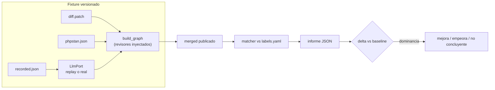

Última modificación: 2026-10-16 | Creado: 2026-10-16

# Evaluación de la review: gold set y métricas

Un *gold set* versionado y un harness offline que corre el grafo real y traduce una
review en cinco números (precisión, recall, *accuracy* de severidad, falsos positivos
`P0`/`P1` y coste por hallazgo verificado). Es el punto de partida de cualquier
cambio de prompt, contrato o modelo: sin esto, «mejora» es una opinión.

> **Estado:** borrador
> **Entrega objetivo:** que `make test` corra un caso real de punta a punta y que el
> informe diga, con criterio explícito, si un cambio de contrato o de modelo mejora,
> empeora o no es concluyente.

---

## 1. Objetivo

La review del PR #3 del repo revisado publicó **9 hallazgos**: **6** se rechazaron a
mano, **1** describía un fallo real **invertido**, **2** documentaban decisiones ya
tomadas, y **no detectó 3 `P1`** de integración y configuración que no estaban en
ningún diff. Ese juicio —hecho por una persona, hallazgo a hallazgo— es valiosísimo y
hoy no está en ninguna parte: se pierde al cerrar la pestaña. Y sin un número no hay
forma de saber si un *prompt* nuevo mejora o solo cambia el ruido.

Este checkpoint **no arregla** la calidad: la **mide**, para que los arreglos de las
iniciativas hermanas (007 en adelante) se aprueben con un número delante.

Se quiere:

1. Un ***gold set* versionado** en `tests/eval/`: un caso por PR auditado a mano, con
   el diff, el artefacto del CI, la lista de hallazgos que **sí** deben salir
   (`expected`) y la de los que **no** (`must_not_report`, cada uno con su motivo).
2. Un **harness offline** que corre el **grafo real** sobre el caso y calcula las
   métricas sobre lo que se habría **publicado**, no sobre lo que el modelo propuso.
3. **Cinco métricas** con definición cerrada (§5.4): precisión, recall, *accuracy* de
   severidad, falsos positivos `P0`/`P1` y coste por hallazgo verificado.
4. El **baseline actual registrado** y reproducible: precisión **3/9 ≈ 0,33** y recall
   **0/3** en los `P1` de integración.
5. Una **comparación explícita** entre corridas: dónde mejora, dónde empeora, con un
   criterio de dominancia que no se pueda satisfacer moviendo una sola métrica.

## 2. No-objetivos

- **Arreglar la calidad.** Filtrar hallazgos, dar contexto al revisor, gatear la
  severidad o añadir personas es de las iniciativas 007 en adelante. Aquí solo se lee
  y se mide: el harness **no** modifica el grafo, el contrato ni la política.
- **Sustituir al `ToolingReviewer` ni depurar sus hallazgos.** Un hallazgo de PHPStan
  está *grounded*; entra en `expected` como verdad, no como sospecha.
- **Un panel de observabilidad.** `docs/arquitectura.md` §7 mantiene D14 abierto: el
  *gold set* mide calidad sobre fixtures versionados, no tráfico real ni trazas.
- **Ejecutar código del PR.** No se toca el `sandbox-runner` ni se ejecutan tests del
  repo revisado; el caso es estático (diff + artefacto).
- **Un gate de CI contra el modelo real.** El modelo no es determinista; CI corre con
  respuestas grabadas. El modelo real se mide aparte (§5.3).
- **Arreglar el presupuesto de tokens (D17).** El harness lo hace visible por corrida
  (coste por hallazgo), no cambia cómo se cuenta.
- **Reescribir el contrato de hallazgos.** El informe añade campos **solo** en su
  propio JSON de salida; `contracts/findings-schema.json` no cambia.

## 3. Contexto y evidencia

### 3.1 El caso semilla

La auditoría manual del PR #3 dejó un veredicto por hallazgo. Es, tal cual, el primer
`labels.yaml`:

| Caso | Qué afirma el hallazgo | Etiqueta | Motivo del veredicto |
|---|---|---|---|
| A | El de `mark_done`/`enqueue` se ordena mal | `expected` (`P1`) | Real, pero el fallo se describió **invertido** |
| B | `_requeue_or_drop` reverifica | `must_not_report` | Semántica inventada de `verifier.py`, fuera del diff |
| C | `_route_fix_wait` bucle infinito | `must_not_report` | El propio texto admite que el bucle es finito |
| D | `run_key` cambia de valor | `must_not_report` | Topología del grafo deducida de un fragmento |
| E | Tope de intentos del grafo ≠ worker | `must_not_report` | Confunde `max_fix_attempts` con `max_fix_attempts_job` |
| F | `build_fix_wait` fuerza `targets=[]` | `must_not_report` | Afirma una regresión sin comparar con el `base_sha` |
| G | Wave parcial vs job perdido | `must_not_report` | Requisito inventado sin leer `verify_job` |
| H | `env_for` expone `Settings` | `expected` | Confirma una decisión ya tomada |
| I | `_touch_heartbeat` silencia `OSError` | `expected` | Real en parte |
| #1 | Secretos por entorno mal resueltos | `expected` (`P1`, integración) | **No detectado**: vive en `settings`/`docker-compose` |
| #2 | El `fix-worker` no arranca en producción | `expected` (`P1`, integración) | **No detectado**: vive en `docker-compose` |
| #3 | `MODELS_CONFIG` pisa `LLM_*` | `expected` (`P1`, integración) | **No detectado**: vive en `settings`/`models_config` |

Los tres últimos son el caso incómodo: **ningún diff los contiene**. Un diff no puede
medir lo que no ve, y el *gold set* tiene que poder decir eso en un número (`recall`
del subconjunto `integracion`).

La causa raíz es única y conocida: el revisor solo recibe el diff recortado y aun así
afirma sobre código que no ve. Los falsos positivos **fabrican** el contexto que falta;
los falsos negativos **carecen** del que existe. Medir los dos signos a la vez es
justamente lo que separa «menos ruido» de «menos ruido y menos recall».

### 3.2 Piezas que ya existen

El harness no necesita nada nuevo del grafo:

| Pieza | Dónde | Para qué |
|---|---|---|
| Grafo real con revisores inyectables | [`build_graph`](../../../src/agent_review/graph/build.py) | Corre scope→personas→merge→policy→publish sobre el caso |
| Persona LLM con puerto inyectable | [`LlmReviewer`](../../../src/agent_review/adapters/llm_reviewer.py) | Sustituir el puerto por grabaciones sin tocar la persona |
| Persona estática desde artefacto | [`ToolingReviewer`](../../../src/agent_review/adapters/tooling_reviewer.py) | Ingerir el `analysis.json` del caso |
| Puerto de modelo | [`LlmPort`/`LlmReply`](../../../src/agent_review/ports/llm.py) | El *replay* y el modelo real son el mismo puerto |
| `FakeVcs` + `FakeLlm` como patrón | [`test_llm_reviewer.py`](../../../tests/test_llm_reviewer.py) | El VCS falso que registra lo publicado no hay que inventarlo |
| Fixtures mínimos | [`diff_emotivoo.diff`](../../../tests/fixtures/diff_emotivoo.diff), [`analysis.json`](../../../tests/fixtures/phpstan/analysis.json) | Son *smoke* de forma, **no** el PR #3: el caso real se captura una vez (§5.2) |
| Coste real por llamada | `LlmReviewer.last_usage` (`LlmReply`) | `coste por hallazgo verificado` con `usage` del proveedor, no estimando |
| Marca `live` y `-m 'not live'` | [`pyproject.toml`](../../../pyproject.toml), [`ci.yml`](../../../.github/workflows/ci.yml) | La corrida real queda fuera de CI sin inventar un mecanismo nuevo |
| Aislamiento del entorno | [`conftest.py`](../../../tests/conftest.py) | Un caso no depende del `.env` del host |

### 3.3 El baseline

| Métrica | Baseline (PR #3) |
|---|---|
| Precisión | **3/9 ≈ 0,33** |
| Recall en `P1` de integración | **0/3 = 0,00** |
| Recall global | Se registra en la primera corrida *replay* |
| *Accuracy* de severidad | Se registra en la primera corrida *replay* |
| Falsos positivos `P0`/`P1` | Se registra en la primera corrida *replay* (6 falsos positivos en total) |
| Coste por hallazgo verificado | Se registra en la primera corrida *replay* |

Los números «se registran en la primera corrida» no son un hueco: son la salida
congelada del caso, que pasa a ser el `expected_report.json` versionado. A partir de
ahí, cualquier deriva de las métricas se ve como un diff.

## 4. Decisiones

| # | Decisión | Motivo |
|---|---|---|
| E1 | Se mide sobre lo **publicado** (el conjunto de `merged` que la política deja salir), no sobre los `findings` crudos | Lo que quema la confianza es lo que la persona ve en el PR; un hallazgo que el merge dedupe no debe contar como mérito |
| E2 | El caso es **un directorio versionado** con diff, artefacto, `labels.yaml` y grabaciones | Un *gold set* en una hoja de cálculo no se reproduce; en git, cualquier corrida es auditable |
| E3 | CI corre con **respuestas grabadas** (*replay*); el modelo real corre fuera de CI | Determinismo dentro, fidelidad fuera. Un CI que llama al modelo es un test *flaky* que además se paga |
| E4 | La grabación lleva el **fingerprint del prompt y del caso**, y CI falla si no coinciden | Un *prompt* nuevo con grabación vieja mediría el pasado en silencio: se fuerza a regrabar, y esa regrabación es un diff revisable |
| E5 | Las métricas tienen **definición cerrada** (§5.4) y un hallazgo no etiquetado cuenta como falso positivo | Un matcher laxo infla la precisión; dejarlo explícito evita discutir el número en vez del hallazgo |
| E6 | «Mejora» es una relación de **dominancia**: precisión y recall no bajan, los falsos `P0`/`P1` no suben, y algo sube estrictamente | Sin esto, se «mejora» subiendo recall a base de publicar basura, o precisión callando |
| E7 | El harness usa el **grafo real** con un VCS falso; lo único que cambia entre *replay* y real es el `LlmPort` | Mide el sistema, no una copia del sistema; y deja una sola variable que comparar |
| E8 | Este checkpoint **no toca** prompt, contrato ni política: solo lee | Separar la medida del arreglo es lo que hace creíble la medida |

## 5. Diseño o contrato

### 5.1 Estructura

```
tests/eval/
  harness.py            carga del caso, matcher, métricas, comparación (sin red)
  test_eval_pr_3.py     regresión en CI (replay) + corrida real (marca live)
  pr_3/
    labels.yaml         procedencia + expected + must_not_report
    diff.patch          diff del PR auditado (copiado una vez)
    phpstan.json        artefacto del CI del PR auditado
    recorded.json       respuestas del modelo, con fingerprint
    expected_report.json  informe congelado = baseline
scripts/eval.py         CLI: informe, comparación y regrabación
```

Sin `__init__.py` en `tests/`: el test importa `harness` como módulo hermano y
`scripts/eval.py` añade `tests/eval` a `sys.path`. No se introduce paquete en `tests/`.

### 5.2 El caso: `labels.yaml`

La procedencia va dentro del caso, para que el fixture no sea un fichero huérfano:
repo, `pr_id`, `head_sha`, fecha de captura y de dónde salió (auditoría manual).

```yaml
case: pr-3-emotivoo-v2
repo: "<repo>"
pr_id: 3
head_sha: "<sha auditado>"
captured_at: 2026-10-16
source: "auditoria manual de la review publicada"

expected:
  - id: A
    severity: P1
    subset: correctness
    match: ["mark_done", "enqueue"]      # frases distintivas del hallazgo
    must_mention: ["..."]                # opcional: dirección correcta del fallo
  - id: integracion-1
    severity: P1
    subset: integracion
    match: ["secretos", "entorno"]

must_not_report:
  - id: B
    match: ["requeue_or_drop"]
    why: "semantica inventada de verifier.py, fuera del diff"
```

- `match` son frases **conjuntivas** (todas deben aparecer) sobre `title` +
  `why_it_matters`, normalizadas como en [`text_utils`](../../../src/agent_review/adapters/text_utils.py).
- `file` y `line` son **opcionales**: cuando están, el hallazgo debe caer en el mismo
  fichero y a ≤ 5 líneas (misma tolerancia que el merge entre personas,
  [ADR-0014](../../adr/0014-criterio-de-merge-entre-personas.md)). Cuando no están,
  casa por contenido: es lo que permite etiquetar los `#1`–`#3`, que no tienen línea.
- `subset` agrupa para reportar (`correctness`, `integracion`, `tooling`…) y permite
  el `recall` por subconjunto sin duplicar casos.
- `must_mention` es opcional y solo lo usa el caso **A**: captura que el fallo se
  describió invertido, cosa que la severidad no ve.
- La atribución es **1:1 y determinista**: orden canónico (severidad, línea, `id`) y
  el primer match no consumido gana, igual que el merge no depende del orden del
  fan-out.

El diff y el artefacto **no** se generan en el test: se capturan una vez del PR (VCS y
`var/tooling`) y se versionan. Los fixtures actuales son de juguete; el caso real es
otro.

### 5.3 Modos de ejecución



| Modo | Puerto LLM | Cuándo | Qué responde |
|---|---|---|---|
| **replay** (por defecto) | `recorded.json`, cacheado por fingerprint | `make test` y CI | ¿Un cambio de contrato, merge o política mueve las métricas? |
| **real** (`-m live`) | `ModelRegistry.port_for(rol)` ([ADR-0015](../../adr/0015-registro-declarativo-de-modelos.md)) | `make eval-live`, a mano y en *nightly* | ¿Un cambio de prompt o de modelo mejora la calidad? |

En `replay`, el puerto devuelve el `text` y el `usage` grabados y **aborta** si el
fingerprint del prompt o del caso no coincide con la grabación (E4). Así, la corrida
de CI reproduce el baseline exacto y cualquier mejora posterior de las iniciativas
hermanas (filtros, humildad, gate de severidad) se ve **sin gastar un token**.

En `real`, la corrida es comparativa, no un gate: se ejecuta el caso, se emite el
informe y se compara con el baseline. Es el paso previo a aprobar un *prompt* nuevo.

### 5.4 Métricas

| Métrica | Definición | Cómo se lee |
|---|---|---|
| **Precisión** | `tp / (tp + fp)` | Proporción de lo publicado que era cierto. Un no etiquetado es `fp` (E5) |
| **Recall** | `tp / n_expected`, y por `subset` | Cuánto de lo que debía salir salió. El `P1` de integración se mira aparte |
| ***Accuracy* de severidad** | casados con la severidad del `expected` / `tp` | Un `P1` publicado como `P3` sigue siendo `tp`, pero con la severidad mal |
| **Falsos positivos `P0`/`P1`** | nº de `fp` con severidad `P0` o `P1` | El fallo caro: la rúbrica ya dice que un falso `P0` quema la confianza antes que diez `P3` |
| **Coste por hallazgo verificado** | tokens del `usage` del run / `tp` | `None` si `tp = 0`. En *replay* usa el `usage` grabado; sin él, la estimación |

El informe es un JSON estable y se congela en `expected_report.json`:

```json
{
  "case": "pr-3-emotivoo-v2",
  "mode": "replay",
  "prompt_fingerprint": "sha256:...",
  "counts": {
    "published": 9, "tp": 3, "fp": 6, "fp_labeled": 6, "fp_unknown": 0,
    "fn": 3, "fp_p0_p1": 6
  },
  "metrics": {
    "precision": 0.333, "recall": 0.5, "recall_subset_integracion": 0.0,
    "severity_accuracy": 1.0, "cost_per_tp_tokens": 12345
  },
  "matched": [], "unmatched": [], "missing": []
}
```

`matched` / `unmatched` / `missing` nombran los `id` para que el fallo de CI diga
**qué** hallazgo se movió, no solo que un número cambió.

La comparación (`harness.compare`) dice **mejora** si y solo si, contra el baseline,
la precisión y el recall no bajan, los falsos `P0`/`P1` no suben y al menos una mejora
estrictamente; **empeora** si lo contrario en cualquier métrica; y **no concluyente**
en el resto (por ejemplo, sube el recall y bajan los `P0`/`P1`, pero cae la precisión).

### 5.5 CI y comandos

- El caso corre dentro de `pytest` (sin job nuevo en [`ci.yml`](../../../.github/workflows/ci.yml)):
  `make test` ya recorre `tests/`.
- `make eval` — informe *replay* por consola; `EVAL_COMPARE=baseline.json` añade el delta.
- `make eval-live` — corrida contra el modelo real (marca `live`, `-m live`).
- `make eval-record` — regraba `recorded.json` contra el modelo real. **Es el único
  camino** que produce grabaciones y su diff se revisa.
- El *nightly* es un workflow opcional (`schedule` + `workflow_dispatch`) que corre
  `eval-live` y publica el informe como artefacto; queda a lo que decida Q1.

## 6. Riesgos

| Riesgo | Mitigación |
|---|---|
| ***Gold set* de un solo caso**: sobreajustar al PR #3 y llamar «mejora» a lo que solo funciona ahí | El sesgo se declara en el informe (`case`); cada review validada a mano añade un caso, y 007+ no puede aceptar una mejora sostenida solo por este caso (Q3) |
| **El matcher decide el número**: laxo infla precisión, estricto infla falsos positivos | Reglas cerradas y conjuntivas (§5.2), atribución 1:1 determinista y tests propios del matcher; la tolerancia de 5 líneas se hereda de una regla ya validada del merge |
| **Grabaciones obsoletas**: medir el pasado en silencio | El fingerprint del prompt y del caso aborta la corrida en CI (E4) |
| **El modelo real es no determinista**: dos corridas del mismo prompt dan números distintos | La corrida real es comparativa y no bloquea CI; el informe declara la varianza (Q4) |
| **Coste de medir**: la corrida real consume tokens (agrava D17) | Un caso, un PR, fuera de CI y bajo demanda; en CI, coste cero |
| **Medir de más**: acabar midiendo anclaje, formato o latencia | El alcance son las cinco métricas de §5.4; lo demás va a Q8 y a las iniciativas que corresponda |
| **Confundir el fixture de juguete con el caso** | Bright line en §5.2: el caso es el PR auditado, capturado y versionado, no `tests/fixtures/` |

## 7. Criterios de hecho

- [ ] `tests/eval/pr_3/` existe con diff, artefacto, `labels.yaml` (con procedencia,
      `expected` y `must_not_report` con motivo) y `recorded.json`.
- [ ] La corrida *replay* es determinista: dos ejecuciones dan el mismo
      `expected_report.json`, byte a byte.
- [ ] El baseline queda registrado y reproducible: precisión **3/9 ≈ 0,33** y recall
      **0/3** en `integracion`.
- [ ] La triaje inicial es **exhaustivo**: ningún hallazgo publicado del caso se queda
      sin etiqueta (`fp_unknown == 0`), o está documentado por qué.
- [ ] Ningún hallazgo que case con un `must_not_report` cuenta como acierto, y cada
      uno lleva su motivo escrito.
- [ ] `harness.compare` implementa la dominancia de E6 con sus tres veredictos, y
      tiene tests propios (incluido el caso «no concluyente»).
- [ ] `make test` en verde **sin** red ni credenciales, y `make eval` imprime el
      informe con el delta contra el baseline.
- [ ] Existe una vía declarada y ejecutable para la corrida contra el modelo real
      (`make eval-live`), con su regrabación (`make eval-record`).
- [ ] Un cambio de prompt que invalide la grabación **falla** en CI con un mensaje que
      nombra el fingerprint; regrabar y revisar el diff es la salida.
- [ ] `make ci` y `make docs-check` en verde.
- [ ] Documentos vivos al día: [`desarrollo.md`](../../desarrollo.md) §1–2 (comandos y
      zona `eval`), [`arquitectura.md`](../../arquitectura.md) §7 (D14 pasa a parcial),
      [`CONTEXT.md`](../../../CONTEXT.md) si nacen «*gold set*», «caso de evaluación» o
      «mejora (dominancia)», y un ADR nuevo para E3/E4 (el siguiente número libre).

## 8. Preguntas abiertas

- **Q1.** La corrida real: ¿*nightly* en CI con el secreto del proveedor, o solo a
  mano antes de aprobar un cambio de *prompt*? El coste y la varianza empujan a lo
  segundo; la frescura, a lo primero.
- **Q2.** ¿La tolerancia de `file`/`line` del matcher (5 líneas) y la exigencia de
  `match` conjuntivo se validan con una revisión humana del primer caso, o se dan por
  buenas y se ajustan solo si un veredicto chirría?
- **Q3.** Con n=1, ¿se marca el PR #3 como caso de desarrollo y se exige un caso
  **nuevo** para aceptar la primera mejora que apliquen 007+, o basta un caso por
  ahora con el sesgo declarado?
- **Q4.** ¿Cuántas repeticiones tiene la corrida real y qué se reporta: mediana, mínimo
  o las dos? Sin esto, un delta pequeño no es interpretable.
- **Q5.** El coste, ¿en tokens o en dinero? El registro de modelos no declara tarifa;
  añadirla es otra superficie de configuración.
- **Q6.** Los hallazgos de `standards`/PHPStan, ¿entran en las métricas globales o en
  un subconjunto aparte (`subset: tooling`)? Hoy entran como `expected`, lo que sube la
  precisión sin que el LLM haya mejorado nada.
- **Q7.** El informe, ¿se publica como artefacto del CI, como comentario en el PR de
  este repo, o solo por consola? Afecta a quién lo lee.
- **Q8.** ¿Se mide también el anclaje (publicado inline vs solo en resumen,
  `inlined_count`)? Es calidad visible, pero toca el camino de publicación.
