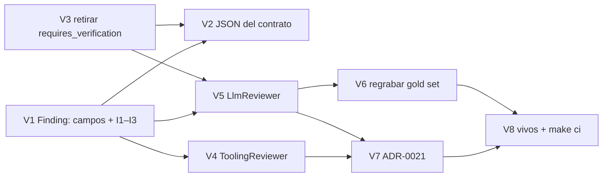

Última modificación: 2026-10-17 | Creado: 2026-10-17

# Plan: Contrato de verificación del hallazgo

El *qué y por qué* vive en [`spec.md`](spec.md); las tareas, en [`todo.md`](todo.md).
Este plan fija el orden, las dependencias y lo que puede romperse por el camino.

## Overview

Cuatro piezas, en este orden:

1. **El contrato.** `Finding` gana `failure_scenario`, `verification`,
   `verification_evidence` y `context_scope`, con los invariantes I1–I3, y pierde
   `requires_verification` (D12). `contracts/findings-schema.json` cambia en el
   **mismo commit** (D7, `schema_matches_domain`).
2. **Los emisores.** El `ToolingReviewer` emite `verified_static` con evidencia y
   `context_scope` según dónde reporte la herramienta. El `LlmReviewer` pide los
   campos en el *prompt*, los lee y normaliza `verification` a `unverified`.
3. **El *gold set*.** El *prompt* cambia, así que su *fingerprint* también
   ([ADR-0017](../../adr/0017-replay-determinista-con-fingerprint.md)) y hay que
   regrabar con el modelo real.
4. **El ADR-0021 y los documentos vivos.**

## Decisiones de implementación

- **I1–I3 viven en un `model_validator(mode="after")` de `Finding`**, no en
  `validate_finding`: así los cumple cualquier vía de construcción, también los tests.
  `validate_finding` no cambia de firma.
- **Un checkpoint antiguo sigue cargando.** El serializador del checkpointer intenta
  `cls(**kwargs)` y, si falla la validación, recurre a `model_construct`. Un `P1`
  guardado sin escenario se reconstruye sin validar, y `requires_verification` se
  ignora porque `Finding` no admite campos extra. Un test lo fija: reanudar un hilo
  pausado con un `P1` de antes de 007.
- **Los tests que construyen `P0`–`P2` necesitan `failure_scenario`.** Son ~50 sitios.
  Se resuelve con el helper de cada fichero (o un `failure_scenario` por defecto en
  la fábrica común), no editando cada llamada, y en el mismo commit que V1.
- **Normalización en el `LlmReviewer`:** cualquier `verification` distinto de
  `unverified` que devuelva el modelo se reescribe a `unverified` y se descartan sus
  `verification_evidence` (§5.4). Un `context_scope` desconocido cae a `None`.
- **`context_scope` del `ToolingReviewer`** (Q3): `in_diff` si la línea que reporta
  phpstan es una línea añadida del diff; `outside_diff` si no lo es y `best_line`
  reancla. Los ficheros fuera del diff se siguen descartando.
- **El JSON se regenera desde el modelo y se afina a mano**: `$defs` de los dos enums,
  el `if/then` de §5.5 y la retirada de `requires_verification` de `properties` y de
  `required`.

## Orden y dependencias

V1, V2 y V3 van en **un solo commit**: el test de drift no permite separarlos. V4 y
V5 son independientes entre sí. V6 necesita red y una API key válida, así que puede
quedar pendiente sin bloquear el resto, pero la iniciativa no se cierra sin él.

## Checkpoints

- **C1 (tras V1–V3):** `test_contracts.py` en verde con los campos nuevos; I1–I3
  probados; un `Finding` serializado con `requires_verification` y un `P1` sin
  escenario siguen cargando desde un checkpoint. `make ci` en verde.
- **C2 (tras V4–V5):** los dos emisores declaran su nivel; un `P1` del modelo sin
  escenario se descarta; un `verified_grounded` que devuelve el modelo sale
  `unverified`. `make ci` en verde con el *replay* apuntando a la grabación nueva.
- **C3 (tras V6–V8):** *gold set* regrabado y revisado (diff del baseline);
  ADR-0021 aceptado; `make ci` y `make docs-check` en verde.

## Riesgos

| Riesgo | Mitigación |
|---|---|
| I1 descarta casi todos los hallazgos del modelo si no rellena el escenario | El *prompt* lo pide de forma explícita y con formato; V6 mide en el *gold set* cuántos `P0`–`P2` se pierden antes de cerrar |
| La regrabación (V6) depende de una API key; la de `nan.builders` está pendiente de rotar (P7 de 015) | V6 puede usar cualquier credencial válida del registro de modelos; si no la hay, la iniciativa espera en C3 sin bloquear a 012 |
| Un consumidor fuera del grafo (panel, inbox HITL, API) revalida `Finding` desde JSON guardado y rompe con datos antiguos | V1 incluye un `grep` de `Finding.model_validate`/`Finding(**` fuera del grafo y un test por cada vía que lea hallazgos persistidos |
| 012 toca el mismo `llm_reviewer.py` | 007 va primero (es más corta); 012 parte de su `_SCHEMA_HINT` ya cambiado |
