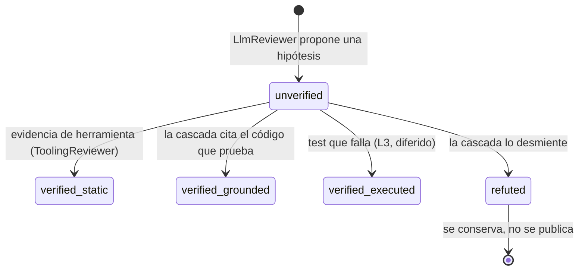

Última modificación: 2026-10-16 | Creado: 2026-10-16

# Contrato de verificación del hallazgo

> **Estado:** borrador
> **Entrega objetivo:** que un hallazgo `P0`–`P2` no pueda emitirse sin escenario
> de fallo o sin verificación que lo sostenga, y que cada revisor declare qué ha
> visto y qué ha verificado.

El contrato de hallazgo reutilizado de `ce-code-review` declara `confidence`,
`evidence` y `requires_verification`, pero ninguna de esas tres piezas sostiene una
afirmación: `requires_verification` **no lo lee ningún código** y `confidence` se
autoasigna y nadie lo comprueba. Esta iniciativa amplía el contrato con el
**estado de verificación**, el **escenario de fallo** y el **alcance de contexto**.
Es el habilitador barato: sin estos campos, la cascada de verificación posterior no
tiene sobre qué filtrar ni qué compuerta cerrar.

## 1. Objetivo

Hoy todo hallazgo que ancla a una línea real del diff se publica con la severidad
que el modelo decide, y `confidence` es decorativo. Hay que endurecer el contrato
para que **una afirmación lleve su prueba o un escenario de fallo**, de modo que el
resto de la cascada (L0 determinista, contexto, adversarial, ejecutable) tenga
campos deterministas que leer, y el gate de publicación pueda apoyarse en el estado
de verificación en vez de en la prosa.

Se quiere:

1. **`failure_scenario`** obligatorio para `P0`–`P2` no verificados: obliga a trazar
   `input/estado → ruta file:line → resultado incorrecto` en vez de opinar.
2. **`verification`** como máquina de estados del hallazgo en la cascada:
   `unverified | verified_static | verified_grounded | verified_executed | refuted`.
3. **`verification_evidence`**: las citas de código o la salida de test que sostienen
   el veredicto; obligatoria en cuanto el hallazgo deja de ser `unverified`.
4. **`context_scope`** opcional: el revisor declara si su afirmación se apoya en algo
   que no ve (`outside_diff`) o solo en el diff (`in_diff`).
5. Que cada persona **emita su nivel**: `ToolingReviewer` emite `verified_static`;
   `LlmReviewer` emite `unverified` y añade los campos a su esquema de prompt.
6. Que el contrato siga siendo **compatible y reutilizable** por `ce-code-review`
   ([ADR-0002](../../adr/0002-contrato-de-ce-code-review-sin-su-runtime.md)), con
   campos nuevos opcionales y versionados.

## 2. No-objetivos

- **Implementar la cascada.** Los niveles L0–L3, el `VerifierPort`, las personas de
  wiring y el *gold set* son checkpoints posteriores. Aquí solo se define el
  contrato y se adaptan los emisores actuales.
- **Cambiar el gate de publicación.** `config/autonomy.yaml` no se toca aquí; esta
  iniciativa añade los campos que ese gate leerá después.
- **Rediseñar `confidence`.** Se mantiene tal cual (es el síntoma que motiva el
  contrato). Su retirada o sentido nuevo se decide en §8.
- **Ejecutar código del PR.** `verified_executed` se declara pero no se produce aún:
  depende del `sandbox-runner`
  ([ADR-0011](../../adr/0011-sandbox-runner-aislado.md)).
- **Reescribir los ADR de publicación.** El gate seguirá usando
  [ADR-0003](../../adr/0003-autonomia-como-politica-por-hallazgo.md).

## 3. Contexto y evidencia

### 3.1 El contrato ya tiene piezas, pero no se usan

`contracts/findings-schema.json` declara `confidence`, `evidence` y
`requires_verification`. En el código:

- `confidence` lo autoasigna el modelo (`_confidence` → 50 por defecto en
  [`llm_reviewer.py`](../../../src/agent_review/adapters/llm_reviewer.py)) y solo lo
  consume la política ([`engine.py`](../../../src/agent_review/policy/engine.py)) y
  el render del comentario; nadie lo **comprueba**.
- `requires_verification` **no lo lee ningún código**; se rellena y se ignora.
- El `merge` solo deduplica
  ([ADR-0014](../../adr/0014-criterio-de-merge-entre-personas.md)); no filtra por
  estos campos.

Es decir: la severidad publicada es la que el modelo dice, y ningún campo del
contrato expresa *cuánto* se ha verificado el hallazgo.

### 3.2 La evidencia empírica de una review real

Una review sobre un PR real produjo 9 hallazgos: **6 falsos positivos**, 1 confirmado
con el fallo descrito **invertido** y 2 que documentaban decisiones ya tomadas; y
**no detectó 3 P1 reales** de integración y configuración. Causa raíz única: el
revisor LLM solo recibe el diff recortado y, aun así, afirma sobre código que no ve.
Los falsos positivos **fabrican** el contexto que falta; los negativos **carecen**
del que existe.

| Síntoma | Qué lo cazaría |
|---|---|
| Afirma semántica de un fichero fuera del diff | `context_scope` (`outside_diff`) |
| Confirma un fallo con la dirección invertida | `failure_scenario` obligatorio |
| Reporta una regresión que ya estaba en el `base_sha` | evidencia de verificación (L0) |
| Reporta como hallazgo una decisión ya documentada en un ADR | evidencia de verificación |

Ninguno de esos filtros existe hoy porque el contrato no deja **expresar** el estado
ni el escenario: el revisor no tiene dónde declarar «esto no lo he visto» ni «así es
como falla».

### 3.3 Restricción de sincronía

El modelo Pydantic `Finding` y el contrato JSON son espejo y hay un test que compara
ambos: [`test_contracts.py`](../../../tests/test_contracts.py)
(`schema_matches_domain`). Cualquier campo nuevo debe entrar **en el mismo commit**
en [`models.py`](../../../src/agent_review/domain/models.py) y en
[`findings-schema.json`](../../../contracts/findings-schema.json), o el test de drift
rompe. `validate_finding`
([`contracts.py`](../../../src/agent_review/domain/contracts.py)) es la puerta única
por la que pasan los emisores.

## 4. Decisiones

| # | Decisión | Motivo |
|---|---|---|
| D1 | `failure_scenario` es **obligatorio** para todo `P0`–`P2` con `verification: unverified` | Es donde vive el error: obliga a trazar `input/estado → file:line → resultado`. Un hallazgo ya verificado cambia el escenario por `verification_evidence`, sin ceremonia redundante. |
| D2 | `verification` es el **estado del hallazgo** en la cascada; nace `unverified` y solo la cascada lo promueve o lo refuta | Un único campo enum, fácil de leer por la política, sustituye a la prosa sobre «cuán seguro estoy». |
| D3 | Un hallazgo **`refuted` se conserva** en el estado, no se borra | Alimenta la métrica de falsos positivos y evita re-proponerlo. El contrato debe poder expresarlo. |
| D4 | `verification_evidence` es **obligatoria** (≥1) en cuanto `verification != unverified` | Un veredicto sin cita es otra opinión. La evidencia es la prueba. |
| D5 | `context_scope` es **opcional** y lo declara el revisor (`in_diff` \| `outside_diff`) | Permite a la cascada acotar un claim que se apoya en lo que no ve, sin exigir el dato a quien sí ve todo el fichero. |
| D6 | Los emisores declaran su nivel: `ToolingReviewer` → `verified_static`, `LlmReviewer` → `unverified` | El `ToolingReviewer` ya está *grounded* (su hallazgo nace de una herramienta que corre); el LLM, por definición, emite hipótesis. |
| D7 | El contrato es la **fuente única**; modelo y JSON cambian en el mismo commit | Lo impone `schema_matches_domain`; es la garantía de que el contrato publicado no miente. |
| D8 | Los campos nuevos entran **opcionales** en el JSON (con *default*), salvo el endurecimiento condicional de `failure_scenario` | El contrato lo reutiliza `ce-code-review`; romper la compatibilidad obligaría a tocar un consumidor ajeno. |
| D9 | Se crea un ADR nuevo, **ADR-0016 — Cascada de verificación del hallazgo** | La cascada es una decisión de arquitectura con alternativas; se describe en §5.6 y el ADR ya no se reescribe. |

## 5. Diseño o contrato

### 5.1 Campos nuevos del contrato

| Campo | Tipo | Obligatoriedad | Quién lo emite |
|---|---|---|---|
| `failure_scenario` | string | **P0–P2 con `unverified`** (condicional); opcional en el resto | `LlmReviewer` (y personas de hipótesis) |
| `verification` | enum (`unverified`\|`verified_static`\|`verified_grounded`\|`verified_executed`\|`refuted`), *default* `unverified` | opcional (con *default*) | la cascada; el emisor solo declara el nivel inicial |
| `verification_evidence` | array\<string\>, *default* `[]` | **≥1** si `verification != unverified` | quien verifica |
| `context_scope` | enum (`in_diff`\|`outside_diff`) o `null` | opcional | el revisor que emite el hallazgo |

Ninguno entra en la lista `required` de nivel superior del contrato: se comportan
como `suggested_fix` o `protected_subject`, lo que mantiene el JSON compatible hacia
atrás. La obligatoriedad de `failure_scenario` es **condicional** y se expresa con un
`if/then` (véase §5.5).

### 5.2 Modelo Pydantic (`Finding`)

```python
class Verification(StrEnum):
    UNVERIFIED = "unverified"
    VERIFIED_STATIC = "verified_static"
    VERIFIED_GROUNDED = "verified_grounded"
    VERIFIED_EXECUTED = "verified_executed"
    REFUTED = "refuted"


class ContextScope(StrEnum):
    IN_DIFF = "in_diff"
    OUTSIDE_DIFF = "outside_diff"


class Finding(BaseModel):
    # ... campos actuales ...
    failure_scenario: str | None = None
    verification: Verification = Verification.UNVERIFIED
    verification_evidence: list[str] = Field(default_factory=list)
    context_scope: ContextScope | None = None
```

Invariantes que valida el modelo (no el JSON, que es contrato publicado):

- **I1** · `severity ∈ {P0, P1, P2}` y `verification == unverified` ⇒
  `failure_scenario` no vacío.
- **I2** · `verification != unverified` ⇒ `verification_evidence` con al menos un
  elemento.
- **I3** · `context_scope ∈ {in_diff, outside_diff, None}`.

`validate_finding` sigue siendo la puerta única: mantiene la comprobación de campos
obligatorios del contrato y delega en `Finding.model_validate`, que ahora aplica I1–I3.
Un hallazgo que incumpla se descarta igual que hoy (el `LlmReviewer` ya captura
`ValidationError` y `ContractError`).

### 5.3 Estados de `verification`



Promover de `unverified` a cualquier `verified_*` o a `refuted` exige
`verification_evidence` (I2). El gate de publicación —qué estados dejan salir un
`P0`/`P1`— es de un checkpoint posterior y vive en
[`autonomy.yaml`](../../../config/autonomy.yaml), no en el contrato.

### 5.4 Emisión en las personas

- **`ToolingReviewer`**
  ([`tooling_reviewer.py`](../../../src/agent_review/adapters/tooling_reviewer.py)):
  añade `"verification": "verified_static"`, `"verification_evidence": ["<file>:<line> <texto>"]`
  y `"context_scope": "in_diff"`. Sus severidades son `P2` (error) y `P3` (warning);
  al ser `verified_static`, no necesita `failure_scenario` (I1 no dispara).
- **`LlmReviewer`**
  ([`llm_reviewer.py`](../../../src/agent_review/adapters/llm_reviewer.py)): añade los
  cuatro campos al `_SCHEMA_HINT`, lee `failure_scenario`, `verification_evidence` y
  `context_scope` de la respuesta, y fija `verification: "unverified"` (el valor por
  defecto; el modelo no puede auto-promoverse). El `failure_scenario` es lo que la
  regla I1 le obliga a rellenar para `P0`–`P2`.

Ningún emisor puede declarar `verified_grounded`/`verified_executed`/`refuted`: son
estados que solo concede la cascada. Si el modelo los devuelve, se normalizan a
`unverified`.

### 5.5 Contrato JSON

Los tres campos con *default* se declaran como propiedad con el mismo patrón que
`confidence`/`suggested_fix`; el endurecimiento condicional de `failure_scenario` se
expresa a nivel de esquema:

```json
{
  "failure_scenario": { "title": "Failure Scenario", "anyOf": [{ "type": "string" }, { "type": "null" }], "default": null },
  "verification": { "$ref": "#/$defs/Verification", "default": "unverified" },
  "verification_evidence": { "title": "Verification Evidence", "type": "array", "items": { "type": "string" }, "default": [] },
  "context_scope": { "anyOf": [{ "$ref": "#/$defs/ContextScope" }, { "type": "null" }], "default": null },
  "allOf": [
    {
      "if": { "properties": { "severity": { "enum": ["P0", "P1", "P2"] }, "verification": { "const": "unverified" } }, "required": ["severity", "verification"] },
      "then": { "required": ["failure_scenario"] }
    }
  ]
}
```

`$defs.Verification` y `$defs.ContextScope` se añaden junto a `Severity`. El JSON se
regenera desde el modelo y se afina a mano (igual que hoy `confidence.enum`), porque
`model_json_schema()` no propaga validadores ni condiciones. `schema_matches_domain`
solo compara `required` de nivel superior y `type` de propiedad: como los campos
nuevos van con `anyOf`/`$ref`, no altera el test —y detecta cualquier drift real.

### 5.6 ADR-0016 — Cascada de verificación del hallazgo (a crear)

El ADR nuevo documenta la decisión de fondo que este contrato habilita:

- **Contexto:** los falsos positivos nacen de opinar sobre lo que no se ve; el
  contrato no permitía expresar el grado de verificación.
- **Decisión:** la verificación es una **cascada barata→cara** (L0 determinista, L1
  contexto, L2 adversarial con otro rol y otro modelo, L3 ejecutable) cuyo estado se
  materializa en `verification`; la severidad `P0`/`P1` **se gana** con verificación o
  evidencia estática; un hallazgo `refuted` se conserva.
- **Consecuencias:** el gate lee `verification` desde `autonomy.yaml` (policy-as-data,
  [ADR-0003](../../adr/0003-autonomia-como-politica-por-hallazgo.md)); el contrato
  gana cuatro campos versionados; L2 añade coste (deuda de presupuesto).
- **Alternativas descartadas:** seguir opinando con el mismo modelo (sello de goma),
  y publicar todo con `confidence` alto (falsa precisión).

## 6. Riesgos

| # | Riesgo | Mitigación |
|---|---|---|
| R1 | El `failure_scenario` se rellena con relleno («podría fallar si…») sin trazar | I1 exige no vacío; el formato `input/estado → file:line → resultado` se refuerza en el *prompt* y se comprueba en el *gold set*. |
| R2 | Romper la compatibilidad con `ce-code-review` (consumidor ajeno) | Campos nuevos opcionales con *default* (D8); `required` de nivel superior intacto; el endurecimiento en la otra ruta queda en §8. |
| R3 | El modelo ignora los campos o los inventa en su respuesta | `LlmReviewer` normaliza `verification` a `unverified`; el resto cae a *default*; un `P0–P2` sin escenario se descarta por I1. |
| R4 | Drift entre modelo y contrato publicado | `schema_matches_domain` en CI obliga al cambio en el mismo commit (D7). |
| R5 | `requires_verification` queda como campo muerto junto al nuevo `verification` | Se documenta como deuda en [`arquitectura.md`](../../arquitectura.md) §7 y su retirada se decide en §8. |
| R6 | Duplicación entre `failure_scenario` y `why_it_matters` | `why_it_matters` dice el **impacto**; `failure_scenario`, el **camino que lo produce**. El prompt los separa y el contrato exige ambos en el mismo hallazgo. |

## 7. Criterios de hecho

| # | Criterio | Verificación |
|---|---|---|
| C1 | `contracts/findings-schema.json` declara `failure_scenario`, `verification`, `verification_evidence` y `context_scope`, con sus `$defs` y el `if/then` condicional | Inspección + `test_contracts.py` |
| C2 | `Finding` valida I1–I3: `P0`–`P2` `unverified` sin escenario se rechaza; veredicto sin evidencia se rechaza | Tests nuevos en `test_domain.py` / `test_contracts.py` |
| C3 | `schema_matches_domain()` sigue en verde (modelo y JSON sincronizados en el mismo commit) | `test_contracts.py` |
| C4 | `ToolingReviewer` emite `verified_static` con evidencia y `context_scope: in_diff`; sus `P2` no necesitan escenario | `test_tooling_reviewer.py` |
| C5 | `LlmReviewer` pide los campos en el *prompt* y normaliza `verification` a `unverified` | `test_llm_reviewer.py` |
| C6 | Los campos nuevos no rompen el `required` de nivel superior ni el consumo por `ce-code-review` (compatibilidad) | Inspección del contrato + tests existentes |
| C7 | El ADR-0016 (cascada de verificación) queda escrito y enlazado desde el índice de ADR | `docs/adr/README.md` + `docs-check` |
| C8 | `make ci` en verde, con `make docs-check` | CI |
| C9 | Documentos vivos al día: `arquitectura.md` §7 (deuda de `requires_verification`) y `CONTEXT.md` si nace el término «verificación del hallazgo» | Revisión |

## 8. Preguntas abiertas

- **Q1 · `failure_scenario` en `ce-code-review`.** ¿Se exige también allí o solo en
  esta ruta? *Propuesta:* de momento **solo aquí** (lo impone el modelo de dominio de
  este repo); el contrato compartido lo recibe como campo opcional y el endurecimiento
  allí se decide tras medir cuántos hallazgos descartaría.
- **Q2 · ¿Qué hacer con `requires_verification`?** Queda declarativo y solapado con
  `verification`. *Propuesta:* depreciarlo y retirarlo en un cambio compatible cuando
  ningún consumidor lo lea; su retirada va a `arquitectura.md` §7.
- **Q3 · `context_scope` por defecto.** ¿Un `ToolingReviewer` puede marcar
  `outside_diff` alguna vez (p. ej. `phpstan` sobre ficheros no del diff)? *Propuesta:*
  hoy siempre `in_diff`; el enum existe para el `LlmReviewer`.
- **Q4 · `confidence` tras el contrato.** ¿Se deriva de `verification` (p. ej.
  `verified_*` ⇒ 100) o se mantiene como juicio del modelo? *Propuesta:* mantenerlo
  ahora; revisar cuando el gate lea `verification`.
- **Q5 · ¿Un `P2` ya verificado debería llevar igualmente escenario?** *Propuesta:*
  no (I1 solo aplica a `unverified`); se revisa con el *gold set*.
