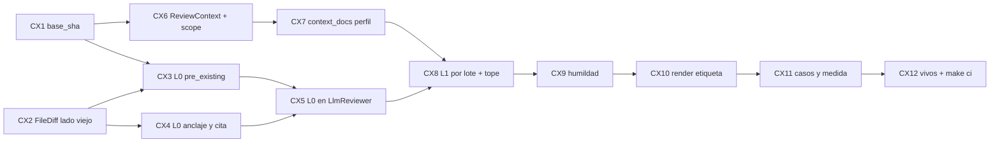

Última modificación: 2026-10-17 | Creado: 2026-10-17

# Plan: Contexto del revisor (L0 + L1)

El *qué y por qué* vive en [`spec.md`](spec.md); las tareas, en [`todo.md`](todo.md).
Este plan fija el orden, las dependencias y lo que puede romperse al aterrizar sobre
el código de hoy (007, 012 y 017 ya entregadas; 021 archivada).

## Overview

Cinco piezas, en este orden:

1. **Cimientos.** `base_sha` en `PullRequestInfo`/`ReviewRequest` (VCS lo puebla) e
   índice del lado viejo del diff (contexto y borradas) en `FileDiff`.
2. **L0.** Módulo puro `verification/l0.py`: anclaje estricto, cita contrastada y
   `pre_existing` calculado; el `LlmReviewer` deja de copiar el valor del modelo.
3. **`ReviewContext`.** Lo ensambla `scope` una vez (ficheros al `head_sha` +
   `context_docs:` del perfil) y viaja en el estado hacia el fan-out.
4. **L1.** El `LlmReviewer` reparte ese contexto por lote (tope de config, sin
   desplazar el diff) y añade la regla de humildad al *system prompt*.
5. **Cierre.** Etiqueta «preexistente» en el render, tests de los casos F/B/D/E/G/H,
   documentos vivos y medida contra el *gold set*.

## Decisiones de implementación

Llegan de la spec (D1–D15); aquí se fija **cómo** se hacen y qué se encuentra el
plan al mirar el código de hoy.

- **D4 y D13 no se pisan.** `scope` **lee y publica** el `ReviewContext` (datos:
  ficheros completos acotados + documentos curados). El `LlmReviewer` **ensambla el
  *prompt*** por lote a partir de ese contexto (prioridad: diff → fichero → docs;
  tope D12). No se vuelve a llamar a `get_file` en la persona.
- **`base_sha` vacío no tumba la review (R3).** Si el VCS no lo trae, L0 calcula
  `pre_existing` solo con el lado viejo del diff (paso a) y omite el `get_file` a
  la base (paso b), con log. Bitbucket: `destination.commit.hash`; GitHub:
  `base.sha`.
- **«Al resumen, no anclado» sin campo nuevo.** Hoy el publish ya manda a
  `summary_only` si `resolve_inline_anchor` falla. L0, ante una cita que casa con
  contexto/borrada, **no** recoloca a la añadida más cercana: deja el `line` en la
  línea de contexto/borrada. Además, `publish` se endurece: si `finding.line` no
  está en `added` del diff, va al resumen sin llamar al VCS (defensa; Bitbucket
  `diff-line` a veces resuelve contexto).
- **L0 solo lo invoca el `LlmReviewer`.** El `ToolingReviewer` sigue con su anclaje
  actual (`best_line`); está *grounded* y fuera del objetivo (§2). El módulo
  `verification/l0.py` queda listo para otras personas con hipótesis.
- **`context_docs` en el perfil del repo revisado.** Se valida en `profile.py`
  (mapa opcional: `glossary`, `decisions: [rutas]`, `extra: [rutas|#sección]`). El
  perfil de `emotivoo-v2` puede ir vacío al principio. Para medir el PR #3 (este
  repo) hace falta un perfil o *fixture* de eval con `CONTEXT.md`, ADR-0013 y
  `docs/operacion.md` §2 — no se acopla al código del agente.
- **Tope L1 en `Settings`.** `LLM_CONTEXT_MAX_CHARS` (nombre provisional; default a
  calibrar, p. ej. 40_000), documentado en `.env.example` y `operacion.md` §2.
  Cuenta en `_estimate_tokens` del lote. El perfil **no** redefine el tope en esta
  pasada (evita dos fuentes); si hace falta por repo, se abre después.
- **Humildad = instrucción + lectura del contrato.** El *system* pide
  `context_scope: outside_diff` cuando el claim no está en lo visible; el test
  comprueba que el modelo (o un doble) que lo declara sobrevive a `_to_finding`. No
  se infiere `outside_diff` en L0 a partir del título.
- **No se toca la severidad (D7, D15).** Ni L0 ni L1 ni el render degradan; solo
  etiqueta «preexistente» / el `context_scope` ya viaja. Publicación = 011.
- **Regrabación del *gold set*.** L1 cambia el *fingerprint* del *prompt*. Los
  tests de *replay* fallarán hasta `make eval-record`. Conviene **una sola
  regrabación** cuando 008 y 009 estén listas (como dice el índice); el cierre de
  008 mide dominancia con tests unitarios de L0/L1 y, si se regraba solo 008, se
  anota como baseline provisional.

## Orden y dependencias

## Checkpoints

- **C1 (tras CX1–CX5):** `base_sha` viaja; el diff indexa contexto/borradas; L0
  descarta cita inventada, manda cita-de-contexto al resumen y calcula
  `pre_existing` sin copiar del modelo. `make ci` en verde.
- **C2 (tras CX6–CX9):** `scope` escribe `ReviewContext`; el lote lleva fichero +
  docs bajo el tope sin desplazar el diff; humildad en el *system*; perfil sin
  `context_docs` solo recibe fichero. `make ci` en verde.
- **C3 (tras CX10–CX12):** etiqueta visible; casos F (y B/D/E/G/H como unidad);
  vivos al día; spec `implementada`; `make ci` y `make docs-check` en verde.

## Riesgos

| Riesgo | Mitigación |
|---|---|
| `base_sha` ausente o no fetchable | Degradar a `pre_existing` solo por diff (R3); nunca tumbar |
| L1 dispara el presupuesto / latencia | Tope config; lectura una vez en `scope`; cache `(path, ref)` |
| Bitbucket ancla inline una línea de contexto | Endurecer publish: `line ∉ added` → resumen |
| *Replay* del PR #3 se rompe al cambiar el prompt | Regrabar una vez (idealmente con 009); hasta entonces, medida por tests de L0/L1 |
| Perfil de `emotivoo-v2` sin docs útiles | Correcto: L1 degrada a fichero completo; el valor se mide en el perfil/fixture del agente |
| Falso `pre_existing` (cita que casa por azar) | Normalizar espacios; es etiqueta, no descarte (D2, R5) |
