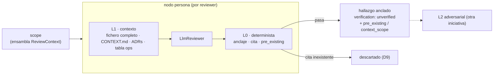

Última modificación: 2026-10-16 | Creado: 2026-10-16

# Contexto del revisor: verificación determinista (L0) y contexto (L1)

> **Estado:** borrador
> **Entrega objetivo:** que el `LlmReviewer` deje de afirmar sobre lo que no ve y
> de publicar como regresión lo que ya estaba en la base, sin gastar un token de más:
> anclaje estricto, cita contrastada y `pre_existing` deterministas (L0), y el
> fichero completo más las decisiones del repo y una regla de humildad (L1).

---

## 1. Objetivo

El revisor LLM recibe **solo el diff recortado** y, aun así, afirma sobre código que
no ve. Eso produce dos síntomas con la misma causa: falsos positivos que **fabrican**
el contexto ausente y falsos negativos que **carecen** del que existe. Esta iniciativa
es la **tajada barata** de la corrección: las dos capas que no dependen de otro modelo
ni de ejecutar código.

Se quiere:

1. **Verificación determinista (L0, gratis).** Conservar el anclaje actual y añadir
   tres comprobaciones sin coste de tokens: que la línea anclada esté entre las
   **añadidas** del diff, que la **cita textual** exista en esa línea, y que el
   problema **no fuese preexistente** comparando con el `base_sha` (un problema que
   ya estaba antes no es un hallazgo de este PR).
2. **Contexto real (L1, barato).** Dar al revisor el **fichero completo** del hunk
   (no el fragmento) y los **documentos de contexto que declare el perfil del repo**
   (en este repo: `CONTEXT.md`, los ADR relevantes y la tabla de variables de
   `docs/operacion.md` §2); y una **regla explícita de humildad**: si la afirmación
   depende de código que no ve, declararla como no probada
   (`context_scope: outside_diff`) en vez de inventar su semántica.
3. **No perder recall.** L0/L1 **declaran hechos**, no deciden: lo dudoso se marca
   (`pre_existing`, `context_scope`) y es el gate de
   [011](../011-gate-de-severidad/spec.md) quien decide su severidad. Solo se
   descarta lo fabricado (una cita que no existe en el diff).

El resto de la solución (verificación adversarial con otro modelo, ejecución en el
sandbox y personas de *wiring*) queda **fuera** y vive en otras tajadas.

Depende de la iniciativa [007 — contrato de verificación](../007-contrato-de-verificacion/spec.md),
que añade al contrato de hallazgo los campos `verification` y `context_scope` que L0
y L1 necesitan para expresar sus veredictos, y de
[012 — cobertura](../012-cobertura-de-la-review/spec.md): el fichero completo solo
cabe si el revisor trabaja por lotes de ficheros, no en un prompt único cortado.

## 2. No-objetivos

- **L2 adversarial y L3 ejecutable.** No se añade otro modelo verificador ni se
  ejecuta código del PR: esto es L0/L1, la parte barata y determinista.
- **Personas deterministas de *wiring*** (`docker-compose`, `settings` ↔
  `.env.example`, `models.yaml`). Recuperan recall de la deriva entre ficheros de configuración,
  pero son un linter, no contexto para el LLM; van aparte.
- **Arreglar el presupuesto de tokens por PR (deuda D17).** L1 lo **agrava** (el
  prompt crece), así que esta spec documenta la dependencia y fija un tope de
  caracteres propio; no resuelve D17.
- **Cambiar el gate de publicación ni la política.** L0/L1 producen hechos en el
  hallazgo; qué se hace con ellos (degradar, publicar en el resumen) lo decide el
  gate de [011](../011-gate-de-severidad/spec.md).
- **Que el diff llegue entero al revisor.** Es
  [012](../012-cobertura-de-la-review/spec.md).
- **Enrutado dinámico de modelos o recarga en caliente.** Sigue la decisión D2 de la
  iniciativa 005 ([ADR-0015](../../adr/0015-registro-declarativo-de-modelos.md)).
- **Sustituir al `ToolingReviewer`.** PHPStan ya está *grounded*; L0/L1 son para las
  **hipótesis** del `LlmReviewer`.

## 3. Contexto y evidencia

### 3.1 Una review real, medida a mano

La auditoría del PR #3 está en [006 §3.1](../archivo/006-eval-de-la-review/spec.md), que es
también la fuente del baseline. Los hallazgos relevantes para L0/L1:

| # | Hallazgo | Veredicto | Por qué | Capa que lo caza |
|---|---|---|---|---|
| B | `_requeue_or_drop` reverifica | Rechazado | Semántica inventada de un fichero **fuera del diff** | L1 (humildad) |
| D | `run_key` cambia de valor | Rechazado | Topología del grafo deducida de un fragmento | L1 (humildad) |
| E | tope de intentos del grafo ≠ worker | Rechazado | Confunde dos settings parecidos | L1 (humildad) |
| F | `build_fix_wait` fuerza `targets=[]` | Rechazado | Afirma una **regresión** sobre código que ya existía en la base | **L0** (`pre_existing` como señal) |
| G | wave parcial vs job perdido | Rechazado | Requisito inventado sobre código que no se lee | L1 (humildad) |
| H | `env_for` expone `Settings` | Confirmado **como decisión** | No conoce el ADR que documenta la decisión | L1 (inyección de decisiones) |
| I | `_touch_heartbeat` silencia `OSError` | Confirmado en parte | Afirma sobre el `restart:` de compose, fuera del diff | L1 + personas de *wiring* |

Los tres P1 no detectados (el `fix-worker` con todos los secretos, un worker que no
arranca en producción y `MODELS_CONFIG` que pisa `LLM_*`) estaban en el diff del PR,
pero el `scope` y el corte de caracteres los dejaron fuera de lo que vio el modelo:
es [012](../012-cobertura-de-la-review/spec.md). Su detección determinista como pares
de configuración es [010](../010-personas-de-wiring/spec.md). L1 ataca la otra causa:
el contexto inventado sobre lo que sí se ve.

### 3.2 El revisor invierte contexto por forma, no por lectura

En [`llm_reviewer.py`](../../../src/agent_review/adapters/llm_reviewer.py) el prompt
es el *system* más el *schema hint* más el diff recortado a `_MAX_DIFF_CHARS`
(60 000 caracteres). El modelo:
- **no** recibe el fichero, solo los `+`/`-`/contexto del hunk;
- **no** conoce `CONTEXT.md` ni los ADR, así que rellena con la semántica que
  supone (B, D, E, G) o "descubre" lo que un ADR ya decidió (H);
- **no** puede comparar con la base, así que llama regresión a lo preexistente (F).

El anclaje actual ([`diff_parser.best_line`](../../../src/agent_review/adapters/diff_parser.py))
ya elige entre líneas **añadidas**, pero cae a «la más cercana al *hint*» cuando la
evidencia no resuelve: eso recoloca en una línea añadida una afirmación que puede ser
sobre una línea de contexto, sin dejar rastro. Y `pre_existing`
([`_to_finding`](../../../src/agent_review/adapters/llm_reviewer.py)) se **copia del
modelo**, no se calcula: el campo existe en el contrato
([`findings-schema.json`](../../../contracts/findings-schema.json)) pero nadie lo
verifica.

### 3.3 Lo que ya está disponible y no se explota

- `VcsPort.get_file(repo, path, ref)` ya lee un fichero a un `ref`
  ([`vcs.py`](../../../src/agent_review/ports/vcs.py)): sirve para el fichero
  completo (al `head_sha`) y para la comparación con la base.
- El nodo [`scope`](../../../src/agent_review/graph/build.py) corre **una vez** por
  review, ya tiene el `VcsPort` y el `request`, y su salida la ven todas las ramas
  del fan-out: es el sitio natural para ensamblar el contexto una sola vez.
- En este repo, `CONTEXT.md` ([`../../../CONTEXT.md`](../../../CONTEXT.md)) ya es el
  glosario único, y `docs/operacion.md` §2 ya contiene la tabla de variables que
  documento y código comparten. Otro repo revisado (p. ej. `emotivoo-v2`) no tiene
  por qué tener nada de eso: lo que se inyecta lo declara su perfil.

## 4. Decisiones

| # | Decisión | Motivo |
|---|---|---|
| D1 | L0 es **determinista y sin tokens**; conserva el anclaje y añade anclaje estricto, cita contrastada y `pre_existing` | El 80% de los falsos positivos son baratos de matar. F muere sin una llamada al modelo. |
| D2 | `pre_existing` se **calcula**, no se copia del modelo, y significa «el código citado es idéntico en la base», no «el problema ya existía» | Hoy el modelo lo rellena; eso es lo que produce F. Pero un cambio en otro sitio (un llamador nuevo) puede romper una línea vieja: el código preexistente no hace preexistente al problema. |
| D3 | L0 **no concede verificación** por sí sola: filtra lo fabricado, pero un hallazgo anclado sigue `unverified` | Un ancla correcta no prueba la semántica. La severidad se gana con verificación, en el gate de [011](../011-gate-de-severidad/spec.md). |
| D4 | El contexto (L1) se ensambla **una vez** en `scope` y viaja en el estado hacia el fan-out | Una lectura por review, no una por persona; coherente con el fan-out que comparte *closure*. |
| D5 | L1 inyecta **fichero completo del hunk + documentos de contexto declarados en el perfil** (`context_docs:`), con tope de caracteres | Da el contexto que falta y las decisiones ya tomadas (H) sin acoplar el código a los documentos de un repo concreto. |
| D6 | Regla de **humildad** en el *system prompt*: claim que depende de código no visible → `context_scope: outside_diff` y no probado | Ata el hueco de contexto a un campo del contrato en vez de a la inventiva del modelo. |
| D7 | L0/L1 **no tocan la severidad**: `pre_existing` y `outside_diff` son hechos que el gate de [011](../011-gate-de-severidad/spec.md) lee; se muestran como etiqueta («preexistente», «fuera del diff») | Un solo dueño de la severidad (007 D11); la calibración se hace en el gate, con el *gold set*. |
| D8 | El contexto se reparte **por lote** de [012](../012-cobertura-de-la-review/spec.md): cada lote lleva el fichero completo de sus ficheros y los documentos de contexto | Un prompt único con todos los ficheros completos revienta cualquier tope. |
| D9 | Una cita que **no existe** en ninguna línea del fichero (ni añadida, ni de contexto, ni borrada) **se descarta** | No es un caso dudoso que proteger: es evidencia fabricada. Descartarla no cuesta recall real. |

## 5. Diseño o contrato

### 5.1 Dónde encajan L0 y L1



**L0 — determinista (gratis).** Sobre el hallazgo ya anclado:

1. **Anclaje estricto.** La línea del hallazgo debe pertenecer al conjunto de líneas
   **añadidas** del diff. Si el `line` del modelo o la cita apuntan a una línea de
   contexto o borrada, **no** se recoloca por cercanía: se marca (hoy
   [`best_line`](../../../src/agent_review/adapters/diff_parser.py) sí recoloca).
2. **Cita contrastada.** La primera evidencia debe casar, normalizando espacios, con
   una línea **añadida** del fichero citado. Si casa con una línea de contexto o
   borrada, el hallazgo se publica en el resumen, no anclado. Si no casa con ninguna
   línea del fichero, se descarta (D9).
3. **`pre_existing`.** ¿El código citado es idéntico en la base? Se decide en dos
   pasos: (a) si la cita casa con el lado viejo del propio diff (contexto o `-`), sí;
   (b) si no, se lee el fichero a `base_sha` con
   [`get_file`](../../../src/agent_review/ports/vcs.py) y se compara. Es un **hecho**
   (D2, D7): el render lo muestra como «preexistente», el verificador de
   [009](../009-verificador-adversarial/spec.md) lo recibe, y un `P0`/`P1` sin
   verificar ya lo degrada el gate. En **F**, el lector ve que no es una regresión
   sin gastar un token.

El cálculo de `pre_existing` requiere el `base_sha` (que hoy no está en
`PullRequestInfo`) y, para el paso (b), indexar también el lado viejo del diff: se
extiende `FileDiff`/`parse_unified_diff` con las líneas de contexto y borradas, con
*cache* por `(fichero, ref)` para no repetir llamadas.

**L1 — contexto (barato).** Antes de llamar al modelo, el *prompt* de cada lote
incluye:

- El **fichero completo** de cada fichero del lote, leído al `head_sha` con
  `get_file` — no solo el fragmento. El modelo ve la función entera, su firma y sus
  llamadas (mata B, D, E, G: la semántica deja de ser una suposición).
- Los **documentos de contexto** que declare el perfil del repo:

  ```yaml
  context_docs:
    glossary: CONTEXT.md
    decisions: docs/adr/          # se eligen los relevantes (Q2)
    extra: ["docs/operacion.md#2"]
  ```

  En este repo: el glosario, los ADR relevantes (p. ej.
  [`ADR-0013`](../../adr/0013-secretos-por-entorno-fail-closed.md), que ya documenta
  la decisión de H) y la tabla de variables de
  [`docs/operacion.md`](../../operacion.md) §2. Un perfil sin `context_docs:` solo
  recibe el fichero completo.

Y una **regla de humildad** explícita en el *system prompt*: «si tu afirmación
depende de código que no ves, declara el hallazgo `context_scope: outside_diff` y no
inventes su semántica». Qué severidad se publica para ese hallazgo lo decide el gate
de [011](../011-gate-de-severidad/spec.md).

### 5.2 Contrato y cableado

- **`ReviewContext`**: estructura inmutable con el diff indexado, los ficheros
  completos (acotados) y los documentos de contexto que declare el perfil.
  La construye `scope` (una vez por review) y viaja en el estado hacia el fan-out.
- **`ReviewerPort.review`** ([`ports/reviewer.py`](../../../src/agent_review/ports/reviewer.py))
  gana un parámetro opcional `context: ReviewContext | None = None`, por
  compatibilidad con las personas que no lo usan (la estática, la nula).
- **`ReviewerResult`** transporta los veredictos de L0/L1 hacia el merge: el hallazgo
  lleva `pre_existing` (calculado) y, vía contrato 007, `verification` y
  `context_scope`. L0/L1 **no** tocan `merge` ni `policy`.
- Un módulo determinista compartido (`verification/l0.py`, puro y testeable) evalúa
  los tres pasos de L0 sobre el hallazgo y el índice del diff; `LlmReviewer` lo
  invoca tras anclar. Así L0 servirá a futuras personas sin duplicar lógica.

### 5.3 Presupuesto por lote

Los lotes de [012](../012-cobertura-de-la-review/spec.md) ya garantizan que ningún
fichero del diff se corta. L1 añade al lote su contexto con prioridad —diff, luego
fichero completo, luego documentos de contexto— y un tope de caracteres propio.
Cuando el contexto no entra, el lote sale sin él y la cobertura lo anota; nunca se
recorta el diff para hacer sitio al contexto. La estimación de tokens y el
presupuesto acumulado del `LlmReviewer` (012 C6) cuentan el contexto: si no, el
presupuesto mide de menos (D17).

## 6. Riesgos

| # | Riesgo | Mitigación |
|---|---|---|
| R1 | La humildad mal calibrada marca **todo** `outside_diff` y se pierde recall | L0/L1 **marcan, no descartan** (D7); la calibración se mide con el *gold set*, nunca a ojo |
| R2 | El contexto **encarece** el prompt (agrava D17) y la latencia | Tope de caracteres propio, solo ficheros del diff, lectura una vez en `scope`, *cache* por ref |
| R3 | `get_file` falla o el `ref` no resuelve | Degradar a «sin contexto» y a `pre_existing` por el diff; **nunca** tumbar la review; loguear |
| R4 | Anclaje estricto descarta hallazgos válidos mal citados | Una cita que casa con una línea de contexto va al resumen, no se pierde; solo se descarta la que no existe en el fichero (D9) |
| R5 | Falso `pre_existing` (la cita casa con el contexto por azar, o el problema nace de un cambio en otro fichero) | Comparación normalizando espacios; es solo una etiqueta (D2, D7), nunca degrada ni descarta por sí misma |
| R6 | `context_scope`/`verification` dependen del contrato 007 | No se implementa hasta que 007 fije los campos; L0/L1 se diseñan contra ese contrato |
| R7 | La inyección de decisiones (H) revela detalles si un ADR trae secretos | Se inyectan documentos versionados del repo (glosario y ADR), no `.env` ni valores; revisar en el propio ADR |

## 7. Criterios de hecho

- [ ] L0 trata, con test, los tres casos: cita sobre línea de contexto (al resumen),
      cita que no existe (descartada) y `pre_existing` contra la base (el caso **F**
      del análisis, etiquetado «preexistente»).
- [ ] `pre_existing` se **calcula** de forma determinista; el valor que devuelva el
      modelo ya no se copia.
- [ ] Con el perfil de este repo, el `LlmReviewer` recibe por lote el fichero
      completo y los `context_docs:` declarados; con un perfil sin `context_docs:`,
      solo el fichero completo.
- [ ] La regla de humildad está en el *system prompt* y un test comprueba que un
      claim fuera del diff sale con `context_scope: outside_diff`.
- [ ] L0/L1 no modifican `severity` en ningún caso (test).
- [ ] El contexto nunca desplaza diff dentro de un lote (test).
- [ ] L0/L1 son una **mejora** sobre el baseline de
      [006](../archivo/006-eval-de-la-review/spec.md) según su criterio de dominancia.
- [ ] `make ci` en verde, con `make docs-check`; y los vivos al día: procedimientos
      de `arquitectura.md` §3–4 (persona y contexto) y `desarrollo.md` §2–3 (tests y
      extensión), más `CONTEXT.md` si nace un término (`L0`, `context_scope`).

## 8. Preguntas abiertas

- **Q1.** El `base_sha`: ¿se añade a `PullRequestInfo`/`ReviewRequest` (lo puebla el
  VCS) o se usa el `destination_branch` como `ref` de [`get_file`](../../../src/agent_review/ports/vcs.py)?
  Añadirlo es más exacto; la rama evita tocar el modelo de la petición.
- **Q2.** ¿Cómo se eligen los **ADR relevantes**? Candidatos: índice curado, casado
  por palabra clave con los ficheros tocados, o el índice completo de `docs/adr/`.
  Un exceso infla el prompt (R2).
- **Q3.** El **tope de caracteres** de L1 y su interacción con D17: ¿un valor fijo, un
  porcentaje del presupuesto de tokens, o *config*? Debe contarse en
  `_estimate_tokens`.
- **Q4.** L0/L1 se aplican **ya** como capa compartida (módulo `verification/`) o solo
  dentro de `LlmReviewer` hasta que existan más personas con hipótesis.
- **Q5.** El fichero completo, ¿se lee al `head_sha` del PR o al `base_sha`? El
  contexto de una afirmación sobre el **cambio** es `head_sha`; la comparación de
  `pre_existing` es `base_sha`.
- **Q6.** Qué se publica para un hallazgo `pre_existing`/`outside_diff` («P3» o
  sección «posibles») se decide en una sola pregunta:
  [011 Q1](../011-gate-de-severidad/spec.md).
- **Q7.** *Resuelta (2026-10-16):* «no probado» es `verification: unverified` con
  `context_scope: outside_diff`
  ([007 D10](../007-contrato-de-verificacion/spec.md)).
