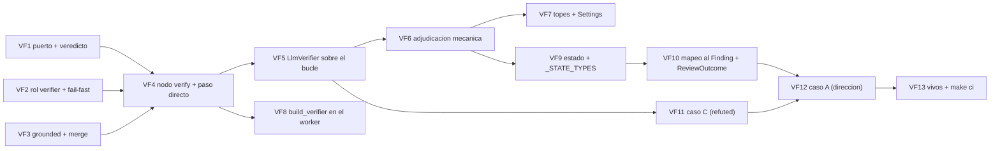

Última modificación: 2026-10-17 | Creado: 2026-10-17

# Plan: Verificador adversarial (L2)

El *qué y por qué* vive en [`spec.md`](spec.md); las tareas, en [`todo.md`](todo.md).
Este plan fija el orden, las dependencias y lo que puede romperse por el camino.

## Overview

Cinco piezas, en este orden:

1. **El contrato.** `Verdict`, `VerificationResult` y `VerifierPort` en
   `ports/verifier.py`, más el rol `verifier` en el registro de modelos y el
   rótulo `grounded` en `ReviewerPort`.
2. **El nodo.** `verify` entre `merge` y `policy`, con paso directo cuando no hay
   binding `verifier` (el grafo se comporta como hoy).
3. **El verificador.** `LlmVerifier` apoyado en el bucle *ReAct* que ya existe
   (`adapters.tool_loop.run_tool_loop`, de [016](../archivo/016-lector-de-contexto/spec.md))
   y en la adjudicación mecánica de §5.5.
4. **El cableado y el estado.** `build_verifier` en el worker, `grounded_findings`
   y `verifications` en `ReviewState`, y el mapeo del veredicto al `Finding`.
5. **Los casos y el cierre.** Los casos C y A de la auditoría del PR #3 como tests,
   y los documentos vivos.

## Decisiones de implementación

Llegan de la spec; aquí se fija **cómo** se hacen y qué se encuentra el plan al
aterrizar sobre el código de hoy (016, 017 y 007 ya entregadas).

- **La pieza de contexto ya existe: se reutiliza, no se rehace.** El bucle *ReAct*
  (`run_tool_loop`), los topes (`ContextLimits`), el registro de lo servido
  (`LoopResult.served`) y la comprobación de cita (`LoopResult.cite_served`) los
  entregó 016. El verificador **no** reimplementa el bucle: aporta el objeto final
  (el veredicto) y su adjudicación. Es lo que la enmienda V13 buscaba.
- **El verificador se inyecta en `build_graph`**, igual que `fixer`, y no se
  construye dentro del grafo (V1, §5.2). `build_graph(..., verifier=None)`
  reproduce el comportamiento de hoy: el nodo `verify` es un paso directo.
- **`grounded` como atributo opcional en `ReviewerPort`.** Sin él, un doble de test
  no lo declara y `getattr(reviewer, "grounded", False)` lo trata como no grounded.
  Lo declara `True` solo `ToolingReviewer` (V7, §5.1).
- **El merge estampa `grounded_findings`, no el nodo.** `_merge_findings` es el
  único punto que conoce el grupo fusionado; se le pasa el conjunto de personas
  grounded y devuelve ambos (`merged` y `grounded_findings`). Si en el grupo
  participa **alguna** persona grounded, el representante queda grounded aunque la
  evidencia más rica venga de una copia del LLM (§5.1).
- **Umbral provisional mientras 011 no existe.** La spec dice que L2 usa el mismo
  umbral que el gate (`severity_gate.require_verified_for` de
  [011](../011-gate-de-severidad/spec.md), G9), pero **011 sigue en borrador**:
  `config/autonomy.yaml` no tiene hoy la clave `severity_gate` y el motor de
  política no la conoce. Decisión de implementación: el nodo lee
  `severity_gate.require_verified_for` **si la clave existe** en la política
  cargada y, si no, usa un `Settings.verifier_require_verified_for` con `[P0, P1]`
  por defecto. Cuando 011 aterrice, el umbral pasa a ser el del gate sin tocar el
  nodo: se lee de la misma clave. Queda anotado como enmienda en §8 de la spec.
- **Presupuesto compartido con la review (017).** El verificador reserva y confirma
  contra el mismo `BudgetPort` de la review (no la clave del fix, que es de B11), y
  una `reserve` que devuelva `False` corta el bucle como un tope (B7): el candidato
  se resuelve `UNPROVEN`, no se pierde.
- **Los topes son por hallazgo y el tope de candidatos es por review.** `ContextLimits`
  ya acota turnos, peticiones y bytes por bucle (016 W2); `VERIFIER_MAX_FINDINGS`
  acota cuántos hallazgos pagan L2 (V11), los más graves primero. Un candidato que
  no cabe por el tope queda `unverified`, sin llamada.
- **El nodo no toca `severity` (V5, D11 de 007).** El mapeo del veredicto escribe
  `verification`, `verification_evidence` y, en `CONFIRMED`, el `failure_scenario`
  del verificador (`model_copy`; nunca se muta el `Finding` del estado).
- **El `Finding` refutado se conserva en `merged`** (V6), no se ancla inline y sigue
  pasando por `policy`; qué se hace con él lo decidirá `on_refuted` de 011. No se
  toca `publish` en esta iniciativa salvo lo que pida el veredicto (una línea de
  verificación en el inline, §5.4 de 011: **eso es de 011**, aquí no).
- **Idempotencia como `fixes`.** El nodo lee `state["verifications"]` como
  `existing` y solo verifica lo que no está; un reintento no re-verifica (V9).

## Orden y dependencias

**Depende de 011 en el umbral, no en el diseño.** El nodo lee la misma clave que
011 definirá; hasta que exista, el default vive en `Settings` (§Decisiones). Si 011
va antes, VF7 solo cambia el origen del umbral.

## Checkpoints

- **C1 (tras VF1–VF3):** `VerifierPort` existe y los tipos del veredicto entran en
  la *allowlist*; el rol `verifier` con el mismo modelo que un rol de revisión
  **falla al arrancar**; `grounded_findings` queda estampado por el merge con el
  `ToolingReviewer` dentro del grupo. `make ci` en verde.
- **C2 (tras VF4–VF7):** `merge → verify → policy`; sin binding `verifier` el grafo
  no llama a nadie y todo queda `unverified`; el bucle respeta los topes; un
  `CONFIRMED` sin escenario y una cita no servida quedan `UNPROVEN`. `make ci` en
  verde.
- **C3 (tras VF8–VF10):** el worker construye el verificador con el lector de
  contexto; `verifications` viaja por el estado y sobrevive a pausa y reanudación;
  el `ReviewOutcome` expone el recuento; la severidad no cambia en ningún test.
  `make ci` en verde.
- **C4 (tras VF11–VF13):** los casos C y A pasan con el fixture;
  `arquitectura.md`, `operacion.md`, `desarrollo.md` y `CONTEXT.md` al día; spec en
  `implementada`; `make ci` y `make docs-check` en verde.

## Riesgos

| Riesgo | Mitigación |
|---|---|
| El umbral provisional se queda quieto y 011 lo mueve | El nodo lee la clave del gate y no un valor propio: el default en `Settings` es el respaldo, no una segunda fuente (V10). Anotado en la spec |
| Doble gasto de presupuesto: el fan-out y L2 compiten por el mismo contador | El presupuesto de la review es compartido y atómico (017 B1); L2 va **después** del fan-out y el `False` de `reserve` corta con `UNPROVEN`, sin reintentar el hallazgo entero (B7) |
| El nodo reintentado re-verifica y paga dos veces | `verifications` se lee como `existing` (VF9); el nodo es idempotente por `finding_id` |
| La grabación del *replay* no cubre el rol nuevo | El `verifier` suma llamadas por rol al *fingerprint*; el caso C del fixture graba sus turnos como cualquier otro rol (016/017 lo permiten por diseño) |
| El lector de contexto sirve un fichero sin anclarlo y el modelo cita mal | `cite_served` rechaza la cita no servida, no el fichero: el veredicto cae a `UNPROVEN` y nunca a `verified_grounded` (§5.5) |
| Un verificador agresivo tumba recall | `REFUTED` exige contra-evidencia citada y **servida**; sin prueba es `UNPROVEN` y el hallazgo se conserva (V5, V6) |
| `verify` se cuela antes del merge y se paga por rama | La arista es `merge → verify` fija: el nodo no se registra en el fan-out (VF4) |
