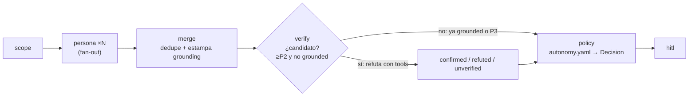

Última modificación: 2026-10-16 | Creado: 2026-10-16

# Verificador adversarial (L2): otro modelo, con herramientas

> **Estado:** borrador
>
> **Entrega objetivo:** entre `merge` y `policy` hay un nodo `verify` que, con un
> **modelo distinto** al de la persona que propuso el hallazgo y con **lectura de
> solo lectura** del repositorio al `head_sha`, intenta **refutarlo**; un hallazgo
> del `LlmReviewer` de severidad `≥P2` que no produzca un `failure_scenario`
> verificado baja a `P3` y ningún hallazgo se borra.

---

## 1. Objetivo

La review de un PR real produjo 9 hallazgos: **6 falsos positivos**, 1 confirmado
con el fallo descrito **invertido** y 2 que documentaban decisiones ya tomadas.
El revisor LLM (`LlmReviewer`) recibe solo el diff recortado y aun así afirma sobre
código que no ve: rellena el hueco con semántica inventada. Dos formas concretas de
ese defecto son el objetivo directo de este trabajo:

- **Hallazgo C — «`_route_fix_wait` es un bucle infinito».** El propio texto del
  hallazgo admitía que el bucle termina. Trazar la ruta real
  (`fix_wait → fix_dispatch → fix_wait`) desmiente la afirmación: cada vuelta
  consume un intento (`fix_max_attempts`). Refutación por trazado.
- **Hallazgo A — fallo real, dirección invertida.** El problema existía, pero el
  sentido del fallo estaba al revés: el revisor describió un orden de llamadas
  equivocado sin comparar con lo que el código hace. Aquí no se refuta: se **obliga
  a fijar la dirección** con una ruta `estado → file:line → resultado`.

Se quiere, por tanto:

1. Un **segundo juicio independiente** sobre cada hipótesis del `LlmReviewer`, con
   otro modelo y con acceso al código que el proponente no tuvo.
2. Un veredicto **anclado a citas**: lo que no se puede citar, no se afirma.
3. Un **escenario de fallo** como precio de la severidad: sin escenario, `P3`.
4. Que un hallazgo **refutado se conserve** en el estado (mide precisión y evita
   volver a proponerlo), en vez de desaparecer sin dejar rastro.

## 2. No-objetivos

- **Sustituir al `ToolingReviewer`.** Su hallazgo nace de una herramienta que ya
  corrió (está *grounded*, `verified_static`); no paga L2 ni lo necesita.
- **Ejecutar código del PR.** Sigue siendo exclusivo del `sandbox-runner`
  ([ADR-0011](../../adr/0011-sandbox-runner-aislado.md)). El verificador **lee**,
  nunca ejecuta; la capa ejecutable (L3) es de otra iniciativa.
- **El gate de publicación.** Qué acción toma `autonomy.yaml` ante un
  `verification: unverified` (degradar o no publicar) lo define la iniciativa del
  contrato y la política; aquí solo se **produce** el veredicto y se **conserva**.
- **El contrato de los campos.** `failure_scenario`, `verification` y
  `verification_evidence` los define [007 — contrato de verificación](../007-contrato-de-verificacion/spec.md).
  Esta iniciativa los **consume**; no los rediseña.
- **La medida.** Precisión y recall se miden con [006 — eval de la review](../006-eval-de-la-review/spec.md);
  aquí solo se exponen los datos que esa medida necesita.
- **Las capas L0/L1.** El filtro determinista y el contexto del proponente son
  iniciativas previas; L2 presupone que L0/L1 ya pasaron.
- **Recarga en caliente del rol.** El binding se lee al arrancar, como el resto del
  registro ([ADR-0015](../../adr/0015-registro-declarativo-de-modelos.md), D2).

## 3. Contexto y evidencia

### 3.1 Mismo contexto, mismo modelo, mismo sesgo

Hoy `merge` ([`_merge_findings`](../../../src/agent_review/graph/build.py)) solo
deduplica y **no filtra nada**: todo hallazgo que ancla a una línea real llega a
`policy` con la severidad que el modelo dijo. Pedirle a `correctness` que revise su
propia salida con el mismo prompt y el mismo diff no añade información: reproduce su
error con otra redacción (sesgo de auto-consistencia). La única forma de añadir señal
es cambiar **dos** cosas: el modelo y el contexto.

### 3.2 Lo que el verificador necesita no está en el diff

Los hallazgos C y A dependen de código que el revisor nunca vio:

| Hallazgo | Qué haría falta para juzgarlo | Se resuelve con |
|---|---|---|
| C · bucle infinito | El cuerpo real de `_route_fix_wait` y el tope de intentos del estado | Leer el fichero al `head_sha` |
| A · dirección del fallo | El orden real de las llamadas, no la forma del fragmento | Leer el fichero y citar la línea |

El `VcsPort` ya expone `get_file(repo, path, *, ref)`
([`ports/vcs.py`](../../../src/agent_review/ports/vcs.py)): leer un fichero a un
commit es una capacidad existente, usada hoy por el fixer. L2 no inventa un acceso
nuevo al repositorio, reutiliza el que ya hay.

### 3.3 El puerto LLM no habla de herramientas

`LlmPort.complete` ([`ports/llm.py`](../../../src/agent_review/ports/llm.py)) acepta
`system`, `prompt`, `max_tokens` y `json_mode`; **no** acepta `tools`. Un bucle de
herramientas real de proveedor (function calling) exigiría ampliar el puerto y el
adaptador `OpenAiCompatibleLlm`. La alternativa sin tocar el puerto es un bucle
*ReAct* explícito en el adaptador: el modelo pide un fichero en JSON, el nodo lo
sirve y se vuelve a llamar. Es la vía que se elige (§5.4).

### 3.4 El presupuesto es por llamada, no por PR

`LlmReviewer._call` compara su **propia** estimación contra
`budget_tokens_per_pr`; no acumula entre personas ni entre reintentos (deuda D17 de
[`arquitectura.md`](../../arquitectura.md) §7). L2 multiplica las llamadas, así que
aquí los topes son **duros y por hallazgo**: número de lecturas, bytes servidos y un
techo de severidad por coste.

## 4. Decisiones

| # | Decisión | Motivo |
|---|---|---|
| V1 | El verificador es un **puerto nuevo** (`VerifierPort`) y un **nodo** `verify` entre `merge` y `policy` | El juicio es una etapa aparte; el nodo la hace visible, reintentable y auditable en el grafo |
| V2 | Rol `verifier` en `models.yaml` con un modelo **distinto** al de `correctness` | Mismo modelo + mismo contexto = sello de goma (§3.1); encaja con el registro por rol ([ADR-0015](../../adr/0015-registro-declarativo-de-modelos.md)) |
| V3 | El *prompt* **refuta** en vez de aprobar, y exige `failure_scenario` | Un verificador que aprueba por defecto no verifica; el escenario obliga a recorrer la ruta |
| V4 | El veredicto debe **citar** código; el nodo comprueba que la cita pertenece a un fichero que sirvió | Corta el defecto raíz: afirmar sobre código que no se ha visto |
| V5 | Sin `failure_scenario` → `P3`; sin veredicto → `unverified` (nunca `refuted`) | La ausencia de prueba no es refutación; un fallo del verificador no puede degradar un P1 real |
| V6 | Un hallazgo refutado **se conserva** en el estado, marcado; no se borra ni se ancla inline | Alimenta la métrica y evita re-proponerlo; no ensucia el inline con lo descartado |
| V7 | L2 solo para hallazgos de personas **no grounded** y severidad `≥P2` | El `ToolingReviewer` ya es `verified_static`; un `P3` no merece el coste |
| V8 | Lectura **de solo lectura** por `VcsPort.get_file` a `head_sha`, con topes de ficheros y bytes | No ejecuta código del PR: no necesita el aislamiento del `sandbox-runner` ni P6 |
| V9 | El nodo es **idempotente** y lleva `RetryPolicy`; un fallo permanente deja `unverified` | Es una llamada externa; un reintento no debe re-verificar lo ya verificado |
| V10 | El umbral de severidad vive en `autonomy.yaml` (`guards.verify_min_severity`); los topes de recursos, en `Settings` | El umbral es política (cambiable sin desplegar); el coste es operación |

## 5. Diseño o contrato

### 5.1 Posición en el grafo



`merge → verify → policy`. Va **después** del merge a propósito: un problema visto
por dos personas se paga **una** vez, no una por rama. Va **antes** de `policy`
porque la política necesita el `verification` ya resuelto para no publicar un `P1`
sin prueba.

**Grounding (quién no paga L2).** El nodo necesita saber de quién es la hipótesis.
`ReviewerPort` gana un atributo `grounded: bool` (`False` por defecto; el
`ToolingReviewer` lo declara `True`). Como el merge es el único punto que conoce el
grupo de hallazgos fusionados, es el merge quien **estampa** el resultado: un
hallazgo fusionado en el que participa **alguna** persona grounded queda grounded
(`grounded_findings` en el estado). Si no, el representante de evidencia más rica
podría ser la copia no grounded de un problema que ya venía de una herramienta.

### 5.2 Puerto nuevo (`VerifierPort`)

```python
class Verdict(StrEnum):
    CONFIRMED = "confirmed"   # probado con citas y escenario -> verified_grounded
    REFUTED = "refuted"       # el código citado desmiente la hipotesis
    UNPROVEN = "unproven"     # no se pudo probar (sin contexto, cita no servida)


class Verification(BaseModel):
    finding_id: str
    verdict: Verdict
    failure_scenario: str | None = None      # contrato de 007
    evidence: list[str] = Field(default_factory=list)   # citas file:line
    files_read: list[str] = Field(default_factory=list) # lo que el nodo sirvio
    reason: str = ""


@runtime_checkable
class VerifierPort(Protocol):
    name: str

    def verify(self, finding: Finding, *, repo: str, head_sha: str) -> Verification: ...
```

El `VerifierPort` recibe **un** hallazgo y devuelve **un** veredicto: aislamiento por
hallazgo, cita comprobable y una unidad que se puede cachear y medir. El nodo no lo
construye: lo recibe en `build_graph` (igual que `reviewers` y `fixer`), de modo que
`build_graph(..., verifier=None)` reproduce el comportamiento de hoy.

### 5.3 Rol `verifier` en el registro declarativo

```yaml
# config/models.yaml
bindings:
  correctness: deepseek-v4-flash
  verifier: qwen3.6        # distinto de correctness y con json_schema
  fixer: deepseek-v4-flash
```

- `ROLES` de [`models_config.py`](../../../src/agent_review/models_registry.py) gana
  `"verifier"`; un typo sigue fallando al arrancar.
- **Fail-fast de independencia:** si `bindings["verifier"] == bindings["correctness"]`,
  el registro no valida y el worker no arranca. Es la decisión V2 hecha ejecutable:
  un sello de goma silencioso es peor que un arranque roto.
- Sin binding `verifier` (vía implícita `LLM_*`, D7 de 0015) el nodo es un
  **paso directo**: todo queda `unverified` y el grafo se comporta como hoy.

### 5.4 Herramientas: lectura acotada, sin ejecución

El verificador necesita **más contexto que el proponente** para añadir señal. Se le
da mediante un bucle *ReAct* acotado sobre `LlmPort` (que no admite `tools`, §3.3):

1. El nodo arma el prompt con el hallazgo, el hunk y la lista de ficheros del diff.
2. El modelo responde JSON: o un veredicto, o `{"tool": "read_file", "path": "…"}` /
   `{"tool": "grep", "pattern": "…"}`.
3. El nodo sirve la petición vía `ContextReaderPort` y vuelve a llamar.
4. Se para al veredicto o al tope de llamadas; agotado el tope sin veredicto → `unproven`.

```python
@runtime_checkable
class ContextReaderPort(Protocol):
    def read_file(self, path: str) -> str | None: ...
    def grep(self, pattern: str) -> list[str]: ...   # lineas `path:line: texto`
```

El adaptador por defecto (`VcsContextReader`) implementa `read_file` con
`VcsPort.get_file(..., ref=head_sha)` y `grep` **sobre los ficheros que ya sirvió**
(o los del diff), no sobre el árbol entero: un `grep` de repo completo exigiría un
clon (lo que hace el `sandbox-runner`) o una API de búsqueda que `VcsPort` no tiene.

**Coste y aislamiento frente al `sandbox-runner`.** El verificador no clona, no
construye imagen, no ejecuta el código del PR ni abre red hacia él: son `get_file` a
un commit, la misma credencial de solo lectura que ya usa el fixer. Por eso **no**
necesita el contenedor endurecido de [ADR-0011](../../adr/0011-sandbox-runner-aislado.md)
ni queda bloqueado por P6. El precio es otro: cada `get_file` es una llamada al VCS
(hoy un proceso `twg`), así que el contexto se acota con
`VERIFIER_MAX_CONTEXT_BYTES` y `VERIFIER_MAX_TOOL_CALLS`, y se **reutiliza** lo que
L1 ya hubiera traído si está en el estado.

### 5.5 El *prompt* refuta y el nodo adjudica

El *prompt* del sistema instruye a **buscar el contraejemplo**, no a validar:
«intenta construir un escenario en el que el hallazgo sea falso; si el código citado
lo desmiente, refuta». Salida JSON con `verdict`, `failure_scenario` y `evidence`.

Dos comprobaciones **mecánicas** en el nodo, que no dependen de la buena voluntad del
modelo:

- **Cita servida.** Cada entrada de `evidence` debe referenciar un `file:line` de un
  fichero que el nodo sirvió. Una cita a un fichero no leído → `UNPROVEN`. Es la
  traducción ejecutable de V4: el modelo no puede afirmar sobre lo que no se le dio.
- **Escenario exigido.** `CONFIRMED` sin `failure_scenario` (o con un escenario sin
  las tres partes: entrada/estado → ruta `file:line` → resultado incorrecto) →
  `UNPROVEN`. El contrato de `failure_scenario` es de
  [007 — contrato de verificación](../007-contrato-de-verificacion/spec.md); aquí se exige que esté.

Mapeo del veredicto al contrato de 007 sobre el `Finding`:

| `Verdict` | `verification` | Severidad resultante | Presencia en el estado |
|---|---|---|---|
| `CONFIRMED` | `verified_grounded` | La propuesta | `merged`, publicable |
| `REFUTED` | `refuted` | `P3` | `merged`, **conservado** y fuera de la publicación (007, §5.3) |
| `UNPROVEN` | `unverified` | `P3` | `merged`, conservado; el gate decide |

El gate de `autonomy.yaml` es quien traduce `verification` a «publicar, degradar o
callar» (decisión de [007 — contrato de verificación](../007-contrato-de-verificacion/spec.md));
L2 solo deja el estado del hallazgo en un valor que el gate pueda leer (Q2).

### 5.6 Estado y persistencia

| Campo de `ReviewState` | Reducer | Quién lo escribe |
|---|---|---|
| `grounded_findings: list[str]` | Sustituye | `merge` (ids de hallazgos ya *grounded*) |
| `verifications: dict[str, Verification]` | Sustituye | `verify`, idempotente sobre lo ya verificado |

`findings`/`merged` **no** se tocan: un hallazgo refutado sigue en `merged` con su
marca (V6). El nodo lee `verifications` como `existing` —igual que `fix_dispatch` lee
`fixes`— para no re-verificar en un reintento (V9). Los tipos nuevos entran en la
*allowlist* del checkpointer (`_STATE_TYPES`), como manda
[`desarrollo.md`](../../desarrollo.md) §3, o un hilo pausado no podrá deserializar.

`ReviewOutcome` expone `verifications` para que
[006 — eval de la review](../006-eval-de-la-review/spec.md) pueda contar
`confirmed`/`refuted`/`unproven` por review sin releer el estado.

## 6. Riesgos

| # | Riesgo | Mitigación |
|---|---|---|
| R1 | **Coste**: L2 agrava la deuda D17 (presupuesto por llamada, no por PR) | Solo `LlmReviewer` y `≥P2` (V7); topes duros de llamadas y bytes (V8); decisión de D17 en las preguntas abiertas |
| R2 | **Latencia**: 1–5 llamadas extra por hallazgo en la ruta caliente | Los segundos de L2 no bloquean a nadie: el flujo es asíncrono y lo caro sigue detrás del `interrupt` de E7 |
| R3 | **Verificador agresivo que tumba recall** | `REFUTED` exige contra-evidencia citada; sin prueba es `UNPROVEN`, y el hallazgo **se conserva** (V5, V6) |
| R4 | **Sello de goma** si el modelo acaba siendo el mismo | Fail-fast al arrancar: `verifier ≠ correctness` (§5.3) |
| R5 | **Cita inventada** por el modelo | El nodo valida la cita contra los ficheros servidos; sin coincidencia, `UNPROVEN` (§5.5) |
| R6 | **Fallo del verificador degrada un P1 real** | Un fallo permanente del modelo deja `unverified`, nunca `refuted` (V5); el gate decide, y aquí no se borra nada |
| R7 | **Lecturas caras** al VCS (procesos `twg`) o límite de tasa | Reutilizar el contexto de L1; `grep` acotado a los ficheros servidos; topes de bytes y llamadas |
| R8 | **Interacción con el gate**: sin binding `verifier`, todo es `unverified` | El paso directo es explícito y testeado; el gate debe tratar `unverified` como «degrada», no como «refutado» (decisión de 007) |
| R9 | **Un solo caso de referencia** (n = 1) para calibrar el *prompt* | Los casos C y A son el fixture semilla; cada falsa alarma real validada a mano añade caso, y el umbral se ajusta con el *gold set*, no a ojo |

## 7. Criterios de hecho

1. `verify` existe como nodo entre `merge` y `policy`; un test de grafo afirma el
   orden y que un hallazgo refutado **sigue en `merged`** y no se publica inline.
2. `config/models.yaml` declara el rol `verifier`; arrancar con
   `verifier == correctness` **falla**, y sin binding `verifier` el grafo se comporta
   como hoy (todo `unverified`, cero llamadas al verificador).
3. **Caso C**: con el fixture del bucle de `fix_wait`, el veredicto es `refuted` y el
   hallazgo queda `P3` en el resumen.
4. **Caso A**: el verificador fija la **dirección** del fallo con un
   `failure_scenario` de tres partes y lo marca `verified_grounded`, sin refutarlo.
5. Un `CONFIRMED` sin `failure_scenario` se degrada a `P3`; un
   `failure_scenario` con una cita a un fichero **no servido** queda `UNPROVEN`,
   nunca `verified_grounded`.
6. El nodo **no llama** al verificador para hallazgos `P3` ni para hallazgos con
   fuente grounded (`ToolingReviewer`), con test de contador de llamadas a 0.
7. Un fallo permanente del modelo deja `unverified` (test); un reintento del nodo no
   re-verifica lo ya verificado (idempotencia, test).
8. Los topes `VERIFIER_MAX_TOOL_CALLS` / `VERIFIER_MAX_CONTEXT_BYTES` se respetan:
   un test comprueba que se corta y se marca `UNPROVEN`.
9. `verifications` viaja en `ReviewOutcome` y los tipos nuevos están en
   `_STATE_TYPES` (test de serialización de un hilo con `verifications`).
10. `make ci` en verde, con `make docs-check`; documentos vivos al día:
    [`arquitectura.md`](../../arquitectura.md) §3–4 (nodo, estado y §7 si nace deuda),
    [`operacion.md`](../../operacion.md) §2 (rol `verifier` y variables nuevas),
    [`desarrollo.md`](../../desarrollo.md) §3 (puerto, adaptador y tipo de estado) y
    `CONTEXT.md` («verificación adversarial», «hallazgo refutado», «escenario de
    fallo»).

## 8. Preguntas abiertas

- **Q1 — ¿Qué modelo?** `qwen3.6` o `gemma4` (razonan y admiten `json_schema`);
  `deepseek-v4-flash` queda descartado para `verifier` porque ya es `correctness` y
  por el 400 permanente de `json_schema`. Se decide midiendo contra el *gold set*.
- **Q2 — ¿Un hallazgo `refuted` se publica?** Publicarlo en el resumen (marcado)
  enseña que se comprobó y se descartó; silenciarlo es más limpio. Hoy se propone la
  sección del resumen (§5.5) y se revisa con la medida.
- **Q3 — ¿Lote o por hallazgo?** Una llamada por hallazgo aísla la cita y el
  escenario, pero multiplica el coste. ¿Merece un lote por PR con N hallazgos?
- **Q4 — ¿El verificador puede pedir ficheros fuera del diff?** Lo propuesto es sí,
  con tope; restringirlo al diff es más barato y también más ciego.
- **Q5 — ¿D17 entra aquí?** L2 hace más agudo el presupuesto por llamada; ¿se
  arregla en esta iniciativa o sigue siendo una iniciativa aparte?
- **Q6 — ¿`unverified` degrada a `P3` o va a una sección «posibles»?** Es una
  decisión del gate (007), pero el umbral que se elija obliga a revisar el *prompt*
  de L2: si degradar pierde recall, el verificador debe ser menos conservador.
