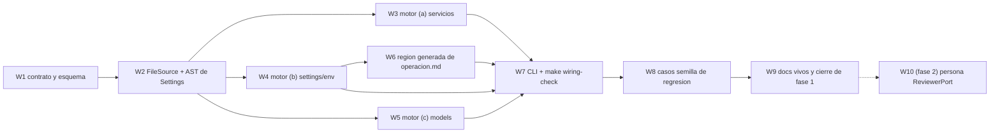

Última modificación: 2026-10-17 | Creado: 2026-10-17

# Plan: Personas deterministas de wiring y configuración

El *qué y por qué* viven en [`spec.md`](spec.md); las tareas, en [`todo.md`](todo.md).
Este plan fija el orden y las dependencias de las dos fases (W11). Aterriza sobre el
código de hoy: `profile.py`, `settings.py` (con el descriptor `Secret` de 020),
`models_config.py` y `tests/test_compose.py` ya existen; 007 dejó
`verification: verified_static` en el enum y `ToolingReviewer` como persona sin rol.

## Overview

La fase 1 es **un motor y un gate**, sin tocar el grafo:

1. **El contrato.** `config/wiring.yaml` y su esquema `WiringConfig` (W13), con la
   validación de que los ficheros que referencia existen y son legibles.
2. **El motor.** `WiringChecker` sobre un puerto `FileSource`: las tres
   comprobaciones (a)–(c) de §5.3, con el mapa de severidad de W15.
3. **El gate.** `make wiring-check` (dentro de `make ci`) y la generación de la
   región de `operacion.md` §2 (W14).

La fase 2 reutiliza el mismo motor como persona `ReviewerPort` (`name = "wiring"`).

## Decisiones de implementación

- **Un solo esquema, dos callers.** `WiringConfig` (Pydantic, `extra="forbid"`, como
  `ModelsConfig`) se instancia desde `config/wiring.yaml` y, en la fase 2, desde el
  bloque `wiring:` del perfil. El motor no sabe de dónde viene el contrato.
- **`FileSource` con dos adaptadores.** `RepoFileSource` (árbol de trabajo, fase 1) y,
  en la fase 2, uno sobre `VcsPort` a `head_sha` (W3). El motor no hace `open()`
  directo: así el mismo código corre en CI y en la review.
- **`Settings` por AST (W12).** La comprobación (b) extrae campos, defaults y
  `Secret` del `metadata` leyendo el fichero con `ast`, sin importarlo: en la fase 2
  el fichero es código del PR. La fase 1 puede usar los mismos datos de dos vías
  (AST y el `Settings` real) para un test de equivalencia.
- **La región generada de `operacion.md` §2 es la salida textual del motor.** El
  generador formatea la tabla; el gate compara. Región marcada con comentarios HTML
  para que `check_docs.py` (que ya ignora las vallas de código y valida enlaces) no
  la toque. La descripción de cada variable sale de `Field(description=…)`; dotar de
  `description=` a los campos es parte de la tarea, no un efecto colateral.
- **`.env.example` se parsea.** Son líneas `KEY=valor` y comentarios: comparar el
  conjunto de claves con `Settings` + `external_keys` es robusto. Los `example_only`
  (p. ej. `MODELS_CONFIG`) se eximen de la igualdad de valor.
- **El motor no conoce nombres.** Ni «fix-worker» ni «env_file» están en el código:
  todo sale del contrato (W2/W8), como el registro de modelos no conoce modelos.
- **Casos semilla como tests de regresión.** Los tres P1 (#1–#3) se reproducen con
  árboles mínimos: un `docker-compose.yml` con `env_file:` en un servicio `isolated`,
  un contrato de arranque sin cubrir y un `${VAR}` de `models.yaml` que no nombra un
  campo. El caso #3 (default de `MODELS_CONFIG`) es un test de regresión de W10, no
  una regla del motor.

### Crítica al diseño (y qué no se hace)

- **No** conviene un checker que solo escriba en un log: sin `Finding` no hay recall
  en la review (W1). Pero tampoco conviene construir la persona antes que el gate:
  el gate da valor el primer día y no añade latencia a la review.
- **No** conviene parsear la tabla de `operacion.md`: fail-closed sobre prosa es una
  fábrica de falsos positivos. Generarla es más trabajo hoy y cero mantenimiento
  después.
- **No** conviene meter el contrato en `repo_profile.emotivoo-v2.yaml`: es el perfil
  del repo revisado, no del agente.

## Orden y dependencias

## Checkpoints

- **C1 (tras W1–W2):** `config/wiring.yaml` carga y valida; un contrato que
  referencia un fichero inexistente falla con mensaje claro. `make ci` en verde.
- **C2 (tras W3–W6):** las tres comprobaciones emiten hallazgos sobre árboles
  mínimos; el generador reproduce la región de `operacion.md` §2 byte a byte.
- **C3 (tras W7–W8):** `make wiring-check` corre en `make ci`; los tres casos
  semilla fallan con el estado de `008da57` y pasan con el actual; sin deriva, cero
  falsos positivos sobre el árbol real.
- **C4 (tras W9):** docs vivos al día; fase 1 cerrada. La fase 2 (W10) se abre como
  trabajo aparte cuando haya un repo con perfil que declare `wiring:`.

## Riesgos

| Riesgo | Mitigación |
|---|---|
| El contrato deriva de la realidad (dice que el `fix-worker` necesita X y ya no) | El motor falla si el contrato referencia un servicio o fichero inexistente; el contrato se revisa en el PR que toca la configuración |
| El generador de la tabla pisa prosa editorial | Solo la región marcada; el resto del apartado sigue a mano y el gate compara únicamente esa región |
| `Settings` por AST se desincroniza del `Settings` real | Test de equivalencia en fase 1 (AST ↔ import); en fase 2 el import no es posible y el AST es la única fuente |
| Solapamiento con `tests/test_compose.py` | El test conserva las aserciones de frontera; el motor las generaliza. No se borra el test |
| Fase 1 convertida en código desechable | El motor y los puertos se escriben para la fase 2; `scripts/wiring_check.py` es un envoltorio fino |

## Dependencias externas

- 007 entregada: `verified_static` y `verification_evidence` ya existen.
- 020 entregada: el descriptor `Secret` es la fuente para saber qué es interno.
- No depende de 014 ni de la regrabación del *gold set*: sus pruebas son los casos
  semilla como tests de regresión.
