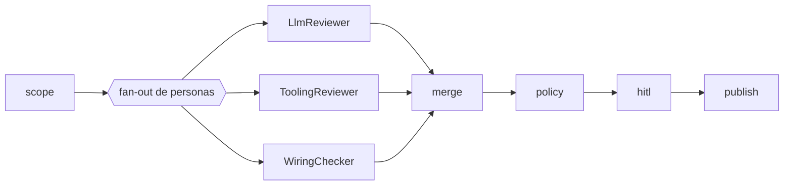

Última modificación: 2026-10-17 | Creado: 2026-10-16

# Personas deterministas de wiring y configuración

> **Estado:** aprobada
>
> **Aprobada el 2026-10-17**: Q1–Q3 resueltas (§8, W13–W15). Fase 1 (motor +
> `make wiring-check`) sin dependencias; fase 2 (persona) después.
>
> **Entrega objetivo:** un motor determinista (sin LLM) que contrasta los pares
> que deben concordar —servicios de `docker-compose.yml`, campos de `Settings`,
> plantilla `.env.example`, tabla de configuración de `operacion.md` §2 y registro
> `models.yaml`—. Primero como gate de CI sobre el repo del agente
> (`make wiring-check`); después, el mismo motor como persona que publica hallazgos
> con `verification: verified_static`. Casos semilla: los tres P1 reales que la
> review no detectó.

---

## 1. Objetivo

Los **tres P1 que la review no detectó** eran **deriva entre ficheros de
configuración** (el aislamiento del `fix-worker`, su contrato de arranque y el valor
por defecto de `MODELS_CONFIG`). Estaban en el diff del PR, pero el `scope` dejó
fuera `docker-compose.yml` y `settings.py` (ver
[012](../archivo/012-cobertura-de-la-review/spec.md)). Arreglar la cobertura es necesario,
pero no suficiente: aunque el LLM vea los dos ficheros, nada garantiza que cruce un
`environment:` de compose con una llamada en `fixworker/main.py`. Hace falta mirar
pares que deben concordar, y hoy nadie lo comprueba.

Se quiere un chequeo **determinista** —«un linter no alucina»— que:

1. Verifique que `docker-compose.yml` arranca **todos** los servicios que el flujo
   necesita y que respeta el **aislamiento declarado** de cada uno (qué variables
   puede y no puede recibir).
2. Contraste `src/agent_review/settings.py` con `.env.example` y con la tabla de
   variables de `docs/operacion.md` §2, **campo a campo** (nombre, presencia y
   default).
3. Contraste `config/models.yaml` (sus referencias `${VAR}`) con los campos de
   `Settings`. Que el default de `MODELS_CONFIG` no oculte la vía de compatibilidad
   `LLM_*` no es un par: queda como test de regresión (W10).

Emite `Finding` con `verification: verified_static`, el campo que define el contrato
de la iniciativa [007](../archivo/007-contrato-de-verificacion/spec.md).

## 2. No-objetivos

- **No es un LLM.** Nada de este chequeo pasa por un modelo: contrasta pares
  declarados. Su coste es cero tokens.
- **No sustituye al `LlmReviewer`.** La cascada de verificación y el contexto de
  repo para las hipótesis del LLM son las iniciativas 008 y 009; esta es la vía de
  **recall determinista**, ortogonal a ellas.
- **No comprueba el *runtime*.** Es estático: no levanta `docker compose`, no
  arranca Postgres ni habla con un proveedor. Que un servicio arranque de verdad
  sigue siendo el smoke de nivel 2.
- **No valida el negocio del repo revisado.** Solo los pares que su perfil declare;
  no opina sobre semántica de código.
- **No arregla la deuda D17** (presupuesto de tokens) ni D14 (métricas): no hay
  llamada al proveedor.
- **No reescribe la tabla de sincronización de `documentacion-mantenimiento`.** La
  **ejecuta** para un subconjunto; la tabla sigue siendo la fuente.

## 3. Contexto y evidencia

### 3.1 Los tres P1 y por qué el diff no basta

Los tres casos semilla viven en ficheros de **configuración y arranque** que hay que
contrastar entre sí:

| # | Síntoma real | Fichero (en `008da57`) | Por qué la review no lo vio | El par que lo caza |
|---|---|---|---|---|
| **#1** | El `fix-worker` recibía **todos** los secretos del despliegue | `docker-compose.yml`: el servicio llevaba `env_file: .env` | El `scope` descartó el fichero (`max_files_per_pr`); y aun visto, el aislamiento es una propiedad del **conjunto** de variables, no de una línea | Servicio declarado `isolated` ↔ `env_file`/variables prohibidas |
| **#2** | El `fix-worker` **no arrancaba en producción** | `src/agent_review/fixworker/main.py` llamaba a `require_production_secrets` (contrato completo, exige `TWG_BBC_TOKEN`) mientras compose lo deja vacío a propósito | `fixworker/main.py` sí se vio, pero su par en compose no; ninguno «parece» mal por separado | Contrato de arranque del servicio ↔ variables que compose le pasa |
| **#3** | El default de `MODELS_CONFIG` **ignoraba** la configuración `LLM_*` | `src/agent_review/settings.py`: `models_config: str = "config/models.yaml"` | El `scope` descartó el fichero; y es un **valor por defecto** que solo falla frente a la vía de compatibilidad documentada | Test de regresión (W10) |

Los tres se corrigieron en `1efc99f` (`require_fix_worker_secrets`,
`models_config: str = ""` y compose sin `env_file` en el `fix-worker`). Esta
iniciativa **fija el invariante** para que la deriva no vuelva; los tres casos pasan
a ser tests de regresión.

### 3.2 Ya hay un test estático, y no basta

`tests/test_compose.py` comprobaba el `environment:` del `fix-worker` pero **no**
miraba `env_file:`; con `env_file: .env` el servicio recibía cada secreto y el test
seguía verde. Un test puntual por síntoma no generaliza: se añade una comprobación
por **contraste de pares declarados**, no una aserción más.

### 3.3 La tabla de sincronización ya está escrita, y nadie la ejecuta

La regla `documentacion-mantenimiento` §2 («si cambias X, actualiza Y») es
exactamente el contrato de estos pares (`settings.py` → `.env.example` y
`operacion.md` §2; `models.yaml` → `Settings`). Hoy es prosa; esta iniciativa la
convierte en código, como `check_docs.py` ya hace con la estructura documental.

## 4. Decisiones

| # | Decisión | Motivo |
|---|---|---|
| **W1** | Forma: un **`ReviewerPort` determinista** llamado `wiring`, no un gate de CI suelto | Reutiliza `merge`, `policy`, HITL, `publish` y el contrato de `Finding`: el hallazgo llega al PR con severidad, dedupe y evidencia. Un gate de CI que solo escribe en un log no da recall **en la review**. El gate (W6) es el mismo motor, no una copia. |
| **W2** | El contrato de wiring es **datos**: `config/wiring.yaml` en la fase 1; bloque `wiring:` del perfil del repo, en la fase 2 (W13) | El checker no conoce rutas ni nombres de fichero en código (igual que el código no conoce nombres de modelo, [ADR-0015](../../adr/0015-registro-declarativo-de-modelos.md)). Otro repo lo declara y funciona; uno que no lo declare, no tiene la persona. |
| **W3** | Acceso a ficheros tras un puerto `FileSource` con dos adaptadores | El mismo motor corre en la review (lee a `head_sha` vía `VcsPort`) y en CI (lee el árbol de trabajo). Patrón *adapter*; el checker no sabe de dónde salen los bytes. |
| **W4** | **Fail-closed**: un fichero declarado e ilegible ⇒ estado de fuente no limpio | Invariante §4: «"sin hallazgos" con una fuente sin cubrir se publica como **incompleta**, nunca como limpia». Se reutiliza el mecanismo de `tooling_status`. |
| **W5** | `verification: verified_static` | Nace de un contraste determinista, no de una hipótesis: pasa el gate de `P0`/`P1` sin pagar L2. Igual que el `ToolingReviewer`. |
| **W6** | El mismo motor se expone como `make wiring-check`, dentro de `make ci` | Un hallazgo de wiring del **propio agente** no debe depender de que alguien revise su repo: la deriva se corta en el PR que la introduce. |
| **W7** | Anclaje: se emite al fichero del par que discrepa; sin línea añadida ⇒ **resumen** | Un par puede vivir fuera del diff (p. ej. `operacion.md`). El `publish` ya manda al resumen lo que no ancla ([ADR-0006](../../adr/0006-publicacion-inline-primero-resumen-al-final.md)); no se inventa una línea. |
| **W8** | Los servicios requeridos y las variables prohibidas **se declaran**, no se intuyen del grafo | Introspección del grafo = acoplamiento frágil y silencioso. Una declaración versionada y revisada es auditable, como `config/autonomy.yaml` ([ADR-0003](../../adr/0003-autonomia-como-politica-por-hallazgo.md)). |
| **W9** | Se descarta el patrón «persona con rol LLM» para este chequeo | Un rol existe para elegir modelo; aquí no hay modelo. `wiring` es una persona **sin rol**, como `standards`: su nombre basta para el `finding_sources` y el merge. |
| **W10** | El caso #3 (default de `MODELS_CONFIG` frente a la vía `LLM_*`) es un **test de regresión** en `tests/`, no una regla del motor | No es un par que deba concordar, sino un caso puntual; codificarlo como regla genérica la volvería frágil |
| **W11** | Entrega en **dos fases**: primero el motor y el gate de CI (W6), después la persona (W1, W3, W7) | Las comprobaciones (a)–(c) dependen de convenciones de este repo (un `Settings` de Pydantic, la tabla de `operacion.md`); un repo Symfony no las tiene. El gate da valor inmediato; la persona se justifica cuando el agente revisa este repo con perfil o un segundo repo declara `wiring:` |
| **W12** | `Settings` se lee con **AST**, no con `import` | En la persona, el fichero llega como texto a `head_sha` vía VCS; importarlo ejecutaría código del PR |
| **W13** | El contrato de la fase 1 vive en **`config/wiring.yaml`** propio (`WIRING_CONFIG`), no en el perfil del repo revisado (Q1, 2026-10-17) | `repo_profile_config` es el perfil del repo **revisado** (PHP), no el del agente; el motor es una declaración versionada como `autonomy.yaml` (ADR-0003) y `models.yaml` (ADR-0015). Un solo esquema (`WiringConfig`) alimenta las dos fases: el gate lee el fichero y la persona leerá el bloque `wiring:` del perfil del repo revisado |
| **W14** | La tabla de variables de `operacion.md` §2 **se genera** desde `Settings` en una región marcada; el gate **regenera y exige que no cambie** (Q2, 2026-10-17) | Parsear la tabla real (celdas de prosa, defaults con explicación) es frágil y fail-closed convierte cada edición editorial en un falso positivo. Al ser salida generada, la deriva «default documentado ≠ código» deja de ser posible. `.env.example` sí se parsea: son líneas `KEY=valor` |
| **W15** | Mapa de severidad (Q3, 2026-10-17): **P1** arranque/aislamiento/`${VAR}` rota, **P2** `.env.example` sin un campo, **P3** clave sobrante en `.env.example` | El P1 rompe producción o el arranque *fail-closed*; el P2 deja al operador ciego a una variable; el P3 es plantilla obsoleta. Con W14, la deriva documental por default desaparece de la tabla |

## 5. Diseño o contrato

### 5.1 Dónde encaja en el grafo



`WiringChecker` implementa `ReviewerPort` (`ports/reviewer.py`) con `name = "wiring"`
y se construye **solo** si el contrato lo declara — `config/wiring.yaml` en el gate de
la fase 1, el bloque `wiring:` del perfil en la fase 2 (W13)— igual que
`ToolingReviewer` solo se construye si `checks.typecheck` existe. Sin contrato no hay
persona: no se sintetiza un «limpio» falso. Si el contrato lo declara y un fichero no
se puede leer, la persona devuelve 0 hallazgos con estado de fuente **no limpio**.

### 5.2 Contrato declarado (`config/wiring.yaml`; el bloque `wiring:` del perfil, en la fase 2)

Fase 1: el contrato vive en `config/wiring.yaml` (W13, `WIRING_CONFIG`), con el mismo
esquema `WiringConfig` que consumirá la persona. El perfil del repo revisado (fase 2)
llevará el mismo bloque bajo su clave `wiring:`.

```yaml
compose: docker-compose.yml
services:
  required: [api, worker, fix-worker, sandbox-runner, postgres, redis]
  isolated:                      # no heredan el entorno del despliegue
    fix-worker:
      forbidden_env_file: true
      requires_env: [REDIS_URL, SANDBOX_RUNNER_URL, SANDBOX_RUNNER_TOKEN]
      forbidden_env: [TWG_BBC_TOKEN, TWG_TOKEN, GITHUB_TOKEN,
                      REVIEWS_DECISION_TOKEN, TOOLING_WEBHOOK_SECRET,
                      LLM_API_KEY, SANDBOX_GIT_TOKEN, DATABASE_URL]
settings:
  module: src/agent_review/settings.py
  env_template: .env.example
  config_doc: "docs/operacion.md#2"
  external_keys: [POSTGRES_PASSWORD, REVIEWS_URL]   # no son campos de Settings
  example_only: [MODELS_CONFIG]                     # la plantilla activa; el default no
models:
  file: config/models.yaml
```

### 5.3 Las tres comprobaciones

| Comprobación | Regla determinista | Caso que caza |
|---|---|---|
| **(a) servicios** | Cada servicio de `required` existe; cada `depends_on` apunta a un servicio declarado; un servicio `isolated` no tiene `env_file` ni recibe ninguna `forbidden_env`; su `environment:` cubre todas las `requires_env` | **#1** (`env_file` filtrado) y **#2** (contrato de arranque sin cubrir) |
| **(b) settings ↔ entorno ↔ doc** | Cada campo de `Settings` aparece como variable en `.env.example`, salvo los declarados internos; cada clave de `.env.example` es campo de `Settings` o `external_keys`; y la región generada de `operacion.md` §2 es **idéntica** a la regenerada desde `Settings` | Toda deriva de la tabla de sincronización (incluido un default documentado distinto del código, como el de #3) |
| **(c) models ↔ Settings** | Cada `${VAR}` de `config/models.yaml` nombra un campo de `Settings` | Una referencia rota en el registro |

La comprobación (b) lee los campos y defaults de `Settings` por AST (W12) y **regenera la región marcada de `operacion.md` §2** desde esos campos (W14): el gate compara el texto generado con el versionado y falla si difieren. La (c) reutiliza el patrón de referencia de
[`models_config.py`](../../../src/agent_review/models_config.py) (`${VAR}` contra
`Settings`), hoy solo usado en *runtime*.

### 5.4 Hallazgo emitido

| Campo de `Finding` | Valor |
|---|---|
| `id` | Estable por par: `wiring-<comprobación>-<clave>` (p. ej. `wiring-compose-fix-worker-env_file`) |
| `title` | Qué par discrepa y cómo (≤ 100) |
| `severity` | `P1` si rompe producción (arranque o aislamiento); `P2`/`P3` para deriva de documentación |
| `file`, `line` | El fichero del par y la línea de la discrepancia (compose/`Settings`/YAML) |
| `why_it_matters` | El modo de fallo concreto, no «está mal» |
| `autofix_class` | `manual`: la decisión de configuración es de una persona |
| `owner` | `human` |
| `confidence` | `100` (contraste determinista, sin modelo) |
| `evidence` | Las citas de los dos lados que deberían concordar |
| `verification` | `verified_static` (contrato de [007](../archivo/007-contrato-de-verificacion/spec.md)) |

## 6. Riesgos

| Riesgo | Mitigación |
|---|---|
| **El contrato declarado deriva de la realidad** (dicen que el `fix-worker` necesita X y ya no es X) | El propio checker falla si el contrato referencia un fichero o un servicio inexistente; el contrato es revisado en el PR que toca la configuración |
| **Falsos positivos al parsear la tabla de `operacion.md`** | Si la tabla no se puede parsear, fail-closed: revisión incompleta, no «limpio». Se prueba contra el documento real |
| **Solapamiento con `tests/test_compose.py`** | `test_compose` conserva las aserciones de frontera; el checker las generaliza. El test deja de ser el único guardián del aislamiento |
| **El `WiringChecker` necesita `VcsPort` y `build_reviewers` no lo recibe hoy** | Es un cambio de cableado en `worker/main.py`; la persona se inyecta con el mismo `VcsPort` de `build_runtime` |
| **W14 toca `operacion.md` §2, un documento vivo** | Solo la región generada; el resto editorial. El gate (`--check`) impide la deriva y el cambio entra con la tarea que genera la tabla |
| **Añadir `wiring` al perfil rompe `validate_profile`** | `profile._MAP_KEYS` y `tests/test_profile.py` deben incluir la clave; es parte de la fase 2, no un olvido |
| **La fase 1 no debe ser código desechable** | El motor `WiringChecker` + `FileSource` se construye en la fase 1 y `scripts/wiring_check.py` es un envoltorio fino; la fase 2 solo añade adaptador y cableado |
| **Un repo sin `wiring:` no gana recall** | Esperado: la persona es opt-in por contrato. Declarar el contrato del repo del agente es el primer caso (Q1) |
| **Ruido en el resumen si un repo declara mucho wiring** | Los hallazgos son estables y deduplicables por `id`; `merge` ya deduplica entre personas |

## 7. Criterios de hecho

**Fase 1 (gate de CI):**

1. Los **tres casos semilla** son tests que fallan con el estado de `008da57` y pasan
   con el actual: #1 y #2 por el motor, #3 por el test de regresión (W10).
2. `make wiring-check` corre en `make ci` y detecta la deriva introducida a mano en
   un repo de prueba.
3. Sin deriva, no hay falsos positivos sobre el árbol actual.
4. Un fichero del contrato ilegible hace fallar el gate, no lo deja en verde.

**Fase 2 (persona):**

5. `WiringChecker` aparece en la review de un repo cuyo perfil declara `wiring:` y
   publica hallazgos con `verification: verified_static`.
6. Un fichero del contrato ilegible deja la review **incompleta**, no limpia.

**Ambas:**

7. `make ci` y `make docs-check` en verde.
8. Documentos vivos al día: `desarrollo.md` §2 (zona de tests) y §3 (cómo extender),
   `operacion.md` §2 si algún campo lo requiere, `arquitectura.md` §7 si aparece
   deuda, y `CONTEXT.md` si nace el término «wiring».

## 8. Preguntas abiertas

- **Q1.** *Resuelta (2026-10-17):* el contrato de la fase 1 vive en
  **`config/wiring.yaml`** propio (`WIRING_CONFIG`), con un único esquema
  (`WiringConfig`). `repo_profile.emotivoo-v2.yaml` es el perfil del repo **revisado**
  (PHP), no el del agente; el patrón de declaración versionada es
  `autonomy.yaml`/`models.yaml` (W13). La fase 2 leerá el mismo esquema desde el
  bloque `wiring:` del perfil del repo revisado.
- **Q2.** *Resuelta (2026-10-17):* la tabla de variables de `operacion.md` §2 **se
  genera** desde `Settings` en una región marcada y el gate regenera y exige que no
  cambie (W14). Parsear la tabla real —celdas de prosa con defaults explicados— es
  frágil y fail-closed convertiría cada edición editorial en un falso positivo.
  `.env.example` sí se parsea. Exige dar `description=` a los campos de `Settings`.
- **Q3.** *Resuelta (2026-10-17):* mapa de severidad de W15 — **P1**
  arranque/aislamiento y `${VAR}` de `models.yaml` que no nombra un campo de
  `Settings`; **P2** `.env.example` sin una variable que sí es campo; **P3** clave
  sobrante en `.env.example`. Se afina con el *gold set* si la medida lo pide, no
  antes.
- **Q4.** ¿El `wiring` también se expone como fuente estática ingerible (artefacto)
  además de persona y gate, o dos callers ya son suficientes?
- **Q5.** *Resuelta (2026-10-17):* `verified_static` ya es un valor del enum de 007
  (`domain/models.py`) y es el nivel que declara todo emisor no-LLM, como
  `ToolingReviewer` (007 D6). El «qué comprobación» vive en `evidence`
  (`verification_evidence`, ≥1 por 007 D4); no hace falta matiz nuevo.
