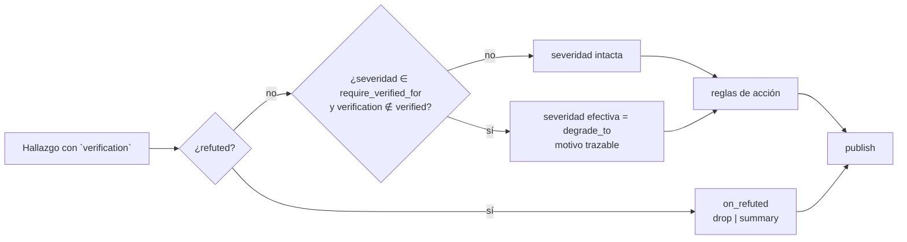

Última modificación: 2026-10-16 | Creado: 2026-10-16

# Gate de severidad por política y observabilidad del veredicto

> **Estado:** borrador
> **Entrega objetivo:** que ningún hallazgo `P0`/`P1` del `LlmReviewer` se publique
> como tal sin un veredicto de verificación que lo sostenga, que este gate sea el
> **único** sitio que decide la severidad publicada, y que el veredicto y su
> evidencia viajen al comentario y al resumen.

---

## 1. Objetivo

Hoy la severidad de un hallazgo la fija el modelo que lo propone y nadie la
comprueba: [`autonomy.yaml`](../../../config/autonomy.yaml) consume `severity` para
elegir acción, pero no exige ninguna prueba de que un `P1` lo sea. Un `P1` inventado
cuesta confianza; una campaña que llora lobo se ignora.

Se quiere:

1. **Hacer que la severidad se gane.** La publicación de un `P0`/`P1` del
   `LlmReviewer` exige un veredicto de verificación
   (`verified_static | verified_grounded | verified_executed`); un `unverified` no
   se publica con esa severidad.
2. **No perder recall al filtrar.** Un `unverified` **no se descarta**: se degrada
   (o se reubica en una sección «posibles»), de modo que el lector lo ve sin
   ensuciar los `P1`.
3. **Un solo dueño de la severidad.** L0/L1 ([008](../008-contexto-del-revisor/spec.md))
   y L2 ([009](../009-verificador-adversarial/spec.md)) solo emiten hechos
   (`pre_existing`, `context_scope`, `verification`); este gate es el único que los
   traduce en severidad publicada ([007 D11](../007-contrato-de-verificacion/spec.md)).
   Eso incluye qué se hace con un `refuted`.
4. **Que el veredicto se vea.** El comentario inline y el resumen muestran por qué
   se sostiene el hallazgo (veredicto + evidencia), no solo la acción.
5. **Que la decisión sea política.** El gate se declara en
   [`autonomy.yaml`](../../../config/autonomy.yaml) y se audita como cualquier regla
   ([ADR-0003](../../adr/0003-autonomia-como-politica-por-hallazgo.md)); modificable
   sin desplegar.

Depende del contrato `verification` ([007](../007-contrato-de-verificacion/spec.md)),
del contexto que reduce el `unverified` legítimo
([008](../008-contexto-del-revisor/spec.md)) y del verificador que produce el
veredicto ([009](../009-verificador-adversarial/spec.md)). Esta iniciativa **consume**
esos resultados; no los implementa. Su efecto se mide con
[006](../archivo/006-eval-de-la-review/spec.md).

## 2. No-objetivos

- **Implementar el verificador ni el contexto del revisor.** Eso es 008/009. Aquí
  solo se consume el campo `verification`.
- **Reescribir los ADR de publicación.** El gate reutiliza el mecanismo de
  `autonomy.yaml` ([ADR-0003](../../adr/0003-autonomia-como-politica-por-hallazgo.md));
  el render sigue
  [ADR-0006](../../adr/0006-publicacion-inline-primero-resumen-al-final.md).
- **Medir la calidad.** Las métricas (falsos positivos, precisión, recall…) y el
  baseline son de [006](../archivo/006-eval-de-la-review/spec.md); aquí no se redefinen.
  Las trazas y el resto de D14 siguen fuera.
- **Cambiar la escala de severidad ni las anclas de `confidence`.** `P0`–`P3` y
  `0/25/50/75/100` se mantienen.
- **Ejecutar código del PR.** Sigue reservado al `sandbox-runner` (fuera de alcance).

## 3. Contexto y evidencia

### 3.1 La severidad no está respaldada

En la auditoría del PR #3 ([006 §3.1](../archivo/006-eval-de-la-review/spec.md)), **6 de 9
hallazgos publicados eran falsos positivos**, varios de ellos con severidad alta. Los
falsos positivos nacen de afirmar sobre código que el revisor no ve. El `merge` solo
deduplica y no filtra:
[`_merge_findings`](../../../src/agent_review/graph/build.py) fusiona por
`(fichero, línea, título)`. Es decir: **todo** hallazgo que ancla a una línea real se
publica con la severidad que el modelo dice.

El contrato ya tenía las piezas, pero no se usan:
[`Finding.requires_verification`](../../../src/agent_review/domain/models.py) no lo
lee ningún código y `confidence` es decorativo (solo lo consume la política). El
campo `verification` que introduce 007 es el que ahora puede sostener —o tumbar— una
severidad.

### 3.2 El motor de política no conoce el veredicto

[`PolicyEngine._match_condition`](../../../src/agent_review/policy/engine.py) casa
solo `protected_subject`, `severity`, `autofix_class`, `confidence` y `paths`; una
clave desconocida lanza `PolicyError`. No hay forma de exigir `verification`, y el
resultado (`PolicyResult`) solo lleva la acción, no una severidad efectiva. La
cobertura actual de la política está en
[`tests/test_policy.py`](../../../tests/test_policy.py).

### 3.3 El lector no ve el veredicto

[`_render_inline`](../../../src/agent_review/graph/build.py) muestra
`_Acción: … · confianza N_` y una línea de política; el resumen lista
`… · {acción} · {inline|resumen}`. En ninguno aparece **por qué** se sostiene el
hallazgo. Un `P1` degradado y un `P1` verificado se leen igual.

### 3.4 Tres capas querían degradar

En los borradores de 008 y 009, L0/L1 «bajaban severidad», L2 ponía `P3` a lo no
probado y este gate calculaba una severidad efectiva. Con tres dueños, un hallazgo
publicado como `P3` no tiene una explicación única, y los umbrales (P0–P2 en L2,
P0/P1 aquí) se contradecían. Se resuelve concentrando la decisión aquí (G8) y
compartiendo el umbral con el verificador (G9).

## 4. Decisiones

| # | Decisión | Motivo |
|---|---|---|
| G1 | La publicación de `P0`/`P1` exige `verification ∈ {verified_static, verified_grounded, verified_executed}` | El veredicto del `LlmReviewer` es una hipótesis; sin prueba, un `P1` no se sostiene. |
| G2 | El gate vive en [`autonomy.yaml`](../../../config/autonomy.yaml), *policy-as-data* | Auditoría y cambio sin desplegar, con `matched_rule` y `policy_version` ya existentes ([ADR-0003](../../adr/0003-autonomia-como-politica-por-hallazgo.md)). |
| G3 | Un `unverified` **no se descarta**: se **degrada** de severidad (por defecto `P3`) | Descartar perdería recall; degradar conserva la visibilidad sin ensuciar los `P1`. La reubicación en «posibles» se decide en Q1. |
| G4 | El `ToolingReviewer` entra como `verified_static` y no paga el verificador | Su hallazgo nace de una herramienta que corre; no es una hipótesis. |
| G5 | La degradación es determinista y trazable: el motor devuelve la severidad **efectiva** y su motivo | El motor no usa LLM; la decisión debe poder auditarse igual que la acción. |
| G6 | El veredicto y su evidencia viajan al inline y al resumen | El lector humano debe ver **por qué** se sostiene (o se degrada) el hallazgo. |
| G7 | La severidad efectiva se calcula **antes** de elegir la regla de acción, y un hallazgo degradado solo puede tener acción `report` | Si se degrada después, un P1 sin verificar sigue escalando a una persona con etiqueta P3; si la severidad degradada entra en las reglas sin guarda, un P1 dudoso convertido en P3 podría acabar en `fix_auto`. Cierra Q3. |
| G8 | El gate es el **único** que cambia la severidad publicada; L0/L1 y L2 solo emiten hechos | Una explicación por hallazgo; el umbral se calibra en un sitio ([007 D11](../007-contrato-de-verificacion/spec.md)) |
| G9 | `require_verified_for` es también el umbral de candidatos del verificador ([009 V10](../009-verificador-adversarial/spec.md)) | Si L2 y el gate tuvieran umbrales distintos, verificar fuera del umbral sería coste sin efecto y quedarse corto dejaría severidades sin poder ganarse |
| G10 | Un `refuted` se trata con `on_refuted`: `drop` (por defecto: no se publica) o `summary` (en el resumen, marcado, nunca inline) | Sin regla explícita, un P1 refutado contaría como «no verificado», se degradaría a P3 y se publicaría |
| G11 | `pre_existing` y `context_scope: outside_diff` no cambian la severidad por sí solos: se muestran como etiqueta | Un `P0`/`P1` con esas marcas que siga `unverified` ya lo degrada G1; uno verificado es real aunque el código fuera viejo |

## 5. Diseño o contrato

### 5.1 Gate como dato de política



`autonomy.yaml` gana un bloque declarativo, separado de las reglas de acción:

```yaml
severity_gate:
  require_verified_for: [P0, P1]    # también umbral de candidatos de L2 (G9)
  verified: [verified_static, verified_grounded, verified_executed]
  on_unverified: degrade            # degrade | possibles
  degrade_to: P3
  on_refuted: drop                  # drop | summary (G10)
```

Se evalúa **antes** de elegir la regla de acción (G7): las reglas ven la severidad
efectiva, y un hallazgo degradado queda limitado a `report`. Es la
forma de menor superficie: deja `rules` intactas (la autonomía no cambia) y mete la
exigencia de verificación en un único sitio auditable. Alternativa descartada: una
clave `verification` dentro del `when` con un `severity_override` en la regla, que
mezcla acción y publicación en la misma estructura.

### 5.2 Motor (`policy/engine.py`)

- `PolicyResult` amplía con `severity` (efectiva) y `severity_reason`; un hallazgo
  degradado tiene acción `report` (G7).
- La degradación solo aplica a hallazgos **por encima** del umbral; un `P2`/`P3` sin
  verificar se queda como está.
- Un `severity_gate` mal formado (lista vacía, `degrade_to` fuera de `P0`–`P3`) falla
  **al arrancar**, como el resto de la política.
- Nuevos casos en [`tests/test_policy.py`](../../../tests/test_policy.py): `P1`
  verificado se mantiene; `P1` `unverified` degrada y queda en `report`; `P1`
  `refuted` sigue `on_refuted`; `ToolingReviewer` (`verified_static`) no degrada; una
  severidad por debajo del umbral es indiferente.

### 5.3 Merge: no degradar un veredicto más fuerte

`_merge_findings` debe conservar el `verification` **más fuerte** entre duplicados
(orden `verified_executed > verified_grounded > verified_static > unverified`): si una
persona marca `unverified` y otra `verified_grounded` el mismo hallazgo, el gate debe
ver el verificado, no el peor. Es la única extensión de `merge` que pide esta
iniciativa.

### 5.4 Observabilidad del veredicto

- **Inline** ([`_render_inline`](../../../src/agent_review/graph/build.py)): una
  línea `_Verificación: <veredicto> · <evidencia>_` junto a la de acción y política,
  y la etiqueta de degradación cuando aplique.
- **Resumen** ([`_render_summary`](../../../src/agent_review/graph/build.py)): el
  veredicto por hallazgo y, si se elige la variante «posibles» (Q1), una sección
  aparte. Los degradados se distinguen de los `P3` nativos.
- Las **marcas de dedupe** no cambian: el token de ejecución sigue siendo la clave
  de no re-publicar.

### 5.5 Medida

El gate actúa después del modelo, así que su efecto se ve en el *replay* de
[006](../archivo/006-eval-de-la-review/spec.md) sin regrabar ni gastar tokens. Las métricas y
el baseline son los de 006; el umbral (`require_verified_for`, `degrade_to`) se
ajusta con ellas, nunca a ojo.

## 6. Riesgos

| Riesgo | Mitigación |
|---|---|
| **Pérdida de recall** por un gate agresivo | Degradar en vez de descartar; el umbral se ajusta **con el *gold set***, nunca a ojo. |
| **Degradar habilita un autofix inseguro** (un `P1` dudoso baja a `P3` y entra en `fix_auto`) | Un hallazgo degradado solo puede tener acción `report` (G7). |
| **Un `refuted` se publica como `P3`** por caer en la rama de «no verificado» | Se evalúa antes y por separado (`on_refuted`, G10); test que lo prueba. |
| **Merge que degrada un veredicto fuerte** | `merge` conserva el veredicto más fuerte (§5.3). |
| **Un `P2`/`P3` sin verificar se cuela** como `P1` por otro camino | La degradación y el render usan siempre la severidad **efectiva**; no hay dos fuentes. |
| **Re-publicación** al cambiar la severidad de una review ya publicada | El dedupe por token de ejecución no re-publica; documentar el comportamiento esperado. |
| **`severity_gate` mal configurado** | Validación al arrancar (fail-fast) y test de política. |
| ***Gold set* minúsculo** (n=1) | El caso semilla es el PR auditado; cada review validada a mano añade *fixture*. |

## 7. Criterios de hecho

1. [`autonomy.yaml`](../../../config/autonomy.yaml) declara el `severity_gate`; el
   motor lo aplica y lo audita (`matched_rule`/`policy_version` intactos).
2. Ningún `P0`/`P1` con `verification: unverified` se publica como `P0`/`P1`; test que
   lo prueba.
3. Un `unverified` **conserva** el hallazgo (degradado o en «posibles»), no se
   descarta; test que lo prueba.
4. `ToolingReviewer` entra como `verified_static` y no paga el verificador.
5. Inline y resumen muestran el veredicto y su evidencia; un degradado se distingue
   de un `P3` nativo.
6. Un `refuted` sigue `on_refuted` y nunca se publica inline; un degradado nunca
   tiene una acción distinta de `report`. Tests que lo prueban.
7. Ningún otro nodo ni adaptador modifica `severity` (test sobre L0, L2 y `merge`).
8. El gate es una **mejora** sobre el baseline según el criterio de dominancia de
   [006](../archivo/006-eval-de-la-review/spec.md).
9. `make ci` en verde y `make docs-check` en verde.
10. Documentos vivos al día: [`arquitectura.md`](../../arquitectura.md) §3 (orden
   gate → reglas en `policy`) y, si el bloque cambia la configuración,
   [`operacion.md`](../../operacion.md) §2; `CONTEXT.md` si nace un término
   («severidad efectiva»); un ADR nuevo para el gate (Q7).

## 8. Preguntas abiertas

- **Q1 — ¿Degradar a `P3` o mover a una sección «posibles» del resumen?** Degradar es
  más simple y no toca el render; la sección conserva la visibilidad sin mezclar los
  `P1`. Se decide con el *gold set* delante. Es la única copia de esta pregunta:
  008 Q6 y 009 Q6 enlazan aquí.
- **Q2 — ¿Bloque `severity_gate` o clave `verification` en el `when` con
  `severity_override`?** Se propone el bloque (una sola fuente y `rules` intactas);
  la alternativa integra todo en el mismo motor de reglas.
- **Q3 —** *Resuelta (2026-10-16):* la severidad efectiva entra en las reglas y un
  degradado queda limitado a `report` (G7).
- **Q4 —** *Resuelta (2026-10-16):* las métricas son de
  [006](../archivo/006-eval-de-la-review/spec.md), que ya separa los falsos `P0`/`P1`.
- **Q5 — ¿Se muestra siempre el veredicto o solo en `≥P2` y degradados?** Mostrarlo
  siempre añade ruido a los `P3`; omitirlo pierde trazabilidad.
- **Q6 — ¿Qué umbral de `confidence` (si alguno) acompaña al gate?** Hoy
  `confidence` no se comprueba en ningún sitio; decidir si el gate también la cruza.
- **Q7 — ¿ADR nuevo o enmienda a ADR-0003?** El gate introduce una decisión de
  severidad que ADR-0003 no cubre; se propone un ADR propio que lo referencie.
- **Q8 — ¿`P2` en `require_verified_for`?** El borrador de 009 verificaba desde `P2`;
  aquí se propone `[P0, P1]` por coste. Como el umbral es compartido (G9), incluir
  `P2` encarece L2: se decide con el coste medido en 006.
- **Q9 — ¿`on_refuted` por defecto `drop` o `summary`?** `drop` no ensucia;
  `summary` enseña que se comprobó y se descartó.
