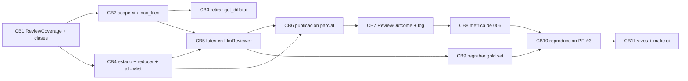

Última modificación: 2026-10-17 | Creado: 2026-10-17

# Plan: Cobertura de la review

El *qué y por qué* vive en [`spec.md`](spec.md); las tareas, en [`todo.md`](todo.md).
Este plan fija el orden, las dependencias y lo que puede romperse por el camino.
Cierra la deuda [D18](../../arquitectura.md) §7.

## Overview

Cinco piezas, en este orden:

1. **El tipo.** `ReviewCoverage` y `SkipReason` en el dominio, y la clasificación de
   ficheros por *globs* (`code`, `config`, `test`, `docs`), ampliable desde el perfil
   del repo.
2. **El `scope`.** Desaparece `max_files_per_pr`. El nodo prioriza por clase y churn,
   crea la cobertura con los ignorados y la deja en el estado.
3. **Los lotes del `LlmReviewer`.** Ficheros enteros hasta `LLM_BATCH_MAX_CHARS`,
   cada lote reserva y confirma contra el presupuesto de
   [017](../archivo/017-presupuesto-por-pr/spec.md), y la persona devuelve su
   cobertura (`too_large`, `budget`, `failed`).
4. **La publicación.** Cabecera de review parcial (C7), marca `:partial` y cobertura
   en el `ReviewOutcome`.
5. **La medida.** La métrica de cobertura del *gold set* sale de `ReviewCoverage`, la
   reproducción del PR #3 cumple el criterio 1 y se regraba la grabación.

## Decisiones de implementación

- **El churn sale del propio diff**, contando líneas `+` y `-` por bloque, en vez de
  pedir `get_diffstat` al VCS. Sin `max_files_per_pr`, `get_diffstat` se queda sin
  consumidores: se retira del `VcsPort`, de sus dos adaptadores y de los dobles de
  test (CB3), para no dejar código muerto.
- **La clasificación vive en `scope.py`** (`classify(path, classes) -> str`), junto a
  los patrones de ignorado. El orden de comprobación es `test` → `docs` → `config` →
  `code` (resto), para que `tests/config/x.yaml` sea test y no configuración.
- **El perfil gana la clave `scope`** (mapa con `classes`). `validate_profile` la
  conoce; las clases del perfil **se suman** a las de por defecto, no las sustituyen.
- **La cobertura viaja en el estado** como `coverage: Annotated[ReviewCoverage, _merge_coverage]`.
  El `scope` la escribe; cada rama de persona LLM devuelve la suya en
  `ReviewerResult.coverage` y el *reducer* las combina: un fichero cuenta como
  revisado si **alguna** persona LLM lo revisó; si ninguna, gana el motivo de la
  primera. `ReviewCoverage`, `SkipReason` y `FileClass` entran en `_STATE_TYPES`.
- **El diff que reciben las personas no cambia de forma**: sigue siendo un diff
  unificado, ya **ordenado por prioridad** (clase, después churn). El `LlmReviewer`
  parte en lotes en ese orden, así que lo que se queda sin presupuesto son tests y
  docs.
- **Lotes:** se llena cada lote en orden de prioridad, agrupando por directorio
  cuando el siguiente fichero del mismo directorio cabe. Un fichero que solo ya
  supera `LLM_BATCH_MAX_CHARS` es `too_large` y no gasta llamada.
- **Presupuesto por lote:** `reserve` antes de cada llamada; si devuelve `False`, ese
  lote y todos los siguientes salen como `budget` y la persona marca
  `budget_exhausted` (el hecho de 017). El tope blando por persona (B10 de 017) se
  aplica al **acumulado** de la persona, no a cada lote.
- **Fallos:** un error transitorio sigue subiendo a la `RetryPolicy` del nodo (se
  repiten los lotes ya hechos; ver riesgos). Uno permanente marca su lote como
  `failed` y la persona sigue con el siguiente.
- **`max_findings`** se aplica al total de la persona tras juntar los lotes,
  ordenando por severidad.
- **`last_seen_files`** pasa a ser la unión de los ficheros de todos los lotes
  llamados. La métrica de 006 deja de leerlo (CB8) y se retira cuando nadie lo use.
- **Publicación:** `complete = not unavailable and not coverage.partial`. Una review
  parcial publica con la marca `:partial`, igual que hoy una fuente de tooling sin
  cubrir, así que el mecanismo de «no repetir el aviso» no cambia.

## Orden y dependencias

**Depende de 007 en la práctica, no en el diseño:** las dos tocan `llm_reviewer.py`
y las dos obligan a regrabar el *gold set*. Si 007 va antes, 012 parte de su
`_SCHEMA_HINT` y la regrabación de CB9 sirve para las dos.

## Checkpoints

- **C1 (tras CB1–CB4):** el `scope` prioriza por clase y no recorta por número;
  `max_files_per_pr` no existe en `autonomy.yaml` ni en el código; `ReviewCoverage`
  sobrevive a pausa y reanudación. `make ci` en verde.
- **C2 (tras CB5–CB7):** ningún fichero se corta a mitad; el presupuesto se reparte
  por lotes; una review con configuración sin revisar publica la cabecera parcial y
  una con solo docs sin revisar no. `make ci` en verde.
- **C3 (tras CB8–CB11):** la métrica de cobertura sale de `ReviewCoverage`; el PR #3
  reproducido deja la configuración dentro; *gold set* regrabado; D18 fuera de
  `arquitectura.md` §7; `make ci` y `make docs-check` en verde.

## Riesgos

| Riesgo | Mitigación |
|---|---|
| Un error transitorio en el lote *k* hace que la `RetryPolicy` repita los lotes 1…*k−1* y los pague dos veces | Se acepta en esta iniciativa: los reintentos son raros y el presupuesto de 017 acota el gasto. Si el *gold set* o los logs lo muestran caro, iniciativa aparte (lotes como subnodos) |
| Sin `max_files_per_pr`, un PR enorme hace muchas llamadas en serie y la review tarda | El presupuesto corta el gasto, no la latencia: se mide en el *gold set* y en P5 de 015. Si hace falta, paralelizar lotes es una optimización posterior |
| La regrabación (CB9) depende de una API key válida | Igual que V6 de 007: cualquier credencial válida del registro; si se hace junto a V6, una sola regrabación |
| Las clases por *glob* clasifican mal en `emotivoo-v2` (PHP/Symfony) | Test con rutas reales del repo (`config/packages/*.yaml`, `src/**/*Test.php`) y `scope.classes` en su perfil si hace falta |
| Retirar `get_diffstat` rompe a un consumidor externo del puerto | El puerto es interno; `grep` en CB3. Si aparece otro uso, se mantiene y se anota |
