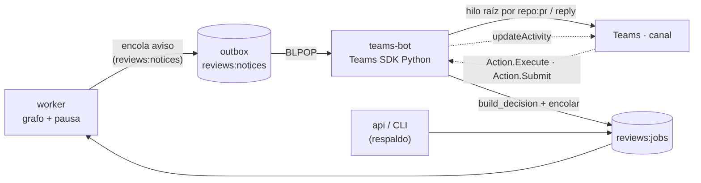

Última modificación: 2026-10-16 | Creado: 2026-10-16

# Canal bidireccional de Teams: un bot con un hilo por PR

> **Estado:** aprobada
> **Entrega objetivo:** el agente pregunta en Teams y una persona responde **en el
> mismo hilo del PR**; la respuesta se convierte en una decisión humana y la review
> reanuda. Teams deja de ser un aviso que ya no llega a ser un canal de ida y vuelta.

---

## 1. Objetivo

1. **Reconstruir la notificación.** El Incoming Webhook actual está retirado
   (Office 365 Connectors, 18–22 de mayo de 2026) y, por si acaso, responde `200`
   descartando el payload: hoy publicar en Teams es un fallo silencioso.
2. **Cerrar el bucle.** Una persona decide desde la tarjeta (`aprobar` / `rechazar` /
   `noted` por hallazgo) sin salir de Teams y sin pegar comandos.
3. **Un hilo por PR.** Cada PR tiene **un** hilo en el canal; la review va ahí, como
   replies, y la tarjeta se **actualiza** al avanzar el grafo
   ([diseño base](../001-diseno-base/spec.md) §5.1).
4. **Sin tocar el grafo.** El bot es **un cliente más del canal de decisión**, al
   mismo nivel que el CLI y `POST /decision`; reutiliza `build_decision` y la cola
   única ([ADR-0008](../../adr/0008-hitl-por-cli-y-http-con-cola-unica.md)).

## 2. No-objetivos

- **Decidir incrementalmente de verdad** (un hallazgo por reanudación). La UX es
  incremental, la decisión es atómica (C3). Se anota como iniciativa futura en §8.
- **Autorización fina** (grupos o allowlist de Entra ID). Se confía en el canal (C5).
- **Meter el grafo, el checkpointer o la política en el bot.** El bot no decide la
  política ni reinterpreta el clamp.
- **Notificar por Workflows webhook.** El bot cubre el egress; la migración al
  webhook solo si el bot se retrasa (§6).
- **Cambiar el contrato de `ChatPort` más allá de lo necesario** para el hilo y la
  edición.
- **Publicar el fix en el canal con más detalle** que hoy: el inline sigue en el PR.

## 3. Contexto y evidencia

### 3.1 El canal actual está muerto

El antiguo `TeamsWebhookAdapter` (retirado en esta iniciativa) enviaba
`MessageCard` a `TEAMS_WEBHOOK_URL`. Los endpoints de Office 365 Connector se
retiraron; los supervivientes devuelven `200` sin entregar. El smoke real del
2026-10-11 quedó en no-op por no haber webhook, así que no hay nada roto en
producción, pero la decisión del ADR-0008 descansa en una pieza inexistente.

### 3.2 Qué permite cada vía (2026)

| Vía | Recibe respuestas | Hilo por PR | Editar tarjeta | Desatendido |
|---|---|---|---|---|
| **Bot** (Azure Bot + Teams SDK) | Sí | Sí (`replyToId`) | Sí (`updateActivity`) | Sí |
| Workflows + Power Automate | Parcial (1 respuesta por flujo) | **No** (su trigger no ve replies) | Sí | Parcial |
| Microsoft Graph | No | Sí | Sí | **No** (requiere permiso delegado) |
| Incoming Webhook | No | **No** | **No** | — (retirado) |

### 3.3 Qué ya existe y se reutiliza

| Pieza | Hoy | Aquí |
|---|---|---|
| `HitlDecision` / `build_decision` | Valida que la decisión cubra todos los pendientes | El bot la usa tal cual |
| Inbox `reviews:paused:<key>` | Descubrir y validar decisiones | El bot lo lee para **decidir** (no para pintar la tarjeta: C12) |
| Cola `reviews:jobs` | Reanudación en el worker | El bot solo encola |
| `ChatPort` | Egress del worker (hoy HTTP al webhook) | Pasa a **encolar** en la outbox (C10) |
| Colas `ReviewQueue`/`FixQueue` | Patrón de cola Redis + DLQ ya probado | Se imita para `reviews:notices` |

## 4. Decisiones

| # | Decisión | Motivo |
|---|---|---|
| C1 | El canal pasa a ser un **bot** (Azure Bot + Teams SDK Python); el Incoming Webhook se retira **en el mismo cambio** | Es la única vía con recepción, hilo y edición a la vez; el webhook retirado devuelve `200` sin entregar: conservarlo es una trampa, no un respaldo |
| C2 | El bot vive en un **servicio propio `teams-bot`**; el *messaging endpoint* es suyo, detrás de un **único ingress** que enruta a él (`api` no cambia) | Un solo dueño del canal y del mapeo de hilos; una sola puerta exterior; el worker y `api` siguen sin conocer el SDK de Teams |
| C3 | La tarjeta marca hallazgo a hallazgo; el botón **Enviar está deshabilitado hasta que todos los pendientes tengan decisión**, y al pulsar emite **una** `HitlDecision` completa | Preserva «cubrir todos los pendientes» del ADR-0008 evitando el estado inválido; el backend sigue aplicando `build_decision` como defensa en profundidad |
| C4 | El bot **encola** en `reviews:jobs` con `build_decision`; no reanuda el grafo | Cola única (ADR-0008): el worker ya tiene grafo y checkpointer |
| C5 | Autorización por **pertenencia al canal**; `actor` = identidad de Entra ID del SDK | Decisión de producto; queda traza de quién decidió. Riesgo aceptado (§6) |
| C6 | **Un hilo por `repo:pr`**: mapeo `{conversation_id, root_message_id}` en Redis; si falta, hilo nuevo | Hilo = UI, no verdad; perder el mapeo crea un hilo, no corrompe nada |
| C7 | La tarjeta se **edita** (`updateActivity`) al avanzar el grafo; los avisos van como reply del hilo | Evita inundar el canal; regla de UX del diseño base §5.1 |
| C8 | La tarjeta lleva el **estado por usuario** (lo que cada uno ha marcado) en Redis | `Action.Execute` debe devolver la tarjeta con lo ya marcado, sin perderlo || C9 | **CLI y `POST /decision` se mantienen** como canal de respaldo | Elemento clave: es el respaldo real. Si el bot o el canal caen, el HITL no se queda sin salida |
| C10 | Egress del worker **por cola outbox** (`reviews:notices`) con un `ChatNotice` estructurado; capa HTTP interna como detalle del bot | Aviso durable y desacoplado; mismo patrón que `ReviewQueue`/`FixQueue`; el worker no conoce el transporte |
| C11 | La **primera decisión es final**: la tarjeta pasa a «decidido por X» y el botón se desactiva. Rectificar solo por CLI/HTTP | Evita carrera con la reanudación del worker y complicar la idempotencia sin ganancia real |
| C12 | El aviso de pausa viaja con la `ApprovalRequest` **estructurada**; el bot no lee el inbox para pintar la tarjeta | El render de texto (`render_pause_notice`) sirve al PR, no a una tarjeta; los datos estructurados son la fuente única |
| C13 | La outbox **se drena** y no crece sin fin; los avisos viejos se descartan (el estado ya está publicado en el PR) | Redis no es un log eterno: un aviso de pausa ya vencida no merece tarjeta |
| C14 | El `conversation_id` del **canal dedicado** se captura al instalar el bot (`install.add` o cualquier actividad) y se guarda en `reviews:teams:channel`; el hilo de cada PR cuelga de ahí | Teams no deja inventarlo: sin esa referencia no hay publicación proactiva. Es el paso que hoy falta para que el primer aviso de un PR llegue |

## 5. Diseño o contrato

### 5.1 Flujo

### 5.2 Contrato del bot

- **Ingress** `POST /api/messages` (el *messaging endpoint*): valida el JWT del Bot
  Framework; al recibir una acción, lee el inbox, arma el `HitlDecision` y encola. El
  tráfico exterior llega por un **único ingress** que enruta a `teams-bot`; `api` no
  cambia (C2).
- **Egress por cola (C10):** el worker **no llama** al bot; encola un `ChatNotice` en
  `reviews:notices`. El bot la consume (`BLPOP`) y decide el hilo y la tarjeta con los
  datos estructurados que trae el aviso.
  - `kind=published` → aviso de review publicada (`notify`).
  - `kind=pause` → tarjeta de decisión (`notify_decision_pending`), con la
    `ApprovalRequest` **estructurada** (no el texto de `render_pause_notice`), para que
    el bot no tenga que leer el inbox para construirla.
- **Tarjeta:** un botón por hallazgo (`aprobar` / `rechazar` / `noted`) y un
  **Enviar** deshabilitado mientras quede algún pendiente sin marcar (C3). Al enviar,
  **una** `HitlDecision` completa; después la tarjeta queda «decidido por X» y deja de
  ser editable desde Teams (C11).
- **Claves Redis nuevas:**
  - `reviews:notices` → cola de avisos al bot (outbox durable).
  - `reviews:teams:channel` → `conversation_id` del **canal dedicado**, capturado al
    instalar el bot (C14).
  - `reviews:teams:thread:<repo>:<pr>` → `{conversation_id, root_message_id}`.
  - `reviews:teams:card:<review_key>` → hash `user_id|finding_id → outcome` (estado de
    la tarjeta, **por usuario**) y `…:final` con el actor de la primera decisión (C11).

- **Hilo por PR (C6), con el SDK:** la primera vez, `app.send(conversation_id, card)`
  publica el mensaje **raíz** del PR y la `SentActivity` devuelve su
  `root_message_id`; el resto va con `app.reply(conversation_id, root_message_id, …)`,
  que construye el *thread id* (`;messageid=`) por ti. Un `app.send` al
  `conversation_id` del canal (sin `;messageid=`) crea un mensaje raíz nuevo; es
  justo lo que se quiere para el primero de cada PR.
  - **Restricción verificada:** el SDK exige que `root_message_id` sea **numérico y
    distinto de cero** (`to_threaded_conversation_id` lanza `ValueError` con
    `root-1`). Se valida al leer de Redis y, si no lo es, se trata como hilo no
    iniciado (`app.send` plano) en vez de romper el aviso.
  - **Al reemplazar una tarjeta por id** (`PUT .../activities/<id>`), el adjunto debe
    envolverse con `card_attachment(...)`: `MessageActivityInput(attachments=[...])`
    valida contra `Attachment` y rechaza un `AdaptiveCardAttachment` suelto. Verificado
    en el spike (T0).
  - **Toda llamada proactiva debe llevar el `service_url` de la conversación.** Si se
    omite, el SDK usa el de la app y el envío acaba en el **Teams real**
    (`smba.trafficmanager.net`) en vez del servicio correcto, con `400 Bad Request`.
    `app.reply(conversation_id, root_message_id, activity, service_url=…)` y
    `app.send(conversation_id, activity, service_url=…)`: hay que pasarlo en **ambas**
    (el `reply` no lo hereda del `send`). Verificado en el spike.
  - **Un fallo de Teams no debe tumbar el handler.** Responder en el hilo o repintar la
    tarjeta son cosméticos: si fallan, se registra la decisión igual. El estado real
    vive en Redis, no en la tarjeta.

### 5.3 Puertos y adaptadores

- `ChatPort` se mantiene como contrato del worker, pero su implementación **encola**:
  `OutboxChatAdapter` (`RedisChatOutbox` + `InMemoryChatOutbox`) escribe el aviso en
  `reviews:notices`, igual que `ReviewQueue`/`FixQueue`. Un test puede afirmar la
  cola sin HTTP ni SDK. Se retira `TeamsWebhookAdapter`.
- La **capa HTTP interna queda como detalle del bot** (`ChatTransport`): si mañana se
  quiere un segundo canal (Jira, correo), no toca al worker.
- La recepción del Bot Framework **no** entra en el grafo: es un adaptador de entrada
  que termina en el mismo camino que el CLI.
- **Un solo escritor del canal:** solo el bot consume la outbox y edita la tarjeta;
  dos bots en paralelo compartirían el mapeo de hilos, pero la edición sigue siendo
  idempotente (misma tarjeta, mismo `review_key`).

### 5.4 Configuración

| Variable | Antes | Ahora |
|---|---|---|
| `TEAMS_WEBHOOK_URL` | Incoming Webhook | **Se elimina** (la URL muere con el conector) |
| `TEAMS_ENABLED` | Declaraba obligatoria la URL del webhook | **Se mantiene**: declara el canal (con él, el worker encola en la outbox) |
| `TEAMS_BOT_ID`, `TEAMS_BOT_TENANT_ID`, `TEAMS_BOT_TOKEN` | — | Identidad y secreto del bot |
| `TEAMS_BOT_URL` | — | URL interna del bot (usada por el bot, no por el worker) |
| `TEAMS_BOT_SHARED_SECRET` | — | Bearer del **ingress interno** del bot (endpoints `/healthz` y observabilidad); el egress ya no lo usa |
| `TEAMS_NOTICES_KEY` | — | Cola outbox (`reviews:notices` por defecto) |

### 5.5 Compose

Servicio nuevo `teams-bot` en la red interna; el *messaging endpoint* se expone por
el ingress/TLS de operación (nueva pieza, hoy inexistente). El canal dedicado debe ser
un **canal estándar**: los canales privados admiten la app pero **no** dejan que el bot
publique mensajes ni tarjetas.

## 6. Riesgos

| Riesgo | Mitigación |
|---|---|
| **Cualquiera del canal aprueba** (C5) | Riesgo asumido; canal dedicado; `actor` auditado. Un `approved` no salta `never_auto_paths` (ADR-0009). Si duele, se sube a grupo de Entra ID |
| **Aviso de pausa no entregado** | Ya no se pierde por un bot caído: la outbox lo conserva y el bot lo consume al arrancar (C10). Un aviso de una pausa ya vencida se descarta al drenar (C13) |
| **La outbox crece sin fin** | Drenado con TTL/recorte (C13); el estado durable sigue en Postgres y el inbox |
| **Redis caído con la outbox** | Misma asimetría que la ingesta (D6): el aviso se pierde si Redis no responde. El *fallback* a memoria no llega al bot; el respaldo real es el CLI (C9). Se documenta, no se disimula |
| **Alta del bot** (Entra ID, consentimiento, *sideload*, ingress/TLS) | Es el coste real; se documenta como pendiente humano en el `todo.md` |
| **SDK de Teams v2 muy nuevo** | Versión fijada; el plugin `microsoft-teams-botbuilder` permite convivir con BotBuilder si hiciera falta |
| **Dos bots compitiendo por un aviso** | Un aviso lo consume **uno** (`BLPOP`) y la edición de tarjeta es idempotente por `review_key` |
| **El canal dedicado es privado o compartido** | Los canales privados **no** admiten publicación del bot (limitación de plataforma, no de configuración). El canal debe ser **estándar**; los compartidos tienen matices |
| **Mapeo de hilo perdido en Redis** | Se crea un hilo nuevo; no se corrompe estado (C6) |
| **Retraso del bot deja el canal muerto** | Puente opcional: migrar el egress a un webhook de Workflows mientras tanto (§2) |

## 7. Criterios de hecho

1. Una review pausada publica **una** tarjeta de decisión en el hilo del PR, y los
   avisos siguientes del mismo PR van como **replies** de ese hilo.
2. Marcar todos los pendientes y pulsar Enviar encola **una** `HitlDecision` que
   cubre todos los pendientes; el worker reanuda el mismo hilo y publica sin duplicar.
3. El botón Enviar está **deshabilitado** mientras quede un pendiente sin marcar, y el
   backend rechaza una decisión incompleta sin tocar el grafo (regla de
   `build_decision`).
4. Decidir dos veces el mismo hallazgo es **no-op**; tras la primera decisión la
   tarjeta queda «decidido por X» y no se puede volver a decidir desde Teams.
5. El same `repo:pr` reutiliza el hilo; borrar la clave de Redis crea otro hilo sin
   efectos sobre el estado durable.
6. El CLI y `POST /decision` siguen funcionando con el bot caído.
7. `TeamsWebhookAdapter` y `TEAMS_WEBHOOK_URL` se han retirado (`TEAMS_ENABLED` se
   mantiene como interruptor del canal).
8. Un aviso encolado con el bot **caído** se publica cuando el bot arranca (outbox), y
   un aviso de una pausa ya vencida se descarta al drenar (C13).
9. `make ci` y `make docs-check` en verde; vivos al día: `arquitectura.md` (§1
   diagrama, §2 capas, §4.3, §5 claves, §6 fases, §7 deuda), `operacion.md` (§1
   compose, §2 variables, §3 secretos, §5 API), `desarrollo.md` (§2 tests, §3
   extensión), `CONTEXT.md` («canal», «hilo», «bot», «outbox»), índice de `adr/` e
   `iniciativas/`.

## 8. Decisiones cerradas

Las cinco preguntas abiertas del borrador se cerraron el 2026-10-16:

- **Q1 — Messaging endpoint.** Por un **único ingress** que enruta a `teams-bot`;
  `api` no cambia (C2).
- **Q2 — Pendiente sin marcar.** El botón Enviar está **deshabilitado** hasta que
  todos los pendientes tengan decisión; el backend sigue exigiendo la decisión
  completa (C3).
- **Q3 — Reabrir.** La **primera decisión es final**; rectificar solo por CLI/HTTP
  (C11).
- **Q4 — `TeamsWebhookAdapter`.** Se retira **en el mismo cambio** (C1).
- **Q5 — Decisión incremental real.** Se anota como **iniciativa futura**; no entra
  en la 013.

## 9. Preguntas abiertas

- **Q1 — Cerrada (2026-10-16, T2).** La tarjeta muestra, por hallazgo: título,
  severidad, `fichero:línea`, la **explicación del problema** (`why_it_matters`, que
  viaja nuevo en `PendingDecision`) y un **enlace al trozo de código** aceptado
  (`VcsPort.file_url`, permalink por host). **Sin `evidence`**: alargaba la tarjeta sin
  añadir contexto a lo que ya venía dado en prosa.
- **Q2.** ¿Se menciona (`@`) a alguien del canal al pausar, o un mensaje sin mención?
  Una mención mal elegida se convierte en ruido; ninguna puede pasar desapercibida.

## 10. Enmiendas

- **2026-10-16 — Estado de la tarjeta por usuario (T2).** La primera lectura de C8 era
  ambigua: un estado *compartido* haría que dos personas marcando hallazgos distintos
  no llegaran nunca a «todo marcado» (C3). Se fija **por usuario**: el hash se indexa
  por `user_id|finding_id`, `Action.Execute` repinta la tarjeta solo para quien pulsa,
  y Enviar se habilita cuando *ese* usuario ha cubierto todos los pendientes. La
  atomicidad de la decisión no cambia (`build_decision` sigue exigiendo cubrir todo).
- **2026-10-16 — Preguntas sobre un hallazgo (futuro).** Además de aprobar/rechazar se
  querrá **preguntar** para pedir más contexto del hallazgo. El `data.action` de los
  botones es un discriminante, así que una acción nueva se añade sin tocar el contrato
  de decisión; se anota como caso futuro, no entra en la 013.

