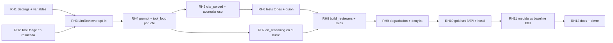

Última modificación: 2026-10-17 | Creado: 2026-10-17

# Plan: Revisor con herramientas de lectura

El *qué y por qué* vive en [`spec.md`](spec.md); las tareas, en [`todo.md`](todo.md).
Este plan fija el orden, las dependencias y lo que puede romperse por el camino.
Aterriza sobre el código de hoy: 008, 012, 016 y 017 ya entregadas; el verificador
de [009](../archivo/009-verificador-adversarial/spec.md) ya consume el mismo bucle.

## Overview

Cuatro piezas, en este orden:

1. **El contrato de salida.** `ReviewerResult` y `ReviewOutcome` exponen el uso del
   bucle (`turns`, `tool_calls`, `bytes_served`, `files_read`) por persona, para que
   [006](../archivo/006-eval-de-la-review/spec.md) mida el coste sin releer el estado.
2. **El `LlmReviewer` con bucle.** Opt-in: con `reader_factory` llama a
   `run_tool_loop` por lote; sin ella, una llamada por lote como en 008. El *prompt*
   gana el protocolo de herramientas; el anclaje al diff y L0 no cambian; las citas
   a ficheros no servidos se quitan de la evidencia (`cite_served`, H7).
3. **El cableado.** `build_reviewers` pasa la fábrica solo a los roles de
   `REVIEW_TOOLS_ROLES` (vacío por defecto → `correctness` es el primero que se
   activa al medir, Q1). Variables nuevas en `Settings`.
4. **La medida.** Casos B, E e I del *gold set* más un fichero hostil; el rol
   activado debe dominar al baseline de 008 según el criterio de 006.

## Decisiones de implementación

Llegan de la spec; aquí se fija **cómo** se hacen al aterrizar sobre el código.

- **No se reimplementa el bucle.** Igual que `LlmVerifier` (009 VF5): el revisor
  aporta *prompt* + objeto final (`findings`) y llama a
  `adapters.tool_loop.run_tool_loop`. Topes, turno final forzado, `served` y
  `cite_served` ya existen (016).
- **Opt-in por instancia, no por ruta especial.** `LlmReviewer` gana
  `reader_factory: ReaderFactory | None` y `tool_limits: ContextLimits | None`.
  `None` → `_call` actual (una `complete` por lote). Con fábrica → `_call` abre el
  lector con `(repo, head_sha, base_sha)` y corre el bucle. El *replay* con
  `REVIEW_TOOLS_ROLES` vacío no regraba.
- **Presupuesto: una sola reserva por turno.** Hoy `_call` reserva antes de
  `complete` y el bucle **también** reserva por turno. Con herramientas, la reserva
  exterior **no** se hace: el presupuesto lo consume el bucle (como `LlmVerifier`).
  El tope blando por persona (`budget_limit`, 017 B10) se consulta **antes** de
  abrir el bucle del lote (estimación conservadora) y `tokens_used` se actualiza con
  `LoopResult.usage`. Doble reserva sería un bug silencioso que vacía el contador.
- **`base_sha` deja de ignorarse.** `review()` hoy hace `del repo, pr_id, head_sha`.
  Con herramientas necesita `repo`, `head_sha` y `base_sha` (H3, `ref="base"`). El
  `base_sha` sale de `ReviewContext.base_sha` (008); si viene vacío, el lector
  degrada en `ref="base"` como ya hace 016 (error al modelo, no excepción).
- **Uso del bucle como un solo valor de dominio.** En lugar de cuatro dicts
  paralelos en `ReviewOutcome`, un `ToolUsage` (`turns`, `tool_calls`,
  `bytes_served`, `files_read`) en `ReviewerResult` y
  `ReviewOutcome.tool_usage: dict[str, ToolUsage]` por persona. Misma información
  que pide el criterio 8; menos superficie que cuatro claves sueltas.
- **Citas no servidas: se quitan, no tumbaron el hallazgo.** Tras el bucle, al
  construir cada `Finding`, toda evidencia `path:line …` cuyo `path` no esté en
  `served` se elimina de la lista (H7). Si tras filtrar no queda evidencia, se
  sintetiza la del anclaje al diff como hoy. Un hallazgo cuya línea no está en el
  diff sigue cayendo en L0 / anclaje —las herramientas no dan permiso para comentar
  fuera del PR.
- **Razonamiento visible (021) también en el bucle.** `run_tool_loop` hoy no
  acepta `on_reasoning`. Sin eso, activar herramientas apagaría el stream del panel
  justo cuando más hace falta diagnosticar turnos. Decisión: extender el bucle con
  `on_reasoning: Callable[[str], None] | None = None` y pasarlo a cada `complete`.
  Cambio mínimo en 016; sin él, 014 regresiona 021 en el rol activado.
- **Un solo rol al medir.** `REVIEW_TOOLS_ROLES` vacío por defecto. La medida y el
  cableado de producción arrancan con `correctness` (Q1). Activar un segundo rol
  exige [017](../archivo/017-presupuesto-por-pr/spec.md) ya entregada **y** comprobar
  que el presupuesto compartido aguanta (Q7); no es tarea de esta iniciativa.
- **L1 sigue precargando** (Q3). El *prompt* de partida es diff numerado + CONTEXT
  de 008; las herramientas amplían, no sustituyen.

### Crítica al diseño (y qué no se hace)

- **No** conviene un `ToolingReviewer`-style wrapper aparte del `LlmReviewer`:
  duplicaría lotes, L0, cobertura y presupuesto. El opt-in por fábrica es el
  patrón correcto (mismo objeto, dos caminos en `_call`).
- **No** conviene activar `security`/`arch` «por si acaso» en el mismo PR de
  medida: triplica coste y ensucia el *gold set*. Primero un rol, una regrabación.
- El *gold set* con fixtures de directorios tocados (Q4) es la pieza más cara y la
  más frágil (R6). Va **al final**, tras el camino guionizado en verde: fallar ahí
  no debe tumbar el cableado.

## Orden y dependencias

## Checkpoints

- **C1 (tras RH1–RH3):** con fábrica `None`, el comportamiento y los tests de
  *replay* existentes no cambian; `ToolUsage` existe pero viaja vacío.
  `make ci` en verde.
- **C2 (tras RH4–RH7):** un `LlmPort` guionizado recorre `grep → read_file →
  findings`; cada tope dispara final forzado; citas no servidas se filtran; el
  stream de razonamiento sigue llegando al sink. `make ci` en verde.
- **C3 (tras RH8–RH9):** `REVIEW_TOOLS_ROLES=correctness` cablea la fábrica;
  vacío = path de 008; runner caído degrada a VCS; ruta vetada no se sirve.
  `make ci` en verde.
- **C4 (tras RH10–RH12):** casos B/E/I y hostil en el *gold set*; el rol activado
  domina al baseline de 008; documentos vivos al día; spec `implementada`;
  `make ci` y `make docs-check` en verde.

## Riesgos

| Riesgo | Mitigación |
|---|---|
| Doble reserva de presupuesto (persona + bucle) | Con fábrica, solo reserva el bucle; tope blando antes del lote (decisión arriba) |
| Activar herramientas rompe el *replay* de 008 | Default vacío + test de identidad sin regrabar (criterio 1); C1 antes de C2 |
| Grabaciones más frágiles (R6) | Solo el rol activado; regrabar es diff revisable (ADR-0017); fixtures por Q4 |
| Inyección que suprime hallazgos (R2) | Delimitación del bucle + caso hostil en el *gold set* (RH10) |
| Más contexto → más FP fuera del PR (R7) | Anclaje + L0 sin cambios; citas no servidas fuera (H7) |
| `on_reasoning` ausente en el bucle apaga el panel | RH7 lo añade antes del cableado en producción |
| El modelo no sigue el protocolo (R3) | Turno correctivo del bucle; modelos candidatos se eligen midiendo (RH11) |

## Dependencias externas

- [016](../archivo/016-lector-de-contexto/spec.md) entregada: puerto, bucle, fábrica,
  workspace. 014 solo consume.
- [017](../archivo/017-presupuesto-por-pr/spec.md) entregada: presupuesto compartido.
  Precondición para un *segundo* rol con herramientas (Q7), no para el primero.
- [006](../archivo/006-eval-de-la-review/spec.md) y [008](../archivo/008-contexto-del-revisor/spec.md):
  el *gold set* del PR #3 aún tiene pendiente la regrabación CX11; RH10/RH11 pueden
  alinearse con esa regrabación para no pagar dos veces.
- [021](../archivo/021-razonamiento-visible/spec.md): el stream debe seguir vivo con
  el bucle (RH7).
