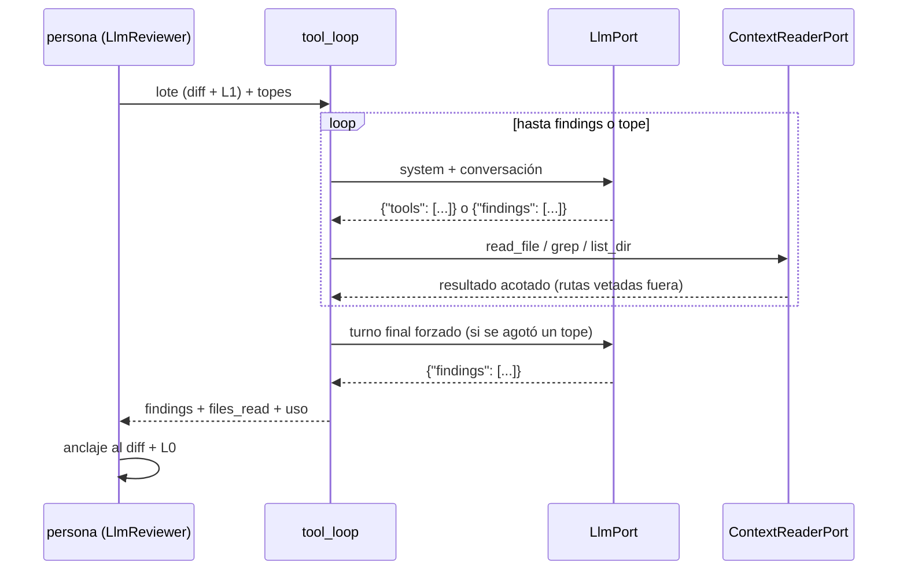

Última modificación: 2026-10-17 | Creado: 2026-10-16

# Revisor con herramientas de lectura

> **Estado:** aprobada
>
> **Entrega objetivo:** una persona LLM con las herramientas activadas revisa cada
> lote en un **bucle acotado de turnos**: puede leer ficheros fuera del diff, hacer
> `grep` sobre el árbol a `head_sha` y comparar con la base antes de proponer
> hallazgos. Usa el puerto, el bucle y el workspace de lectura de
> [016](../archivo/016-lector-de-contexto/spec.md), los mismos que el verificador de
> [009](../archivo/009-verificador-adversarial/spec.md). No ejecuta código y sigue anclando
> cada hallazgo al diff.

---

## 1. Objetivo

Hoy cada persona LLM hace **una llamada** con el diff recortado
([`llm_reviewer.py`](../../../src/agent_review/adapters/llm_reviewer.py)). La
[008](../archivo/008-contexto-del-revisor/spec.md) le añade el fichero completo de cada hunk y
los documentos que declare el perfil, pero el contexto sigue **preparado de
antemano**: el modelo no puede pedir el fichero que de verdad necesita. Cuando la
afirmación depende de código de otro fichero, lo más que puede hacer L1 es marcarla
`context_scope: outside_diff` (008 D6). Eso es honesto, pero deja la hipótesis sin
probar.

Se quiere:

1. Que la persona pueda **pedir contexto** mientras revisa: leer un fichero (o un
   rango), buscar usos con `grep`, listar un directorio y leer un fichero en la base.
2. Que lo leído **sustituya a la suposición**: un hallazgo que depende de otro
   fichero cita ese fichero o no se afirma.
3. Que el coste quede **acotado y medido**: un tope de turnos, de bytes servidos y
   del presupuesto acumulado de [012](../archivo/012-cobertura-de-la-review/spec.md) (C6).
4. Que esto sea **opt-in por rol** y que, desactivado, el comportamiento sea
   exactamente el de 008.

## 2. No-objetivos

- **Ejecutar código (L3).** Escribir un test de reproducción y correrlo en `/verify`
  produciría `verified_executed` ([007](../archivo/007-contrato-de-verificacion/spec.md)),
  pero tarda minutos y compite con los fixes por el runner (concurrencia 1). Es otra
  iniciativa (Q6).
- **Verificar hallazgos.** El revisor sigue emitiendo hipótesis (`unverified`,
  [007 D6](../archivo/007-contrato-de-verificacion/spec.md)); verificar es del nodo `verify`
  de [009](../archivo/009-verificador-adversarial/spec.md).
- ***Function calling* nativo del proveedor.** Se mantiene el bucle *ReAct* en JSON
  sobre `LlmPort` ([009 §3.3](../archivo/009-verificador-adversarial/spec.md)).
- **Un *prompt* propio por rol.** Hoy `correctness`, `security` y `arch` comparten el
  mismo *system prompt* (deuda D20 de [`arquitectura.md`](../../arquitectura.md) §7).
  Este trabajo añade el protocolo de herramientas a ese *prompt*, no lo especializa.
- **El presupuesto global por PR (D17).** Es [017](../archivo/017-presupuesto-por-pr/spec.md).
  Mientras no esté, se consume el presupuesto acumulado entre
  lotes de 012; la acumulación entre personas y fixer sigue fuera.
- **Sustituir a L1.** El fichero completo y los `context_docs:` de 008 siguen siendo
  el contexto de partida (Q3).

## 3. Contexto y evidencia

### 3.1 Lo que L1 no alcanza

En la auditoría del PR #3 ([006 §3.1](../archivo/006-eval-de-la-review/spec.md)), varios
falsos positivos nacen de código que no está en ninguno de los ficheros del diff:

| # | Hallazgo | Dónde estaba lo que faltaba | Con L1 (008) | Con herramientas |
|---|---|---|---|---|
| B | `_requeue_or_drop` reverifica | Un fichero **fuera del diff** | `outside_diff`, sin probar | `grep` + `read_file` y se afirma o se descarta |
| E | Tope del grafo ≠ tope del worker | Dos settings parecidos en `settings.py` | Depende de si `settings.py` está en el lote | `grep` del nombre y lectura de ambos |
| I | `_touch_heartbeat` y el `restart:` de compose | `docker-compose.yml`, fuera del diff | `outside_diff`, sin probar | `read_file` del compose |

En la otra dirección, un cambio de firma o de semántica puede romper a los
**llamadores**, que casi nunca están en el diff. Sin `grep` el revisor no los ve.
Esta tabla es la hipótesis que se mide; no es un resultado.

### 3.2 Lo que ya existe o está especificado

- El bucle de herramientas, el `ContextReaderPort` (con `ref="base"`, rangos y
  `list_dir`), la comprobación de «cita servida» y el **workspace de lectura** del
  `sandbox-runner` están en [016](../archivo/016-lector-de-contexto/spec.md) *(enmienda
  2026-10-16: antes estaban en 009 §5.4)*.
- Los **lotes** de ficheros enteros y el presupuesto acumulado entre lotes son de
  [012](../archivo/012-cobertura-de-la-review/spec.md) (C2, C6).
- `ReviewContext`, la regla de humildad y L0 son de
  [008](../archivo/008-contexto-del-revisor/spec.md).

Esta iniciativa no inventa piezas nuevas: **conecta** las de 016 al `LlmReviewer`.

## 4. Decisiones

| # | Decisión | Motivo |
|---|---|---|
| H1 | El bucle de herramientas es el **módulo compartido** de [016](../archivo/016-lector-de-contexto/spec.md) (`adapters/tool_loop.py`, W2); 014 aporta su *prompt* y su objeto final (`findings`) | Un solo protocolo, una sola comprobación de citas y un solo juego de topes |
| H2 | Herramientas de **solo lectura**: `read_file(path, ref, start, end)`, `grep(pattern, glob)` y `list_dir(path)`. Nada que escriba, ejecute o abra red | El valor está en leer; ejecutar es L3 y tiene otro modelo de coste y de riesgo |
| H3 | Las herramientas se sirven por `ContextReaderPort`: `WorkspaceContextReader` si el runner está disponible y `VcsContextReader` si no ([016](../archivo/016-lector-de-contexto/spec.md) W1, W8) | Sin runner, el revisor sigue funcionando con menos alcance (`grep` solo sobre lo servido) |
| H4 | **Opt-in por rol** con `REVIEW_TOOLS_ROLES` (vacío por defecto). Un rol fuera de la lista hace una llamada por lote, como en 008. El primero es `correctness` (Q1); un segundo rol exige resolver antes D17 (Q7) | Se activa un rol, se mide con 006 y se amplía; sin activar, cero cambios en coste y en grabaciones |
| H5 | Topes **por lote**: `REVIEW_TOOLS_MAX_TURNS`, `REVIEW_TOOLS_MAX_CALLS` y `REVIEW_TOOLS_MAX_BYTES`. Antes de cada turno se estima el coste contra el presupuesto acumulado de 012 (C6) | Cada turno reenvía toda la conversación: el coste crece más rápido que el número de turnos |
| H6 | Agotado un tope, el siguiente turno es **final forzado**: se pide `findings` sin herramientas. Lo ya razonado no se pierde | Cortar sin turno final tira el trabajo de los turnos anteriores |
| H7 | El hallazgo **se sigue anclando al diff** y pasa por L0. Lo leído fuera del diff solo sirve como evidencia: una cita a un fichero **no servido** se quita de la evidencia, con `cite_served` de [016](../archivo/016-lector-de-contexto/spec.md) (W3) | Leer más no da permiso para comentar fuera del PR ni para inventar citas |
| H8 | El revisor sigue emitiendo `unverified` y añade `files_read` al resultado; el nodo `verify` lo reutiliza | La verificación tiene otro modelo y otro *prompt* (009 V2, V3); lo leído no se paga dos veces |
| H9 | El contenido servido es **dato, no instrucción**: va delimitado (`<tool_result>`), el *system prompt* lo dice explícitamente y el veto de rutas lo aplica el runner | Un fichero del PR puede intentar dirigir al modelo |
| H10 | En el *replay* de [ADR-0017](../../adr/0017-replay-determinista-con-fingerprint.md) cada turno es una llamada grabada con su fingerprint, y las herramientas se sirven desde un `FixtureContextReader` con los ficheros del caso | El resultado de cada herramienta entra en el *prompt* del siguiente turno: el fingerprint ya lo cubre, siempre que el lector sea determinista |

## 5. Diseño o contrato

### 5.1 Un lote con herramientas



### 5.2 Protocolo de turno

Cada respuesta del modelo es **uno** de estos dos objetos JSON:

```json
{"tools": [
  {"tool": "grep", "pattern": "_requeue_or_drop", "glob": "src/**/*.py"},
  {"tool": "read_file", "path": "src/agent_review/fixworker/main.py", "ref": "head", "start": 120, "end": 180},
  {"tool": "list_dir", "path": "src/agent_review/fix"}
]}
```

```json
{"findings": [ ... ]}
```

`findings` tiene el formato actual (`_SCHEMA_HINT`) y la evidencia puede citar
`path:line` de cualquier fichero servido. Una respuesta que no es ninguno de los dos
objetos recibe **un** turno correctivo; si se repite, se trata como final sin
hallazgos, igual que hoy la salida no parseable. Un turno lleva como máximo **3**
peticiones (Q2); las que sobran se descartan y se le avisa al modelo en el resultado.

### 5.3 Cableado

- `LlmReviewer` gana `reader_factory: Callable[[str, str, str], ContextReaderPort] | None`
  (`repo`, `head_sha`, `base_sha`) y `tool_limits`. Con `reader_factory=None` hace una
  llamada por lote, como en 008.
- `build_reviewers` ([`worker/main.py`](../../../src/agent_review/worker/main.py))
  pasa la fábrica solo a los roles de `REVIEW_TOOLS_ROLES`. La fábrica elige el
  adaptador (H3); el workspace se abre de forma idempotente por `(repo, head_sha)`
  ([016](../archivo/016-lector-de-contexto/spec.md) W6) y no viaja en el estado.
- `ReviewerResult` gana `files_read` y el uso del bucle (`turns`, `tool_calls`,
  `bytes_served`), que `ReviewOutcome` expone para que
  [006](../archivo/006-eval-de-la-review/spec.md) mida el coste.
- El `base_sha` es el mismo que necesita L0 de 008 ([008 Q1](../archivo/008-contexto-del-revisor/spec.md)).

### 5.4 Variables nuevas

| Variable | Default propuesto | Qué acota |
|---|---|---|
| `REVIEW_TOOLS_ROLES` | vacío | Roles con herramientas |
| `REVIEW_TOOLS_MAX_TURNS` | 4 | Turnos por lote, sin contar el final forzado |
| `REVIEW_TOOLS_MAX_CALLS` | 8 | Peticiones de herramienta por lote |
| `REVIEW_TOOLS_MAX_BYTES` | 60 000 | Bytes servidos por lote |

## 6. Riesgos

| # | Riesgo | Mitigación |
|---|---|---|
| R1 | **Coste y latencia**: hasta 3 personas × lotes × turnos | Opt-in por rol (H4); topes por lote (H5); presupuesto acumulado de 012; coste visible en `ReviewOutcome` y medido con 006 |
| R2 | **Inyección de *prompt*** que **suprime** hallazgos («no hay nada que revisar») | Delimitación y regla en el *system prompt* (H9). La mitigación es parcial: la persona estática y las de [010](../010-personas-de-wiring/spec.md) no leen ese contenido, y el *gold set* debe incluir un caso con un fichero hostil |
| R3 | **El modelo no sigue el protocolo** y gasta turnos | Un turno correctivo y después final (§5.2); los modelos candidatos se eligen midiendo |
| R4 | **Dependencia del runner** para el `grep` completo | Degradar a `VcsContextReader` (H3); el runner caído nunca tumba la review |
| R5 | **Un reintento repite el bucle entero** y paga los turnos otra vez | Las lecturas son baratas (clon *bare*); el coste de los turnos repetidos se mide y, si pesa, se resuelve con Q5 |
| R6 | **Grabaciones más frágiles**: más llamadas por caso y más fingerprints que pueden dejar de casar | Es el comportamiento buscado por [ADR-0017](../../adr/0017-replay-determinista-con-fingerprint.md) (regrabar es un diff revisable); con H4 solo afecta a los roles activados |
| R7 | **Más contexto, más falsos positivos** sobre código viejo fuera del PR | El anclaje al diff (H7) y el `pre_existing` calculado de L0 siguen mandando |

## 7. Criterios de hecho

1. Con `REVIEW_TOOLS_ROLES` vacío, el comportamiento y `recorded.json` son idénticos
   a 008 (test de *replay* sin regrabar).
2. Con un rol activado, un test con un `LlmPort` guionizado recorre
   `grep → read_file → findings`, y el nodo sirve y cuenta cada petición.
3. Cada tope (turnos, peticiones, bytes y presupuesto) dispara el turno final
   forzado y los hallazgos de ese turno se publican (un test por tope).
4. Una cita a un fichero no servido se quita de la evidencia; un hallazgo cuya línea
   no está en el diff no se ancla (test).
5. Una ruta vetada no se sirve ni aparece en el `grep` (test contra el runner o su
   doble).
6. Con el runner caído, el rol activado usa `VcsContextReader` y la review termina
   (test).
7. El *gold set* de 006 incluye los casos B, E e I con sus ficheros de fixture
   (directorios tocados más los leídos, a `head_sha` y `base_sha`, Q4) y un
   caso con un fichero hostil (R2). El rol activado **domina** al baseline de 008
   según el criterio de 006.
8. `ReviewOutcome` expone `turns`, `tool_calls`, `bytes_served` y `files_read` por
   persona.
9. `make ci` en verde, con `make docs-check`; documentos vivos al día:
   [`arquitectura.md`](../../arquitectura.md) §3–4 (persona con bucle),
   [`operacion.md`](../../operacion.md) §2 (variables de §5.4),
   [`desarrollo.md`](../../desarrollo.md) §3 (fábrica de lectores y
   `FixtureContextReader`) y [`CONTEXT.md`](../../../CONTEXT.md) («bucle de
   herramientas», «workspace de lectura»).

## 8. Preguntas abiertas

- **Q1 — ¿Qué rol se activa primero?** *Resuelta (2026-10-16):* `correctness`, que
  es el que más afirma sobre semántica fuera del diff. Se mide con 006 antes de
  activar otro.
- **Q2 — ¿Cuántas peticiones por turno?** *Resuelta (2026-10-16):* hasta **3**.
  Ahorra turnos (cada turno reenvía la conversación) sin dejar que un solo turno
  agote `REVIEW_TOOLS_MAX_CALLS`.
- **Q3 — ¿L1 sigue precargando el fichero completo si hay herramientas?**
  *Resuelta (2026-10-16):* sí, como punto de partida. Antes de cambiarlo se compara
  con 006 contra la variante sin precarga.
- **Q4 — ¿Qué ficheros lleva un caso del *gold set*?** *Resuelta (2026-10-16):* los
  de los **directorios tocados por el diff** más los que lea la grabación, a
  `head_sha` y a `base_sha`. Un cambio de *prompt* que lee un fichero cercano no
  rompe el caso, y no se versiona el repo entero.
- **Q5 — ¿Reintento por turno dentro del bucle?** *Resuelta (2026-10-16):* no. Un
  fallo transitorio sube y la `RetryPolicy` repite la persona entera, como manda
  [ADR-0007](../../adr/0007-reintento-en-dos-capas.md). Si el coste de los turnos
  repetidos pesa en la medida de 006, se reabre (R5).
- **Q6 — ¿Iniciativa para L3?** *Resuelta (2026-10-16):* sí, **aparte y después**:
  se abre cuando 009 y 014 estén medidas, solo para `P0`/`P1` sin verificar. Hoy
  competiría con los fixes por el runner y depende de P6.
- **Q7 — ¿Cuándo entra D17?** *Resuelta (2026-10-16):* con un solo rol activado basta
  el presupuesto acumulado entre lotes de 012. Resolver D17
  ([017](../archivo/017-presupuesto-por-pr/spec.md)) es **precondición para
  activar un segundo rol** en `REVIEW_TOOLS_ROLES` (H4).
