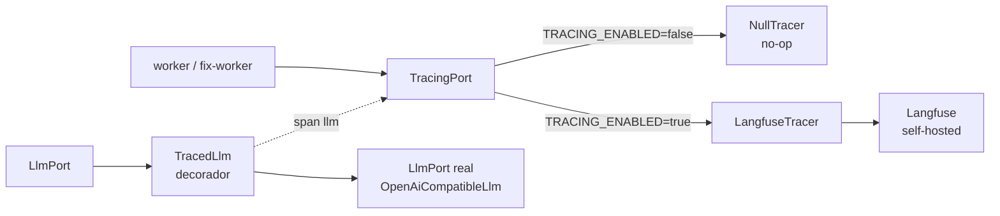
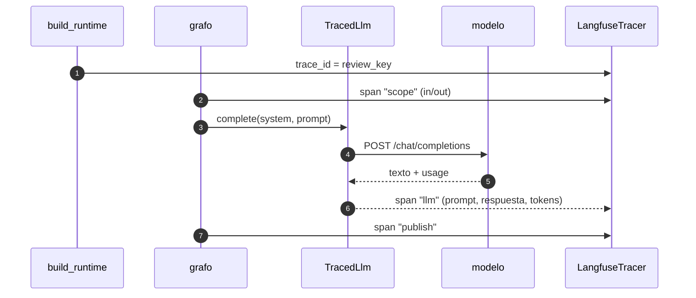

Última modificación: 2026-10-16 | Creado: 2026-10-16

# Trazas de la review: el recorrido de una petición, visible

> **Estado:** borrador
>
> **Entrega objetivo:** poder abrir una review concreta y ver su **recorrido
> completo** —qué nodo corrió, en qué orden, con qué entrada y salida, cuánto tardó
> y cuánto gastó—, incluido el interior de cada llamada al LLM (prompt, respuesta,
> tokens). Self-hosted y sin depender de un SaaS.

---

## 1. Objetivo

Hoy la observabilidad son **logs de texto** (`logging.basicConfig` + `logger.info`
por nodo). Es deuda reconocida ([`arquitectura.md`](../../arquitectura.md) §7, D14:
«No hay trazas ni métricas sobre tráfico real; solo logs»). Con logs se puede
reconstruir a mano qué pasó, pero no se puede **ver**:

- el **árbol de spans** de una review (`scope → persona → merge → policy → hitl →
  fix_dispatch → publish → fix_wait → notify`), con el orden real y la duración de
  cada tramo;
- qué **prompt** exacto se envió a la persona y qué **respuesta** devolvió el modelo
  —donde nacen los falsos positivos de la auditoría del PR #3
  ([006](../archivo/006-eval-de-la-review/spec.md))—;
- el **gasto real** de tokens por review, hoy fragmentado y medido por llamada
  (D17, lo cierra [017](../017-presupuesto-por-pr/spec.md)).

Se quiere:

1. **Una traza por review**, correlacionada por su `review_key` (`thread_id`,
   [ADR-0005](../../adr/0005-identidad-de-la-ejecucion.md)), que una en un mismo
   árbol el grafo, los nodos y las llamadas al modelo.
2. Que la traza incluya las **fronteras que hoy son cajas negras**: la llamada al
   LLM (entrada, salida, `usage`) y las llamadas al VCS/sandbox que dominan la
   latencia.
3. Que sea **self-hosted**: el diff y los prompts son de PRs de terceros y no salen
   de la infraestructura del despliegue.
4. Que **degradar no rompa nada**: sin trazas configuradas el sistema funciona igual
   (patrón *null object*), como ya ocurre con el sandbox o el canal de Teams.

## 2. No-objetivos

- **Métricas agregadas de negocio** (precisión, recall, tasa de aceptación). Eso es
  [006](../archivo/006-eval-de-la-review/spec.md); aquí solo se instrumenta la traza
  por review, de la que aquellas se podrán alimentar más adelante.
- **Alertas y dashboards de SLO.** Fuera: esto es la traza, no el sistema de guardia.
- **Sustituir el logging.** Los logs estructurados siguen siendo la traza barata de
  producción; las trazas son la capa de análisis.
- **Cambiar el puerto `LlmPort` ni el grafo.** La instrumentación se **envuelve** por
  fuera (§4, T2/T3); ni `build.py` ni los adaptadores existentes cambian de contrato.
- **Enviar prompts a un SaaS.** Langfuse Cloud queda descartado de raíz por el
  tratamiento de código de terceros (ver R3).

## 3. Contexto y evidencia

### 3.1 El checkpointer ya es media traza (y no se aprovecha)

El checkpointer de Postgres guarda el estado durable del hilo. `graph.get_state_history`
devuelve, por cada `step`, los `writes` (qué escribió cada nodo) y el `next`. Es
traza **de estado**, no de tiempo ni de LLM: no dice cuánto duró un nodo ni qué
prompt se envió. Pero confirma que el correlador (`thread_id` = `review_key`) ya
existe y es estable.

### 3.2 El cuello de botella es invisible justo donde importa

`adapters/openai_llm.py` habla HTTP directo (`httpx`) contra un endpoint
`/chat/completions` compatible (`nan.builders`, según `config/models.yaml`). **No usa
`ChatOpenAI` ni ningún SDK de LangChain**, así que la auto-instrumentación de Langfuse
para LangChain **no captura estas llamadas**: son `httpx.post`, no callbacks de
LangChain. Es el punto crítico del alcance (Q2).

### 3.3 La correlación cruza procesos

El `fix-worker` corre en otro proceso y otro contenedor
([004](../archivo/004-fase3-e7-desacople/spec.md)) y solo comparte Redis. La traza de
una review que pasa por fix tiene que **enlazar** los dos procesos bajo el mismo
`review_key`, como ya hace el handoff por Redis.

### 3.4 El coste de infraestructura no es trivial (esto es lo que hay que mirar)

Langfuse v3 self-hosted **no es un contenedor**: exige Postgres + ClickHouse + Redis
+ almacenamiento de objetos compatible con S3 (MinIO). Es decir, hasta **cuatro
servicios nuevos** junto a los seis que ya tiene el `docker-compose.yml`. La
alternativa de una versión 2.x (solo Postgres) sacrifica la UI y el modelo de datos
actuales. Es el principal motivo para dudar antes de aprobar esta spec (R1, Q1).

### 3.5 Los datos que viajan son sensibles

La traza lleva el **diff de PRs de terceros** y, si se instrumenta el LLM, los
prompts y respuestas completos. Un diff puede contener credenciales o datos de
clientes (`emotivoo-v2`). Self-hosted resuelve la **exfiltración**, no la
**redacción**: los secretos que aparezcan en un diff se guardarán en la traza igual
(R4).

## 4. Decisiones

| # | Decisión | Motivo |
|---|---|---|
| T1 | **Puerto `TracingPort`** con dos adaptadores: `LangfuseTracer` y `NullTracer` (no-op) | Coherente con los puertos del repo (`LlmPort`, `VcsPort`, `ChatPort`); sin trazas configuradas, el sistema no cambia de comportamiento |
| T2 | **La llamada al LLM se instrumenta con un decorador sobre el puerto** (`TracedLlm(LlmPort)`), no dentro de `OpenAiCompatibleLlm` | El adaptador HTTP sigue sin conocer Langfuse; el decorador envuelve cualquier `LlmPort` (el real, un fake, el del verificador futuro) y captura `LlmReply.usage` sin tocar el proveedor |
| T3 | **Los nodos se instrumentan por envoltura** (decorador/handler al registrar el nodo), no editando cada función | Siete nodos instrumentados a mano serían siete sitios donde olvidarlo; la envoltura se aplica en `build_graph` y es uniforme |
| T4 | **`trace_id` determinista a partir de `review_key`** | La traza se encuentra sin buscar por metadatos y los dos procesos (`worker`, `fix-worker`) escriben en **el mismo** árbol, como el `fingerprint` de [ADR-0017](../../adr/0017-replay-determinista-con-fingerprint.md) |
| T5 | La instrumentación es **opt-in por configuración** (`TRACING_ENABLED` + credenciales) | Igual que `SANDBOX_ENABLED`/`TEAMS_ENABLED`: un despliegue sin Langfuse no arranca nada extra ni gasta recursos |
| T6 | La traza es **best-effort**: un fallo al emitir nunca tumba una review | La observabilidad no puede convertirse en una nueva causa de *fallo* del sistema que observa; el error se registra y se sigue |
| T7 | El **prompt y la respuesta del LLM se trazan** (Q3), con **redacción de patrones sensibles activada por defecto** | Sin el contenido, la traza no explica los falsos positivos; con redacción, se mitiga el secreto en el diff (R4) |
| T8 | Los secretos de Langfuse entran en el **contrato *fail-closed*** ([ADR-0013](../../adr/0013-secretos-por-entorno-fail-closed.md)) **solo si** `TRACING_ENABLED` | Un despliegue en `production` con trazas activas y sin clave debe fallar al arrancar, como el resto |
| T9 | El adaptador vive como **servicio de compose con perfil** (`profiles: ["tracing"]`) | Quien no quiera los cuatro servicios de Langfuse no los levanta; `docker compose up` sigue arrancando lo de siempre |

## 5. Diseño o contrato

### 5.1 Puerto y adaptadores (ports & adapters)



El decorador envuelve **sin cambiar el puerto**: `TracedLlm` recibe un `LlmPort` y
devuelve un `LlmPort`. Abre un span con `system`/`prompt` de entrada, cierra con
`text` y el `usage` real (`prompt_tokens`, `completion_tokens`, `reasoning_tokens`
ya existen en `LlmReply`).



### 5.2 Qué se instrumenta (y qué no, por coste)

| Superficie | ¿Span? | Por qué |
|---|---|---|
| Nodos del grafo (`scope`…`notify`) | Sí | Es el «recorrido» que se pide |
| `LlmPort.complete` | Sí | El gasto y los falsos positivos viven aquí |
| VCS (leer diff, publicar) | Sí | Domina la latencia fuera del LLM |
| Sandbox / fix (HTTP al runner) | Sí, solo la llamada | Es larga (hasta 20 min) y opaca |
| Redis / Postgres | No | Ruido; el checkpointer ya guarda el estado |
| `merge`, `policy` | Sí, triviales | Baratos y explican la decisión |

### 5.3 Configuración propuesta

```bash
# Trazas (iniciativa 018). Opt-in: sin TRACING_ENABLED=true no se emite nada.
TRACING_ENABLED=false
# Endpoint self-hosted de Langfuse y sus claves (proyecto del despliegue).
LANGFUSE_HOST=http://langfuse:3000
LANGFUSE_PUBLIC_KEY=
LANGFUSE_SECRET_KEY=
# Patrones (regex) cuyo contenido se redacta antes de enviar el span.
TRACING_REDACT_PATTERNS=
```

Las claves se resuelven como el resto de secretos: `${VAR}` contra `Settings`, y
`unresolved_secrets` falla el arranque en `production` si faltan y las trazas están
activas.

### 5.4 Correlación entre procesos

`review_key` → `trace_id` por función determinista (hash estable). `worker` y
`fix-worker` calculan el mismo id y escriben en el mismo árbol sin hablarse, igual
que hoy comparten el hilo por `Redis` y el estado por el checkpointer. El `pr_id` y
el `sha` van como metadatos para poder filtrar por PR.

## 6. Riesgos

| Riesgo | Mitigación |
|---|---|
| R1 | **Peso de infraestructura.** Langfuse v3 añade hasta 4 servicios (Postgres, ClickHouse, Redis, MinIO) a un compose que ya tiene 6 | **Aceptado** con el perfil `tracing` (T9): se levantan solo cuando se quieren; Q1 resuelta a favor de Langfuse completo para tener la UI orientada a LLM |
| **R2 — La auto-instrumentación de LangChain no captura este LLM** (§3.2) | El decorador sobre `LlmPort` (T2) es **obligatorio**, no opcional: sin él, la traza tendría el hueco justo donde está el gasto |
| **R3 — Código de terceros fuera de la infraestructura** | Self-hosted (T5) y Langfuse Cloud descartada; el `LANGFUSE_HOST` apunta a la red interna de compose |
| **R4 — Secretos en el diff entran en la traza** | Redacción de patrones (T7); aun así, la traza es un almacén que hay que tratar con la sensibilidad del repo revisado |
| **R5 — Acoplamiento al proveedor de observabilidad** | Todo pasa por `TracingPort`; cambiar Langfuse por OTel/Jaeger es otro adaptador, sin tocar los nodos |
| **R6 — La emisión añade latencia** | El transporte de Langfuse es asíncrono (*batching*); el decorador no bloquea la review |
| **R7 — Retención y disco** | El checkpointer ya se poda por retención; Langfuse necesita su propia política de limpieza (tarea aparte) |
| **R8 — Una traza incompleta miente** | Se instrumenta el grafo **entero** (T3) para que el árbol no parezca una review corta cuando en realidad faltó un span |

## 7. Criterios de hecho

1. Con `TRACING_ENABLED=true`, una review real produce **un** árbol en Langfuse con
   sus nodos, su llamada al LLM (prompt, respuesta, `usage`) y la latencia por span.
2. El `trace_id` es determinista desde `review_key`: re-ejecutar la misma review
   escribe en la misma traza, no en una nueva.
3. Una review que pasa por el `fix-worker` aparece en **un solo** árbol (correlación
   entre procesos).
4. Con `TRACING_ENABLED=false` (o sin claves) nada se emite y **ninguna** review
   cambia de comportamiento; `make ci` en verde sin Langfuse levantado.
5. Un fallo de Langfuse (caído, timeout) **no** falla la review: se registra y se
   sigue (test que lo prueba).
6. En `production` con `TRACING_ENABLED=true` y claves sin resolver, el arranque
   **falla** nombrando la variable.
7. `docker compose up` sin el perfil `tracing` no levanta ningún servicio de Langfuse.
8. Documentos vivos al día: [`operacion.md`](../../operacion.md) §1–2 (servicio,
   variables), [`arquitectura.md`](../../arquitectura.md) §7 (D14 pasa a resuelta o se
   acota) y `CONTEXT.md` si nace un término («traza», «span»); un **ADR nuevo** para
   el diseño por puerto del trazado (Q5).
9. `make docs-check` en verde.

## 8. Preguntas abiertas

- **Q1 —** *Resuelta (2026-10-16):* **Langfuse v3 self-hosted completo** (Postgres,
  ClickHouse, Redis y MinIO), como servicio de compose con perfil `tracing` (T9). El
  peso de infraestructura (§3.4) se asume a cambio de la UI orientada a LLM y del
  modelo de datos actual. Alternativa descartada: OTel puro (menos peso, UI menos
  orientada a LLM) y Langfuse en un host aparte (más aislamiento, otro despliegue).
- **Q2 — ¿Cómo se instrumenta el LLM?** Se propone el decorador `TracedLlm` sobre el
  puerto (T2). Alternativa: meter el span dentro de `OpenAiCompatibleLlm`. La primera
  mantiene el adaptador puro y cubre futuros `LlmPort` (verificador, fixer); la
  segunda acopla el proveedor HTTP a Langfuse. ¿Se confirma el decorador?
- **Q3 —** *Resuelta (2026-10-16):* se traza el **prompt y la respuesta completos**,
  con **redacción de patrones de secretos activada por defecto** (T7). Es lo que hace
  útil la herramienta (explica los falsos positivos) y la redacción mitiga R4.
- **Q4 — ¿Nodos por decorador o por *callback* de LangGraph?** El decorador (T3) es
  explícito y no depende de la API interna de callbacks; el *callback* captura todo
  automáticamente, incluidos pasos futuros. ¿Compensa la dependencia a cambio de
  cobertura automática?
- **Q5 — ¿ADR propio o basta la spec?** El patrón «trazado tras un puerto, opt-in,
  *best-effort*» es una decisión de arquitectura con alternativas descartadas
  (SaaS, acoplamiento directo): se propone ADR.
- **Q6 — ¿Esto entra antes o después que [017](../017-presupuesto-por-pr/spec.md)?**
  Ambas comparten la lectura del `usage` real; 017 lo usa para decidir y 018 para
  observarlo. Si 018 va primero, la traza mide el gasto que 017 luego acotará.
- **Q7 — ¿Se añade un endpoint de traza desde el checkpointer** (sin Langfuse) como
  entrega intermedia? Daría el recorrido de nodos hoy mismo, sin infraestructura,
  pero sin LLM ni duraciones. ¿Es un peldaño útil o trabajo duplicado?
