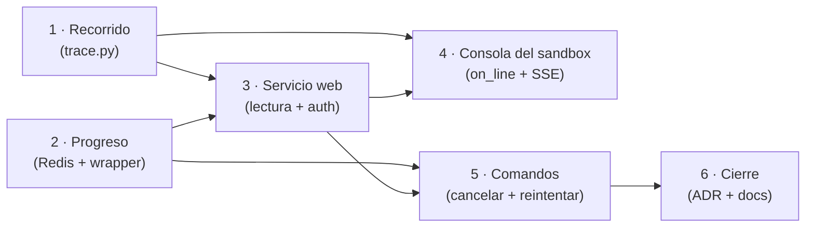

Última modificación: 2026-10-16 | Creado: 2026-10-16

# Plan: Panel de operación

Cómo se construye la [spec](spec.md) de la 019: en qué orden, con qué coste y con
qué checkpoints. El porqué de cada opción está en la spec; aquí está el cómo.

---

    10|## 1. Overview

El principio que ordena todo el plan: **primero leer, después escribir.** El grueso
del valor (ver qué corre, qué espera, qué gastó y por dónde va) se apoya en estado
que **ya existe** en Redis y Postgres. La única pieza que hay que **inventar** es
cancelar, y por eso va casi al final.

Cinco frentes, en este orden:

1. **El recorrido** (spec §5.2): leer el checkpointer y reconstruir los nodos de una
   review. Es el peldaño que la [018](../018-trazas-de-la-review/spec.md) planteó
   como Q7; se implementa **una vez** aquí y lo consume también la 018.
2. **El progreso del worker** (spec §5.3): una marca en Redis con el nodo en curso.
   Cierra D16 («el latido mide vida, no avance») sin tocar el latido de compose.
3. **El servicio `web`** (spec §5.1): un proceso aparte, de solo lectura, con
   autenticación de sesión.
4. **La consola del sandbox** (spec §5.6): `on_line` en el runtime, un buffer efímero
   en el runner y SSE.
5. **Los comandos** (spec §5.4–5.5): cancelar y reintentar, como jobs encolados.

Nada de esto entra en el camino crítico del webhook del CI ni dentro del bucle del
worker: son dos consumidores de estado más (el `web` y su navegador) y una marca que
el worker escribe de pasada.

---

## 2. Decisiones de implementación

Resuelven las preguntas abiertas de la spec que bloquean el arranque. Las que
necesitan una persona se marcan como tal.

| # | Decisión | Motivo |
|---|---|---|
| D1 | **El recorrido vive en un módulo nuevo (`trace.py`), no en la API.** Se expone desde el `web` | La API declara que **no** habla con el checkpointer (spec §4.9 de 002, [`api/main.py`](../../../src/agent_review/api/main.py)); meterle Postgres rompería esa separación. El `web` sí construye un checkpointer de lectura |
| D2 | **Un solo *seam* de envoltura de nodo**, compartido con [018](../018-trazas-de-la-review/spec.md) | La 018 envuelve los nodos para trazar (T3) y la 019 para el progreso (W4/O5). Dos envolturas distintas sobre el mismo grafo es deuda garantizada: se diseña una y las dos la usan |
| D3 | **El progreso vive en Redis, no en el latido** (`HEARTBEAT_PATH`) | El latido es el healthcheck de compose y no puede depender de Redis; el progreso sí lo necesita para verse desde fuera del worker (spec Q5) |
| D4 | **SSE leyendo un buffer, sin pub/sub asíncrono** | El runner verifica en un hilo bloqueante; un `asyncio.Queue` por suscriptor exige primitivas entre hilos. Leer el buffer con un `sleep` corto es robusto y suficiente para una consola (spec Q6) |
| D5 | **Cancelar = marca para lo que corre + job para lo pausado**, y el hilo se **borra** al abortar | Con el worker bloqueado en `graph.invoke` no puede procesar un job de cancelación; la marca la lee el wrapper en la frontera de nodo. Un hilo abortado con `next` no vacío se reanudaría en una reentrega: borrarlo es la única guarda durable |
| D6 | **`Cancelled` hereda de `PermanentError`**, nunca de `TransientError` | La `RetryPolicy` de los nodos reintenta con `retry_on=is_transient`: una cancelación **no** puede reintentarse |
| D7 | El `web` es **de solo lectura + comandos**; nunca muta estado del grafo | Un solo escritor (el worker), como hoy (spec W3). Coherente con que la decisión humana también se encola |
| D8 | **Dos entregas, no una**: lectura (bloques 1–4) y comandos (bloque 5) | La lectura es barata y ya útil; los comandos son la única parte con decisiones de diseño reales (spec Q3) |
| D9 | **ADR nuevo** (spec Q7) al cerrar, no al empezar | El patrón («panel aparte, read model + comandos, progreso por marca») se documenta cuando está probado; el número libre es **ADR-0020** |

**Necesita una persona (spec Q4):** quién puede cancelar. El plan implementa un rol
`operador` y deja la asignación de personas fuera del código; sin confirmar, el
bloque 5 no se cierra.

---

## 3. Orden y dependencias

- El **bloque 1** no depende de nada: se puede empezar hoy y [018](../018-trazas-de-la-review/spec.md)
  lo reutiliza en cuanto exista.
- El **bloque 2** tampoco: es una marca nueva, sin tocar el resto del worker.
- El **bloque 3** es el primero que levanta algo (el servicio `web`) y depende de 1 y 2
  para tener qué mostrar.
- El **bloque 4** cuelga del `web` (proxy) y del runner (`on_line`). Es independiente
  del progreso del worker, aunque comparta el transporte SSE.
- El **bloque 5** va el último: necesita el `web` para el botón y el *wrapper* (de 2)
  para abortar entre nodos.

**Coordinación con 018 (D2):** si la 018 entra antes, su envoltura de nodos y la de
aquí (O5) se fusionan en una sola. Si entran a la vez, el *seam* se define una vez y
cada una añade su comportamiento (traza, progreso) al mismo punto.

---

## 4. Checkpoints

Cada checkpoint es un estado **usable y probado**; no se pasa al siguiente sin él.

| Checkpoint | Al terminarlo |
|---|---|
| **C1 — Recorrido** | `read_trace` reconstruye los nodos de un hilo completado y de uno pausado, con test; sin servicio ni HTTP. Se puede usar ya desde un test o el harness de eval |
| **C2 — Progreso** | Con el worker en marcha, `reviews:active:<key>` refleja el nodo en curso y su `started_at`; sin `ProgressPort`, el worker se comporta igual (test) |
| **C3 — Panel de lectura** | Levantando el perfil `panel`, una persona autenticada ve cola, en vuelo, pausas, descartes, presupuesto y el recorrido de una review; sin el perfil, nada cambia en el sistema |
| **C4 — Consola del sandbox** | Una verificación en curso emite su consola por SSE; el buffer es efímero y un reinicio da `404`; el `VerifyReport` no cambia (test) |
| **C5 — Comandos** | Cancelar antes de publicar no deja comentarios y limpia el inbox; cancelar tras publicar se ofrece solo como «cancelar lo pendiente»; reintentar un descarte funciona; `Cancelled` no se reintenta (tests por estado) |
| **C6 — Cierre** | ADR-0020 escrito; `operacion.md`, `arquitectura.md` (§7) y `CONTEXT.md` al día; `make ci` y `make docs-check` en verde |

---

## 5. Riesgos

Además de los de la [spec](spec.md) §6, los riesgos **de ejecución** de este plan:

| # | Riesgo | Mitigación |
|---|---|---|
| R1 | **El *wrapper* de nodo rompe el fan-out o la `RetryPolicy`** | `persona` recibe `Runtime` y otras llevan `RetryPolicy`: la envoltura debe **preservar la firma y los parámetros** del nodo. Es el punto más delicado del bloque 2; test dedicado que compara el grafo con y sin envoltura |
| R2 | **La marca de progreso caduca dentro de un nodo largo** | TTL holgado (por encima del peor caso de un nodo con reintentos) y refresco por nodo; el LLM medido hoy es ~15 s, el margen es amplio |
| R3 | **Cancelar deja un hilo reanudable** (D5) | Borrar el hilo del checkpointer (como hace `reconcile_paused` con los `:partial` superados) y limpiar el inbox; el test lo prueba con una reentrega posterior |
| R4 | **La consola del sandbox se cruza entre verificaciones** | El buffer está indexado por `run_key` y el runner es concurrencia 1; el SSE se cierra al terminar el comando y devuelve `404` si el `run_key` no está |
| R5 | **Leer `stdout` y `stderr` con `Popen` bloquea por un *pipe* lleno** | Un hilo lector por flujo (el `VerifyReport` los mantiene separados); no se usa `stderr=STDOUT` para no perder esa distinción |
| R6 | **El `web` abre un pool de Postgres y compite con el worker** | Pool pequeño de solo lectura (mismo criterio que `build_checkpointer`); el `web` no usa el checkpointer para escribir |
| R7 | **SSE y `mypy` estricto** | `StreamingResponse` con un generador síncrono; el `web` no introduce tipos laxos (el repo es `mypy` strict, sin excepciones nuevas) |
| R8 | **Duplicar trabajo con 018** | Frontera D2 y el reparto de la spec §2: 019 = operación, 018 = análisis; el recorrido y el *seam* de nodos son **compartidos**, no copiados |
