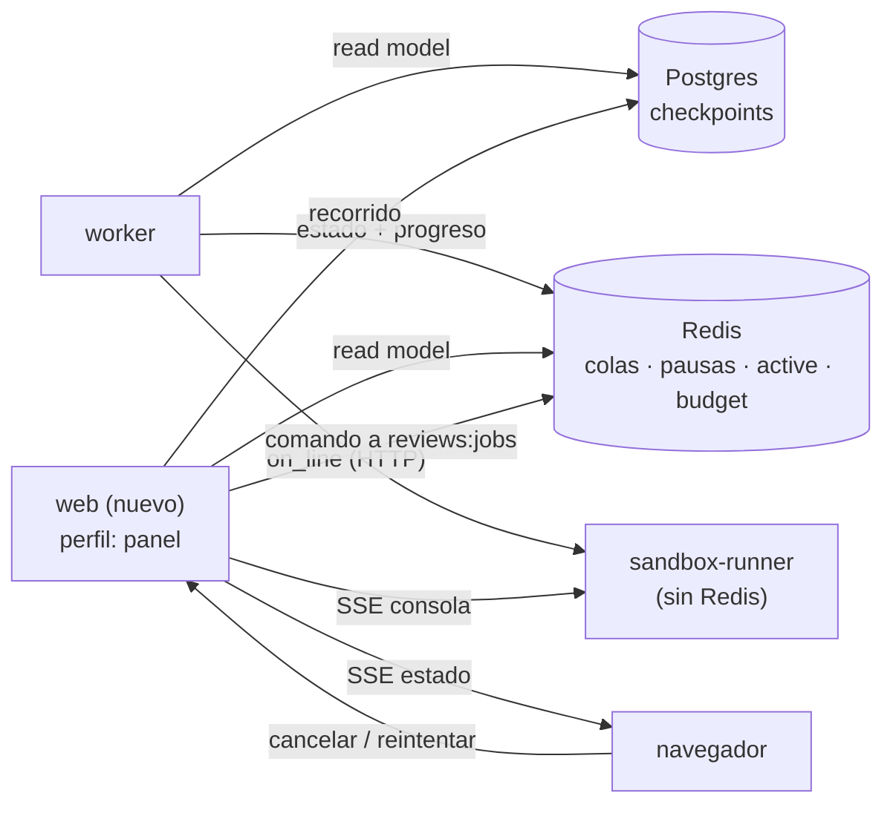
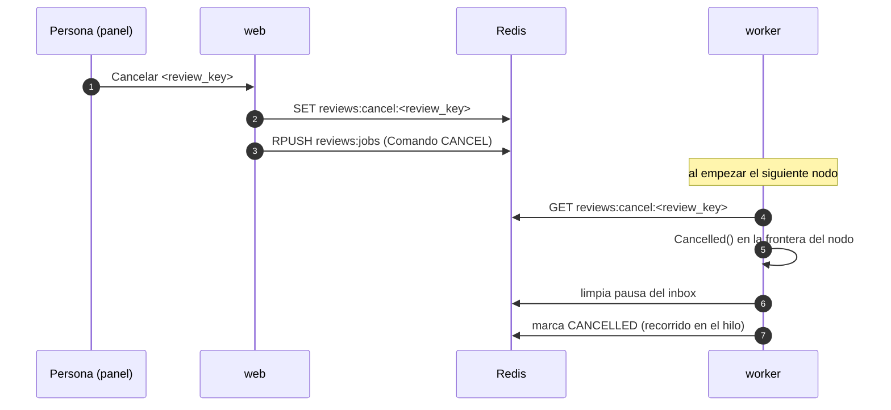

Última modificación: 2026-10-16 | Creado: 2026-10-16

# Panel de operación: ver el sistema en vivo, cancelar y reintentar

> **Estado:** implementada
>
> **Entrega objetivo:** una web propia que muestre, en todo momento, qué está haciendo
> el sistema (cola, reviews en vuelo, pausas, verificaciones y descartes), que deje
> **seguir en vivo** la verificación del sandbox, y que permita **cancelar** y
> **reintentar** una review encolando el comando correspondiente. Sin meter UI dentro
> del worker.

---

## 1. Objetivo

Hoy la observabilidad es **logs de texto** y un puñado de endpoints de lectura
suelta ([`operacion.md`](../../operacion.md) §5). Se puede saber *algo* preguntando a
Redis (`/reviews/paused`) o mirando el latido del worker, pero no se puede **ver** el
sistema, ni seguir una ejecución larga, ni intervenir sobre ella. La deuda está
reconocida: D14 (sin métricas sobre tráfico real) y D16 (el latido mide que el
proceso vive, **no que avanza**).

Se quiere:

1. **Un panel único** con el estado vivo de todos los trabajos: lo encolado, lo que
   corre, lo pausado (humano y de fix), lo que falló (DLQ) y lo terminado. Cada
   trabajo con su `review_key`, su PR y su gasto de tokens.
2. **Seguir en vivo la verificación del sandbox**: el `stdout`/`stderr` de los
   comandos del PR a medida que se ejecutan, que es donde de verdad «no se sabe qué
   pasa» (hasta ~20 min de imagen del CI, `git apply`, tests).
3. **Cancelar** una review en curso o en cola, y **reintentar** una review caída, sin
   tocar el grafo a mano y sin un segundo escritor sobre el estado.
4. **Saber el progreso, no solo la vida**: qué nodo corre ahora y desde cuándo (esto
   cierra D16 en lo que respecta al worker de reviews).

## 2. No-objetivos

- **Streaming de tokens del LLM.** Descartado en esta iniciativa, y a conciencia: el
  revisor pide salida estructurada (`json_object`/`json_schema`) en **una sola**
  llamada por persona y la parsea al final, así que un chorro de tokens sería JSON a
  medio formar: cosmético, no informativo. Lo útil del LLM es su **prompt y su
  respuesta completos**, y eso lo cubre [018](../018-trazas-de-la-review/spec.md).
- **Construir un Langfuse casero.** El árbol de spans, el prompt, la respuesta, el
  `usage` y la latencia por llamada son de [018](../018-trazas-de-la-review/spec.md).
  La 019 no duplica esa capa: es el plano **operativo** (qué corre, qué espera, qué
  se puede cancelar), complementario al plano de **análisis** de 018.
- **Métricas agregadas de negocio** (precisión, recall, tasa de aceptación): son de
  [006](../archivo/006-eval-de-la-review/spec.md).
- **Editar la política o los modelos desde la web.** `autonomy.yaml` y `models.yaml`
  se editan y se reinicia (ADR-0015): el panel es de lectura y de comandos, no un
  editor de configuración.
- **Multi-repo o multi-despliegue.** Un despliegue revisa **un** repo
  ([`arquitectura.md`](../../arquitectura.md) §1). El panel muestra ese despliegue.
- **Despublicar.** Cancelar no puede borrar comentarios ya escritos en el PR (§4, W6).

## 3. Contexto y evidencia

### 3.1 El sustrato ya existe (casi entero)

- **Estado durable**: el checkpointer de Postgres guarda el estado por hilo
  (`thread_id` = `review_key`). `graph.get_state_history` ya devuelve, por `step`,
  qué escribió cada nodo y cuál es el `next`. El «recorrido» de una review **ya está
  persistido**; solo falta un endpoint que lo lea. Es exactamente el peldaño barato
  que [018](../018-trazas-de-la-review/spec.md) planteó como Q7.
- **Estado operativo**: en Redis está todo lo que el panel necesita listar: cola
  (`reviews:jobs`), pausas (`reviews:paused:*`, con `kind` `human`/`fix`), descartes
  (`reviews:jobs:dead`), waves de fix (`reviews:fixes`), presupuesto consumido
  (`budget:<review_key>`, iniciativa [017](../017-presupuesto-por-pr/spec.md)) y
  avisos al canal (`reviews:notices`).
- **La API ya tiene el patrón**: `/reviews/paused` lista el inbox con una forma por
  `kind`; `/reviews/{key}` responde `PAUSED` o `404`; `POST /reviews/{key}/decision`
  **encola** en vez de tocar el grafo ([`api/main.py`](../../../src/agent_review/api/main.py)).

### 3.2 El worker es secuencial (y eso abarata el panel)

El worker procesa **una review a la vez** (`BLPOP` y `graph.invoke` síncrono,
[`worker/main.py`](../../../src/agent_review/worker/main.py); D11). El «panel en
tiempo real» es, en la práctica, **una** review activa y una cola. No hay contención
de escritura ni concurrencia que gobernar: se cancela lo que está en vuelo (a lo
sumo uno) o lo que está en cola.

### 3.3 El LLM y el VCS no son interrumpibles a mitad

`LlmReviewer` hace **una** llamada bloqueante por persona
([`adapters/openai_llm.py`](../../../src/agent_review/adapters/openai_llm.py)); `twg`
y el HTTP al runner también bloquean. LangGraph no ofrece «cancelar este hilo». Es
decir: la cancelación **no** puede ser instantánea solo con lo que hay; hay que
elegir una estrategia (§4, W4).

### 3.4 El runner no *streaming*ea: acumula y devuelve al final

`DockerCliRuntime.start` usa `subprocess.run(capture_output=True)` y devuelve
`ContainerOutcome` con `stdout`/`stderr` **completos al terminar**
([`sandbox_runner/runtime.py`](../../../src/agent_review/sandbox_runner/runtime.py)).
El `VerifyReport` recorta ambas colas a `_TAIL_CHARS` (4000). Hoy, mientras un
comando corre, **no hay nada que ver** hasta que acaba. Es el punto de trabajo real
de esta iniciativa.

### 3.5 El runner es la caja más aislada del sistema

El `sandbox-runner` ejecuta código de PRs de terceros y no publica puertos
([ADR-0011](../../adr/0011-sandbox-runner-aislado.md)); hoy no habla con Redis ni con
Postgres (solo recibe un bearer). Cualquier diseño de *streaming* tiene que respetar
ese aislamiento: **no** se le da acceso a la red de datos para emitir progreso.

## 4. Decisiones

| # | Decisión | Motivo |
|---|---|---|
| W1 | **Servicio `web` propio** (compose, con **perfil** como el `tracing` de 018), no UI dentro del worker ni de la API de ingesta | El worker es un bucle tonto y la API está en el camino crítico del webhook del CI; la web es un tercer consumidor de estado, no un escritor |
| W2 | **Puerto `ProgressPort` con `NullProgress` por defecto**, igual que `ChatPort`/`TracingPort` | Degradación por capas: sin panel, el sistema no cambia de comportamiento; ya es el patrón del repo |
| W3 | La web es **CQRS-lite**: lee de Redis y Postgres (read model) y **encola comandos**; nunca escribe estado ni reanuda el grafo | Un solo escritor del estado (el worker), como hoy: la decisión humana también se encola (ADR-0008) |
| W4 | **Cancelación cooperativa entre nodos**: un *wrapper* de nodo (el mismo *seam* que [018](../018-trazas-de-la-review/spec.md) propone para instrumentar) consulta `reviews:cancel:<review_key>` al **empezar** cada nodo y, si está puesto, aborta la review | LangGraph no cancela un `invoke`; el nodo es la única frontera segura. La latencia de la cancelación es la duración del nodo en curso, y se declara así en la UI |
| W5 | El **progreso del sandbox** se emite desde el runner por **callbacks de línea** (`on_line` opcional en `ContainerRuntime.start`, con default `None`) y se sirve en un buffer **en memoria del runner** por `run_key`, expuesto como **SSE** con el mismo bearer | Mantiene el aislamiento (el runner no necesita Redis); el buffer es efímero como los workspaces de [ADR-0018](../../adr/0018-workspace-de-lectura-en-el-runner.md), y el `VerifyReport` sigue siendo el canal fiable |
| W6 | Cancelar y reintentar son **comandos encolados** en `reviews:jobs` (un `ReviewRequest` marcado), no mutaciones directas desde la web | Igual que `POST /decision`: sin carreras entre procesos; el worker aplica la semántica con su propio estado del hilo |
| W7 | **Autenticación de sesión con rol** en el panel, no solo un bearer de servicio | Cancelar es una acción con consecuencias; el bearer actual autoriza a un servicio, no identifica a una persona |
| W8 | El *streaming* del sandbox es **best-effort y efímero**: no persiste, no entra en el `VerifyReport`, y su caída no afecta a la verificación | La observabilidad no puede convertirse en una causa de fallo de lo que observa (mismo criterio que 018 T6) |
| W9 | **SSE**, no WebSocket | El flujo es unidireccional (servidor → navegador) y los comandos van por HTTP normal; SSE no necesita un protocolo nuevo ni estado de conexión en el servidor |
| W10 | **Marca de progreso del worker en Redis** (`reviews:active:<review_key>` con TTL, nodo actual y `started_at`), actualizada por el *wrapper* de W4 | Es lo que cierra D16 («el latido mide vida, no avance») y lo que el panel necesita para pintar «qué corre ahora» |

## 5. Diseño o contrato

### 5.1 Vista de conjunto



El worker no sabe que el panel existe (W2). El runner solo gana un endpoint de
lectura de su buffer de consola (W5). La web es un consumidor más.

### 5.2 Qué ve el panel

| Zona | Fuente | Qué muestra |
|---|---|---|
| **Cola** | `LRANGE reviews:jobs` | Reviews encoladas, por antigüedad, con PR y `attempts` |
| **En vuelo** | `reviews:active:*` (W10) | Nodo actual, `started_at`, tiempo en el nodo, gasto de tokens (`budget:<review_key>`) |
| **Pausas** | `reviews:paused:*` | `human` (pendientes y orden para decidir) y `fix` (wave y `run_key`s en verificación) |
| **Verificación** | `reviews:paused:*` (kind `fix`) + `GET /verify/{run_key}/console` (W5) | Waves en curso y su consola en vivo |
| **Descartes** | `LRANGE reviews:jobs:dead` | Reviews caídas, motivo e intentos (reinyectables) |
| **Recorrido** | `graph.get_state_history` | Nodos, orden, `next` y qué escribió cada uno (el Q7 de 018) |
| **Historial** | Checkpoints (poda a 30 días) | Reviews terminadas recientes |

El **recorrido** (leer el checkpointer) se propone como **primer peldaño**, sin panel:
un endpoint que hoy mismo da valor y que la 019 reutiliza. Da el orden real de nodos
y el punto de parada; las **duraciones** por nodo y el prompt/respuesta siguen siendo
de [018](../018-trazas-de-la-review/spec.md).

### 5.3 Progreso del worker (W10) — cierra D16

El *wrapper* de nodo (W4) hace dos cosas al empezar y una al terminar:

- `SET reviews:active:<review_key> {node, started_at}` con TTL holgado (p. ej. el
  doble del timeout del nodo más lento); se refresca por nodo.
- Comprueba `reviews:cancel:<review_key>`; si existe, lanza `Cancelled`.
- Al terminar el nodo, limpia o avanza la marca.

Ese mismo registro es lo que hoy falta para distinguir «el worker vive» de «el worker
avanza»: el latido de `/tmp/reviews-worker-heartbeat` se queda como está
(healthcheck de compose) y el progreso real vive en Redis.

### 5.4 Cancelación (W4, W6)



Reglas de negocio de la cancelación (**críticas**, y hay que decirlas en la UI):

- **Si la review aún no ha publicado** (el estado no tiene `published`): cancelar es
  limpio; no hay nada en el PR que deshacer.
- **Si ya ha publicado**: los comentarios del PR **se quedan**. Cancelar solo puede
  detener el trabajo *posterior* (una verificación de fix pendiente, un aviso). La UI
  debe ofrecer en ese caso «cancelar la verificación en curso», no «cancelar la
  review».
- **Si está pausada de fix esperando el runner**: cancelar equivale a resolver la
  wave como no verificable (lo que ya hace el TTL `FIX_VERIFY_TTL_S`), pero a
  petición. No se mata el contenedor del PR: se deja que el runner termine y se
  descarta la reanudación (matar un contenedor de terceros a mitad es más arriesgado
  que esperar; el runner es concurrencia 1 y su timeout ya acota el daño).
- **Siempre** limpiar la entrada del inbox de pausas: una pausa cancelada sin limpiar
  es una pausa huérfana inmortal (familia de D15).

Los descartes (DLQ) son **reintentables**: reencolar su `request` con `attempts=0`
es la operación manual que hoy se hace con `redis-cli RPUSH` ([`operacion.md`](../../operacion.md) §7).

### 5.5 Reintentar / reiniciar (W6)

Hay **tres** operaciones distintas que conviene no confundir en la UI:

| Operación | Qué hace | Riesgo |
|---|---|---|
| **Reintentar** (DLQ) | Reencola el `request` descartado con `attempts=0` | Ninguno: es lo que hoy se hace a mano |
| **Reanudar** | Reencola el `request` de una pausa (lo que hace una decisión) | Ninguno: el worker decide según el estado del hilo (ADR-0007) |
| **Re-review** | Vuelve a revisar un PR ya publicado | **Alto**: exige identidad nueva o limpiar las marcas del PR, o no se publicará nada (o se duplicará). Fuera de alcance en v1 |

El panel expone las dos primeras. La tercera se deja explícitamente fuera: es la
trampa de identidad (`review_key` + marcas `:ok`/`:partial` del PR) que el diseño
protege a propósito.

### 5.6 Streaming del sandbox (W5)

Cambios mínimos y compatibles:

- `ContainerRuntime.start(container_id, *, timeout_s, on_line=None)` — `on_line` es
  opcional, así que los *fakes* y el runtime actual siguen valiendo.
- `DockerCliRuntime` pasa de `subprocess.run` a `Popen` con lectura línea a línea de
  `stdout`/`stderr` (dos hilos) y **acumula** igual que hoy (para el `VerifyReport`
  no cambia nada) **y** emite a `on_line`.
- El `Verifier` conecta `on_line` a un `ProgressSink` que guarda por `run_key` un
  **buffer circular en memoria** (p. ej. últimas N líneas) y da de alta a los
  suscriptores vivos.
- El runner expone `GET /verify/{run_key}/console` (SSE, bearer compartido; *enmienda
  2026-10-16*: también acepta `SANDBOX_CONSOLE_TOKEN`, de solo lectura, que es el que
  recibe el panel para no poder lanzar verificaciones). Si el
  `run_key` ya terminó, sirve lo que quede en el buffer; si el runner reinició, `404`
  (efímero, como los workspaces de ADR-0018).

Límite explícito: el buffer no persiste y **no** se copia al `VerifyReport`. Y como
la salida puede contener rutas o datos del PR, se aplica la misma disciplina que el
recorte de `_TAIL_CHARS`: el panel la muestra, no la archiva.

### 5.7 Configuración propuesta

```bash
# Panel de operación (iniciativa 019). Opt-in por perfil de compose, como 018.
PANEL_ENABLED=false
PANEL_PORT=8090
# Sesión del panel: no es el bearer de servicio de decisión. Un secreto real por
# despliegue; en producción entra en el contrato fail-closed (ADR-0013).
PANEL_SESSION_SECRET=
# Tope de la consola en vivo por verificación (líneas en el buffer del runner).
SANDBOX_CONSOLE_BUFFER_LINES=2000
```

### 5.8 Seguridad

- El panel **no** se publica sin autenticación (W7): sesión con rol. Quien puede
  cancelar es una decisión de operación, no un `curl` anónimo.
- El panel **muestra diffs y salidas de PRs de terceros**: mismo tratamiento que
  [018](../018-trazas-de-la-review/spec.md) §3.5 (self-hosted; la redacción de
  secretos es un riesgo abierto, R4 de 018).
- El panel **no** recibe credenciales de VCS ni de LLM; solo lee estado y encola
  comandos.

## 6. Riesgos

| # | Riesgo | Mitigación |
|---|---|---|
| R1 | **Se duplica con [018](../018-trazas-de-la-review/spec.md)** | Frontera explícita: 019 = operación (estado, consola del sandbox, comandos); 018 = análisis (spans, prompt, `usage`). El *recorrido* del checkpointer (Q7 de 018) se implementa **una vez** y lo consumen las dos |
| R2 | **Cancelar no es reversible** (comentarios ya publicados) | Semántica por estado (§5.4); la UI nunca ofrece «cancelar la review» si ya publicó |
| R3 | **Matar un contenedor del PR a mitad** | No se mata: se descarta la reanudación (§5.4); el timeout del runner acota el daño |
| R4 | **La cancelación tarda un nodo entero** | Es la latencia que impone LangGraph; se declara en la UI y no se finge instantánea. El nodo más largo es el LLM (~15 s medidos) o la verificación (que no bloquea al worker, E7) |
| R5 | **Un `Cancelled` en el nodo equivocado deja el hilo a medias** | La frontera es el *wrapper* entre nodos: un `Cancelled` nunca cae a mitad de un nodo, y el hilo queda con su último checkpoint (por diseño, reanudable) |
| R6 | **La consola del sandbox filtra datos del PR** | Efímera, no persistida, con la misma disciplina que `_TAIL_CHARS`; el panel es self-hosted |
| R7 | **Un servicio más que operar** | Perfil de compose (`profiles: ["panel"]`), como el `tracing` de 018: sin el perfil, `docker compose up` arranca lo de siempre |
| R8 | **La web se convierte en un segundo escritor** | W3: solo encola comandos; el worker sigue siendo el único que muta estado |
| R9 | **Re-review accidental** | Fuera de alcance en v1 (§5.5); si se añade, con identidad nueva explícita |

## 7. Criterios de hecho

1. Con el perfil `panel` levantado, el panel lista cola, en vuelo, pausas (human y
   fix), descartes y el gasto por review; sin el perfil, nada cambia en el sistema.
2. `reviews:active:<review_key>` refleja el nodo en curso y su `started_at`; una
   review colgada en un nodo se distingue de un worker muerto (D16 deja de ser deuda
   para el worker de reviews).
3. El recorrido de una review (nodos, orden, `next`) se puede consultar desde el
   checkpointer, sin infraestructura nueva (Q7 de 018, peldaño 1).
4. Una verificación de fix en curso emite su consola en vivo por SSE; el buffer es
   efímero y un reinicio del runner da `404`, no un informe alterado.
5. Cancelar una review **antes** de publicar no deja comentarios en el PR y limpia su
   entrada del inbox; cancelar una review **ya publicada** se ofrece solo como
   «cancelar lo pendiente» y deja los comentarios intactos (test por estado).
6. Reintentar un descarte de la DLQ lo reencola con `attempts=0` y la review vuelve a
   procesarse.
7. El panel exige autenticación para leer y, sobre todo, para cancelar (test de
   `401`/`403`).
8. Un fallo del panel o de la emisión de progreso **no** altera ninguna review (test).
9. Documentos vivos al día: [`operacion.md`](../../operacion.md) §1–2 (servicio y
   variables), §5 (endpoints del panel), [`arquitectura.md`](../../arquitectura.md)
   §7 (D14 y D16 acotadas) y `CONTEXT.md` si nace un término («panel»,
   «progreso»); un **ADR nuevo** para «panel como servicio aparte y comandos
   encolados» (W1/W3/W6).
10. `make docs-check` en verde.

## 8. Preguntas abiertas

- **Q1 — ¿Cuándo, respecto a [018](../018-trazas-de-la-review/spec.md)?** El peldaño 1
  (recorrido por el checkpointer) es útil hoy y no depende de Langfuse. ¿Se hace
  primero y 018 lo reutiliza, o se espera a 018?
- **Q2 — ¿Dónde vive el panel: en el `web` nuevo o como una extensión de la API
  existente?** Se propone servicio aparte (W1) con perfil. Alternativa: un módulo más
  de FastAPI en el proceso `api`, que ya publica un puerto y tiene auth de bearer.
- **Q3 — ¿La cancelación va antes o después que la lectura?** El panel de solo lectura
  es barato; la cancelación es la única con decisiones de diseño reales (§4 W4/W6).
  ¿Se entrega en dos fases o de golpe?
- **Q4 — ¿Quién puede cancelar?** ¿Cualquier persona autenticada, o solo un rol de
  operación? ¿Se registra el actor de cada cancelación (como `HitlDecision.actor`)?
- **Q5 — ¿El progreso del worker entra en el latido** (`HEARTBEAT_PATH`) o vive solo
  en Redis (W10)? El latido es el healthcheck de compose y no debería depender de
  Redis; el progreso sí lo necesita.
- **Q6 — ¿SSE o *polling* corto?** Se propone SSE (W9); *polling* es más simple pero
  menos «en vivo». ¿Compensa la complejidad de SSE en el runner?
- **Q7 — ¿ADR propio?** El patrón «panel como servicio aparte, read model + comandos
  encolados, progreso por outbox» es una decisión con alternativas descartadas
  (UI en el worker, escritura directa): se propone ADR.
