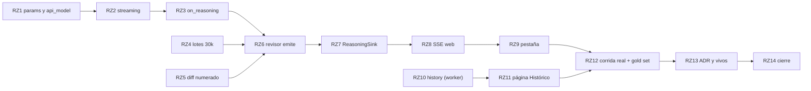

Última modificación: 2026-10-17 | Creado: 2026-10-17

# Plan: Razonamiento del revisor visible en el panel

El *qué y por qué* vive en [`spec.md`](spec.md); las tareas, en [`todo.md`](todo.md).
Este plan fija el orden, las dependencias y lo que puede romperse por el camino.

## Overview

Cinco bloques, en este orden:

1. **Modelo y adaptador.** El registro gana parámetros por modelo y un nombre de API
   propio (para tener un «revisor» con razonamiento sobre el mismo modelo real), y
   `OpenAiCompatibleLlm` pasa a *streaming* siempre, con el razonamiento en
   `LlmReply.reasoning` y un `on_reasoning` opcional.
2. **El revisor.** Lotes de 30 000 caracteres (R12), diff con número de línea (R13) y
   el `LlmReviewer` que emite el razonamiento con su contexto (persona, lote, ficheros).
3. **Sink y panel.** `ReasoningSink` con adaptador Redis (`reviews:reasoning:<key>`),
   endpoint SSE en `web` y la pestaña «Razonamiento» en el detalle.
4. **Histórico.** `reviews:history` escrito por el worker al cerrar cada review,
   podado con los checkpoints, y la página «Histórico» del panel.
5. **Medida y cierre.** Una review real del PR #3 con razonamiento alto, regrabación
   del *gold set*, ADR y documentos vivos.

## Decisiones de implementación

- **Alias de modelo.** `ModelSpec` gana `api_model` (el nombre que se manda a la API;
  por defecto, la clave del registro) y `params` (se fusionan **encima** de los
  `defaults` del proveedor). Así `deepseek-v4-flash-revisor` es una entrada propia con
  `reasoning_effort: high` que llama a `deepseek-v4-flash`. `probe` contrasta
  `api_model`, no la clave.
- **Streaming en el adaptador, no en el puerto.** El puerto sigue devolviendo un
  `LlmReply` completo; el *streaming* es un detalle de `OpenAiCompatibleLlm`. El SSE
  se parsea a mano con `httpx.stream` (sin SDK nuevo). Errores: un estado HTTP de
  error antes del primer *chunk* se clasifica como hoy (4xx permanente, 5xx/429
  transitorio); un corte a mitad del *stream* es transitorio; `length` sin contenido
  sigue siendo `LlmError`. *Enmienda 2026-10-17:* el 408 se queda **permanente**,
  como hoy: reintentar una llamada larga choca con el mismo corte, y el *streaming*
  ya lo evita.
- **`on_reasoning` opcional y *best-effort*.** Se añade a `LlmPort.complete` con
  *default* `None`. Quien llama solo lo pasa si hay sink, así que los dobles de test
  que no lo aceptan siguen valiendo; `ReplayLlm` y `RecordingLlm` del harness lo
  aceptan y lo ignoran. Una excepción del *callback* se registra y no corta la
  llamada.
- **El diff numerado es una vista.** El `LlmReviewer` numera solo lo que manda al
  modelo (`  625 + texto`, `  626   contexto`); el anclaje (`parse_unified_diff`,
  `best_line`) sigue trabajando sobre el diff original.
- **El sink agrupa.** Acumula trozos y escribe un `XADD` cada ~250 ms o cada ~4 KB,
  con `MAXLEN ~` derivado de `REASONING_MAX_BYTES` y `EXPIRE` de `REASONING_TTL_S` en
  cada escritura. `start`/`end`/`error` delimitan cada llamada. Sin Redis, el sink es
  un no-op (como el progreso de 019, W2).
- **SSE del panel.** `XRANGE` desde el principio y después `XREAD BLOCK` hasta ver el
  `end` de todas las llamadas abiertas o un tope de inactividad; el navegador usa
  `EventSource`. Todo texto del modelo se escapa en el HTML.
- **Histórico.** El worker escribe el resumen en `_log_outcome` (un único punto para
  completada, parcial e incompleta); las pausas no entran hasta que la review cierra.
  La poda va en el mismo barrido que `prune_completed_threads`.

## Orden y dependencias

El bloque 4 (histórico) no depende de los anteriores y puede ir en paralelo. RZ5
cambia el *prompt*: el *replay* del *gold set* falla desde ahí hasta RZ12, que regraba
una sola vez con todo (razonamiento, lotes de 30k y diff numerado).

## Checkpoints

- **C1 (tras RZ1–RZ3):** el adaptador hace *streaming*, devuelve el razonamiento y
  respeta los errores de hoy; el registro resuelve el alias del revisor. `make ci` en
  verde.
- **C2 (tras RZ4–RZ6):** el revisor manda lotes de 30k con el diff numerado y emite su
  razonamiento con contexto a un oyente falso. `make ci` en verde salvo el *replay*
  del *gold set*.
- **C3 (tras RZ7–RZ9):** con un LLM falso que emite trozos, el panel muestra el
  razonamiento en vivo por SSE; un sink caído no cambia la review.
- **C4 (tras RZ10–RZ11):** el panel lista las reviews terminadas y enlaza a su
  detalle; la poda las retira con los checkpoints.
- **C5 (tras RZ12–RZ14):** review real del PR #3 sin 408 ni lotes vacíos; *gold set*
  regrabado y etiquetado; ADR, vivos y `make ci` en verde.

## Riesgos

| Riesgo | Mitigación |
|---|---|
| Parsear SSE a mano falla con *chunks* raros del proveedor (`[DONE]`, líneas vacías, `usage` en el último) | Tests con respuestas SSE grabadas de la sonda del 2026-10-17 y con *chunks* partidos |
| ~15 dobles de `LlmPort` en los tests | `on_reasoning` es opcional y solo se pasa con sink; los dobles no cambian |
| Regrabar con razonamiento alto tarda (~12 lotes × ~2 min) y hay que etiquetar de nuevo | Una sola regrabación en RZ12; el etiquetado se hace como en 007 y 012, con verificación contra `008da57` |
| El razonamiento repite secretos del diff en Redis | Mismo riesgo que el diff en el PR; TTL de 10 días y panel tras sesión |
| `reviews:history` crece sin control si falla la poda | Recorte por fecha en cada escritura, además del barrido |
