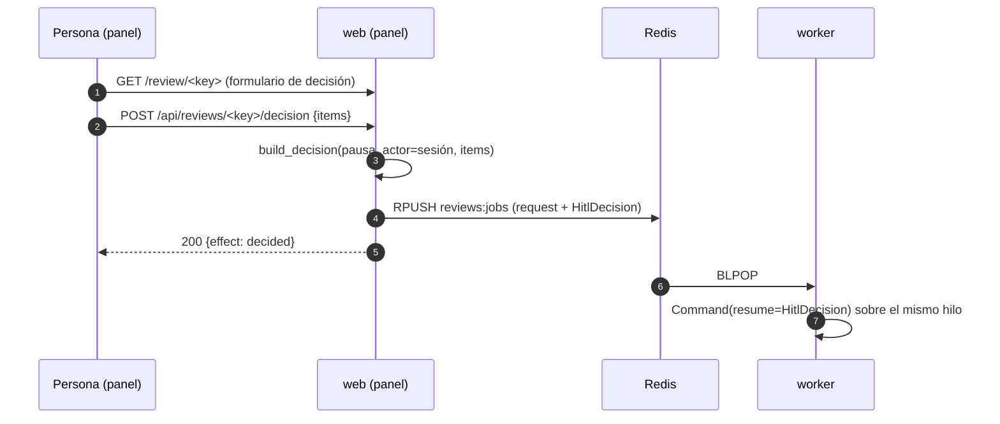

Última modificación: 2026-10-17 | Creado: 2026-10-17

# Decisión humana desde el panel

> **Estado:** aprobada
>
> **Entrega objetivo:** que el panel de operación muestre cada hallazgo de una pausa
> humana con su contexto y permita **decidirlo** (`approved` / `rejected` / `noted`)
> desde la propia web, encolando una `HitlDecision` con el mismo `build_decision` que
> usan el CLI, la API y el bot de Teams. Sin reimplementar la decisión y sin dar al
> panel la credencial de decisión.

---

## 1. Objetivo

Hoy el panel (019) **lista** las pausas humanas (`PausedGroups.human`) pero no deja
decidirlas: el único comando humano es **«Reanudar»**, que reencola el `request`
resolviendo **todos** los pendientes como `expired` (commands.py, §5.5 de la 019). Eso
no es decidir: es dejar que la review se publique «sin decisión», que es lo que ya
hace el TTL a los 7 días. El detalle, además, vuelca el `pending` como JSON crudo
(ui.py:419), ilegible para decidir sin abrir otro canal.

Se quiere:

1. **Ver** cada pendiente con lo necesario para decidir sin abrir el PR: `title`,
   `severity`, `fichero:línea`, `why_it_matters`, la acción propuesta
   (`escalate` / `fix_with_approval`) y el enlace al código (`code_url`).
2. **Decidir** desde el panel: un resultado por hallazgo y una nota opcional,
   cubriendo **todos** los pendientes de una vez.
3. Que la decisión se **encolar** como cualquier otra (ADR-0008): el worker hace
   `Command(resume=…)` sobre el mismo hilo. El panel sigue sin ser escritor del
   grafo (W3).
4. Que la validación sea **la misma** que en el resto de canales: `build_decision`
   (fuente única). Ni una regla nueva, ni una copia.

## 2. No-objetivos

- **Reimplementar la decisión.** `build_decision` es el único validador; el panel es
  un cliente más, como el bot de Teams (C4).
- **Decidir pausas de fix.** Una pausa de `kind=fix` espera la verificación de la
  wave, no una persona: sigue con «Cancelar lo pendiente» y su consola.
- **Sustituir a Teams, al CLI o a la API.** El panel se suma; no retira canales.
- **Dar al panel el `REVIEWS_DECISION_TOKEN`.** El panel no recibe credenciales de
  servicio (ADR-0020, OP18): por eso **no** llama a `POST /reviews/{key}/decision` y
  construye la decisión en su propio proceso con la lógica compartida.
- **Editar hallazgos o política.** El panel decide sobre lo que la política ya pausó;
  no crea acciones ni cambia la severidad.
- **Firmar en nombre de otro.** El actor es el de la sesión, nunca el del cuerpo
  (mismo criterio que OP51).

## 3. Contexto y evidencia

### 3.1 El contrato de decisión ya existe y es único

- `build_decision(paused, actor=…, items=…, reviewed_key=…)` (`src/agent_review/decision.py`)
  exige que los `items` cubran **exactamente** los pendientes (ni de menos ni de más),
  que los `finding_id` pertenezcan a esta pausa y que nadie emita `expired` a mano.
  Lo usan el CLI (`cli.py`), la API (`api/main.py`) y Teams
  (`teams_bot/decisions.py`).
- El transporte ya está: un `ReviewRequest` con `decision` es una reanudación
  (ADR-0008), y el worker la aplica con `Command(resume=…)`.
- Los modelos viajan ya por el read model: `_paused_item` serializa
  `approval.pending` como `dict`; no hay que inventar forma nueva, sólo tiparla (§5.2).

### 3.2 Lo que le falta al panel

- **Ver**: `_paused_detail` (ui.py:419) pinta el `pending` con `_json(...)`, un volcado
  crudo. Los campos que una persona necesita ya están en el modelo
  (`PendingDecision`), sólo hay que renderizarlos.
- **Decidir**: no hay comando. `_pause_commands` (ui.py:386) sólo ofrece
  «Cancelar la review» y «Reanudar».

### 3.3 Por qué el panel no puede reutilizar el endpoint de la API

El panel deliberadamente **no** recibe el bearer de decisión ni credencial de VCS/LLM
(ADR-0020, op-18 de la 019): es un *read model* más comandos encolados. Enrutar la
decisión del panel por `POST /reviews/{key}/decision` obligaría a meterle el
`REVIEWS_DECISION_TOKEN`, un secreto de alto valor (ADR-0008). En su lugar, el panel
construye la `HitlDecision` con `build_decision` y la encola él mismo, igual que ya
hace con cancelar y reintentar.

### 3.4 La carrera de decisiones (C11) hoy sólo la sella Teams

El bot de Teams sella la **primera** decisión por `pause_id` (`CardStore.close`, SETNX)
para que dos pulsaciones no encolen dos reanudaciones. El CLI, la API y el panel **no**
tienen sello. En la práctica la carrera es benigna —el primer `resume` publica y deja
el hilo completado, y el segundo job es un **no-op** con aviso en el log—, pero con el
panel aparece una segunda superficie de clic y conviene decidir si se sella (§8 Q2).

## 4. Decisiones

| # | Decisión | Motivo |
|---|---|---|
| H1 | La decisión del panel se construye con **`build_decision`** y se **encola** (`ReviewRequest.decision`); nunca toca el grafo | Fuente única de validación; el worker sigue siendo el único escritor (W3, ADR-0008) |
| H2 | Endpoint **`POST /api/reviews/{review_key}/decision`** en el panel, con `require_command_session` (rol `operador` + defensa CSRF) y el **actor de la sesión** | Coherente con los demás comandos del panel; el cuerpo no puede suplantar al actor (OP51) |
| H3 | El read model tipa `pending` como **`list[PendingDecision]`** y la UI pinta sus campos, no JSON crudo | El modelo ya viaja validado; tiparlo deja que la UI lo renderice y detecta una deriva de forma |
| H4 | La UI ofrece **un resultado por hallazgo** (`approved`/`rejected`/`noted`) con nota opcional, y exige cubrir todos los pendientes | Es la regla de `build_decision`; el servidor devuelve `409` con los que falten |
| H5 | El comando `decide` responde `409` si la pausa ya no existe, no es humana o la decisión no cubre exactamente los pendientes | Mismo contrato que el `409` de la API y el exit 2 del CLI |
| H6 | **Sin sello de primera decisión**: se acepta la carrera y se confía en el no-op del segundo `resume` del worker (§8 Q2) | La carrera es benigna ya hoy (el hilo completado convierte el segundo job en no-op con aviso); añadir un sello genérico a los tres canales es más superficie que valor mientras sólo haya un operador por despliegue |

## 5. Diseño o contrato

### 5.1 Vista de conjunto



### 5.2 Lectura (H3)

`PausedItem.pending` pasa de `list[dict[str, Any]]` a **`list[PendingDecision]`**. No
cambia el origen (`PausedReview.human_request.pending` ya es `list[PendingDecision]`);
sólo deja de pasar por `model_dump`. La UI renderiza, por pendiente: `severity`,
`title`, `file:line`, `why_it_matters`, `proposed_action` y `code_url` (enlace).

### 5.3 Comando (H1, H5)

`CommandService.decide(review_key, *, actor, items) -> CommandEffect.DECIDED`:

```python
def decide(self, review_key, *, actor, items):
    paused = self._paused.get(review_key)
    if paused is None:
        raise CommandError(f"{review_key} no esta pausada")
    if paused.kind is not PauseKind.HUMAN:
        raise CommandError(f"{review_key} no es una pausa humana")
    try:
        decision = build_decision(paused, actor=actor, items=items, reviewed_key=review_key)
    except DecisionError as exc:
        raise CommandError(str(exc)) from exc
    self._queue.enqueue(paused.request.model_copy(update={"decision": decision}))
    return CommandEffect.DECIDED
```

`CommandEffect` gana `DECIDED = "decided"`. El endpoint valida la forma con
`FindingDecision.model_validate` (`400` si el cuerpo está mal) y traduce `CommandError`
a `409`, como los otros comandos.

### 5.4 Contrato del endpoint

| Método | Ruta | Sesión | Cuerpo | Respuestas |
|---|---|---|---|---|
| `POST` | `/api/reviews/{review_key}/decision` | `operador` | `{"items": [{"finding_id", "outcome", "note"}]}` | `200 {review_key, effect, actor}`; `400` cuerpo mal formado; `403` `lector` o CSRF; `409` no pausada / no humana / decisión incompleta; `503` si Redis no responde |

El **actor** no viaja en el cuerpo: se toma de la sesión (H2).

### 5.5 UI (H4)

- La sección de pausas humanas y el detalle pintan, por pendiente, los campos de §5.2 y
  tres controles (`Aprobar`, `Rechazar`, `Anotar`) más una nota opcional.
- Un botón «Decidir» envía el conjunto. Si falta algún pendiente, el `409` del servidor
  se muestra con los `finding_id` que faltan (no se inventa la validación en el
  navegador).
- *(Resuelto, §8 Q1.)* El botón **«Reanudar»** deja de ofrecerse para pausas humanas:
  ahora que se puede decidir de verdad, resolver todo como `expired` a mano sólo
  confunde; el `expired` es del sistema (TTL). El endpoint `resume` se conserva (lo
  usan otras vías y su semántica sigue siendo válida), pero la UI no lo pinta en las
  pausas humanas.
- *(Resuelto, §8 Q4.)* La **nota va por hallazgo** (`FindingDecision.note`), que es
  donde el contrato ya la admite: un rechazo explica un falso positivo y una
  aprobación, qué se autoriza.

## 6. Riesgos

| # | Riesgo | Mitigación |
|---|---|---|
| R1 | **Dos decisiones a la vez** (panel + Teams, o dos operadores) | El worker aplica la primera y el segundo `resume` es no-op con aviso; opcionalmente un sello por `pause_id` (§8 Q2) |
| R2 | **Aprobar parece autorizar escritura** | Aprobar sólo autoriza a *intentar* el arreglo; `protected_subject` y `never_auto_paths` siguen mandando (ADR-0009). La UI lo dice junto al botón |
| R3 | **Decisión parcial** (falta un hallazgo) | `build_decision` la rechaza (`409`) con los ids que faltan; la UI los muestra |
| R4 | **La pausa ya no está** (venció el TTL, la decidió otro) | `409`; la review pudo publicarse como «sin decisión». La UI lo explica |
| R5 | **XSS** al pintar textos del PR (`title`, `why_it_matters`) y la nota del usuario | Todo pasa por `_esc`; la nota también (mismo criterio que el resto del panel) |
| R6 | **Sin el secreto del panel** (`dev`), el actor es `dev` | Es el comportamiento relajado ya existente en dev/test; en producción la sesión es obligatoria |

## 7. Criterios de hecho

1. El panel muestra cada pendiente con su contexto (título, severidad, `fichero:línea`,
   `why_it_matters`, acción propuesta y enlace al código), no JSON crudo.
2. Decidir todos los pendientes desde el panel encola una `HitlDecision` que cubre
   **exactamente** los pendientes y el worker publica (un test por `outcome`:
   `approved`, `rejected`, `noted`).
3. Una decisión incompleta da `409` con los `finding_id` que faltan y **no** encola.
4. `expired` no se ofrece ni se acepta como decisión humana.
5. El actor auditado es el de la sesión; un `actor` en el cuerpo no lo suplanta.
6. Sólo el rol `operador` decide: `lector` da `403`; por cookie, sólo JSON del mismo
   origen (CSRF).
7. Una pausa que ya no existe (TTL u otra decisión) da `409` sin encolar.
8. Documentos vivos al día: [`operacion.md`](../../operacion.md) §5 (endpoint del panel),
   [`arquitectura.md`](../../arquitectura.md) §7 si nace una deuda, y
   [`CONTEXT.md`](../../../CONTEXT.md) si aparece un término.
9. `make ci` y `make docs-check` en verde.

## 8. Preguntas abiertas

- **Q1 — ¿Se retira «Reanudar» de las pausas humanas?** *Resuelta (2026-10-17):* sí,
  la UI deja de pintarlo en pausas humanas (§5.5); `expired` es del sistema. El
  endpoint se conserva.
- **Q2 — ¿Sello de primera decisión?** *Resuelta (2026-10-17):* no. Se acepta la
  carrera: el worker ya hace no-op del segundo `resume` (H6). Se reabre si aparece
  más de un operador concurrente por despliegue.
- **Q3 — ¿Confirmación al aprobar?** *Resuelta (2026-10-17):* no hay paso extra; el
  texto junto al control ya dice que aprobar sólo autoriza a *intentar* el arreglo y
  que `protected_subject`/`never_auto_paths` siguen mandando (ADR-0009).
- **Q4 — ¿Nota por hallazgo o global?** *Resuelta (2026-10-17):* por hallazgo
  (`FindingDecision.note`), que es lo que el contrato ya admite.
