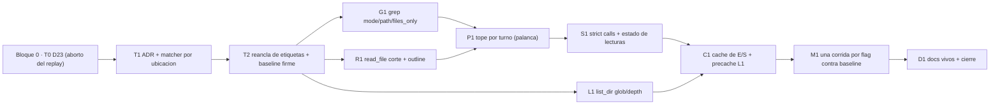

Última modificación: 2026-10-17 | Creado: 2026-10-17

# Plan: Eficacia del bucle de lectura

El *qué y por qué* vive en [`spec.md`](spec.md); las tareas, en [`todo.md`](todo.md).
Este plan fija el orden y por qué el orden es ese. Aterriza sobre 014 RH10 (bucle
cableado y *gold set* regrabado) y sobre la medición del 2026-10-17.

## Overview

Cuatro bloques, y el orden **no es negociable** por una razón concreta:

1. **Base de medida (bloque 0).** Antes de tocar el bucle: que el *replay* aborte si
   la grabación no casa (D23) y que el informe mida **defecto y no redacción**
   (ADR del matcher + reancla). Sin esto, **cada mejora de aquí en adelante hace
   salir el eval en verde con recall 0** y no se distingue de una medida real.
2. **Modos de las tres herramientas.** `grep` con `mode`/`path`/`files_only`;
   `read_file` con aviso de corte y `outline`; `list_dir` con filtro y profundidad.
3. **Palancas transversales**, cada una detrás de su flag: tope de peticiones por
   turno, no descartar en silencio, estado de lecturas, caché de E/S por review y
   precarga de L1 conmutable.
4. **La medida.** Una corrida de 006 por flag contra el *baseline*, con los números
   anotados. La entrega se juzga por ese informe, no por el número de mejoras.

## Decisiones de implementación

- **D23 se arregla en el `LlmReviewer`, no en el harness.** `FingerprintMismatch` es
  `RuntimeError` y hoy cae en el `except Exception` de `_call_once` y de
  `_call_with_tools` (≈`llm_reviewer.py:607` y `:536`), que lo degrada a «0
  hallazgos». Un `except FingerprintMismatch: raise` explícito **antes** del
  genérico, o una marca en la excepción, basta. El harness no cambia: es el
  consumidor el que no debe tragarse el aborto.
- **El matcher cambia de ancla: `file`(+`line`) primero, fragmentos como respaldo.**
  `_matches` hoy exige «todos los fragmentos presentes»; por eso un mismo defecto
  redactado distinto no casa (`build.py:1123` en las dos corridas, etiqueta `R3`
  solo en el *baseline*). El cambio de `_matches`/`_attribute` es de 006: va a ADR
  y actualiza su spec.
- **Los modos son parámetro, no operación.** `grep` acepta `mode="literal"|"regex"`;
  `read_file` acepta `mode="full"|"outline"`. El `ContextReaderPort` **no** gana
  métodos: `read_file` recibe `mode` y `list_dir` recibe `glob`/`depth`. Los tres
  adaptadores (`fixture`, `vcs`, `workspace`) lo honran o degradan de forma
  declarada.
- **`mode` ausente = comportamiento de hoy.** Nada de cambiar la semántica por
  debajo: un `grep` sin `mode` sigue siendo literal (T1 y T11 lo verifican).
- **El caché de E/S es un decorador** (`CachingReader`) que envuelve el lector por
  review. No toca el puerto ni los adaptadores y se apaga con un flag.
- **El bloque de estado vive en el `LlmReviewer`** (vida de la review), no en el
  bucle (vida del lote): las repeticiones son **entre lotes**.
- **`outline` cae a `full` si duda.** Índice por AST donde exista; en YAML/Dockerfile
  y lenguajes sin parser, heurística declarada; si no hay confianza, `full`. Nunca
  un índice peor que una lectura completa, según `read_file` sirve para opinar.
- **`_MAX_CALLS_PER_TURN` deja de ser constante** y pasa a `ContextLimits`/ajuste,
  para poder medir 3 contra 4–5 sin recompilar el bucle.
- **La precarga de L1 (E8) se mide antes de fijarla.** Es la palanca grande de
  *prompt* pero puede costar recall (014 Q4); va con su flag y su corrida.

### Crítica al diseño (y qué no se hace)

- **No** se añade `search` como herramienta: ya es un alias de `grep` y basta con
  aceptarlo en el *system prompt*.
- **No** se implementa un caché que «devuelva caché» al modelo: se le devuelven los
  bytes y solo se ahorra E/S. Prometer un ahorro de *prompt* que no existe sería
  vender humo en la spec.
- **No** se sube el tope de 3 por decreto: es la palanca más fácil de suponer y una
  de las más fáciles de engordar (el turno se reenvía).
- **No** se toca `_SYSTEM` para especializar roles: eso es la iniciativa de D20.
- **No** se mide nada antes de que D23 y el matcher estén resueltos: sería medir el
  pasado (R1/R2 de la spec).

## Orden y dependencias

## Checkpoints

- **K0 (tras T0–T2):** `make eval-tools` con una grabación caducada **falla**; el
  informe con la reancla es estable entre redacciones del mismo defecto. Sin K0 no
  se empieza el bloque 2.
- **K1 (tras G1/R1/L1):** los modos funcionan, `mode` ausente es idéntico a hoy, y
  el *gold set* con flags apagados no cambia de número. `make ci` en verde.
- **K2 (tras P1/S1/C1):** cada palanca tiene su flag y su test; con todos en default
  el comportamiento es el de hoy (criterio 7 de la spec).
- **K3 (tras M1/D1):** informe por flag anotado; docs vivos al día; spec
  `implementada`; `make ci` y `make docs-check` en verde.

## Riesgos

| Riesgo | Mitigación |
|---|---|
| Medir con el matcher roto (R1) | Bloque 0 antes de cualquier mejora: ADR + reancla |
| Grabación caducada leída como recall 0 (R2) | T0 arregla D23; el eval debe fallar ruidoso |
| `regex` caro en el `git grep` del runner (R3) | Default `literal`; `mode` explícito, acotado y con topes |
| `outline` opina mal donde no hay parser (R4) | AST donde exista, heurística declarada, caída a `full` |
| Los avisos engordan el *prompt* (R5) | Bloques acotados y medidos; cada uno con su flag |
| Cada flag invalida la grabación (R6) | Una regrabación por configuración medida (ADR-0017) |
| Palancas que se suponen y no se miden (R7) | Una corrida por flag contra el *baseline*, anotada |

## Dependencias externas

- [014](../014-revisor-con-herramientas/spec.md) RH10: bucle cableado y *gold set*
  regrabado; **RH11 (su medida) depende de que 023 cierre el bloque 0**.
- [016 Q1](../archivo/016-lector-de-contexto/spec.md): la decisión «`grep` literal»
  que E2 enmienda; el bucle y el puerto que 023 consume sin reimplementar.
- [006](../archivo/006-eval-de-la-review/spec.md): el matcher y las métricas que el
  ADR de T1 cambia.
- [ADR-0017](../../adr/0017-replay-determinista-con-fingerprint.md): el *replay* por
  *fingerprint* que D23 debe hacer abortar de verdad.
