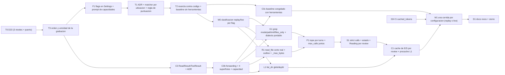

Última modificación: 2026-10-17 | Creado: 2026-10-17

# Plan: Eficacia del bucle de lectura

El *qué y por qué* vive en [`spec.md`](spec.md); las tareas, en [`todo.md`](todo.md).
Este plan fija el orden y por qué el orden es ese. Aterriza sobre 014 RH10 (bucle
cableado y *gold set* regrabado) y sobre la medición del 2026-10-17.

## Overview

Cinco bloques, y el orden **no es negociable** por una razón concreta:

1. **Base de medida (bloque 0).** Antes de tocar el bucle: que el *replay* aborte si
   la grabación no casa (D23) **en los tres niveles del camino de un lote**, que la
   grabación **conserve el orden y la unicidad** de las llamadas (sin eso ninguna
   medida por lote es reproducible), que el informe mida **defecto y no redacción**
   (ADR del matcher + reancla contra el código), que los flags existan de verdad
   (Settings + `.env.example` + cableado) y que cada uno esté clasificado como
   *replay* o *live*. Sin esto, **cada mejora de aquí en adelante hace salir el eval
   en verde con recall 0** y no se distingue de una medida real.
2. **Contrato de lectura (bloque 0.5).** El lector devuelve metadatos
   (`ReadResult`/`ToolResult`), los argumentos nuevos llegan de punta a punta
   (`_serve_*` → adaptador → API del runner) y hay **dos** *baselines* congelados.
   Sin este bloque, el aviso de corte de R1 no puede ser honesto y los modos de G1
   no llegan al adaptador aunque se implementen.
3. **Modos de las tres herramientas.** `grep` con `mode`/`path`/`ref`/`files_only`;
   `read_file` con aviso de corte y `outline`; `list_dir` con filtro y profundidad.
4. **Palancas transversales**, cada una detrás de su flag: tope de peticiones por
   turno, no descartar en silencio, estado de lecturas, caché de E/S por review y
   precarga de L1 conmutable.
5. **La medida y el cierre.** Una corrida por configuración, **declarando cuáles son
   *replay* y cuáles exigen regrabación *live***, con los números anotados. La
   entrega se juzga por ese informe, no por el número de mejoras.

## Decisiones de implementación

- **D23 se arregla en tres sitios, no en dos.** `FingerprintMismatch` es
  `RuntimeError` y cae hoy en el `except Exception` de `_call_once` (`≈:607`), de
  `_call_with_tools` (`≈:536`) **y de `_call_with_retries` (`:402`)**. El tercero es
  el que se activa en producción: con `llm_batch_retries=2` el aborto se reintenta
  con espera creciente y acaba en `None` → «0 hallazgos». Un test con
  `batch_retries=0` no lo cubre: el test va con `batch_retries=2`.
- **La excepción se mueve a producción.** Hoy vive en `tests/eval/harness.py:479`;
  `src/` no puede importarla. Va a `ports/llm.py` (es semántica del contrato LLM,
  junto a `LlmTruncatedError`) y el harness la importa de ahí. Dirección tests → src.
- **Solo se reintenta lo transitorio.** El `except Exception` de
  `_call_with_retries` se sustituye por `is_transient(exc)`; lo demás sube. D23 es
  un caso de una clase más ancha: cualquier error permanente se publica hoy como
  review limpia.
- **El matcher cambia de ancla: `file`(+`line`) primero, fragmentos como respaldo.**
  `_matches` hoy exige «todos los fragmentos presentes»; por eso un mismo defecto
  redactado distinto no casa (`build.py:1123` en las dos corridas, etiqueta `R3`
  solo en el *baseline*). El cambio de `_matches`/`_attribute` es de 006: va a ADR
  y actualiza su spec. Debe declarar la **regla de puntuación**: desempate cuando
  dos etiquetas podrían casar el mismo hallazgo, y qué pasa si un hallazgo casa a la
  vez una `expected` y una `must_not_report`. **El solapamiento es error al cargar
  el caso**, no prioridad silenciosa: `_attribute` consume `expected` antes que
  `must_not`, así que un hallazgo que casa ambos **nunca** cuenta como FP.
- **El reancla es contra el código, no contra la grabación.** La verdad es el código
  en `008da57` (el `head_sha` del caso, servido por `fixtures/head`). La grabación
  sirve para **descubrir** redacciones alternativas, nunca para decidir qué es un
  defecto: anclar contra la salida que se quiere medir es circular. Cada etiqueta
  reanclada se revisa contra el fichero y la línea.
- **Tests negativos del matcher.** Además del positivo (dos redacciones del mismo
  defecto casan), el negativo: dos defectos **distintos en la misma línea** del mismo
  fichero no casan la misma etiqueta. Con `LINE_TOLERANCE=5`, un test con dos
  defectos separados pasa trivialmente y no demuestra nada. Toda etiqueta con `file`
  exige además un **fragmento discriminante**.
- **La grabación guarda el orden y la unicidad.** Hoy `Recording.dump` usa
  `sort_keys=True` y `calls` es un `dict` con clave = *fingerprint*: el JSON pierde
  el orden de ejecución y **colapsa dos llamadas con el mismo *prompt***. Se añade
  `seq`, `batch_index`, `turn` y `call_id`, se lee como lista y se conserva el `dict`
  como índice. Sin esto, M1 no se puede declarar hecho y la tabla de §3 de la spec
  solo puede usar medidas que no dependan del orden.
- **Los modos son parámetro, no operación.** `grep` acepta `mode="literal"|"regex"`;
  `read_file` acepta `mode="full"|"outline"`. El `ContextReaderPort` **no** gana
  métodos: `read_file` recibe `mode` y `list_dir` recibe `glob`/`depth`.
- **Un solo dialecto portable, no POSIX ERE.** El patrón que acepta el puerto es
  un subconjunto con la **misma** semántica en `git grep -E` y en `re`; el
  normalizador emite una **única** cadena (`\d` → `[0-9]`, `\w` → `[A-Za-z0-9_]`,
  `\s` → `[ \t\n\r\f\v]`). Se rechazan `[[:…]]`, `\b`, `\<`/`\>`, *lookaround* y
  retro-referencias. **No** se traduce `\s` a `[[:space:]]`: en `re` eso es una
  clase con los caracteres `[ : s p a c e`, no un espacio. Una tabla de patrones se
  prueba en las **cuatro** superficies; `VcsContextReader` es un lector **parcial**
  y la equivalencia se predica de la intersección de ficheros visibles. Un patrón
  inválido o no portable es `ERROR` para el modelo, nunca «sin coincidencias».
- **La lectura devuelve un value object, no un `str`.** `ReadResult(content,
  total_bytes, truncated, served_range)`; `grep` y `list_dir` devuelven el mismo
  `ToolResult` con `total`/`truncated`. El bucle renderiza el aviso según la
  operación. El cambio es de **contrato**: puerto, tres adaptadores, `FileResponse`/
  `GrepRequest`/`tree` del runner, `context_workspace` y dobles de test, con test de
  ida y vuelta worker ↔ runner.
- **Hay cuatro superficies, no tres.** `fixture`, VCS, workspace y **la API HTTP del
  runner**. Los campos nuevos viajan de punta a punta con **negociación de
  capacidad**: un runner viejo que no entiende `mode` devuelve error explícito, no
  degradación silenciosa. Y `_serve_*` hace **forwarding**: hoy descarta los
  argumentos nuevos (`_serve_grep` solo lee `pattern`/`glob`), así que cambiar el
  adaptador no basta.
- **`search` se cablea o se retira.** Hoy no está en `_serve_one` ni en
  `_BASE_SYSTEM`; decir que «basta con aceptarlo en el *prompt*» es falso. Se mapea
  `search → grep` en el *dispatch* y se prueba, o se quita de la spec.
- **`total_bytes` se arregla en el origen.** El bucle solo ve el string que le da el
  adaptador, y el adaptador ya puede haber recortado (`context_fixture` a 200 000,
  `ReadWorkspace` a 500 000, y `show_file` corta antes de devolver). El **tamaño
  real** sale del lector; si no está disponible, el aviso lo dice, no lo inventa.
- **`ReadWorkspace._max_bytes` se arregla o se borra.** Hoy se acepta el parámetro,
  se asigna y `show_file` corta con la constante de módulo `_MAX_READ_BYTES`
  (`:89`): tres topes (200 000 declarado, 500 000 efectivo, 60 000 del bucle) sin
  una fuente. Se decide uno: el de la lectura pertenece al adaptador y el del bucle
  al bucle; no se mezclan.
- **Un único registro de lecturas por review, con tipo y ref.** `Reading(path, ref,
  kind, ranges)`, `kind ∈ {full, range, outline, grep}`. La cita se valida contra
  `(path, ref)` y el `kind`; la **cobertura solo cuenta `full`/`range`**. Hoy
  `served` es `dict[path, ref]`: un `outline` valida una cita de cuerpo, un `grep`
  cuenta como fichero leído y una lectura de `base` valida una cita de `head`.
- **El registro se pasa al bucle.** El `LlmReviewer` construye el *prompt* inicial
  por lote; solo `run_tool_loop` añade los `<tool_result>`. Sin una costura
  (`state_provider`/`ReadingRegistry`) el bloque no puede actualizarse dentro del
  lote. Se inserta **al final del último mensaje de usuario**, tras el
  `<tool_result>`, para no romper el prefijo cacheable de 024 (E6).
- **El caché de E/S es un decorador** (`CachingReader`) que envuelve el lector por
  review. Cachea **solo `read_file`** (inmutable para un `ref` fijo) o exige una
  clave de pureza/semilla: en `VcsContextReader`, `grep` y `list_dir` dependen del
  *seed* de cada lote y cachear un «sin coincidencias» haría perder ficheros.
- **`_MAX_CALLS_PER_TURN` deja de ser constante** y pasa a `ContextLimits`/ajuste.
  **Se sube junto con `max_calls`** (8 por lote): con 5 por turno y 8 totales, el
  tope se agota en dos turnos y la palanca se convierte en un espejismo.
- **La precarga de L1 (E8) se mide antes de fijarla.** Es la palanca grande de
  *prompt* pero puede costar recall (014 Q4); va con su flag y su corrida *live*.
- **El *prompt* anuncia siempre las capacidades del puerto; los flags deciden el
  coste, no la disponibilidad.** El criterio anterior («*prompt* byte a byte») y
  «que el modelo use `mode="regex"`» son incompatibles: si el *prompt* no anuncia el
  modo, los 46 patrones con metacaracteres siguen fallando. Se acepta **una**
  regrabación de referencia (con `cached_tokens` de 024 en la misma pasada) y el
  criterio 9 pasa a **comportamiento por defecto idéntico**.
- **Cada flag se clasifica antes de medir** (E12 de la spec): los que cambian lo que
  recibe el modelo exigen regrabación *live*; los que no (caché de E/S) se miden con
  *replay*. El informe declara cuál es cuál y compara contra **dos** baselines
  congelados (con y sin herramientas).

### Crítica al diseño (y qué no se hace)

- **No** se añade `search` como herramienta nueva: es un alias y se **cablea**
  (E15). Retirar la afirmación es la alternativa si no se quiere tocar el
  *dispatch*.
- **No** se implementa un caché que «devuelva caché» al modelo: se le devuelven los
  bytes y solo se ahorra E/S. Prometer un ahorro de *prompt* que no existe sería
  vender humo en la spec.
- **No** se sube el tope de 3 por decreto: es la palanca más fácil de suponer y una
  de las más fáciles de engordar (el turno se reenvía). Y **no** se sube sin subir
  `max_calls` total.
- **No** se toca `_SYSTEM` para especializar roles: eso es la iniciativa de D20.
- **No** se mide nada antes de que D23, el orden de la grabación, el matcher y la
  clasificación *replay*/*live* estén resueltos: sería medir el pasado.
- **No** se reanclan las etiquetas mirando la salida con herramientas: es
  circular (R1 de la spec).
- **No** se sustituye `0.125` por `0.375`: son configuraciones distintas (con y sin
  herramientas). Lo que se corrige es la **declaración**, no el número.
- **No** se traduce el dialecto a dos emisores (ERE y `re`): dos emisores son dos
  superficies que pueden divergir. Un subconjunto portable es una sola cadena.

## Orden y dependencias

**`024 S` no es una tarea de este plan, pero sí una entrada suya:** las corridas
*live* de M1 son el único momento en que se paga el modelo, y sin el contador de
caché instrumentado antes hay que repetirlas o el número se queda en `no medido`
(Q5 de la spec). Es la única dependencia externa que **precede** a una tarea de
aquí; el resto llega después (su bloque A espera a K3).

**Por qué T3 va antes que F1 y que todo lo demás.** Sin orden de ejecución en la
grabación no se puede fijar un *baseline* por lote ni auditar M1; instrumentarlo es
barato y no cambia lo que recibe el modelo. Es requisito de C0c y de la propia
medida.

**Por qué C0/C0b van antes de G1/R1/L1.** Los modos se implementan en el adaptador,
pero el bucle **descarta** los argumentos nuevos y el runner no los acepta: sin
*forwarding* y sin campo en la API, `mode="regex"` no llega a ningún sitio. Y sin
`ReadResult`, el aviso de corte de R1 no tiene tamaño real que anunciar.

## Checkpoints

- **K0 (tras T0–M0):** `make eval-tools` con una grabación caducada **falla**
  también con `batch_retries=2`; la grabación reconstruye los 19 lotes y no colapsa
  dos llamadas con el mismo *prompt*; el informe con la reancla es estable entre
  redacciones del mismo defecto y **no** sube el recall con defectos distintos en la
  misma línea; los flags existen en `Settings` y `.env.example`, y con todos en
  default el **comportamiento servido** es el de hoy; cada flag está clasificado
  como *replay* o *live*. Sin K0 no se empieza el bloque 0.5.
- **K0.5 (tras C0/C0b/C0c):** `read_file` devuelve `total_bytes` real desde el
  runner; cada argumento documentado llega al adaptador (test de contrato);
  `search` resuelve a `grep` o no se anuncia; hay **dos** baselines congelados y
  `make eval-tools` falla si el *replay* con herramientas se desvía. `make ci` en
  verde.
- **K1 (tras G1/R1/L1):** los modos funcionan, `mode` ausente es idéntico a hoy, el
  mismo patrón canónico da lo mismo en las **cuatro** superficies (VCS sobre la
  intersección visible) y un patrón inválido o no portable es error; el aviso de
  corte lleva el tamaño real y el de `grep`/`list_dir` su consejo. El *gold set* con
  flags apagados no cambia de número. `make ci` en verde.
- **K2 (tras P1/S1/C1):** cada palanca tiene su flag y su test; `calls_per_turn` y
  `max_calls` se mueven juntos; `Reading` distingue `full`/`range`/`outline`/`grep`
  y `ref`; `served` es único por review y se reinicia entre reviews.
- **K3 (tras M1/D1):** informe por configuración anotado, con *replay*/*live*
  declarado y razonamiento desglosado, comparado contra el baseline que
  corresponda; docs vivos al día; spec `implementada`; `make ci` y `make docs-check`
  en verde.

## Riesgos

| Riesgo | Mitigación |
|---|---|
| Medir con el matcher roto (R1) | Bloque 0 antes de cualquier mejora: ADR + reancla contra código |
| El ancla estructural sube el recall por la puerta de atrás (R1b) | Tests negativos: dos defectos distintos del mismo fichero no casan la misma etiqueta |
| Grabación caducada leída como recall 0 (R2) | T0 arregla D23 en los tres niveles; el eval debe fallar ruidoso con `batch_retries=2` |
| Otro error permanente se lee como «0 hallazgos» (R2b) | Solo se reintenta lo transitorio |
| `regex` caro en el `git grep` del runner (R3) | Default `literal`; `mode` explícito, acotado y con topes |
| Dialecto divergente entre *replay* y producción (R3b) | Subconjunto **portable** único (misma cadena para `re` y `git grep -E`), rechazo explícito, tabla probada en las cuatro superficies |
| El runner viejo ignora los campos nuevos (R3c) | Negociación de capacidad: error explícito, no degradación silenciosa |
| El *forwarding* se olvida y el modo no llega (R11) | Test de contrato por argumento documentado |
| La medida por lote no es reproducible (R10) | T3: `seq`/`batch_index`/`turn`/`call_id` antes de cualquier medida |
| `outline` opina mal donde no hay parser (R4) | AST donde exista, heurística declarada; si no puede indexar, lo dice y **no** sirve el fichero entero |
| Los avisos engordan el *prompt* (R5) | Bloques acotados y medidos; cada uno con su flag |
| Cada flag invalida la grabación (R6) | Una regrabación de referencia (anuncio de capacidades) más una por configuración *live*, con E12 separando *replay* de *live* |
| Palancas que se suponen y no se miden (R7) | Una corrida por configuración contra el baseline que corresponda, anotada |
| El aviso de corte miente (R8) | `ReadResult` con `total_bytes` real desde el lector y el runner |
| El estado por review filtra entre reviews (R9) | Reinicio explícito por review, con test |
| Un `outline`/`base` valida una cita completa (R12) | `Reading(path, ref, kind, ranges)`; cobertura solo `full`/`range` |

## Dependencias externas

- [014](../014-revisor-con-herramientas/spec.md) RH10: bucle cableado y *gold set*
  regrabado; **RH11 (su medida) depende de que 023 cierre el bloque 0**. Sus
  preguntas Q3/Q4 se resuelven aquí y su spec se enmienda con fecha.
- [016 Q1](../archivo/016-lector-de-contexto/spec.md): la decisión «`grep` literal»
  que E2 enmienda; el bucle y el puerto que 023 consume sin reimplementar.
- [006](../archivo/006-eval-de-la-review/spec.md): el matcher y las métricas que el
  ADR de T1 cambia.
- [009 V4](../archivo/009-verificador-adversarial/spec.md): la comprobación de
  citas que consume el registro de lecturas de E9.
- [ADR-0017](../../adr/0017-replay-determinista-con-fingerprint.md): el *replay* por
  *fingerprint* que D23 debe hacer abortar de verdad; el límite que E12 respeta.
- Iniciativa [024](../024-contexto-conversacional-del-bucle/spec.md): estructura del
  contexto. **Su bloque S** (instrumentar `cached_tokens`) va antes que las corridas
  *live* de M1: no cambia el *prompt* ni el *fingerprint*, y sin él esas corridas
  habría que repetirlas para medir el caché (Q5 resuelta).
- [ADR-0019](../../adr/0019-presupuesto-de-tokens-por-review.md): el presupuesto por
  review que el reenvío consume.
- [014](../014-revisor-con-herramientas/spec.md) Q3/Q4: se resuelven aquí y su spec
  se enmienda con fecha; **RH11 (su medida) depende de que 023 cierre K0**.
- [024](../024-contexto-conversacional-del-bucle/spec.md) E6: el bloque de estado va
  al final del último mensaje de usuario (prefijo cacheable); su bloque S antecede a
  M1.
