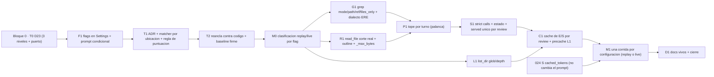

Última modificación: 2026-10-17 | Creado: 2026-10-17

# Plan: Eficacia del bucle de lectura

El *qué y por qué* vive en [`spec.md`](spec.md); las tareas, en [`todo.md`](todo.md).
Este plan fija el orden y por qué el orden es ese. Aterriza sobre 014 RH10 (bucle
cableado y *gold set* regrabado) y sobre la medición del 2026-10-17.

## Overview

Cinco bloques, y el orden **no es negociable** por una razón concreta:

1. **Base de medida (bloque 0).** Antes de tocar el bucle: que el *replay* aborte si
   la grabación no casa (D23) **en los tres niveles del camino de un lote**, que el
   informe mida **defecto y no redacción** (ADR del matcher + reancla contra el
   código), que los flags existan de verdad (Settings + `.env.example` + cableado) y
   que el *prompt* siga siendo idéntico con todo en default, y que cada flag esté
   clasificado como *replay* o *live*. Sin esto, **cada mejora de aquí en adelante
   hace salir el eval en verde con recall 0** y no se distingue de una medida real.
2. **Modos de las tres herramientas.** `grep` con `mode`/`path`/`ref`/`files_only`;
   `read_file` con aviso de corte y `outline`; `list_dir` con filtro y profundidad.
3. **Palancas transversales**, cada una detrás de su flag: tope de peticiones por
   turno, no descartar en silencio, estado de lecturas, caché de E/S por review y
   precarga de L1 conmutable.
4. **La medida.** Una corrida por configuración, **declarando cuáles son *replay* y
   cuáles exigen regrabación *live***, con los números anotados. La entrega se juzga
   por ese informe, no por el número de mejoras.
5. **Docs y cierre.**

## Decisiones de implementación

- **D23 se arregla en tres sitios, no en dos.** `FingerprintMismatch` es
  `RuntimeError` y cae hoy en el `except Exception` de `_call_once` (`≈:607`), de
  `_call_with_tools` (`≈:536`) **y de `_call_with_retries` (`:402`)**. El tercero es
  el que se activa en producción: con `llm_batch_retries=2` el aborto se reintenta
  con espera creciente y acaba en `None` → «0 hallazgos». Un test con
  `batch_retries=0` no lo cubre: el test va con `batch_retries=2`.
- **La excepción se mueve a producción.** Hoy vive en `tests/eval/harness.py:479`;
  `src/` no puede importarla. Va a `ports/llm.py` (es semántica del contrato LLM,
  junto a `LlmTruncatedError`) y el harness la importa de ahí. Dirección tests → src.
- **Solo se reintenta lo transitorio.** El `except Exception` de
  `_call_with_retries` se sustituye por `is_transient(exc)`; lo demás sube. D23 es
  un caso de una clase más ancha: cualquier error permanente se publica hoy como
  review limpia.
- **El matcher cambia de ancla: `file`(+`line`) primero, fragmentos como respaldo.**
  `_matches` hoy exige «todos los fragmentos presentes»; por eso un mismo defecto
  redactado distinto no casa (`build.py:1123` en las dos corridas, etiqueta `R3`
  solo en el *baseline*). El cambio de `_matches`/`_attribute` es de 006: va a ADR
  y actualiza su spec. Debe declarar la **regla de puntuación**: desempate cuando
  dos etiquetas podrían casar el mismo hallazgo, y qué pasa si un hallazgo casa a la
  vez una `expected` y una `must_not_report`.
- **El reancla es contra el código, no contra la grabación.** La verdad es el código
  en `008da57`. La grabación sirve para **descubrir** redacciones alternativas, nunca
  para decidir qué es un defecto: anclar contra la salida que se quiere medir es
  circular. Cada etiqueta reanclada se revisa contra el fichero y la línea.
- **Tests negativos del matcher.** Además del positivo (dos redacciones del mismo
  defecto casan), el negativo: dos defectos **distintos** del mismo fichero no casan
  la misma etiqueta. Sin él, el ancla estructural sube el recall por la puerta de
  atrás.
- **Los modos son parámetro, no operación.** `grep` acepta `mode="literal"|"regex"`;
  `read_file` acepta `mode="full"|"outline"`. El `ContextReaderPort` **no** gana
  métodos: `read_file` recibe `mode` y `list_dir` recibe `glob`/`depth`. Los tres
  adaptadores (`fixture`, `vcs`, `workspace`) lo honran o degradan de forma
  declarada.
- **Un solo dialecto de regex.** El contrato es **POSIX ERE** en los tres
  adaptadores. El borde traduce los escapes comunes (`\d`, `\w`, `\s`) y rechaza lo
  que ERE no tiene (*lookaround*, retro-referencias) con error explícito. Una tabla
  de patrones se prueba contra `fixture`, `vcs` y `workspace` para garantizar que el
  *replay* y producción dicen lo mismo. Un patrón inválido es `ERROR` para el
  modelo, nunca «sin coincidencias».
- **El aviso de corte necesita el tamaño real, no el recortado.** El bucle solo ve
  el string que le da el adaptador, y el adaptador ya puede haber recortado
  (`context_fixture` a 200 000, `ReadWorkspace` a 500 000). El lector devuelve
  metadatos de la lectura (`total_bytes`, `truncado`, rango servido) y el aviso se
  construye con ellos; además, el consejo depende de la operación (`start/end` en
  `read_file`, `path`/`glob` en `grep`, `glob`/`depth` en `list_dir`).
- **`ReadWorkspace._max_bytes` se arregla o se borra.** Hoy se acepta el parámetro,
  se asigna y `show_file` corta con la constante de módulo `_MAX_READ_BYTES`
  (`:89`): tres topes (200 000 declarado, 500 000 efectivo, 60 000 del bucle) sin
  una fuente. Se decide uno: el de la lectura pertenece al adaptador y el del bucle
  al bucle; no se mezclan.
- **Un único registro de lecturas por review.** Hoy `served` vive en `_last_loop` y
  se resetea por lote (`:315`, `:469`), mientras `files_read` se acumula: una cita a
  un fichero leído en otro lote se marca como no servida. Se unifica en un registro
  de review que alimenta a la vez el bloque de estado y la comprobación de citas, y
  **se reinicia por review** (el `LlmReviewer` lo indica al empezar, con test).
- **El caché de E/S es un decorador** (`CachingReader`) que envuelve el lector por
  review. No toca el puerto ni los adaptadores y se apaga con un flag. El lector se
  construye por lote (`factory(...)`), así que el decorador se instancia en el
  `LlmReviewer`, no en el bucle.
- **El bloque de estado vive en el `LlmReviewer`** (vida de la review), no en el
  bucle (vida del lote): las repeticiones son **entre lotes**.
- **`outline` cae a `full` si duda.** Índice por AST donde exista; en YAML/Dockerfile
  y lenguajes sin parser, heurística declarada; si no hay confianza, `full`. Nunca
  un índice peor que una lectura completa, según `read_file` sirve para opinar.
- **`_MAX_CALLS_PER_TURN` deja de ser constante** y pasa a `ContextLimits`/ajuste,
  para poder medir 3 contra 4–5 sin recompilar el bucle.
- **La precarga de L1 (E8) se mide antes de fijarla.** Es la palanca grande de
  *prompt* pero puede costar recall (014 Q4); va con su flag y su corrida *live*.
- **El *prompt* es condicional al flag.** Con todos los flags en su default, el
  texto que recibe el modelo es **byte a byte** el de hoy. El anuncio de los modos,
  del estado o del aviso de corte solo aparece cuando su flag está activo; si no, el
  *fingerprint* cambia y se pierde el criterio 9 (y la grabación) sin haber cambiado
  nada de comportamiento.
- **Cada flag se clasifica antes de medir** (E12 de la spec): los que cambian lo que
  recibe el modelo exigen regrabación *live*; los que no (caché de E/S) se miden con
  *replay*. El informe declara cuál es cuál.

### Crítica al diseño (y qué no se hace)

- **No** se añade `search` como herramienta: ya es un alias de `grep` y basta con
  aceptarlo en el *system prompt*.
- **No** se implementa un caché que «devuelva caché» al modelo: se le devuelven los
  bytes y solo se ahorra E/S. Prometer un ahorro de *prompt* que no existe sería
  vender humo en la spec.
- **No** se sube el tope de 3 por decreto: es la palanca más fácil de suponer y una
  de las más fáciles de engordar (el turno se reenvía).
- **No** se toca `_SYSTEM` para especializar roles: eso es la iniciativa de D20.
- **No** se mide nada antes de que D23, el matcher y la clasificación *replay*/*live*
  estén resueltos: sería medir el pasado (R1/R2/R6 de la spec).
- **No** se reanclan las etiquetas mirando la salida con herramientas: es
  circular (R1 de la spec).

## Orden y dependencias

**`024 S` no es una tarea de este plan, pero sí una entrada suya:** las corridas
*live* de M1 son el único momento en que se paga el modelo, y sin el contador de
caché instrumentado antes hay que repetirlas o el número se queda en `no medido`
(Q5 de la spec). Es la única dependencia externa que **precede** a una tarea de
aquí; el resto llega después (su bloque A espera a K3).

## Checkpoints

- **K0 (tras T0–M0):** `make eval-tools` con una grabación caducada **falla**
  también con `batch_retries=2`; el informe con la reancla es estable entre
  redacciones del mismo defecto y **no** sube el recall con defectos distintos del
  mismo fichero; los flags existen en `Settings` y `.env.example`, y con todos en
  default el *prompt* es idéntico al de hoy (test); cada flag está clasificado como
  *replay* o *live*. Sin K0 no se empieza el bloque 2.
- **K1 (tras G1/R1/L1):** los modos funcionan, `mode` ausente es idéntico a hoy, el
  mismo patrón da lo mismo en los tres adaptadores y un patrón inválido es error; el
  aviso de corte lleva el tamaño real. El *gold set* con flags apagados no cambia de
  número. `make ci` en verde.
- **K2 (tras P1/S1/C1):** cada palanca tiene su flag y su test; con todos en default
  el comportamiento es el de hoy (criterio 9 de la spec); `served` es único por
  review y se reinicia entre reviews.
- **K3 (tras M1/D1):** informe por configuración anotado, con *replay*/*live*
  declarado y razonamiento desglosado; docs vivos al día; spec `implementada`;
  `make ci` y `make docs-check` en verde.

## Riesgos

| Riesgo | Mitigación |
|---|---|
| Medir con el matcher roto (R1) | Bloque 0 antes de cualquier mejora: ADR + reancla contra código |
| El ancla estructural sube el recall por la puerta de atrás (R1b) | Tests negativos: dos defectos distintos del mismo fichero no casan la misma etiqueta |
| Grabación caducada leída como recall 0 (R2) | T0 arregla D23 en los tres niveles; el eval debe fallar ruidoso con `batch_retries=2` |
| Otro error permanente se lee como «0 hallazgos» (R2b) | Solo se reintenta lo transitorio |
| `regex` caro en el `git grep` del runner (R3) | Default `literal`; `mode` explícito, acotado y con topes |
| Dialecto divergente entre *replay* y producción (R3b) | POSIX ERE único, traducción declarada, tabla de equivalencia en los tres adaptadores |
| `outline` opina mal donde no hay parser (R4) | AST donde exista, heurística declarada, caída a `full` |
| Los avisos engordan el *prompt* (R5) | Bloques acotados y medidos; cada uno con su flag |
| Cada flag invalida la grabación (R6) | Una regrabación por configuración medida, con E12 separando *replay* de *live* |
| Palancas que se suponen y no se miden (R7) | Una corrida por configuración contra el *baseline*, anotada |
| El aviso de corte miente (R8) | El lector devuelve `total_bytes`/`truncado`, no solo el texto |
| El estado por review filtra entre reviews (R9) | Reinicio explícito por review, con test |

## Dependencias externas

- [014](../014-revisor-con-herramientas/spec.md) RH10: bucle cableado y *gold set*
  regrabado; **RH11 (su medida) depende de que 023 cierre el bloque 0**. Sus
  preguntas Q3/Q4 se resuelven aquí y su spec se enmienda con fecha.
- [016 Q1](../archivo/016-lector-de-contexto/spec.md): la decisión «`grep` literal»
  que E2 enmienda; el bucle y el puerto que 023 consume sin reimplementar.
- [006](../archivo/006-eval-de-la-review/spec.md): el matcher y las métricas que el
  ADR de T1 cambia.
- [009 V4](../archivo/009-verificador-adversarial/spec.md): la comprobación de
  citas que consume el registro de lecturas de E9.
- [ADR-0017](../../adr/0017-replay-determinista-con-fingerprint.md): el *replay* por
  *fingerprint* que D23 debe hacer abortar de verdad; el límite que E12 respeta.
- Iniciativa [024](../024-contexto-conversacional-del-bucle/spec.md): estructura del
  contexto. **Su bloque S** (instrumentar `cached_tokens`) va antes que las corridas
  *live* de M1: no cambia el *prompt* ni el *fingerprint*, y sin él esas corridas
  habría que repetirlas para medir el caché (Q5 resuelta).
- [ADR-0019](../../adr/0019-presupuesto-de-tokens-por-review.md): el presupuesto por
  review que el reenvío consume.
- Iniciativa 024 (pendiente de especificar): estructura del contexto; si cambia el
  puerto a mensajes, las regrabaciones *live* de §5.5 se replanifican (Q5 de la
  spec).
