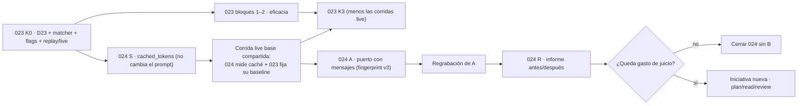

Última modificación: 2026-10-17 | Creado: 2026-10-17

# Plan: Contexto conversacional del bucle

El *qué y por qué* vive en [`spec.md`](spec.md); las tareas, en [`todo.md`](todo.md).
Este plan fija el orden y por qué el orden es ese.

## Overview

Cuatro bloques. El primero **no cambia lo que recibe el modelo** y por eso va
primero: se puede hacer en paralelo con 023 y evita pagar dos regrabaciones.

1. **Medida del caché (S).** `cached_tokens` en `LlmReply`, normalizado en el
   adaptador, grabado por llamada y pintado en el informe de 006. No toca el
   *prompt* ni el *fingerprint*: es instrumentación. Su corrida *live* se puede
   compartir con el *baseline* de 023, así que **una sola pasada de pago** da el
   número de caché y el punto de partida de la matriz de flags de 023.
2. **Puerto con mensajes (A).** `LlmMessage`, `as_messages`, `run_tool_loop`
   acumulando en vez de reconstruir, y `fingerprint` v3. Cambia lo que recibe el
   modelo: exige regrabación y va **después de K3 de 023**.
3. **Informe antes/después (R).** *Prompt*, *completion*, razonamiento, caché y
   recall, con las dos grabaciones. Es lo que decide si B se abre.
4. **Decisión sobre B (D).** Escrita en la spec. **No se implementa aquí** (E12).

## Decisiones de implementación

- **La medida va antes que el puerto, y no por comodidad.** Añadir
  `cached_tokens` a `LlmReply`, a `record_call` y al informe **no cambia el
  `prompt`**, así que no invalida ninguna grabación: el *fingerprint* cubre rol,
  `system`, `prompt`, `max_tokens` y contrato de salida, y esto no toca ninguno.
  En cambio, cambiar el puerto sí lo invalida todo. Instrumentar primero hace que
  cada regrabación *live* que 023 ya tiene que hacer **traiga el caché gratis**.
- **Una sola corrida de pago para dos cosas.** Con 023 en K3 y todos sus flags en
  su default, el *prompt* es byte a byte el de hoy (criterio 9 de 023), así que la
  corrida *live* que 024 necesita para medir el caché **es también** una grabación
  válida de la configuración base de 023. Se hace una vez y se anota en los dos
  `todo.md`.
- **La normalización del proveedor es una tabla, no un `if`.** OpenAI-compatible
  usa `prompt_tokens_details.cached_tokens`; DeepSeek, `prompt_cache_hit_tokens`;
  Anthropic, `cache_read_input_tokens`. El adaptador los lee en ese orden y
  devuelve `None` si no hay ninguno (E3 de la spec). `None` **no** es `0`: el
  informe distingue «no medido» de «no cachea».
- **`_read_message` y `_read_stream` devuelven un `cached` más.** Hoy devuelven
  `(text, reasoning, usage, finish)`. Pasan a devolver el `usage` completo y la
  normalización se hace una sola vez, no en cada lector.
- **`record_call` y `ReplayLlm` se cambian juntos.** Si se añade el campo al
  escribir y no al leer, el *replay* devuelve `None` y el informe miente por
  omisión. Test de ida y vuelta: grabar un `usage` con caché y leerlo igual.
- **El informe de 006 gana una columna, no una métrica.** `cached_tokens /
  prompt_tokens` por lote y por review, con `no medido` explícito. No entra en el
  *recall* ni en la precisión: es coste.
- **El puerto no gana un flag de compatibilidad** (E11 de la spec). Dos formas de
  llamar son dos *fingerprints* y dos sitios donde romper el prefijo.
- **`as_messages` es una función pura, no una segunda API.** La usan el `LlmFixer`,
  el verificador y los dobles de test que hoy piensan en dos strings.
- **El eco del *assistant* se mide, no se presume.** E7 de la spec: añade tokens
  que hoy no viajan. El test de estimación fija la cota y el informe declara la
  diferencia. Si el delta es grande, es un dato en contra de A y se dice.
- **El *fingerprint* v3 cubre la lista ordenada de mensajes.** No basta con
  hashear la concatenación: dos conversaciones distintas pueden concatenar igual
  (`["ab","c"]` frente a `["a","bc"]`). Se hashea la estructura (rol y contenido de
  cada mensaje, en orden).
- **Una grabación v2 se lee como lo que es: caducada.** Con 023 T0 hecho, aborta
  con `FingerprintMismatch`; sin T0, sería un recall 0 silencioso. Por eso A va
  después de K0 y A no se empieza sin T0.

### Crítica al diseño (y qué no se hace)

- **No** se implementa B aquí, ni un esqueleto de nodos «para probar». Un esqueleto
  sin número es un rediseño colado en un cambio de puerto (E12).
- **No** se descuenta el caché del presupuesto (Q3 de la spec): el contador se
  queda conservador hasta que ADR-0019 se enmiende.
- **No** se mete rol `tool` ni *function calling* nativo: el protocolo sigue siendo
  *ReAct* en JSON (014 §2).
- **No** se mueve el `baseline` de 023 a mitad de su matriz de flags (E14).
- **No** se instrumenta `cached_tokens` en los tres proveedores «por si acaso»: se
  implementa la tabla de §5.4 y se prueba con el campo de cada uno en un doble.

## Orden y dependencias

**Por qué S va antes de las corridas *live* de 023.** 023 M1 necesita regrabar por
configuración porque sus flags cambian lo que recibe el modelo. Si esas corridas se
hacen antes de instrumentar el caché, hay que repetirlas para tener el número, o el
número se queda en `None` para siempre. Instrumentar primero convierte una lista de
corridas de pago en una sola lista que sirve para las dos iniciativas.

**Por qué A va después de K3.** Mover el puerto cambia el *prompt* y obliga a
regrabar: si ocurre a mitad de M1, el informe por flag de 023 mezcla dos estructuras
de conversación y deja de ser comparable (E14).

## Checkpoints

- **S-K (tras S):** una llamada con `cached` en el `usage` llega al informe como
  número; una sin detalle llega como `no medido`, nunca como 0. `make ci` verde.
  No ha cambiado ningún *fingerprint*: la grabación actual sigue casando (test).
- **LB-K (tras la corrida *live* base):** el informe de 006 trae
  `cached_tokens / prompt_tokens` del caso y el número está anotado en los dos
  `todo.md`. El *recall* de esa corrida es el *baseline* de 023 con flags en default.
- **A-K (tras A):** el puerto solo acepta `messages`; el prefijo es byte a byte
  igual entre turnos; `_FORCE_FINAL` y `_CORRECTIVE` no se acumulan; la grabación v2
  **aborta** y la v3 se produce con `FingerprintMismatch` si falta una llamada.
  `make ci` verde.
- **R-K (tras R y D):** informe antes/después anotado con caché, razonamiento y
  recall; decisión sobre B **escrita**; docs vivos al día.

## Riesgos

| Riesgo | Mitigación |
|---|---|
| El proveedor no reporta caché y se confunde con «no cachea» (R3 de la spec) | S2 devuelve `None`; el informe pinta `no medido`; test de los tres campos |
| Instrumentar invalida la grabación sin querer | S no toca `prompt`, `system`, `max_tokens` ni contrato: test que compara el *fingerprint* antes y después de S |
| La corrida *live* base no sirve para 023 porque un flag no está en su default | 023 criterio 9 exige *prompt* byte a byte idéntico con todo en default; es la precondición de LB |
| El eco del *assistant* engorda el *prompt* (R11 de la spec) | Se mide en R; si el delta es grande, se declara en contra de A |
| `fingerprint` v3 por concatenación colisiona | Se hashea la estructura (rol + contenido por mensaje, en orden), no la suma de textos |
| A se cuela antes de K3 y rompe la matriz de 023 | E14: A depende de K3; el grafo del plan lo hace explícito |
| B se abre sin número por presión de calendario | R-K exige la decisión escrita con el informe delante |
| La regrabación de A no cubre todas las llamadas y el *replay* falla por «fingerprint ya consumido» | `FingerprintMismatch` en la primera llamada que falte; la grabación es un artefacto revisable (ADR-0017) |

## Dependencias externas

- [023](../023-eficacia-del-bucle-de-lectura/spec.md): base de medida (K0), flags y
  clasificación *replay*/*live*. **024 S se adelanta a su M1** para no pagar dos
  veces; **024 A espera a su K3**.
- [ADR-0017](../../adr/0017-replay-determinista-con-fingerprint.md): el *replay* por
  *fingerprint* que la v3 extiende a la lista de mensajes.
- [ADR-0019](../../adr/0019-presupuesto-de-tokens-por-review.md): el presupuesto que
  no se descuenta por caché hasta que se enmiende (Q3 de la spec).
- [006](../archivo/006-eval-de-la-review/spec.md): el informe que gana la columna de
  caché y el *baseline* con el que se compara.
- [016](../archivo/016-lector-de-contexto/spec.md): el *ReAct* en JSON que se
  conserva; no hay rol `tool`.
