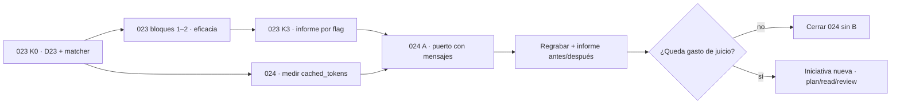

Última modificación: 2026-10-17 | Creado: 2026-10-17

# Contexto conversacional del bucle de herramientas

> **Estado:** borrador
>
> **Entrega objetivo:** que el bucle de herramientas deje de reconstruir la
> conversación como un único `prompt` y pase a mantener una **lista de mensajes**,
> con la medida del caché del proveedor como puerta; y una **decisión escrita, con
> número**, sobre si la review debe repartir responsabilidades en varios nodos
> (`plan` → `read` → `review`) en vez de seguir juzgando turno a turno. La segunda
> parte **no se implementa aquí**: si el número la justifica, se especifica en su
> propia iniciativa (E12).

---

## 1. Objetivo

[023](../023-eficacia-del-bucle-de-lectura/spec.md) arregla la **eficacia** de las
herramientas: que un `grep` encuentre, que una lectura declare su corte, que una
petición no se descarte en silencio. Este trabajo ataca otra cosa: la **estructura
del contexto** que el bucle reenvía en cada turno.

La medición del PR #3 (2026-10-17) deja el problema a la vista: 72 llamadas al
modelo, 52 de ellas con herramientas, **744k tokens de *prompt*** frente a 417k de
*completion*. El material único de cada lote (diff + L1) es una fracción pequeña;
**≈91 % del *prompt* es reenvío** de lo ya enviado, porque
[`run_tool_loop`](../../../src/agent_review/adapters/tool_loop.py) hace
`conversation = turn_prompt + _serve_tools(...)` y manda la transcripción entera
como un solo `prompt` de usuario.

Se quiere:

1. **Saber cuánto de ese reenvío ya lo cachea el proveedor.** Hoy medimos a ciegas:
   ni `LlmReply` ni la grabación guardan `cached_tokens`; en el código y en los
   datos de la regrabación no hay **ninguna** referencia a `cached_tokens` ni a
   `prompt_cache` (la búsqueda se hizo antes de escribir este borrador).
2. **Que el puerto hable mensajes.** `LlmPort.complete` solo acepta
   `system: str` y `prompt: str`; el adaptador construye dos mensajes y tira la
   estructura. Una lista de mensajes es la forma que el proveedor cachea, la que
   permite partir la review en fases sin reconstruir el *prompt* en cada nodo, y la
   única que puede incluir la respuesta previa del modelo (hoy no viaja).
3. **Decidir la metodología con número, no con intuición.** La propuesta de
   `plan` / `read` / `review` es plausible y probablemente sea la única palanca
   sobre el razonamiento, pero hoy no se puede medir: el *gold set* tiene **un**
   caso y el matcher está roto (023, bloque 0).

**A es prerrequisito de B.** Si el puerto habla mensajes, el estado de una fase es
una lista que se pasa tal cual y partir la review en nodos deja de exigir
reconstruir un *prompt*. Sin A, cada fase volvería a serializar la conversación y B
arrastraría el mismo reenvío que intenta eliminar.

## 2. No-objetivos

- **La eficacia de las herramientas.** `grep` regex, `read_file` con corte y
  `outline`, `list_dir` con `glob`/`depth`, el tope de peticiones por turno y el
  caché de E/S son de [023](../023-eficacia-del-bucle-de-lectura/spec.md). Aquí no
  se toca ni una firma del `ContextReaderPort`.
- **El matcher y las etiquetas del *gold set*.** Son 023 T1/T2 (bloque 0). 024
  **depende** de esa base de medida y no la duplica.
- ***Function calling* nativo del proveedor.** El protocolo sigue siendo *ReAct* en
  JSON ([014 §2](../014-revisor-con-herramientas/spec.md)); por eso no hay rol
  `tool` ni `tool_call_id`.
- **Especializar el *system prompt* por rol (D20).** Sigue siendo su propia
  iniciativa; 024 no cambia el texto del *prompt*, solo su forma.
- **Cambiar el presupuesto de tokens** ([ADR-0019](../../adr/0019-presupuesto-de-tokens-por-review.md)).
  Se mide el caché; no se descuenta del contador.
- **Tocar el anclaje, L0, el merge o la política.** Si B se especifica, los toca;
  por eso B no se implementa aquí.

## 3. Contexto y evidencia

### 3.1 La medida (regrabación del PR #3, 2026-10-17)

Caso `pr_3`, modelo `deepseek-v4-flash-revisor`, grabación
[`recorded_tools.json`](../../../tests/eval/pr_3/recorded_tools.json). Los totales
salen de sumar `prompt_tokens`, `completion_tokens` y `reasoning_tokens` de las 72
llamadas grabadas (cada llamada al puerto se graba con su `usage` real):

| Observación | Medida |
|---|---|
| Lotes (`_batches`, `LLM_BATCH_MAX_CHARS=20 000`) | **19** |
| Llamadas al modelo / turnos con herramientas | **72 / 52** |
| *Prompt* / *completion* (razonamiento) | **743 998 / 417 263 (384 295)** |
| *Prompt* base por lote (diff + L1) | 2,4k–18,5k tokens |
| Reenvío sobre el *prompt* total | **≈91 %** |
| `grep` con metacaracteres que devolvieron 0 | 42 de 64 |
| `read_file` sin rango | 43 de 55 |
| Ficheros releídos entre lotes | 16 (`domain/models.py` en 5) |
| Repeticiones **dentro** de un mismo turno | 0 |
| Peticiones descartadas por el tope de 3 | 14, en 11 de 52 turnos |

Dos lecturas importan aquí:

- **El reenvío consume presupuesto.** La reserva es
  `_estimate_tokens(full_system, turn_prompt)` con `turn_prompt` = conversación
  entera (4 caracteres por token). Un bucle verboso agota el tope de la review
  repitiendo, no razonando, y **deja lotes sin revisar**: el reenvío no es solo
  coste, es recall.
- **El razonamiento también se paga por turno.** De los 417k de *completion*,
  384k son razonamiento. Aunque el *prompt* fuese gratis, quedan 384k de juicio
  repartido en 72 llamadas.

### 3.2 Lo que el código hace hoy

- `run_tool_loop` arranca con `conversation = prompt` y en cada turno hace
  `conversation = turn_prompt + _serve_tools(...)`: el *system* se repite en cada
  llamada y la transcripción viaja como **un solo mensaje de usuario**.
- La conversación **no incluye la respuesta del modelo**: solo se acumulan los
  `<tool_result>`. En el turno siguiente el modelo ve los resultados de lo que pidió
  pero no su propia petición. No hay medida de si eso le hace repetir lecturas (las
  16 repeticiones son **entre lotes**, no dentro de un turno), pero es una
  conversación mal formada y el eco del *assistant* de E5 la arregla; su coste en
  *prompt* se declara y se mide (R11), no se presenta como ahorro.
- `OpenAiCompatibleLlm.complete` construye exactamente dos mensajes
  (`system` y `user`): la estructura de conversación se pierde en el adaptador.
- `_call_with_tools` agrega el gasto en `LoopResult.usage` (un entero) y devuelve
  `LlmReply(text=..., prompt_tokens=0, completion_tokens=loop.usage)`: el
  `prompt_tokens` del resultado agregado es 0 y el total se disfraza de
  *completion*. **Hoy no corrompe ninguna medida**: la grabación guarda el `usage`
  real de cada llamada al puerto y `tokens_used` suma `loop.usage` (el total, que
  sí es correcto). El defecto es **latente**: `last_usage` no tiene ningún lector.
  Se arregla aquí porque la medida del caché (E9) y cualquier informe que lea el
  agregado lo necesitan con los contadores separados.
- `_estimate_tokens` suma `full_system` y `turn_prompt`. Es correcto mientras el
  *prompt* sea un string; con mensajes hay que sumar la lista.

### 3.3 Lo que no sabemos: hay dos cachés distintos

| Caché | Qué ahorra | Quién lo decide |
|---|---|---|
| **Caché de E/S** (lecturas de fichero) | Procesos `git show` repetidos; **no** ahorra *prompt* | 023 E9 (`CachingReader`) |
| **Caché de prefijo del proveedor** | *Prefill* del prefijo idéntico; puede descontar factura | Nadie: no se mide |

[023 §3](../023-eficacia-del-bucle-de-lectura/spec.md) dice que «el caché no ahorra
tokens» y lo argumenta con las repeticiones **entre lotes**. Eso es cierto para el
caché de E/S que 023 decide, pero no responde a la otra pregunta: **¿el proveedor
está cacheando el prefijo que le reenviamos?** `usage.prompt_tokens_details.cached_tokens`
(OpenAI-compatible) existe para contestarla y hoy se descarta en el adaptador.

La grabación guarda `prompt_tokens`, `completion_tokens` y `reasoning_tokens`; no
guarda ningún detalle de caché. Por tanto, cualquier afirmación sobre el ahorro del
reenvío es hoy una hipótesis.

### 3.4 Relación con 023

| Pieza | Dueño | 024 |
|---|---|---|
| `grep` regex/acotado, `files_only` | 023 E2–E3 | No lo toca; lo consume |
| `read_file` corte declarado y `outline` | 023 E4–E5 | No lo toca; lo consume |
| `list_dir` con `glob`/`depth` | 023 E6 | No lo toca |
| Tope de peticiones por turno (3 vs 4–5) | 023 E7 | No lo re-mide; anota que su coste marginal cambia |
| Precarga de L1 conmutable | 023 E8 | La consume; mide si ese prefijo se cachea |
| Estado de lecturas + caché de E/S | 023 E9 | Impone dónde va el bloque (cola, no cabeza) |
| Flags de cada mejora y *prompt* condicional | 023 E11 | No añade flags de comportamiento: el cambio de forma del puerto es de contrato y se mide antes/después, no por configuración |
| Clasificación *replay*/*live* de la medida | 023 E12 | Hereda la disciplina: todo cambio de forma exige regrabación y el informe declara qué es cada corrida |
| D23 (replay que aborta) + matcher | 023 T0–T2 | **Depende**; no duplica |
| Lista de mensajes en el puerto | — | **024** |
| Medir `cached_tokens` | — | **024** |
| Subgrafo `plan`/`read`/`review` | — | **024** decide si se especifica |

**023 sigue siendo necesaria e independiente.** Un puerto que habla mensajes con un
`grep` que devuelve cero sigue quemando turnos: la estructura no arregla la
herramienta. Y 023 puede cerrarse sin 024: sus modos son parámetros y no cambian de
significado con mensajes.

Solapan en dos puntos y así se reparten:

- **E8 (precarga de L1).** 023 decide *si* el L1 viaja precargado y lo mide con la
  estructura actual. 024 no re-decide E8: mide si, con la precarga en `on`, ese
  primer mensaje se cachea. Si 023 fija `off`, 024 mide un prefijo más pequeño y
  sigue funcionando.
- **E9 (caché de E/S y estado de lecturas).** El caché de E/S es de 023 y no se
  toca. El **bloque de estado** es la única pieza de 023 que 024 condiciona: si se
  concatena en la cabeza del *prompt*, cambia bytes en cada turno e invalida el
  prefijo. Debe ir al final del último mensaje de usuario (§5.3).

## 4. Decisiones

| # | Decisión | Motivo |
|---|---|---|
| E1 | El alcance es la **estructura del contexto**, no la eficacia de las herramientas | 023 ya mide que el fallo de `grep`/`read_file` es de interfaz; el reenvío es un problema distinto y no se arregla con modos |
| E2 | **Primero se mide `cached_tokens`**; la medida decide si A se justifica por coste o solo por estructura y por B | 744k de *prompt* sin saber cuánto descuenta el proveedor es decidir a ciegas; la medida es barata y puede cambiar la conclusión sin bloquear el diseño |
| E3 | `cached_tokens: int \| None`, con `None` = «el proveedor no lo reporta», **distinto de 0** | Un 0 falso cerraría la pregunta al revés; hay que poder decir «no medido» |
| E4 | `LlmPort.complete` recibe `messages: Sequence[LlmMessage]`; `system`/`prompt` dejan de ser parámetros del puerto y quedan en un helper `as_messages(system, prompt)` | Una sola forma canónica. Dos formas de llamar son dos fingerprints, dos caminos y dos sitios donde romper el prefijo |
| E5 | El bucle mantiene `messages[]` y **solo añade**: el *assistant* con el texto crudo de la respuesta y un *user* con el bloque de `<tool_result>` | El prefijo debe ser byte-estable para que el proveedor lo cachee; re-serializar el JSON cambia espacios y lo rompe |
| E6 | Nada mutable en la cabeza: `_FORCE_FINAL`, `_CORRECTIVE` y el bloque `LECTURAS` de 023 van **al final** | Cualquier byte que cambie al principio invalida el prefijo completo; el estado de lecturas es justo el que cambia cada turno |
| E7 | Mensajes **no reduce por sí solo** los tokens enviados: añade el eco del *assistant* y reduce la recomputación solo *si el proveedor cachea*; su otro valor es habilitar B | No vender humo: el mismo texto sigue viajando, más la respuesta del modelo que hoy no se reenvía. Lo que cambia es quién procesa el prefijo y cómo se factura |
| E8 | La reserva de presupuesto suma los mensajes; el contador sigue contando tokens **crudos**, también los cacheados | [ADR-0019](../../adr/0019-presupuesto-de-tokens-por-review.md) no cambia aquí. Si el proveedor descuenta, el presupuesto queda conservador: es preferible a que mienta hacia abajo |
| E9 | `LoopResult` y `LlmReply` separan `prompt_tokens`, `completion_tokens`, `reasoning_tokens` y `cached_tokens` | Hoy `_call_with_tools` devuelve `prompt_tokens=0` y el total como *completion*. El defecto es latente (`last_usage` no tiene lector y la grabación sí guarda el `usage` real por llamada), pero una medida de caché necesita el agregado con los contadores separados; se arregla al tocar el puerto, no antes |
| E10 | Fingerprint **v3** sobre el rol + la lista ordenada de mensajes + `max_tokens` + el contrato de salida; regrabación obligatoria del *gold set* | [ADR-0017](../../adr/0017-replay-determinista-con-fingerprint.md): cambia lo que recibe el modelo. Con D23 sin arreglar, el fallo se leería como recall 0 |
| E11 | **Sin flag** de compatibilidad para la forma del puerto; la comparación es antes/después con dos grabaciones | Un flag duplicaría caminos, fingerprints y matrices de medida. Esto es un cambio de contrato, no una palanca |
| E12 | **B no se implementa en 024.** Se documenta el boceto y se especifica aparte si el informe lo justifica | Cambia la metodología de la review y toca merge, anclaje, replay y cobertura; aprobarlo dentro de 024 sería colar un rediseño en un cambio de puerto |
| E13 | B exige **≥2 casos** de *gold set* y matcher estable (023 K0) | Con un caso y el matcher anclado a redacción, el recall 0.125 de la variante con herramientas es un artefacto (023 R1) |
| E14 | 024 se implementa **después de K3 de 023**, no en medio de su matriz de flags | Cada cambio de *prompt* invalida la grabación; mover el *baseline* a mitad de M1 invalida el informe por flag de 023 |
| E15 | **A es prerrequisito de B**: sin la lista de mensajes no se especifica el subgrafo `plan`/`read`/`review` | Con mensajes, el estado de una fase es una lista que se pasa entre nodos; sin ellos, cada fase reconstruye el *prompt* y B hereda el reenvío que quiere quitar. B no sustituye a A: lo necesita |

## 5. Diseño o contrato

### 5.1 El puerto

```python
@dataclass(frozen=True)
class LlmMessage:
    role: Literal["system", "user", "assistant"]
    content: str

def as_messages(system: str, prompt: str) -> list[LlmMessage]:
    """Azúcar para los llamantes que aún piensan en dos strings."""

class LlmPort(Protocol):
    def complete(
        self,
        *,
        messages: Sequence[LlmMessage],
        max_tokens: int,
        json_mode: JsonMode | None = None,
        response_schema: dict[str, Any] | None = None,
        on_reasoning: Callable[[str], None] | None = None,
    ) -> LlmReply: ...
```

No hay rol `tool`: sin *function calling* nativo, un `tool` sin `tool_call_id` es un
mensaje inválido para medio ecosistema. El resultado va en un `user` delimitado con
`<tool_result>`, como hoy ([016 W4](../archivo/016-lector-de-contexto/spec.md)).

`as_messages` existe para el `LlmFixer` y el verificador, que siguen teniendo dos
strings; no es una segunda API del puerto, es una función pura.

### 5.2 La conversación

```python
messages = [LlmMessage("system", full_system), LlmMessage("user", prompt)]
while True:
    reply = llm.complete(messages=messages, max_tokens=max_tokens, ...)
    messages.append(LlmMessage("assistant", reply.text))   # texto crudo
    if is_final(parse(reply.text)):
        return ...
    messages.append(LlmMessage("user", _serve_tools(...)))  # "\n<tool_result>…"
```

Tres reglas que no son obvias y hay que probar:

1. **Se replica el texto crudo del modelo**, no `json.dumps(data)`. Si se
   re-serializa, cambian espacios y orden y el prefijo deja de casar.
2. **`_FORCE_FINAL` y `_CORRECTIVE` se añaden una vez** como mensaje de usuario.
   Hoy el correctivo se concatena a la conversación y **persiste** en los turnos
   siguientes, mientras el forzado se recalcula en cada turno. Con mensajes, cada
   uno se añade en su turno; acumularlos dejaría órdenes contradictorias dentro de
   la misma conversación.
3. **El *system* es el primer elemento de la lista**, no un campo aparte. Sigue
   viajando en cada llamada; lo que cambia es que es un prefijo estable más, no una
   pieza que el adaptador recompone.

El eco del *assistant* **añade tokens** que hoy no viajan: el bucle actual no
incluye la respuesta del modelo en `conversation`, solo sus resultados. Es el precio
de una conversación bien formada y de que el prefijo sea cacheable; es pequeño
frente a los `<tool_result>`, pero se declara y se mide, no se presenta como ahorro.

### 5.3 Prefijo estable

El invariante que hace medible el caché:

```
messages(turno N+1)[:len(messages(turno N))] == messages(turno N)
```

De ahí salen cuatro reglas de diseño:

- Sin timestamps, `review_key`, `batch_index` ni nada variable en la cabeza.
- El bloque `LECTURAS (esta review)` de 023 §5.3 va **al final** del mensaje de
  usuario que lleva los resultados del turno, nunca antes del diff.
- Las peticiones se sirven en el orden pedido y con el mismo formato de siempre.
- El *system* es constante por lote (`_SYSTEM + _BASE_SYSTEM`).

Se verifica con un test de prefijo, no con una revisión a ojo.

### 5.4 Medida del caché

| Proveedor | Campo del `usage` |
|---|---|
| OpenAI-compatible | `prompt_tokens_details.cached_tokens` |
| DeepSeek | `prompt_cache_hit_tokens` |
| Anthropic | `cache_read_input_tokens` |

El adaptador los normaliza a `LlmReply.cached_tokens`; si no hay ninguno, `None`.
La grabación lo guarda por llamada (ADR-0017) y el informe de 006 añade **una**
columna: `cached_tokens / prompt_tokens`. El informe declara `no medido` cuando el
proveedor no lo reporta, y no lo cuenta como 0.

Con ese número se responde a la pregunta que hoy no tiene respuesta: si el 91 % de
reenvío ya está cacheado, A no se justifica por coste; si no lo está, sí. En ambos
casos A sigue siendo el prerrequisito de B.

### 5.5 Presupuesto

| Hoy | Con mensajes |
|---|---|
| `_estimate_tokens(full_system, turn_prompt)` | suma del `content` de cada mensaje |
| `commit(review_key, held, reply.total_tokens)` | igual: `prompt + completion` crudos |

No se descuenta el caché. Si el proveedor factura menos, el presupuesto será más
estricto que la factura; cambiarlo exige enmendar [ADR-0019](../../adr/0019-presupuesto-de-tokens-por-review.md)
y decidir si un token cacheado «cuesta» 0, 0,1 o 1. Queda como pregunta abierta.

### 5.6 B: el boceto y por qué no entra

El boceto **supone A ya hecho** (E15): `read` devuelve material y `review` lo
recibe como mensajes. Sin A, cada fase tendría que reconstruir el *prompt* y el
subgrafo no arreglaría el reenvío.

```
plan  (1 llamada)  diff + L1 → {"reads": [...], "greps": [...], "questions": [...]}
read  (0 llamadas) ejecuta el plan con 023; material ordenado y acotado
review (1 llamada) diff + material → {"findings": [...]}
```

Lo que **sí** ataca: el razonamiento de 384k se paga hoy en 72 llamadas; B lo
concentra en ~2 por lote. Lo que **no** resuelve: el material reunido tiene que
caber en un *prompt*; si no cabe, hay que trocear el juicio y volvemos a los lotes
de hoy. Y pierde la adaptatividad del *ReAct*: hoy el modelo lee, ve algo y decide
la siguiente lectura; un `read` determinista no.

Por eso B no es «la opción de diseño»: es una hipótesis más cara, con menos
evidencia y con dos dependencias que hoy no se cumplen (un caso, matcher roto).

**Regla de decisión (a fijar al aprobar):** B se especifica en su propia iniciativa
si, tras A, el informe muestra que (1) el prefijo ya está cacheado o el *prompt* ha
dejado de ser el gasto dominante, y (2) el razonamiento por turno sigue siendo la
mayor parte del coste. Si el caché no existe y el *prompt* sigue mandando, la
palanca es reducir turnos, no partir la review.

Aritmética de servilleta, **no medida**: si el proveedor descontase el 90 % de un
prefijo cacheado al 91 %, el gasto efectivo de *prompt* caería de 744k a ~135k y el
razonamiento (384k) pasaría a ser ~70 % del total. Ese escenario es exactamente el
que hace de B la palanca principal; el que lo confirma o lo descarta es el informe,
no el escenario.

### 5.7 Secuencia con 023



La medida M no toca las herramientas y puede hacerse en paralelo con 023. El cambio
de puerto A espera a K3 para no mover el *baseline* de la matriz de flags de 023.

## 6. Riesgos

| # | Riesgo | Mitigación |
|---|---|---|
| R1 | **Medir el pasado**: el *prompt* nuevo no casa la grabación y el eval sale en verde con recall 0 | E10 + 023 T0 (D23): sin aborto ruidoso no se mide. Fingerprint v3 y regrabación revisable |
| R2 | **El proveedor no cachea** y A no ahorra un token | E2: se mide antes. Si `cached_tokens` es 0, A se justifica por estructura y por habilitar B, no por coste |
| R3 | **El proveedor no reporta** y se confunde con «no cachea» | E3: `None` = no medido, y el informe lo dice; nunca 0 por defecto |
| R4 | **El prefijo se rompe por un detalle** (estado de lecturas, re-serialización, un id) | E5–E6 + test de prefijo byte a byte; una sola función construye los mensajes |
| R5 | **Coste de medir**: regrabar 72 llamadas y repetir por configuración | Una sola regrabación para A, sin flags (E11); el caso ya existe y la corrida es a mano |
| R6 | **B pierde adaptatividad** y baja el recall | No se implementa sin dominancia (006 E6) y con ≥2 casos (E13) |
| R7 | **El material de B no cabe** en un *prompt* y reaparece el troceado | Es parte del diseño de B, no de 024; si no cabe, B no ahorra y se descarta |
| R8 | **Un caso no decide una metodología** (sesgo declarado en 006) | E13: B exige un segundo caso auditado a mano |
| R9 | **Dos fuentes de verdad del *prompt***: un camino sigue concatenando strings | `as_messages` como único constructor y un test que compara bytes equivalentes |
| R10 | **El razonamiento no baja con A** y el gasto sigue igual | Se mide `completion`/`reasoning` por llamada (E9); es el número que decide B |
| R11 | **El eco del *assistant* engorda el *prompt*** y A sale más caro que hoy | Es el precio de una conversación bien formada; se acota a lo que el modelo devolvió (que ya se paga en *completion*) y se mide el delta antes/después |
| R12 | **Las regrabaciones *live* de 023 (su Q5) quedan obsoletas si 024 mueve el puerto a mensajes antes de que se hagan** | No se resuelve aquí: 024 no reescribe el calendario de 023 ni su §5.5. E14 ordena 024 después de K3; si el orden cambia, esas regrabaciones se replanifican contra el puerto nuevo y el informe de 023 se declara de nuevo |

## 7. Criterios de hecho

1. `LlmPort.complete` acepta `messages` y **solo** esa forma; todos los llamantes
   usan `as_messages` cuando tienen dos strings (test de contrato del puerto).
2. El turno `N+1` empieza por los mismos bytes que el turno `N`:
   `messages[:n]` es idéntico (test de prefijo, R4).
3. `_FORCE_FINAL` y `_CORRECTIVE` se añaden una sola vez y como mensaje de usuario;
   no se acumulan ni reescriben la cabeza (test).
4. `_estimate_tokens` suma los mensajes y la reserva cubre la llamada. La estimación
   **puede subir** respecto a hoy por el eco del *assistant*; el test fija la cota y
   el informe declara la diferencia (no se presenta como ahorro).
5. `LlmReply.cached_tokens` y `LoopResult` distinguen `prompt`, `completion`,
   `reasoning` y `cached`; un *usage* sin detalle de caché da `None`, no 0 (test).
6. El *fingerprint* v3 cubre el rol, la lista ordenada de mensajes, `max_tokens` y
   el contrato de salida; una grabación v2 **aborta** con `FingerprintMismatch`
   (test; depende de 023 T0).
7. El informe de 006 incluye `cached_tokens / prompt_tokens` por lote y por review,
   y `no medido` cuando el proveedor no lo reporta (test del informe).
8. El *gold set* regrabado da un informe **estable** y el antes/después queda
   anotado (prompt, completion, razonamiento, caché y recall). La comparación de
   calidad se lee con el matcher de 023 K0; aquí solo se exige que el número sea
   reproducible.
9. Con 023 implementada, sus criterios siguen en verde: la estructura no cambia la
   semántica de `grep`, `read_file` ni `list_dir` (regresión).
10. La decisión sobre B queda **escrita** en esta spec: se abre iniciativa o se
    cierra 024 sin ella, con el número delante. `make ci` y `make docs-check` en
    verde y documentos vivos al día ([`arquitectura.md`](../../arquitectura.md) §3–4,
    [`operacion.md`](../../operacion.md) §2 si hay variables nuevas,
    [`desarrollo.md`](../../desarrollo.md) §3 y [`CONTEXT.md`](../../../CONTEXT.md)
    con «mensaje», «prefijo cacheable» y «tokens cacheados»).

## 8. Preguntas abiertas

- **Q1 — ¿Hay que modificar o subsumir 023?** *Recomendación: no.* 023 mide eficacia
  con la estructura actual; 024 cambia la estructura. Subsumirla tiraría un plan
  aprobado y mezclaría dos *baselines*. El único cambio de forma que 024 impone a
  023 es dónde va el bloque de estado de 023 E9 (§3.4); eso se resuelve al
  implementar 023, no reescribiendo su spec.
- **Q2 — ¿La medida del caché espera a K3?** *Recomendación:* la medida (M) puede ir
  en paralelo porque no toca las herramientas; el cambio de puerto (A) espera a K3
  para no invalidar el informe por flag de 023 (E14).
- **Q3 — ¿Se descuenta el caché del presupuesto?** *Recomendación:* no en 024. Si se
  descuenta, hace falta enmendar ADR-0019 y decidir el precio relativo de un token
  cacheado. Mientras tanto, el contador es conservador y la review puede cortar
  antes de lo que la factura exigiría.
- **Q4 — ¿Y si `nan.builders` no expone el detalle de caché?** Entonces la medida
  queda en `None` y la decisión se toma con lo que sí hay (prompt, completion,
  razonamiento, latencia). A se justifica por estructura y por B; no se inventa un
  0. Si el proveedor expone un campo con otro nombre, se mapea en el adaptador.
- **Q5 — ¿Cuál es el umbral exacto para abrir B?** La regla de §5.6 es cualitativa a
  propósito. Fijar un porcentaje antes de tener el informe sería inventar el
  resultado; se concreta al aprobar esta spec, con la estructura de la medida ya
  decidida.
- **Q6 — ¿`plan.md` y `todo.md`?** No existen todavía: la spec está en **borrador** y
  el repositorio exige aprobarla antes de planificar
  (regla [`documentacion`](../../../.agents/rules/documentacion.md), §4). Se
  escribirán al aprobar, con el orden K0 → medida del caché (en paralelo con
  023) → K3 → A → informe antes/después → decisión sobre B.
- **Q7 — ¿ADR?** El cambio de puerto y el fingerprint v3 son una decisión de diseño
  con alternativas (mensajes frente a string, una API frente a dos): nace un
  **ADR nuevo al implementar**, que sustituya o enmiende lo que
  [ADR-0017](../../adr/0017-replay-determinista-con-fingerprint.md) dice del
  *prompt* como string. **No se fija número aquí**: el 0025 está reservado al
  matcher de 023 (T1) y el siguiente libre al dialecto de `grep` de 023 (G1).
