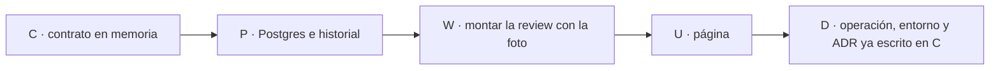

Última modificación: 2026-10-23 | Creado: 2026-10-23

# Plan: Configuración desde el panel

El *qué y por qué* vive en [`spec.md`](spec.md); las tareas, en [`todo.md`](todo.md).
Este plan fija el orden y por qué el orden es ese.

## Overview

Cinco bloques. El contrato en memoria va primero porque la página y el worker
dependen de él. El worker va **antes** que la página: si la foto no cambia la
review, pintar 23 controles sería un formulario que miente.

1. **Contrato (C).** Catálogo, valor inicial, candado, validación y techo de
   autonomía. Sin Postgres y sin HTML.
2. **Persistencia (P).** Una fila vigente, historial y compare-and-swap. Sin UI.
3. **Review (W).** El worker monta cada review con la foto, sin abrir otro pool.
   Un hilo reanudado no relee la tabla.
4. **Página (U).** Secciones, ayuda, Restaurar y Guardar, con la misma defensa
   CSRF que los comandos que ya existen.
5. **Documentación (D).** `operacion.md`, `.env.example` y el ADR. Van con el
   comportamiento ya probado, no antes.

## Decisiones de implementación

- **La foto no basta con estar en `ReviewState`.** `run_forever` llama a
  `build_runtime` una vez. `build_graph` cierra `scope_ignore`, `budget_total` y
  `verifier_max_findings`. `build_reviewers` cierra los topes del bucle, el
  tamaño de lote y las banderas. `PolicyEngine` cierra `max_autonomy_override`.
  Un nodo que no lee esa clausura no ve el guardado. El mecanismo es montar
  **esa** parte por review, con la foto ya elegida.
- **No se reconstruye el proceso.** Cola, checkpointer, VCS, chat, progreso,
  registro de modelos y cancelación salen una vez en `run_forever`. Por review
  se montan revisores, política, presupuesto y grafo. Un pool nuevo por review
  filtraría conexiones. El registro de modelos sigue leyéndose al arrancar: no
  es un dial de esta página.
- **El reanudado lee la foto del checkpoint y monta con ella.** Si montara con
  la revisión publicada, un hilo a medias cambiaría de presupuesto al
  continuar. Un checkpoint sin el campo monta con `Settings` (R3 de la spec).
  **Reintentar** no reanuda ese hilo: es una review nueva y lee la fila vigente.
- **`get_settings.cache_clear()` no se usa.** Cambiaría el proceso entero y la
  review siguiente heredaría el valor de la anterior (CFG6).
- **El presupuesto de Redis ya recibe el total en cada reserva** (`ARGV[1]` de
  `budget_redis.py`). Una instancia por review, con el total de la foto y la
  clave de esa `review_key`, no pisa el contador de otra.
- **Sin Alembic.** El repo no tiene migraciones. La tabla se crea con
  `CREATE TABLE IF NOT EXISTS` al arrancar `web` y `worker`, el mismo gesto que
  `PostgresSaver.setup()`. Sin `DATABASE_URL`, el almacén es en memoria: vacío,
  que es el comportamiento de hoy.
- **Guardar no es un `<form>` clásico.** `require_command_session` rechaza un
  POST por cookie que no sea `application/json`. Guardar usa el `fetch` JSON que
  ya usan cancelar y reintentar. Restaurar no llama al servidor: escribe el
  `data-initial` del control en el input.
- **El candado se valida al arrancar** `web` y `worker`. Un nombre de
  `PANEL_CONFIG_LOCK` que no esté en el catálogo aborta. No se ignora (R2).
- **El ADR se escribe al implementar C, con el número libre de ese momento.**
  No se reserva en el índice antes de que el fichero exista.

### Qué no se hace

- No se relee `config/autonomy.yaml` desde la página. Solo viaja el override, y
  la validación de «solo bajar» usa el YAML que el proceso ya carga.
- No se proyecta el documento a Redis. Ningún dial de esta página es del
  `fix-worker`.
- No se añade un botón de restaurar todo.
- No se cambia `build_runtime` de los tests que inyectan el grafo. Si
  `run_forever` recibe `graph=`, no consulta el almacén.

## Orden y dependencias

W va antes que U porque el criterio de hecho 7 (la review en curso no ve el
guardado; la siguiente sí) no se puede afirmar desde el HTML. U muestra el
número que W ya deja en el estado.

## Checkpoints

- **C-K (tras C):** sin filas, el valor efectivo es el de `Settings`. Una clave
  ajena al catálogo, un secreto, un entero negativo o un techo de autonomía por
  encima del YAML se rechazan. `make test T=tests/test_panel_config.py` en verde.
- **P-K (tras P):** dos guardados con la misma revisión: entra uno. El historial
  tiene actor y claves. Una lectura fallida con una revisión ya cargada no cae
  al default del código. `make test T=tests/test_panel_config.py` en verde.
- **W-K (tras W):** una review nueva usa el override; un hilo reanudado sigue
  con la foto del checkpoint; un reintento usa la fila vigente. No se abre un
  pool por review. `make test T=tests/test_worker.py` en verde.
- **U-K (tras U):** los 23 controles, en su sección, con ayuda y Restaurar.
  Restaurar no escribe. Un `lector` recibe 403. Una revisión vieja recibe
  conflicto y la fila no cambia. `make test T=tests/test_web_ui.py` en verde.
- **D-K (tras D):** `make ci` en verde. `operacion.md` describe la página y
  `PANEL_CONFIG_LOCK` y enlaza el catálogo sin copiarlo.

## Riesgos

| Riesgo | Qué lo contiene |
|---|---|
| Montar el grafo por review duplica el pool o el registro | W1 parte `build_runtime`: lo caro queda en `run_forever` |
| Un reanudado monta con la revisión nueva | W2 lee el checkpoint antes de montar |
| Un `<form>` POST se salta la defensa CSRF o choca con ella | U2 reutiliza el `fetch` JSON de los comandos |
| La página enseña «guardado» y el worker sigue con el arranque | U no se da por cerrada sin W-K |
